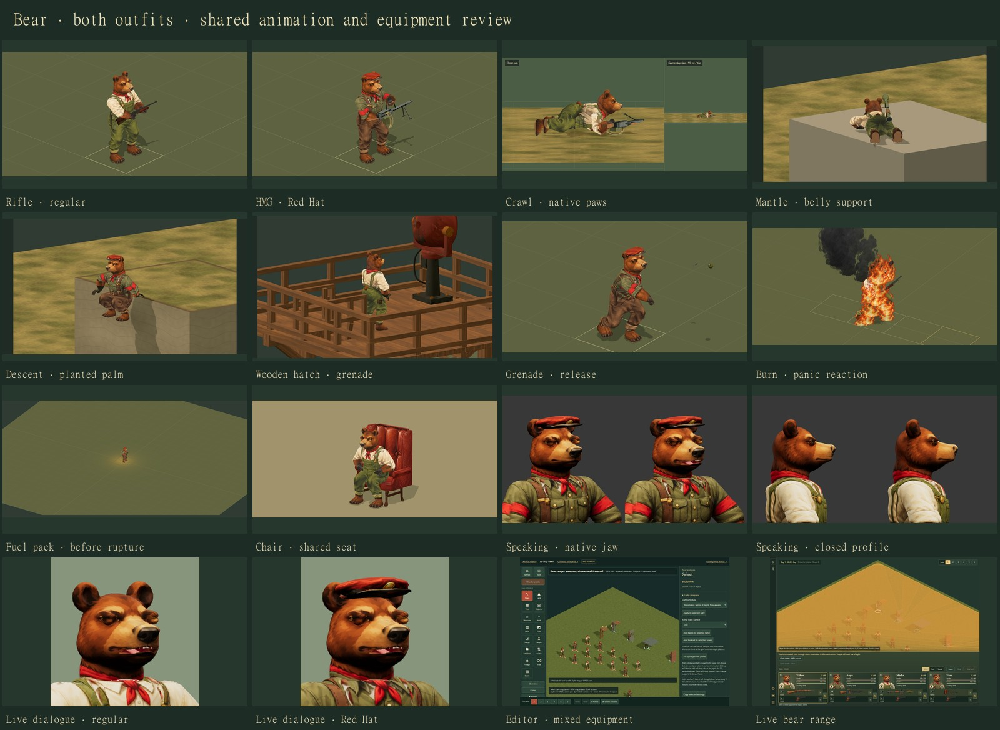

# Bear animation and game integration

28 October 2026 · `work/bear-character` · follows the approved tail adjustment at `466aae4`.

The regular bear and Red Hat bear now use the shared character catalog, equipment,
editor, recruitment and existing battle presentation. The roster contains 13
animals and 27 outfit combinations, including the donkey guide. Each bear has
all 13 equipment choices: hands, knife, pistol, rifle, assault rifle, SMG, HMG,
shotgun, sniper rifle, grenade, launcher, RPG and flamethrower.

[Open the animation index](http://127.0.0.1:4478/tactics/bear-animation-study.html)
or [the live bear range](http://127.0.0.1:4478/tactics/battle-3d.html?study=bear).
The index carries the selected outfit and weapon into the appropriate studies.

## Coverage

| Family | Bear fitting and wiring |
| --- | --- |
| Standing, walking, running, kneeling and prone | Native skeleton, grounded paws, shared stance transitions and sighted rifle fitting |
| Guard and mercenary idle | Both outfits, every weapon, measured collision limits and equipment-inclusive balance |
| Aiming and firing | Existing battle weapon paths; fitted bear eye/sight relationship and native hand anchors |
| Crawling | All equipment, forward and backward travel, seven legal paired carries, actual skull and floor clearance |
| Grenades | Prepared bear trajectory and release point, both outfits, shared grenade model |
| Roof and cliff ascent | Chest first, sideways transfer, belly support, planted hands and broad-paw clearance |
| Roof and cliff descent | Every bear weapon; stow, crouch, edge contact, supported drop and draw |
| Iron and wooden tower ladders | Every bear weapon, both directions, including the wooden hatch; compact holster arcs |
| Other existing traversal | Shared simple window/wall/ladder presentation accepts the registered bear |
| Casualties and fatal reactions | Standing, kneeling and prone falls; fitted head mask; equipment lands before fading |
| Fire and fuel-pack reactions | Planted support, protective gestures, panic travel, collapse, ash and separate pack rupture |
| Sitting and rising | Shared chair study accepts the bear; common seat and planted paw/palm contacts across the chair library |
| Speaking | Native sculpted jaw, lips, cavity, teeth and tongue; both outfits in the viewer and actual dialogue portrait renderer |

Chair motion remains an unarmed study. Grenade throwing and fuel-tank rupture use
their corresponding equipment. The older weighted-window experiments are absent
from this checkout; the table describes the current shared game presentation.

## Native fits

The accepted body geometry, paintings and tail position remain the source of the
bear's appearance. `BEAR_PROFILE.outfitPaints` selects its native Red Hat painting;
the generic faction repaint is skipped for that profile. The bear's cuff and tail
paint repairs also run through the shared painter, including prepared dialogue
projection and scene lighting.

The broad shoulders need distinct HMG and RPG carries. Idle adds fitted SMG/HMG/RPG
positions and keeps the relaxed rifle stock behind the trigger forearm. Balance
uses the paw surface actually touching the floor. The independent pressure checks
include the carried equipment's mass. The measured idle neck envelope is 25° left,
40° right and 15° down; the existing surface-fit and over-limit checks retain it.

Traversal keeps native bone lengths and weapon anchors. Heavy receivers sit clear
of the back; the assault-rifle receiver sits slightly forward to remain reachable
during pickup. Small weapons use smaller arm arcs. Mantling retains the planted
hand through transfer, then gathers the legs. The bear's broad paws receive a small
clearance adjustment. Fire collapse retains a grounded palm and supported body.

The offline tools `fit-bear-aim.mjs`, `fit-idle-rigs.mjs` and
`prepare-grenade-motion.mjs` produce or verify the fitted data. There is no runtime
mesh rescaling to make the animal fit another species.

## Game, saves and assets

The recorded core adapter adds `bear` to accepted map appearances and recruitment
slates. The existing save schema and base species trait rules remain sufficient.
The bear receives a physical body mass of 110 for presentation; this pass adds no
species combat perk. Existing campaign identities stay authored; newly generated
recruitment slates can contain bears.

The editor can place a bear with either outfit and existing weapons. Export,
save/reload and editor-to-Playtest preserve that appearance. The review fixture
deploys four playable bears and a reference for each equipment choice. Ordinary
maps retain their authored cast. HUD and dossier portraits are transparent 256 ×
256 renders of the actual painted models, with a distinct Red Hat portrait.

Speaking meshes follow the existing native SDF → author → reduced workflow. The
new bear head has 12,152 author triangles and 4,416 game triangles; replacing the
native closed head gives a speaking body of 11,616 triangles, plus the separate
700-triangle cap. Battle bodies keep their accepted 10,050-triangle mesh. Adding
the bear changes the roster-wide speaking source hash. The provenance tool proves
the previous twelve heads' source inputs and mesh payloads are unchanged before
refreshing their hash metadata; 24 existing meshes are preserved.

## Validation and reproduction

The [execution record](review-images/bear/animation-integration-validation.json)
records the complete regression run, corrected failures and focused rechecks,
browser checks, source/package image comparisons, source lineage and asset hashes.
The initial full run and every retry remain in `artifacts/bear/`; the committed
record distinguishes original failures from their successful rechecks.

The complete run executed **3,114 tests**: 3,099 passed, nine initially failed and
six existing speaking-head cases remain marked TODO. All nine failures were
corrected and successfully rechecked, with 48 focused checks passing. The combined
result is **3,108 passing tests, zero unresolved failures and six existing TODOs**;
this is a complete run followed by targeted reruns, not a second complete run.
The bear also passes the full closed-mouth visibility instrument independently.

Both source and packaged animation reviews completed 66 checks with no application
or asset-loading errors. Additional checks exercise the real dialogue portrait
worker and renderer, visible battle after loading, and ownership/disposal. The
browser review covers both outfits, all idle equipment choices, representative
motion phases, save/reload and editor-to-Playtest. Geometry tests independently
check the complete equipment matrices, contact, floor clearance, bone lengths,
playback restoration and falling-equipment lifecycle.

Across the six final browser runs, 148 checks completed without application or
asset-loading errors. Of 38 source/package canvas comparisons, 37 match exactly;
the remaining tank-blast image differs by 21 edge pixels. The per-image comparison
is retained in the record. The visible battle check waits for the loading overlay
to close and verifies all 17 bear models' equipment and hand contacts.

Run the package check with bounded concurrency on this machine, then
`node tools/sync-tactics-core.mjs --check`,
`node tools/prepare-grenade-motion.mjs --check`,
`node tools/build-tactics-3d.mjs` and `node tools/check-assets.mjs`.
`review-bear-integration.mjs` uses `PLAYWRIGHT_PATH` and the retained preview; its
`--packaged`, `--dialogue-only`, `--keyframes-only` and `--battle-only` modes preserve
separate evidence folders through `BEAR_REVIEW_OUTPUT`. It launches a disposable
browser, records exact ownership and process identity, and closes it in `finally`.
`compose-bear-integration-review.mjs` uses `SHARP_PATH` to build the board and final
execution record from those results.

This is artist implementation and self-review, with automated verification. It
does not replace an independent architect pass or a full-sector frame-time test.
The preview on port 4478 retains its existing automatic shutdown deadline:
**29 October 2026 at 12:32 AM Eastern**. Its registered restart record preserves
the delivered source and outputs; the work does not extend that deadline.
