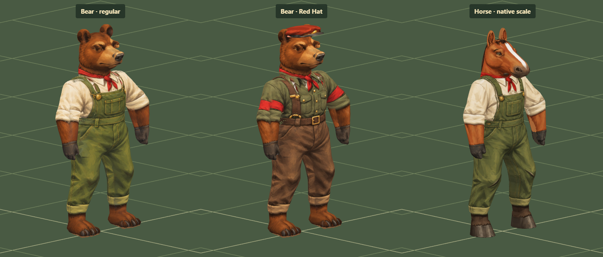
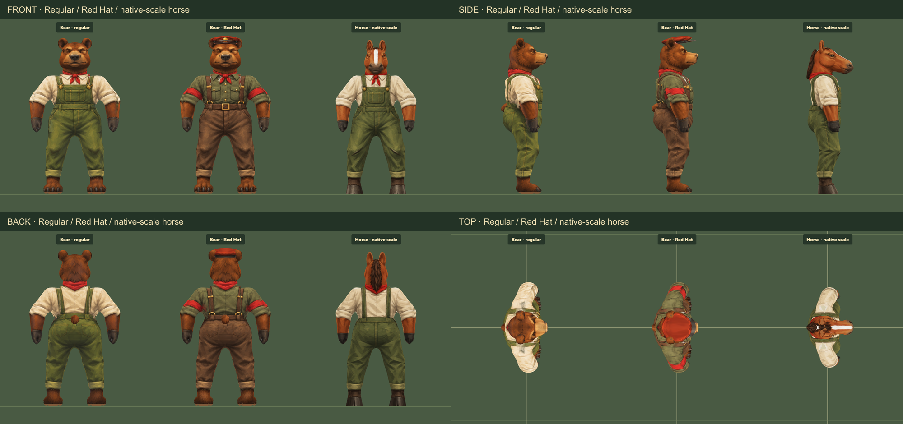

# Bear worker and Red Hat

Artist delivery · 28 October 2026 · branch `work/bear-character` · canonical base `d3b0ccc`

A brown bear joins the character studies in two painted outfits. The regular
worker wears a cream rolled-sleeve shirt, olive overalls, red neckerchief and
dark gloves. The Red Hat wears an olive military shirt, brown trousers and
braces, red armbands and the existing painted service cap, fitted to this head.
Both retain the same fur, face, paws, proportions and skeleton.

[Open the study](http://127.0.0.1:4478/tactics/bear-worker.html). It compares both
outfits with a horse at the same scale. Select the author or game mesh, six
camera angles, close or gameplay size, grey, wireframe and paint coverage.
Neutral, carry, walk, kneel, prone and crawl are available with all 13 weapon
choices. The gallery links the study.

## The established process

1. A four-view concept establishes the brown fur, round ears, short broad muzzle,
   heavy shoulders, plantigrade paws and small tail.
2. A **27,298-triangle author sculpt** adapts the accepted worker garments and
   hands, with a newly sculpted bear head, ears, paws and tail. Eight closed,
   connected surfaces keep broad form in geometry and small detail in paint.
3. Meshoptimizer produces a **10,050-triangle game mesh** from that stored author.
   The maximum recorded reduction error is below 0.0035 world units. The
   separate Red Hat cap adds **700 triangles**, for 10,750 body-and-cap triangles.
4. Four exact orthographic views of the author supply the paint registration
   target. Built-in ImageGen paints the regular outfit, then creates the matching
   faction outfit. Both 1774 × 887 sheets share that normalized 2:1 layout.
5. Bound-space, visibility-checked painting is applied to the rig and reviewed
   from front, side, back, top and gameplay angles, through equipment and motion.

The game mesh's neutral bounds are approximately **0.972 tiles wide and 1.671
tiles tall**, including the extended resting arms and rounded ears. No runtime
rescaling makes it fit the horse. The broader torso and shoulders provide its
mass. The native 17-bone skeleton is widened at the arms by 0.055 tile per side;
leg lengths and hand contact offsets remain native.

## Rigging and painting

The bear's garment weights use the original shirt coordinate before its width
adjustment. Widening the torso therefore does not accidentally turn torso cloth
into an arm sleeve. The shared neck layer fitting is retained. Plantigrade upper
ankles follow their shins during low poses while the paw soles remain rigid.

The HMG carry is lifted to fit the shoulders. The RPG is lowered and centered.
Both preserve the weapon's authored hand anchors, and unequipping or disposing
the bear restores the caller-owned carry profile. Other weapons retain their
existing carries. The service cap follows the head bone using `redHatFit` in
the bear profile; the existing named species fits remain unchanged.

Each eye has one profile-paint owner to avoid overlapping front/profile irises.
Unseen cuff rims borrow a small patch of the same outfit's painted shirt.
The face and exposed fur are retained across the two outfits. Four-view
projection still borrows paint for hidden surfaces; this is not a conventional
UV atlas or proof that every hidden texel was separately authored. Coverage mode
distinguishes direct projection, reused paint and fallback.

The tail correction raises its attachment **0.085 tile** and tucks it forward
**0.012 tile**, above the fullest part of the rump. Both mesh levels preserve
the original paint registration separately from the fitted physical positions.
The paintings' lower tail copy is covered with adjacent rear trouser paint;
their existing fur is reused on the higher tail. This fixes both the side
silhouette and the apparent second tail in the rear view without changing the
paint sheets. Reused patches remain marked as borrowed paint in coverage mode.

## Files and builder use

| Asset | File |
| --- | --- |
| Author sculpt | `dist/tactics/bear-author-data.json` |
| Reduced mesh | `dist/tactics/bear-10k-data.json` |
| Native factory and profile | `dist/tactics/bear-worker.js` |
| Paint fitting | `dist/tactics/bear-paint.js` |
| Regular painting | `dist/assets/characters/lowpoly-proof/bear-worker-model-paint-v1.png` |
| Red Hat painting | `dist/assets/characters/lowpoly-proof/bear-red-hat-model-paint-v1.png` |
| Concept | `dist/assets/characters/model-references/bear-worker-turnaround-v1.png` |
| Exact grey paint target | `docs/tactics/review-images/bear/neutral-paint-reference.png` |

Use `createBearWorker(data)`, `BEAR_PROFILE` and `createBearPaint(renderer,
worker, texture)`. Choose `BEAR_PAINT` or `BEAR_RED_HAT_PAINT`; the Red Hat variant
also uses `createRedHatCap(renderer, worker, BEAR_PROFILE, loader)`. Dispose
motion controllers before releasing the cap, painting, character and owned
weapon. The character restores fitted borrowed carry profiles on release.

This delivers the **character study and reusable assets**. The canonical
`ANIMAL_MOTION_CATALOG`, core species choices, campaign population and saved-game
schema are not extended here. The architect/builder can add the supplied profile
after review and fit further traversal, casualty and firing states. Existing
models and outfits are not replaced.

## Validation

- **51 targeted tests pass**: eight new bear checks plus projection, existing
  dog rig, battle motion, Pages/module closure, posture and prone regressions.
- Both mesh levels have normalized weights, outward winding, closed connected
  surfaces, round ears, broad paws and the expected author-to-runtime lineage.
- All 13 equipment choices retain native carry contacts. Walk and crawl preserve
  limb lengths; actual rendered body surfaces clear the floor, and crawling
  equipment clears the intact posed skull. These are flat-floor fitting checks.
- Repeated kneel/prone sampling starts from a reset native carry, remains
  grounded and does not accumulate changes to the pose.
- **68 browser captures** cover both outfits, both mesh levels, six angles,
  movement, all weapon carries/crawls, gameplay size and a single-character phone
  view. No browser, shader or asset-loading error was recorded.
- Six cycles through regular → Red Hat → pair retain the same renderer geometry
  and texture counts. Repeating a prone frame produces identical pixels.
- Four fresh source/package comparisons match exactly: outfit pair, crawl,
  Red Hat RPG carry and author back view. The 3D build and asset audit pass.
- Disposable review browsers were closed and their ports released. This is
  artist self-review and automated validation; independent architect review is
  still pending. No full-battle performance or unrestricted animation approval
  is claimed.

Reproduce geometry with `node tools/build-bear-worker.mjs`. Run
`node --test tests/bear-worker.test.mjs` for the bear checks. Build with
`node tools/build-tactics-3d.mjs` before running `tools/review-bear-worker.mjs`
with `PLAYWRIGHT_PATH` and `BEAR_REVIEW_PACKAGED=1`. The `--grey` option also
recreates the original paint target from the stored registration positions;
the main viewer's grey mode shows the currently fitted physical geometry.

The [painting provenance and prompts](BEAR-WORKER-PAINT-PROMPTS-2026-10-28.md)
record all selected bitmap assets. The [compact validation record](review-images/bear/validation.json)
preserves measurements, selected image hashes and package comparisons.

The registered read-only preview on port 4478 is retained for art review until
**29 October 2026 at 12:32 AM Eastern**. A private stop marker and an installed
timer stop that process. Its restart record preserves the source, outputs and
configuration; restart deliberately with a new deadline and registration.
