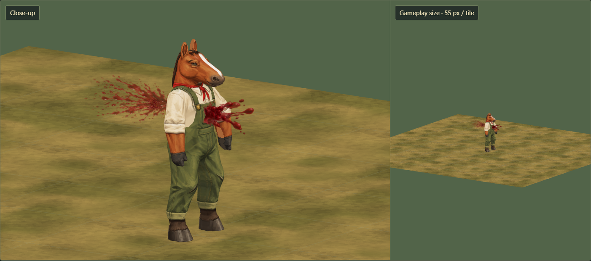
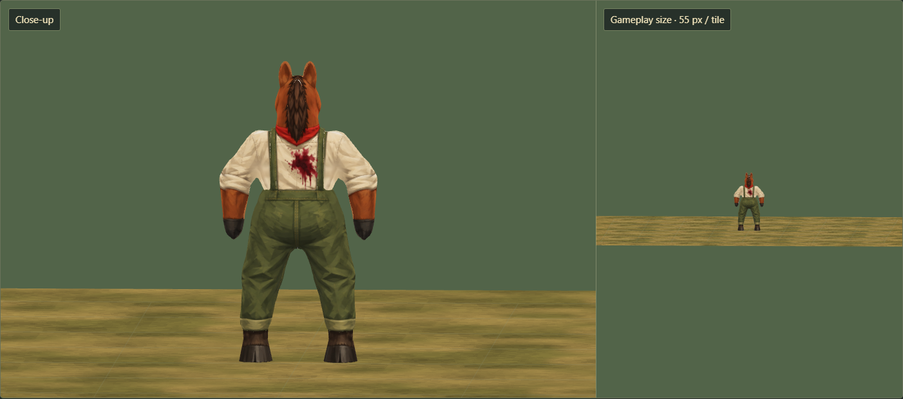
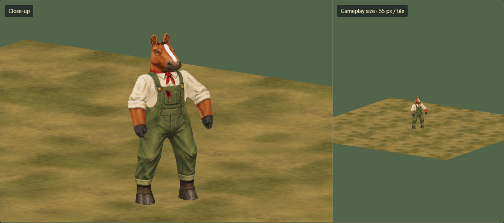

# Forward spatter and persistent painted stains

Artist delivery · 21 October 2026 · Independent visual review: **9/10**

This extends the [ordinary entry spray](PAINTED-BLOOD-SPRAY-ASSET-2026-10-21.md)
with a fuller forward exit spray and a persistent painted stain layer. The entry
effect keeps its existing smaller fan and larger droplets. The exit has a wider
fan, finer droplets and ragged flecks. Both separate, fall and fade; the paint
remains on the struck surface afterwards.

**Lifetime: the visible wound lasts for the current battle.** Clear the stain
layers when that battle ends; do not carry them into the campaign view or the
next encounter. They are cosmetic and do not change injury or treatment state.

[Open the study](http://127.0.0.1:4477/tactics/blood-wounds-study.html). It includes
all **12 animals, both outfits and the donkey guide (25 combinations)**, close
and 55-pixel-per-tile views, torso/arm/leg examples, camera changes, backgrounds,
scrubbing, reduced/still effects, clear/restore and a post-hit pose change.
The hen uses wing/breast articulation for the flex check.





## Painted assets

| Asset | Runtime file | Dimensions | Compressed size |
| --- | --- | --- | ---: |
| Forward spray: fan, fine spray, streak, flecks | [exit-components-v1.png](../../dist/assets/effects/painted-blood-exit/exit-components-v1.png) | 512 × 512 RGBA | 138,438 bytes |
| Stains: two entry and two exit variants | [stain-components-v1.png](../../dist/assets/effects/painted-blood-stains/stain-components-v1.png) | 512 × 512 RGBA | 240,663 bytes |

Both paintings were made with **built-in ImageGen** on transparent backgrounds.
Unchanged 1254 × 1254 originals, exact prompts, hashes, cell UVs and preparation
details are saved in the [exit manifest](../../dist/assets/effects/painted-blood-exit/manifest.json)
and [stain manifest](../../dist/assets/effects/painted-blood-stains/manifest.json).
Runtime preparation only crops, resizes and packs the original painted cells
with transparent gutters. Each new runtime atlas costs approximately **1.33 MiB**
decoded with mipmaps, or **2.67 MiB combined**, in addition to the entry atlas.

## Exit spray API

[createPaintedBloodExit](../../dist/tactics/painted-blood-exit.js) uses the same
rendering path as the original entry effect. The shared renderer was extracted
without changing the entry motion, painting, pivots or lifetime.

```js
const exit = createPaintedBloodExit(sharedExitAtlas, {
  seed: presentationSeed, strength: 1, reduced: false
});
scene.add(exit.mesh); // identity mesh under an untransformed scene/root
exit.setFrame(confirmedExitWorldFrame);
exit.update(ageSeconds, camera, {floor: supportWorldY});
// Retire by 0.6 s. Caller retains the shared texture.
exit.dispose();
```

The local **+X** axis points forward from a **confirmed exit point**, in the
projectile's direction. A rigid, unscaled render-world frame is required. Entry
uses negative incoming at its own contact; exit uses positive incoming at its
separate contact. Camera-facing cards retain world-space travel and world-down
gravity. Strength is bounded to 0.7–1.2. Full uses **32 cards**, Reduced uses
**8**, and Still shows a stationary mark fading within **0.18 s**. Normal alpha,
depth testing, no depth writes, shadows or lights remain in force.

The study's two opposite surface probes are an **authored through-shot example**.
They are not penetration logic. Current entry receipts do not establish an exit;
the builder must supply an independently resolved exit before using this effect.
The effect must never infer an exit merely from the victim's body bounds.

## Stains as a local second skin

[createBloodStainLayer](../../dist/tactics/painted-blood-stain.js) adds small patches
to the existing surface rather than duplicating the whole character or repainting
a shared body texture. At creation, it projects a painted cell onto the struck
body part and retains only nearby, outward-facing original triangles. Their
original bind positions and exact bone weights remain intact. The patch shares
the source skeleton, so it bends with the clothing or fur with no repeated
projection during animation. Normal depth testing and a shallow projection limit
keep it local; a small depth bias avoids flickering against the original surface.

```js
const blood = createBloodStainLayer(sharedStainAtlas, {
  parts: worker.parts, maxStains: 8
});
const stain = blood.stamp({
  source: struckBodyMesh,
  point: surfacePointWorld,
  normal: outwardSurfaceNormalWorld,
  kind: 'exit', variant: 1,
  width: 0.25, height: 0.31, depth: 0.085
});
// The stain follows subsequent skeletal poses for the current battle.
// Clear when the battle ends or the encounter is reset:
blood.clear();
blood.dispose();
```

- Supply the actual authored body mesh, posed and updated at the hit, plus its
  visible surface point and outward normal in world coordinates. Width, height
  and projection depth are in rendered tile units. A miss returns `null`.
- Use a verified skin contact. A collider-only fallback that floats outside the
  skin is suitable for the transient spray, but should not manufacture a stain
  on another surface. Held weapons are outside the character's supplied part list.
- The patch is an identity child of its source mesh and shares its skeleton.
  Translation, rotation, scale and bone articulation remain aligned. It does not
  alter the source geometry, its material or the shared character paintings.
- Projection is shallow and rejects back-facing triangles. Separate entry and
  exit stamps cannot project through the whole body. The patch ignores picking,
  so original body picking remains available.
- The layer caps stains at eight by default, dropping the oldest patch when the
  cap is exceeded. A maximum of sixteen is allowed. Each patch owns only its
  geometry/material; the caller owns the atlas, body and skeleton. Disposal is
  idempotent. Dispose patches before replacing their source actor.
- This adapter follows skeletal deformation. Morph targets and later CPU edits
  to the source's bind geometry require their own adapter or re-stamping; morph
  targets are rejected explicitly. The native model poses checked here retain
  exact alignment. The builder handles reconstructing the same battle's stains
  when an actor is rebuilt or an ongoing battle is resumed. Discard that cosmetic
  state at battle end; it must not persist between encounters.



## Validation

- **16 focused tests pass**, including the seven original entry tests, exit
  direction/lifetime/camera invariance, exact stain-to-body vertex alignment in
  moving/kneeling/prone poses and root transforms, ownership/eviction/disposal,
  all twelve skeletons, an explicit rear-face/deep-surface rejection fixture,
  asset hashes and both packaging module-closure lists.
- Asset audit and the packaged 3D build pass. The browser review passes **46
  captures**, including all 25 outfit combinations, arm/leg stamps, stance and
  camera changes, contrasting backgrounds, Reduced/Still modes and mobile layout.
  Source and packaged appearance match byte-for-byte, with no browser errors.
  Delayed initial mesh loading and delayed replacement paint loading are both
  interrupted by disposal successfully. Late tasks release their textures and
  temporary paints; the renderer is retired once those tasks finish. Interrupted
  boot installs no late resize observer.
- Fifty clear/re-stamp and effect-mode reset cycles retain **12 geometries and
  8 textures**, including the horse and its paints. This is an isolated study
  measurement; global batching, combat frame times and full-sector performance
  are not established. Each exit emitter adds one instanced draw. Each retained
  patch adds a draw; the builder must budget concurrent actors and effects.
- Review helpers close in `finally` and verify process exit and released ports.
  The existing registered preview on port 4477 retains its original automatic
  stop: **22 October 2026, 7:56 PM Eastern**. No extra server is retained.

This delivery supplies assets and reusable rendering adapters. Combat damage,
exit qualification, live visibility, receipt timing, save state and gameplay
settings remain with the builder. No head removal, new damage rules or permanent
ground stains were added.

## Reproduction

Node.js 22+; `sharp` and `playwright` packages; installed Edge for the review.
`SHARP_PATH` and `PLAYWRIGHT_PATH` may point to bundled package directories.

- `node tools/prepare-blood-followup.mjs <exit-original-png> <stain-original-png>`
- `node --test tests/painted-blood-spray.test.mjs tests/painted-blood-wounds.test.mjs tests/tactics-pages-files.test.mjs`
- `node tools/check-assets.mjs`
- `node tools/build-tactics-3d.mjs`
- With the registered preview running, set `BLOOD_WOUNDS_PACKAGED=1` and run
  `node tools/review-blood-wounds.mjs`. Set `BLOOD_WOUNDS_OUTPUT` for a fresh
  artifact directory. Raw captures and helper receipts are local artifacts;
  curated images are saved beside this document.
