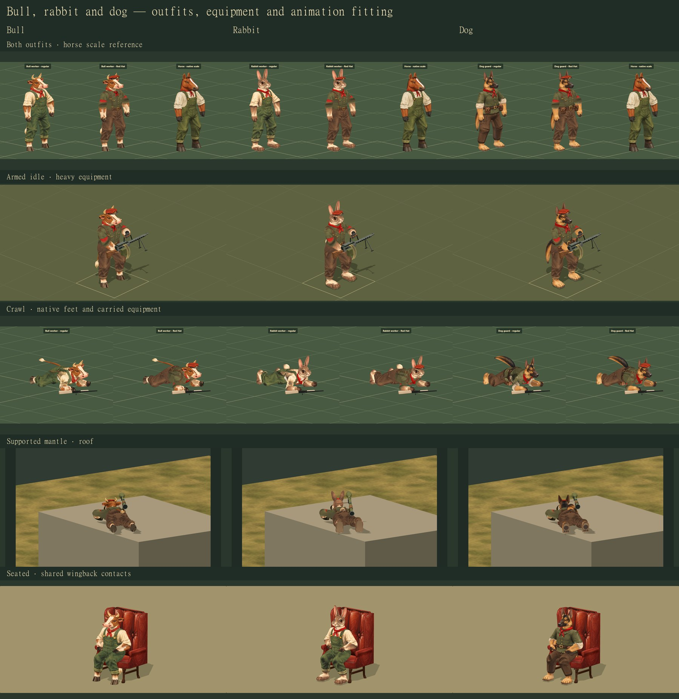

# Bull, rabbit and dog: production completion

28 October 2026 · `work/bear-character` · follows bear integration at `4f5f539`.

The three accepted native models now receive the bear's equipment, animation,
portrait, placement and recruitment coverage. Their existing sculpts and normal
paintings already provided the right identities; this pass finishes their use in
the game rather than replacing those designs. Both the regular and Red Hat
appearances retain each species' face, ears, feet and tail.

[Model fitting and scale](http://127.0.0.1:4478/tactics/character-fitting-study.html?animal=bull&outfit=pair)
· [Animation index](http://127.0.0.1:4478/tactics/character-animation-study.html?animal=bull)
· [Battle range](http://127.0.0.1:4478/tactics/battle-3d.html?study=character-roster&animal=bull).
Each view includes animal selection. The fitting view compares both outfits with
the horse, author/game meshes, six camera directions, tile grid, paint coverage,
grey forms and wireframe. Its original model-study links preserve the design
history.



## Source models

| Character | Author triangles | Game triangles | Retained identity |
| --- | ---: | ---: | --- |
| Bull | 29,572 | 9,998 | Broad skull, short curved horns, cloven hooves and hanging tail |
| Rabbit | 29,972 | 10,156 | Adult female worker, smooth painted face, leaf ears, broad fur feet and compact tail |
| Dog | 29,850 | 10,446 | Adult female shepherd, upright ears, tapered muzzle, work jacket, utility pouches and fur feet |

All retain the native 17-bone rig and separately attached equipment. The Red Hat
outfit uses the existing shared painterly faction layer with each character's
fitted service cap. Fur, face and local eye/scarf repairs stay species specific.
No character mesh is scaled to fit another character or a chair. Speaking meshes
are the existing native heads, with their established jaw and mouth interiors.

Six new transparent 256 × 256 PNGs render the actual models for HUD, dossier,
campaign and recruitment portraits: `assets/characters/{bull,rabbit,dog}-idle.png`
and the matching files under `assets/characters/red-hats/`.

## Equipment and motion

Each character has all 13 equipment choices: hands, knife, pistol, rifle, assault
rifle, SMG, HMG, shotgun, sniper rifle, grenade, launcher, RPG and flamethrower.
The shared catalog already supplied their walking, aiming, idle, crawl, grenade,
mantle, casualty, fire and speaking motion. Those paths were exercised again with
the production outfits and equipment. This pass also removes the rifle-only
restrictions on their live descent and wooden-hatch traversal, and exposes the
complete weapon set in the associated studies.

The new physics checks found and corrected these fits:

- Heavy equipment transfers needed a shorter shoulder arc on the narrower rigs.
  HMG, RPG and flamethrower now remain reachable while the hand retains its grip.
  Small holstered items keep their short transfer paths. Native arm lengths stay
  fixed; the tests retain their contact-error thresholds.
- Ladder handoff now reads the weapon's own palm offset, including the HMG's
  support handle, rather than assuming every support grip has rifle geometry.
- The rabbit's seated palms rest slightly higher on the thighs to stay within
  native arm reach. The elbow poles still bend behind the body.
- Chair cloth fitting now accepts the dog's actual trouser surface as well as
  the workers' overalls. The existing cloth correction is reversible.

The animation index includes armed idle, walk/aim/fire, stances and casualties,
crawl, grenade throwing, roof/cliff mantling and descent, both tower ladders,
burning, fuel-pack rupture, fatal reaction, sitting/rising and speaking. It carries
the chosen animal, outfit and equipment into each appropriate study. The new
crawl clip is not yet invoked by live battle movement. Chair motion remains an
unarmed study, with no new world sitting interaction; grenade and fuel-pack
studies use their own equipment. The older
weighted-window experiments are absent from this checkout; existing simple game
window/wall traversal uses the registered native models.

## Game and delivery boundaries

A recorded adapter extends the pinned core's accepted map appearances and recruit
slates with `bull`, `rabbit` and `dog`. It preserves the save schema, authored
campaign identities and existing species-trait behavior. The shared core remains
pinned to `e529f4b3d512d32cea522d701d01ebe8488af013` with all 20 modules recorded.

The range is a review fixture: four playable characters plus a reference for each
equipment choice. Ordinary authored maps retain their cast. The editor can place,
save, reload and Playtest the three appearances with either outfit. This branch
contains the completed wiring; canonical integration and architect approval are
separate from this delivery.

## Validation

The relevant regression run passed **734 tests**, the new physics suite passed
**51**, and the additional dog/dialogue checks passed **15**: **800 passed, zero
failed**. These are the relevant suites, not a new complete repository test run.
The production build, asset audit and shared-core synchronization also passed.
All four chair forms passed the seated, weight-forward and standing checks.
Twelve source/package model comparisons were pixel exact.

The first editor reload check exposed a race in the review script; it now waits
for the replacement document. One combined packaged run had an Edge target crash
during editor reload. Each packaged species was subsequently checked in its own
fresh browser, through save/reload/Playtest and both dialogue portraits. The
completed runs reported no application or asset errors. The crash does not
establish its cause, and these functional checks are not a full-sector performance
benchmark.

The adjacent [execution record](review-images/completed-characters/validation.json)
contains the final test counts, browser passes, package comparisons, asset hashes
and unchanged model/paint provenance. The focused physics suite covers every
weapon's descent and both tower ladders in both directions, fixed bone lengths,
contact errors, native seated foot support and restoration of modified geometry.

Reproduce with:

```text
node --test tests/completed-character-integration.test.mjs
node tools/sync-tactics-core.mjs --check
node tools/check-assets.mjs
npm run build:tactics-3d
node tools/review-completed-characters.mjs --models
node tools/review-completed-characters.mjs --motion
node tools/review-completed-characters.mjs --integration
node tools/review-completed-characters.mjs --seats
node tools/review-completed-characters.mjs --details
node tools/review-completed-characters.mjs --package
```

The browser tool accepts `PLAYWRIGHT_PATH`, `CHARACTER_REVIEW_BASE`,
`CHARACTER_REVIEW_OUTPUT`, `CHARACTER_REVIEW_ANIMALS=bull` (or rabbit/dog),
and `CHARACTER_REVIEW_PACKAGED=1`. Use a fresh packaged integration run per species,
with a separate output directory for each. It owns a disposable
headless browser, records its process identity, closes it in `finally`, and verifies
that the process and listener exited. The retained local preview on port 4478 keeps
its already agreed expiry: **29 October 2026, 12:32 AM Eastern**. It is not silently
extended by this follow-up.
