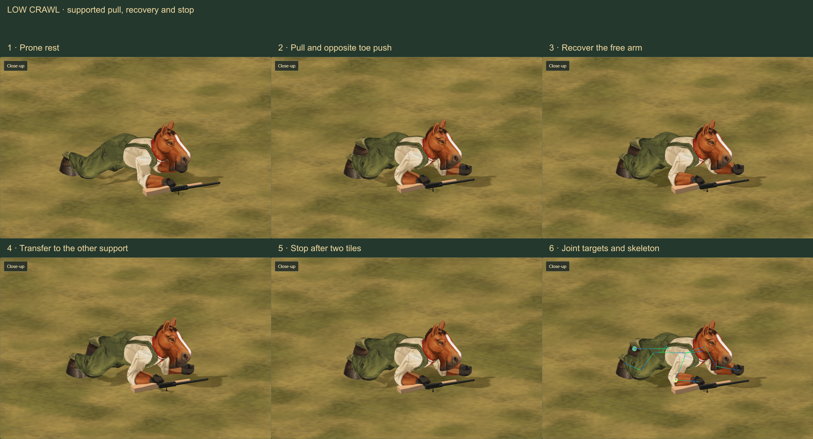
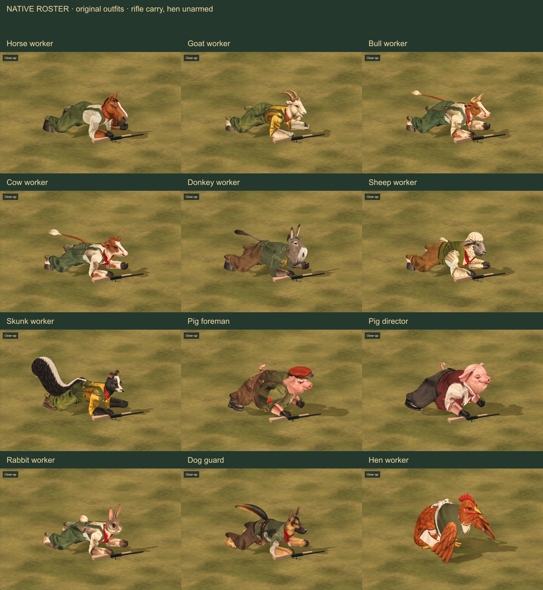

# Crawling animation study

Artist delivery · 23 October 2026 · Independent art review: **9/10**

A dedicated low crawl replaces a borrowed walking rhythm in this study. A
forearm and the opposite toes support a body pull; the free limbs recover,
then support changes sides. The torso stays low, the head remains alert and
the weapon is carried below the right forearm with its muzzle off the ground.
The native character dimensions, geometry and painted materials are retained.

[Open the study](http://127.0.0.1:4477/tactics/crawl-study.html).
The preview includes forward and backward travel, prone rest, scrubbing,
slow playback, five camera angles, support markers and a skeleton. A close
view sits beside the **55-pixel-per-tile** gameplay view.



## Species and equipment

The study contains **12 animals, both outfits and the donkey guide**, giving
25 painted character combinations. Eleven armed animals accept all 13 catalog
loadouts, including empty hands. The hen retains her native unarmed role.

- Horses and the other lean mammals alternate forearm pulls and opposite toe
  pushes. Overlapping support periods avoid a moment with no planted support.
- Both pigs use a belly-supported drag and shorter steps, with hands bracing
  their weight rather than suspending the belly above the ground.
- The hen has a low breast shuffle, tucked legs, balancing wings, a folded
  apron hem and a tail laid back. Her head stays upright enough to look ahead.
- The skunk's plume folds behind the hips. Long tails reuse the existing low
  posture treatment. Upper boots and hooves blend with the shins so their
  closed top caps remain inside the trouser cuffs.

Long guns are carried diagonally on their sides. The hand closes over the
narrow stock neck; the shoulder butt clears the supporting forearm. This is
a carrying pose, not a firing pose. Flamethrower tanks retain their native
mounts and a connected, grounded hose.



## Builder contract

This is **study delivery**, based on canonical `a20b343`, on artist branch
`work/crawling-animations`. It does not replace the live battle motion driver,
change prone action costs, weapon rules, pathfinding or saved simulation state.

`createCrawlMotion(worker, profile)` in
[`crawl-motion.js`](../../dist/tactics/crawl-motion.js) expects an equipped,
native unit-scale actor. It returns `stride`, `at(distance, options)`,
`diagnostics()` and an idempotent `dispose()`.

- `distance` is **accepted signed travel in rendered tile units**, not elapsed
  time. It advances the support cycle and root translation. Negative travel
  crawls backward without turning the character around.
- `heading` is in degrees, using the battle presentation's heading convention.
  `position` is the route origin, including the actual floor height.
- `blend`, from zero to one, reduces recovery lift and body motion while
  stopping. It is **not** an interpolation from standing to prone.
- The driver places its root at `position + forward(heading) * distance`.
  Do not add the same travel again in the caller. When the renderer already
  supplies the current interpolated root, derive the origin as below.
- Contacts are verified on a **flat floor at fixed heading**. Turning, slopes,
  uneven terrain and transitions into or out of prone need builder treatment
  and another visual check. The study's 12-second timing is a demonstration,
  not a new movement-speed rule.

```js
const crawl = createCrawlMotion(worker, profile);
const forward = new THREE.Vector3(1, 0, 0)
  .applyAxisAngle(new THREE.Vector3(0, 1, 0), -heading * Math.PI / 180);
const origin = visualRoot.clone().addScaledVector(forward, -acceptedTravel);
crawl.at(acceptedTravel, {heading, position: origin, blend: movingBlend});
// Before another pose controller takes ownership:
crawl.dispose();
```

Body, forearm and foot fitting runs once when constructing the controller.
Playback uses the cached fit and native bone lengths. The diagnostic markers
show joint targets; they do not implement environment collision or IK against
arbitrary terrain. The light mammals' active forearm and planted toe endpoints
stay fixed in world space during their support period. The pigs' belly/hand
support and the hen's foot shuffle use their own fits.

Disposal restores caller bones, root transforms, geometry attribute references
and values, skeletons, materials, loadout transforms, visibility and the original
fuel-hose updater. Caller-owned character and weapon resources are not disposed.
The hen adapter owns and restores its temporary skeleton extensions. The fuel
hose reuses one 216-triangle buffer rather than allocating geometry each frame.
There are no new character meshes, texture atlases or dependencies in gameplay.

## Validation and review

- **27 focused tests pass:** the ten crawl tests, fifteen existing battle-motion
  checks and two packaging/module-closure checks.
- The floor/native-length/grip matrix covers **144 native combinations**:
  11 armed animals × 13 loadouts, plus the unarmed hen, over 25 samples each.
- Actual posed skull surfaces are checked against every armed loadout over
  four phases. Actual forearm surfaces are checked against shoulder-butt
  vertices and edges over both pulls. The stock neck held by the hand is
  explicitly excluded from the butt check.
- Contact locking is checked after translation and rotation, along with reverse
  scrubbing, exact restoration, invalid input and repeated hose updates.
- **219 browser captures** cover the roster/outfits, loadouts, reverse travel,
  camera angles, contact guides, contrasting ground and mobile layout.
  No browser, shader or asset-load error was recorded.
- Fresh source and packaged screenshots match exactly for horse, flamethrower,
  hen and donkey guide. Replaying 50 cycles retains bounded geometry/texture
  counts. Delayed-load cancellation passes at boot, outfit replacement and
  grenade loading. Disposable review browsers exited and released their ports.
- The Pages build and asset audit pass. These are isolated study checks, not a
  full-battle frame-time result. The independent reviewer cleared both fitting
  holds and rated the final study **9/10**. A roughly 0.003-unit support-handover
  adjustment remains optional polish, below a pixel at the gameplay scale.

The [compact validation record](review-images/crawling/validation.json) preserves
the selected image hashes and replay resource counts. Reproduce browser captures
with `tools/review-crawl.mjs` (set `PLAYWRIGHT_PATH`,
`CRAWL_REVIEW_PACKAGED=1`, and optionally `CRAWL_REVIEW_OUTPUT`). Build first and
keep the source fixed during source/package comparison. `CRAWL_REVIEW_FAST=1`
skips the larger matrix; `CRAWL_REVIEW_FIT=1` reduces the main poses to one time.
`tools/compose-crawl-review.mjs` makes these boards using `SHARP_PATH` if needed.

## Integration checklist

- [x] Native roster, outfits and loadout studies.
- [x] Supported forward/backward crawl and settled prone rest.
- [x] Species-specific pig and hen fitting; stock, ankle and tail review.
- [x] Playback/restoration tests and packaged browser checks.
- [ ] Connect accepted prone movement to this driver in battle.
- [ ] Blend into/out of prone and handle turns and terrain changes.
- [ ] Recheck firing readiness, fog/visibility and sustained battle frame time.

The task-owned read-only preview on port 4477 is retained for review until
**24 October 2026 at 9:15 PM Eastern**. It has a fixed shutdown timer and a
registered private stop marker. Restart deliberately with a new deadline and
helper registration; the local lifecycle restart record preserves the sources
and configuration.
