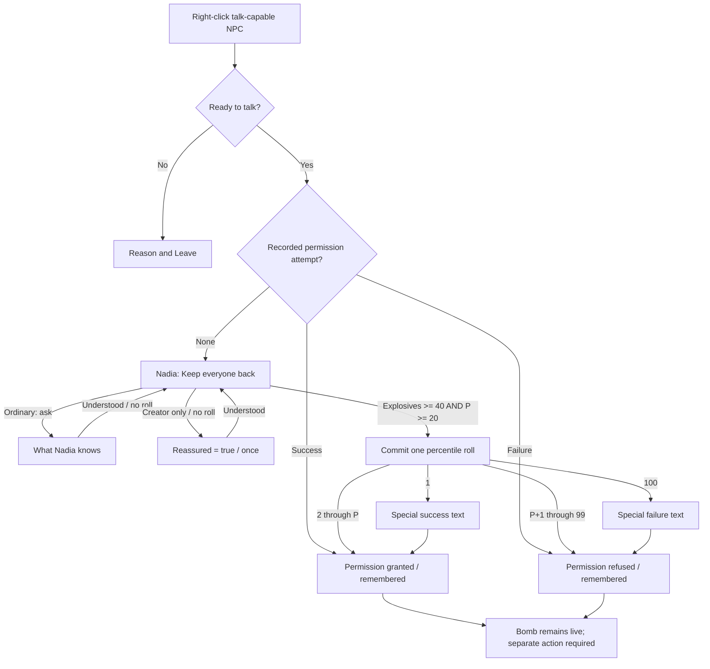

# Dialogue infrastructure: a conversation, a decision, a recorded result

Design proposal · 19 October 2026 · **Not implemented**

Code inspected: builder branch `work/editor-3d`, commit
[`146ee23`](https://github.com/Syntaxswine/animal-factory-tactics-3d/commit/146ee23a66987d3ea053c2439576d139206a849f).
This is a proposal for the next coding task, not a claim about canonical or live
Pages. Existing code is evidence; the rules marked **Recommended** are new.
The bomb, its custodian and all conversation lines below are **invented example
content**, not an existing quest. No authored bomb conversation or bomb-disarming
interaction was found in the inspected gameplay/content files.

The deliverable is deliberately limited to talking: starting a conversation,
displaying authored lines and choices, resolving an explicitly requested check,
recording its consequences and leaving safely. It does not build bomb mechanics,
trading, a general quest engine, a visual tree editor, voice acting or group
negotiations.

## Confirmed requirements

- Right-clicking a talk-capable NPC initiates dialogue. NPC is a placement
  category; `canTalk` remains independent of faction, outfit and combat behavior.
- A flat NPC can say one fixed line or select flavour text without meaningful
  choices. More involved NPCs can use ordinary, personality and skill choices.
- Personality choices have distinctive colours **and readable labels**.
- A checked choice can have a minimum skill, such as Explosives 40. It still
  rolls, and becomes visible only with at least a 20% chance of success.
- Rolls of 1 and 100 can have special text. Their mechanical meaning is a
  recommendation below, not a previously confirmed requirement.
- Looking at the conversation or its choices must not roll or apply effects.
  Convincing an NPC to permit bomb handling does not disarm the bomb.

## Start with the people and their intentions

**Invented situation:** Nadia, a yard warden, is keeping everyone away from a
suspected bomb left at the town's loading yard. She is neutral, frightened by the
device but not in the game's combat-fear state. No active countdown is invented
for this example. Her goal is to keep people safe without surrendering control
to someone who merely sounds confident. The player's goal is to obtain
permission for the team to inspect and potentially disarm it later.

The four mercenaries and these starting values are **actual code**, before map
overrides or training. See
[character stats](https://github.com/Syntaxswine/animal-factory-tactics-3d/blob/146ee23/dist/tactics/character-stats.js#L6)
and [personalities](https://github.com/Syntaxswine/animal-factory-tactics-3d/blob/146ee23/dist/tactics/core/personalities.js#L4).

| Merc | Existing archetype | Explosives | Example offer, before reassurance |
| --- | --- | ---: | --- |
| Yakov | Ruler | 30 | Hidden: below minimum 40 |
| Anya | Rebel | 45 | Visible: 20% |
| Misha | Creator | 65 | Visible: 40% |
| Vera | Caregiver | 20 | Hidden: below minimum 40 |

Misha's established methodical, practical character makes him the worked
speaker. He wants to show Nadia a careful approach, not claim the device is
already safe. Nadia wants evidence of competence and restraint. The personality
reply changes her confidence in the **team's approach**, not the speaker's skill.

## Recommended interaction rules

### Speaker and readiness

1. Right-clicking an identified actor with `character.canTalk === true` opens the
   dialogue panel directly, before the generic tile context menu. This applies
   to a friendly Red Hat as well as a civilian. Actors without the capability
   keep their existing context behavior. The editor keeps its authoring menu.
2. The primary selected merc (`state.selected`) is the speaker. Multi-selection
   does not combine skills or borrow the best merc elsewhere in the sector.
   Show both portraits/names: **Misha speaking to Nadia — Yard warden**.
3. Extend `characterTalkStatus`; do not treat it as a complete interaction check.
   Both actors must be alive, conscious, present in this sector and not departing.
   The speaker must be player-controlled, with no action/traversal in flight.
   Require distance `hypot(dx,dy) <= 2`, support-height difference `<= 0.3`, and
   a clear potential sightline ignoring the speaker's current facing. Do not
   reveal an unidentified actor through fog. Reuse the game's potential-sight
   obstruction query (`canAimAt` already performs a pure turn-to-face check for
   an identified squad contact); opening dialogue does not rotate or move anyone.
4. Preserve the existing refusal during engagement, player/enemy combat phases,
   relevant guard alerts/searches, NPC fright or hostility. Being a Red Hat alone
   is not hostility. A failed conversation check does not provoke a character.
5. If blocked, show the actor and the reason, such as **Move within two tiles**
   or **Too frightened to talk**; show no conversation choices and consume no
   roll. No automatic approach movement in this tranche.
6. An explicit **Speaker** picker lists present mercs and explains unavailable
   ones. Switching selects one eligible speaker and recomputes choices; it does
   not advance a node or roll, and changes only the panel's speaker rather than
   writing `state.selected`. Use `u.archetype`, with the existing
   `personality(u)?.archetype` as fallback, not species or a display-name match.
   An untagged merc gets ordinary and skill choices, not a guessed personality.

The panel pauses tactical simulation **and campaign time**. Opening, reading,
ordinary replies, checked replies and closing cost no AP, stamina or game time
in this tranche. Include the panel in the existing modal-pause predicate and
reset the frame clock on opening/closing. Preserve the player's prior manual
pause state. This is not a framework for conversations against a running fuse.

### Decision table

All rows assume a valid session and true authored story conditions. Failed
global readiness blocks the conversation before this table is evaluated.

| Choice | Additional requirement | Visible/clickable? | Roll/effect on selection |
| --- | --- | --- | --- |
| Ordinary reply | None | Yes | No roll; authored branch, optional explicit fact change |
| Personality-only reply | Speaker has named archetype | Yes if matched; otherwise hidden | No roll; authored branch/effect |
| Checked reply below skill minimum | `S < minimum` | Hidden, even if modifiers would give 20% | Nothing |
| Checked reply at minimum but below 20% | `S >= minimum`, `P < 20` | Hidden | Nothing |
| Checked reply meeting both gates | `S >= minimum`, `P >= 20`, no completed attempt | Yes | One percentile result; success or failure effect |
| Explicit personality + checked reply | Both archetype gate and both skill gates | Yes only if all pass | One declared skill roll; never an automatic extra roll |
| Previously attempted check | Shared attempt already recorded | No fresh attempt; show remembered response/status | No new roll/effect |
| Leave / Escape / close button | Always available | Yes, including an error or empty node | Close only |

Ordinary choices are not secretly Leadership checks. Personality choices are
not inherently superior: their authored response can be helpful, humorous or
unhelpful, but the consequence must match the line. Only the presence of a
`check` object creates a roll. A combined personality/skill choice must display
both labels; the example needs only a personality-only reply.

### Percentile calculation and visibility

**Recommended default, version `dialogue-percentile-1`:**

```text
S = the named speaker's stored integer u.stats[check.skill], 1..100
D = authored difficulty, integer 0..100; default 50
M = clamp(sum of applicable authored modifiers, -20, +20)
raw = 50 + S - D + M
P = clamp(floor(raw + 0.5), 1, 99)
visible = sessionReady AND authoredConditions AND S >= minimum AND P >= 20
success = roll <= P, where roll is an integer from 1 through 100 inclusive
```

`minimum` is an integer 1..100, default 1. Difficulty and minimum are independent:
the minimum is a credibility gate; difficulty is how hard it is to convince this
NPC. Modifiers cannot substitute for the minimum. All v1 inputs are integers,
so rounding is normally a no-op; half-up is specified to prevent later preview
and resolution divergence. Reject fractional/NaN input instead of silently
normalizing authored data.

Each modifier has a stable ID, an explicit boolean dialogue-fact condition, and
an integer adjustment between -20 and +20. Apply each at most once, sum, then
clamp the total. No implicit species, Leadership, armour, equipment, difficulty
mode, injury, fatigue or NPC-personality bonuses in v1. Incapacity, fear and
combat still block talking. Do not reuse `effectiveSkill` blindly: it currently
adds Intelligence to Medical/Mechanical for other actions; that is not an
approved conversation bonus. Missing/invalid stats hide the checked option
with a content/compatibility diagnostic, never a fabricated skill value.

For Nadia: `minimum=40`, `D=75`, with `+10` if the team has reassured her.
Misha has `P=50+65-75=40`; after reassurance, `P=50`. Anya starts at 20.
A hypothetical merc at Explosives 40 passes the credibility gate but has only
15%, so the offer is still hidden until context improves. Explosives 39 with
reassurance would calculate 24%, but remains hidden because the minimum fails.

**Natural 1 succeeds; natural 100 fails.** With the 1..99 cap and `roll <= P`,
these are already included in the normal counts: there is no second critical
roll, added 1% success, or overriding failure that reduces a displayed 20% to
19%. Optional special text replaces the first outcome line; it does not change
the ordinary success/failure effects or cause a bonus explosion, damage or XP.
A hidden/ineligible choice cannot be rescued by hoping for a natural 1.

Recommend displaying **exact effective odds** for visible checked options,
alongside the minimum, current skill and attempt policy. For example:

> **[Explosives] Offer to handle the bomb — 50%**
>
> Misha: 65 · Minimum: 40 · Difficulty: 75 · Reassurance: +10
>
> One attempt for the team. Success grants permission; it does not disarm the bomb.

Show **[Creator · no roll]** for the special reassurance, and no probability
badge on ordinary replies. Do not expose the roll before commitment. Revalidate
the same pure preview at selection; if its speaker, inputs or eligibility have
changed, redraw and require another click instead of committing stale odds.
After commitment, show a compact result such as **Rolled 47; needed 50 or less —
permission granted**, alongside the authored response. A 1/100 receives a natural
roll label without suggesting extra damage or another hidden effect.

### Colours are secondary to words

Use a small coloured archetype badge, never colour alone or a recoloured whole
sentence. Keep focus outlines, selected state and disabled state distinct.
Recommended badge fills below use dark text `#162A22`; labels are the existing
archetype IDs. These are initial UI colours, not new personality definitions.

| Label | Fill | Label | Fill | Label | Fill |
| --- | --- | --- | --- | --- | --- |
| Ruler | `#F2C66D` | Rebel | `#E89C91` | Creator | `#8AD0C2` |
| Caregiver | `#D0AFE0` | Innocent | `#F2E9B7` | Sage | `#A8C7EB` |
| Explorer | `#C0D58D` | Magician | `#B9AFF0` | Hero | `#EFB780` |
| Lover | `#ECAEC7` | Jester | `#D9CF84` | Everyman | `#C7C4BB` |

### Consequences, retries and lifecycle

**Recommended default: one checked attempt per team, NPC instance, dialogue and
authored attempt ID.** The attempt is shared across mercenaries. Choosing a better
speaker beforehand matters; swapping speakers after failure does not reset it.
The UI says this before the player selects the checked line. Ordinary information
can be revisited. A one-time personality fact stays set for that NPC's conversation
and helps subsequent speakers because Nadia's confidence concerns the team.

| Event | Exact behavior |
| --- | --- |
| Open, inspect, hover, change speaker | Pure evaluation. No RNG advance, fact write, attempt or reward |
| Select ordinary information | Move to authored node; no roll. Only declared choice effects can commit |
| Select Creator reassurance | Set `reassured=true` once, persist a receipt; no roll |
| Select the offer | Commit one outcome and receipt; success sets `permission=true`; failure leaves it false |
| Close at any node | No new effects. Completed receipts/facts remain; pending dialogue text is not a world action |
| Reopen | Pure entry routing: accepted/refused if already attempted, otherwise greeting. Previous facts remain |
| Change speaker, leave/return, rest or improve skill | No reset of a completed attempt |
| Save/load | Preserve facts, attempt outcome, exact roll, RNG state, speaker ID and content version; reopen without replay |
| Load an older pre-attempt save | Deliberate history rewind. Same input state and command order yield the same roll; this is not an ironman system |
| NPC dies/becomes hostile/frightened, or combat begins | Close safely; no new choice can commit. Keep already committed effects |
| Bad content, missing reference or zero available choices | Explain the problem and retain Leave; no exception loop or forced option |

There are **no automatic retries** in this tranche. A later author-approved new
situation could have a new attempt ID gated by a real world event; reopening,
content hot reload or renaming must never manufacture that event. Neither this
example nor its minimum-skill gate implements a quest to unlock another try.

Success means **permission for the team**, not skill improvement, an equipment
grant, a disarmed bomb or a queued interaction. Failure means a recorded refusal,
not hostility, detonation or an extra attempt. A later bomb-action implementation
may read the permission fact, but must independently check its acting merc,
range, tools, skill, time and hazards. Talking never calls sabotage, explosives
or disarm code.

Every node has an engine-provided **Leave** button and Escape/close support,
even if all authored choices are hidden. Closing consumes the pointer event and
cannot issue a move or attack through the panel. Do not close on an accidental
outside click. Repeated right-clicks focus the current panel rather than restarting
it. Disable world commands and portrait shortcuts while open; use its explicit
speaker selector.

## Complete worked conversation — invented draft

Each quoted player reply is spoken by the displayed merc. These lines contain
no instructions for constructing or disarming a real device.

| Node / choice | Draft speech | Player intention | NPC intention / result |
| --- | --- | --- | --- |
| `greeting` | Nadia: “Stop there. Someone left a bomb beside the loading yard. I'm keeping everyone back until I know who can deal with it.” | Understand the obstacle | Protect the yard; establish responsibility |
| `ask` → `facts` | Player: “What do you know about it?” Nadia: “It appeared after the patrol left. Nobody here has touched it. I need someone who understands explosives, not someone willing to guess.” | Get information without commitment | Explain her objection; no effect or roll |
| `back` | Player: “Understood.” | Return to the options | No effect or roll |
| `creator` → `plan` | Player: “I won't guess. We'll work from a plan and stop if it doesn't hold up.” Nadia: “Good. Knowing when to stop matters. Tell me why your team is qualified.” | Reassure her through a Creator approach | Set `reassured=true`; +10 to this offer, once; no roll |
| `offer` | Player: “Let me handle the bomb. I'll inspect it before attempting to disarm it.” | Win permission, not perform the work | Explosives check; one attempt for the team |
| `accepted` | Nadia: “All right. Your team has my permission to inspect it. It's still live; don't mistake my permission for a promise that it's safe.” | Learn that permission was granted | Record success and permission; bomb unchanged |
| Natural 1 replacement | Nadia: “That's the careful approach I needed to hear. Your team may inspect it. Until it's dealt with, everyone else stays back.” | Receive an exceptional acknowledgement | Same success effects, special wording only |
| `refused` | Nadia: “No. You haven't convinced me that your team can handle this safely. Keep back.” | Understand refusal | Record failure; no permission, hostility or detonation |
| Natural 100 replacement | Nadia: “That made me less confident, not more. Step back. Your team does not have my permission.” | Understand a badly received pitch | Same failure effects, special wording only |
| Leave | Player closes the panel | Return to the map | No new consequence |

One complete example trace: choose Misha → ask for facts → return → choose the
Creator reply → return. The offer now displays 50%. Select it once and, in the
deterministic test fixture, inject **roll 47**. Commit success and `permission=true`,
then show `accepted`. Close, save, load and speak as Anya: Nadia remembers the
permission and no new roll occurs. The bomb remains live throughout. With the
same 47 but no reassurance, Misha's 40% offer would fail. With reassurance, 51
fails, 1 uses the special success line, and 100 uses the special failure line.



Every box also permits Leave. The special-text boxes annotate the **same** result;
they do not enter another effectful node or require a second click/roll.

## Smallest useful authoring data

All examples are **proposed JSON**, not supported resource files yet. Conditions
and effects are typed data, never JavaScript, expressions, callbacks or URLs.
IDs are stable; changing prose does not rename a dialogue, choice or attempt.

This is a character-properties fragment for a placed actor, not a complete map.
Its internal ID is an invented valid example; normal placement uses the existing
UUID generator. `dialogueRef` uses the current readable-token format.

```json
{
  "character": {
    "id": "char_762dfca8-0d52-44a3-b19a-73edc239eff4",
    "displayName": "Nadia — Yard warden",
    "scriptId": "yard_bomb_warden",
    "category": "npc",
    "faction": "civilians",
    "attitude": "neutral",
    "combatBehavior": "cower",
    "canTalk": true,
    "dialogueRef": "yard_bomb_permission",
    "canSell": false,
    "shopInventoryRef": "",
    "shopPricingRef": "",
    "references": []
  },
  "characterResources": { "dialogues": ["yard_bomb_permission"] }
}
```

`characterResources` above belongs at map root, while `character` belongs on its
placed actor. The combined fragment shows the two bindings, not a new nesting
rule. Reusing the resource on another NPC gives that instance its own facts and
attempts. References to other actors must use `character.references` roles and
internal IDs; never put a mutable Script ID or runtime numeric actor ID into a
shared conversation file.

```json
{
  "schemaVersion": 1,
  "id": "yard_bomb_permission",
  "version": 1,
  "facts": { "reassured": false, "permission": false },
  "entry": [
    { "when": { "attempt": "permission", "is": "success" }, "node": "accepted" },
    { "when": { "attempt": "permission", "is": "failure" }, "node": "refused" },
    { "node": "greeting" }
  ],
  "nodes": {
    "greeting": {
      "npc": "Stop there. Someone left a bomb beside the loading yard. I'm keeping everyone back until I know who can deal with it.",
      "choices": [
        { "id": "ask", "text": "What do you know about it?", "to": "facts" },
        {
          "id": "creator",
          "text": "I won't guess. We'll work from a plan and stop if it doesn't hold up.",
          "requires": { "archetype": "Creator", "fact": { "id": "reassured", "is": false } },
          "set": { "reassured": true },
          "to": "plan"
        },
        {
          "id": "offer",
          "text": "Let me handle the bomb. I'll inspect it before attempting to disarm it.",
          "check": {
            "attemptId": "permission",
            "skill": "explosives",
            "minimum": 40,
            "difficulty": 75,
            "modifiers": [
              { "id": "careful_plan", "fact": { "id": "reassured", "is": true }, "add": 10 }
            ]
          },
          "outcomes": {
            "success": { "to": "accepted", "set": { "permission": true } },
            "failure": { "to": "refused" }
          },
          "rollText": {
            "1": "That's the careful approach I needed to hear. Your team may inspect it. Until it's dealt with, everyone else stays back.",
            "100": "That made me less confident, not more. Step back. Your team does not have my permission."
          }
        }
      ]
    },
    "facts": {
      "npc": "It appeared after the patrol left. Nobody here has touched it. I need someone who understands explosives, not someone willing to guess.",
      "choices": [{ "id": "facts_back", "text": "Understood.", "to": "greeting" }]
    },
    "plan": {
      "npc": "Good. Knowing when to stop matters. Tell me why your team is qualified.",
      "choices": [{ "id": "plan_back", "text": "Understood.", "to": "greeting" }]
    },
    "accepted": {
      "npc": "All right. Your team has my permission to inspect it. It's still live; don't mistake my permission for a promise that it's safe."
    },
    "refused": {
      "npc": "No. You haven't convinced me that your team can handle this safely. Keep back."
    }
  }
}
```

Evaluation rules: entry routes are first-match with one final unconditional
fallback. `requires` fields are ANDed. `set` is an assignment to declared boolean
facts, applied only by an accepted choice command, never by entering a node.
`to` is exclusive with `check/outcomes`; both outcomes are mandatory for a check.
Each attempt ID has one checked choice definition. A node without choices shows
only the system Leave control. `rollText` is optional and can contain only keys
`1` and `100`; missing special text falls back to the ordinary destination line.
Record the resolved response in the receipt so **Last response** can show the
original special wording after loading, without running the outcome again.

A flat NPC is the same runner with one node and no meaningful choices:

```json
{
  "schemaVersion": 1,
  "id": "yard_worker_flavour",
  "version": 1,
  "entry": [{ "node": "greeting" }],
  "nodes": {
    "greeting": {
      "npc": [
        "The town's past the loading yard. Mind the barricade.",
        "Quiet shift? I don't think we get those anymore."
      ]
    }
  }
}
```

Use a string instead of the array for a fixed line. For an array, select with a
versioned pure hash of `[initialDialogueSeed, npcInstanceId, dialogueId,
contentVersion, nodeId, floor(clock.minutes/1440)]`, modulo line count. Pin the
chosen line for the open panel. This provides daily seeded variety across NPCs
without spending a check roll or incrementing a visit counter when inspected.
Same-day reopening and save/load reproduce it; a different day may select the
same line again. This daily cadence is a recommended default, not a requirement
that flavour change on every click.

## Fit to the actual game

The rules above determine the architecture. These are the relevant existing
seams, rather than an assertion that the dialogue engine already exists.

| Existing material, pinned to inspected code | Reuse | Missing work |
| --- | --- | --- |
| [Character identity/capabilities](https://github.com/Syntaxswine/animal-factory-tactics-3d/blob/146ee23/dist/tactics/character-properties.js#L8) | Permanent `character.id`, `characterId`, display/Script IDs, `canTalk`, `dialogueRef`, explicit role/target links and duplication remapping | Resolve references to real dialogue payloads; preserve identities while editing lines |
| [Talk readiness](https://github.com/Syntaxswine/animal-factory-tactics-3d/blob/146ee23/dist/tactics/character-properties.js#L65) | Combat, fright and hostility refusal; same-faction behavior already works | Living/available speaker, distance, height, potential sight and content checks |
| [Right-click dispatch](https://github.com/Syntaxswine/animal-factory-tactics-3d/blob/146ee23/dist/tactics/battle-3d.js#L232) | Existing actor picking and modal/pointer coordination | Dispatch a talk-capable NPC to dialogue; current handler offers merc/tile menus, not dialogue |
| [Stat definitions](https://github.com/Syntaxswine/animal-factory-tactics-3d/blob/146ee23/dist/tactics/character-stats.js#L1) | Actual 1..100 stats and named keys, including Explosives | Pure conversation-specific preview/chance function |
| [Personality model](https://github.com/Syntaxswine/animal-factory-tactics-3d/blob/146ee23/dist/tactics/core/personalities.js#L11) and [archetypes](https://github.com/Syntaxswine/animal-factory-tactics-3d/blob/146ee23/dist/tactics/core/archetypes.js#L7) | Existing archetype IDs and authored merc voices | Choice gating and labelled colours; do not repurpose friendly-fire retaliation/bond mechanics |
| [Field action preview/commit](https://github.com/Syntaxswine/animal-factory-tactics-3d/blob/146ee23/dist/tactics/field-actions.js#L16) | Pattern of pure preview followed by revalidated commit | Dialogue checks and limited fact effects; no bomb-disarm action exists here |
| [Encounter snapshots](https://github.com/Syntaxswine/animal-factory-tactics-3d/blob/146ee23/dist/tactics/encounter-save.js#L22), [campaign checkpoints](https://github.com/Syntaxswine/animal-factory-tactics-3d/blob/146ee23/dist/tactics/campaign-save.js#L78), [campaign store](https://github.com/Syntaxswine/animal-factory-tactics-3d/blob/146ee23/dist/tactics/campaign-store.js#L23) | Structured clones, validation before replacement, transient cleanup, atomic IndexedDB writes and campaign revision checks | Explicit dialogue state validation/migration, receipts, content pinning and an equivalent staged encounter commit |
| [Campaign character registration](https://github.com/Syntaxswine/animal-factory-tactics-3d/blob/146ee23/dist/tactics/campaign-model.js#L32) | `campaignId`, sector reference map and `resolveCharacterReference` | Scope conversation state to the actual NPC instance, not a shared template ID |

The older character-property handoff still describes neutral/friendly behavior as
unwired; current code and `npc-behavior.test.mjs` supersede that paragraph. Likewise
the older stat document lists 13 stats; the current registry contains 14 including
Climbing. Use inspected executable contracts over stale summaries.

### Minimal implementation boundaries for the subsequent coding task

- **Dialogue resources/validator:** load data from a manifest and validate it.
  Suggested files: `dialogue-data.js` plus `dialogues/manifest.json` and JSON
  resources. Extend the existing editor reference picker/diagnostics to inspect
  actual resources, not merely strings in `characterResources.dialogues`.
- **Pure rules:** `dialogue-rules.js` returns readiness, entry node, visible
  choices, badges, exact odds and reasons. It has no RNG, state writes, DOM or
  calls into gameplay actions. Preview and resolution use the same calculation.
- **Session/command reducer:** `dialogue-session.js` owns the transient node and
  speaker, accepts a choice command and produces a candidate committed state,
  receipt and response. Support only declared boolean fact assignment in this
  tranche; no arbitrary scripts or general effect dispatch bus.
- **UI:** `battle-dialogue.js` renders text through text nodes, shows speaker/NPC,
  exact odds and attempt policy, supplies keyboard focus and Leave, and joins the
  existing pause/overlay lifecycle. No full-screen inventory or weapon swap may
  accidentally execute underneath it.
- **Save and build integration:** add the dialogue subtree to both snapshot
  validators/migrations, include resources in both packaging dependency checks,
  and use a core adapter if generated core initialization must change. Do not
  edit `dist/tactics/core` by hand; the
  [sync tool](https://github.com/Syntaxswine/animal-factory-tactics-3d/blob/146ee23/tools/sync-tactics-core.mjs#L34)
  pins upstream and regenerates its manifest.

### Identity, storage and randomness

One canonical `dialogue` state subtree belongs to the campaign root, or to the
standalone encounter for Quick Fight/playtest. Do not keep independent campaign
and active-sector copies. It contains:

- Schema version, immutable `initialSeed`, mutable `checkSeed` and command revision.
- Pinned dialogue definitions by ID/version/content hash, shared rather than
  copied for every NPC. An active save uses its pinned definitions after a game
  content update. Migrating to changed content requires an explicit mapping;
  never discard old attempts because a node was renamed.
- Instance records keyed by `(npcInstanceId, dialogueId)`: declared facts,
  completed attempts and effect receipts. Use `campaignId` in a campaign and
  saved `characterId` in a standalone map. Runtime numeric IDs may locate a
  unit during the session, but must not bind shared authored references.
- A checked receipt stores attempt/choice ID, stable speaker identity, skill,
  minimum, difficulty, applied modifier IDs/values, effective `P`, actual roll,
  outcome, resolved response, applied fact assignments and content version.
  Ordinary fact-changing choices also get a receipt, keyed by their stable
  choice ID. Repeated information-only choices need no persistent history.

Scope an attempt by the tuple `(npcInstanceId, dialogueId, attemptId)`, represented
structurally rather than an ambiguous concatenated string. Duplication/block
placement already assigns new character IDs; the new NPC receives fresh instance
state while sharing the dialogue resource. Renaming preserves the old instance
state. No auto-generated identity on every opening. Legacy actors without talk
remain unaffected; a talk-enabled authoring record must have a valid identity.

For randomness, reuse the project's separated-stream convention and 32-bit LCG
step, **not** its live ballistic, perception, interaction or social stream.
`socialRoll` is already used for friendly-fire reactions: borrowing it would
change retaliation outcomes just because the player talked.

At campaign/new-encounter initialization, set both dialogue seeds to
`(initialGameSeed ^ 0x4449414c) >>> 0`. Capture the original seed argument before
gameplay consumes it. Old saves lacking the subtree migrate once on load using
their saved campaign seed or saved encounter seed; do not initialize on hover.
Missing optional state means an old save; malformed supplied state is an error.
Validate both seeds as integers in 0..4294967295, and the revision as a nonnegative
safe integer. Never accept NaN/fractional seeds merely because older RNG fields
have looser validation.

On a valid checked command, work on a candidate copy:

```text
checkSeed = (imul(checkSeed, 1664525) + 1013904223) >>> 0
repeat this step while checkSeed >= 4294967200
roll = 1 + (checkSeed % 100)
```

The rejection limit is `2^32 - (2^32 mod 100)`, avoiding modulo bias. It is one
accepted percentile outcome, even in the rare case of multiple PRNG steps.
Store the resulting seed and receipt together. Flat text uses the pure hash
described above and never advances this stream. Define `flavour-hash-1` as FNV-1a
32-bit over the UTF-8 bytes of compact JSON for that ordered array: start at
2166136261, then `h = imul(h XOR byte, 16777619) >>> 0` for each byte. Fixture:
`[173,"npc_a","greeting",1,"start",0]` hashes to 1155903867 (`0x44e5b17b`).

### Commit and persistence contract

1. A click carries session/command revision, speaker, node and choice IDs. Reject
   stale, hidden, unavailable, already-attempted or duplicate commands before RNG.
2. Pause other commands. Revalidate current inputs against the displayed preview.
   Make a candidate clone; resolve the roll and assignments there. Facts are
   initialized when content is bound during load, not as a side effect of reading.
3. Write the outcome, RNG, assignments and receipt in **one** checkpoint. Campaign
   code can use `CampaignSession.transition`; standalone encounters need an
   equivalent staged write to their existing autosave slot. That write also
   needs an encounter/session revision guard, so a second tab cannot silently
   replace another session's checkpoint. Capture the expected autosave record
   token (or absence) when establishing the standalone session; compare-and-put
   it within one IndexedDB transaction. A new encounter may replace the previous
   encounter's autosave only if that expected token still matches. Every
   successful save refreshes the expected token.
4. Install the candidate and show the NPC response only after the write succeeds.
   A failed write leaves the live state, prior save and RNG untouched. Show
   **Could not record this reply** with Retry/Leave; Retry uses the same candidate
   while inputs remain unchanged, never a fresh roll. A revision conflict instead
   offers Load latest/Leave; Retry must not bypass it. Leave discards the candidate. Keep
   the resulting response hidden until committed. Manual saves queue behind this
   short transaction, never capture half an outcome.
5. Record/effect application is idempotent: the same command or completed attempt
   returns its stored receipt without reapplying assignments or advancing RNG.
   An assignment and its receipt may never exist separately. Revalidate both on
   load; duplicate/contradictory records reject the candidate save atomically.

Transient panel position, focus, open state and uncommitted node navigation are
not saved. Loading starts paused with dialogue closed, as current save loading
already does. Reopening routes from saved facts/attempts. A **Last response** view
can show the stored outcome, including critical wording, without entering an
effectful branch. Sector departure closes the panel before transition; campaign
state carries the receipts to the next sector. A save made before a conversation
is an earlier history, not evidence that the later attempt can be recovered.

Resources must be bound and validated during sector preparation, before dialogue
can open. Save records pin resolved resource data; editor export/import should
include any authored resource bundle or report the exact missing ID, rather than
silently claiming a catalog string is sufficient. Referencing an NPC role stores
the existing internal target ID and follows normal block remapping. This tranche
does not add cross-map character migration or a new identity system.

For a concrete portable format, add optional `map.dialogueDefinitions`, an object
whose keys are dialogue IDs and whose values are the resource objects shown above;
blocks use the same field. `characterResources.dialogues` remains the reference
list. Resolve an embedded definition first, otherwise use the installed manifest's
declared version; do not fetch an author-supplied URL. Export embeds the resolved
definitions referenced by that map/block, and playtest transfers them unchanged.
Merging identical ID/version/hash definitions deduplicates them; conflicting
definitions require an explicit author choice or new resource ID, never silent
replacement. Hash canonical JSON with lexicographically sorted object keys,
array order preserved and UTF-8 encoding using SHA-256. Saves retain the exact
resolved definitions and their hashes. Unknown/missing bundles remain an editor
warning and a runtime unavailable message; playable-package validation fails.

### Authoring validation

Validate unique dialogue/node/choice/attempt/modifier IDs, known stat/archetype
keys, supported schema/content versions, integer bounds, declared fact names and
types, one fallback entry, both check outcomes and every branch destination.
Reject executable fields/unknown effect types and render authored text as text.
Bound resources to 256 nodes, 32 choices per node, 2,000 characters per line and
256 KiB of JSON each; reject oversized imports with a useful resource/node path.

An unreachable node is an author warning; missing destinations, duplicate IDs,
an empty flavour array or invalid check data are errors. Story conditions cannot
remove Leave. Cycles such as `facts → greeting` are legitimate, but only an
explicit player selection advances nodes; no automatic transition loop. A map
with an unresolved dialogue can be saved as unfinished work, consistent with
existing reference warnings. Packaged playable content must pass strict resource
resolution. At runtime a missing resource produces a safe unavailable panel.

An author can add a JSON conversation, register it in the data manifest, and
select its ID on an existing NPC without changing engine code. Package the whole
validated manifest's referenced data rather than adding per-conversation logic
to a build script. Editing prose uses a new content version while preserving IDs.

## Evidence required for acceptance

These are implementation acceptance criteria, **not tests of a dialogue feature
that already exists**. Arithmetic and example-data checks can run on this proposal
now; interactive behavior must be demonstrated in the subsequent coding task.

### Boundary and exhaustive checks

| Test setup | Below | At | Above | Expected |
| --- | --- | --- | --- | --- |
| Minimum 40; D=50; M=0 | S=39, P=39 | S=40, P=40 | S=41, P=41 | Hidden, visible, visible; minimum is independent of odds |
| Example minimum 40; D=75; M=0 | S=39, P=14 | S=40, P=15 | S=41, P=16 | All hidden; reaching the minimum alone is insufficient |
| 20% boundary; minimum 40; D=75; M=0 | S=44, P=19 | S=45, P=20 | S=46, P=21 | Hidden, visible, visible; no rounding/display mismatch |
| Modifier cannot bypass minimum | S=39, M=10, P=24 | S=40, M=10, P=25 | S=41, M=10, P=26 | Hidden, visible, visible |
| Bounds | S=1,D=100,M=-20 | S=65,D=75,M=10 | S=100,D=0,M=20 | P=1,50,99; never 0 or 100 |

For **every integer P from 1 to 99**, inject **every roll 1 through 100** into the
pure resolver: exactly P outcomes must succeed, 100-P fail, natural 1 succeeds,
natural 100 fails, and only those two rolls select critical wording. Run the same
enumeration through commit on fresh valid fixtures for P>=20; for P<20 the public
command must reject all attempts **before** calling the roll source. Specifically
test the inclusive boundary `roll=P` and failure at `P+1`.

The accompanying
[100-roll enumeration](DIALOGUE-PERCENTILE-ENUMERATION-2026-10-19.csv)
lists each individual roll at P=19,20,40,50,99. P=19 is a pure-resolver verification
case, not a visible player option. Expected counts:

| P | Ordinary successes | Natural-1 success | Ordinary failures | Natural-100 failure |
| ---: | ---: | ---: | ---: | ---: |
| 19 | 18 | 1 | 80 | 1 |
| 20 | 19 | 1 | 79 | 1 |
| 40 | 39 | 1 | 59 | 1 |
| 50 | 49 | 1 | 49 | 1 |
| 99 | 98 | 1 | 0 | 1 |

Also inject raw PRNG integers 0, 99, 4294967199, 4294967200 and 4294967295;
accepted endpoint mappings and rejection must match the specified sampler.
For modifier overflow, +15/+15 gives +20, not +30; negative saturation is
symmetrical. Duplicate modifier IDs and fractional skill/minimum/difficulty/
modifier values reject validation. Test archetype mismatch/missing archetype,
and explicitly combined personality/check requirements.

### State, identity and interface checks

- Snapshot all RNG streams, facts, attempts, AP, stamina, clock and geometry;
  open/hover/inspect/redraw/switch speaker/close 100 times. Deep equality must
  hold for committed world state. Flavour selection stays stable that day.
- Ordinary information and the Creator reply draw zero rolls; reassurance commits
  once and never stacks. A visible checked reply draws one accepted outcome and
  records exactly one receipt. Ballistic/social/perception/interaction RNGs remain
  byte-identical. A stale preview or duplicate/double-click draws none.
- Test every readiness refusal separately, including a dead talk-capable actor,
  unavailable speaker, obstruction, range, height, fear, combat and hostility.
  A neutral/friendly Red Hat with `canTalk` can converse; `canTalk=false` cannot.
- Rename the NPC and its Script ID after creating an editor-managed reference:
  the link still resolves. Duplicate the NPC/block: references remap, shared
  content survives, and the new NPC has no inherited attempts. Campaign copies
  in different sectors do not share an instance's permission accidentally.
- Check failure → close → another speaker → sector exit/return → save/load:
  no retry or lost refusal. Check success follows the same path with permission
  intact and bomb untouched. After a skill increase, completed attempts remain
  completed. After an older-save rewind, identical command sequences reproduce
  the original roll. Restarting Quick Fight intentionally creates fresh history.
- Save before an offer, after reassurance, after success/failure and after rolls
  1/100. All restore paused without replay. Reject corrupt facts, receipts, RNG
  values, resource hashes and destinations without replacing the running state.
  Old saves migrate once without resetting unrelated state.
- Inject quota/write failures and campaign/encounter revision conflicts: no
  consequence or RNG escapes the candidate. Retry cannot reroll. Simulate closure
  immediately after a successful checkpoint: loading contains the whole receipt
  and effect. Manual-save/choice races serialize.
- Open/leave every node with pointer, Escape and keyboard-only input, including
  a node with no visible authored choices and a missing resource. Focus returns
  safely; no underlying move, shot or menu action is dispatched. Test a narrow
  viewport, long translated-style text, colour-blind/grayscale rendering and
  readable badge contrast (at least 4.5:1 for normal text).
- Run this in packaged Quick Fight/editor playtest and a saved campaign, including
  a sector transition. Check both build resource lists, safe-text handling,
  frame-clock pause/resume and the existing NPC/identity/save regression suites.

### Small authoring exercise

Give a second author only the schema, examples, validator and editor reference
instructions. Ask them to create **Depot key**: one information reply, one
Caregiver-only reply with its label/colour, and a Leadership check with minimum
40 and both outcomes. It records permission to request a key, not an inventory
grant. Ask for natural-1/100 lines and one flat worker greeting. They must add the
JSON/manifest entries, bind existing NPCs, and load them in playtest without
editing engine or build code. Deliberately break one destination and one resource
ID; the validator must identify both exact paths. They then repair them, rename
an NPC and export/import the map/bundle without losing the bindings.

Pass evidence: their data diff, zero runtime-code changes, validation output and
a recorded end-to-end playtest. Observe where the author needs assistance; the
proposer does not coach them through failures or count their own successful
authoring as independent evidence.

### Uncoached player test

Use the bomb conversation with Misha and Anya nearby; counterbalance which one
is selected initially. Give at least five players the neutral task: **Find out
whether Nadia will let your team handle the bomb.** Do not explain the speaker
picker, colours, odds or the permission/disarm distinction. Use controlled fixture
rolls to cover success and failure, but tell participants only that this is a
test build; never label a forced result as a measured random sample.

After an answer, ask: Who spoke? What did you attempt? What changed? Is the bomb
safe? Can another merc immediately retry? Observe whether they can leave without
issuing a world command. Target: all understand the bomb is still live, at least
four of five identify speaker/action/outcome and the team-wide attempt policy,
and all can leave unassisted. Record exact misunderstandings and revise wording
before coding more content. This small test identifies comprehension problems;
it is not statistical proof of general usability or balance.

## Recommended defaults versus unresolved decisions

**Defaults ready to implement if this proposal is accepted:** one named speaker;
two-tile same-height conversation; paused/no-time dialogue; hard minimum AND
20% effective-odds gate; the specified 1..99 percentile formula; exact displayed
odds; personality-only choices without rolls; natural 1/100 affect outcome and
optional text consistently; one team-wide attempt; atomic saved receipts; daily
hashed flavour; no automatic bomb action or automatic hostility.

**Unresolved content/integration decisions, not hidden rules:**

- Nadia, the loading yard and these lines are illustrative. The actual NPC,
  sector, bomb asset and canon dialogue need author approval before production
  placement. The existing safehouse guide can be a separate flat-dialogue pilot;
  this proposal does not silently replace him with Nadia.
- The later bomb system must decide what physical access permission controls,
  its action costs/tools/disarm rules and its failure hazards. This tranche
  exposes a scoped permission fact and deliberately supplies none of those rules.
- The initial 40%/50% difficulty and one-attempt policy are recommended balance
  choices to validate with the player test. If changed, update the formula/data,
  visibility examples and exhaustive expectations together. They are not
  unspecified implementation decisions.

Proposal checks actually run: all three JSON examples parse; all five tree nodes
and branch destinations resolve; the 15 boundary cases above match their stated
results; all 9,900 `(P, roll)` pairs give exactly the stated counts; the CSV has
100 individual rolls; and the proposed badge fills have at least 6.91:1 contrast
against the specified dark text. The hash fixture was calculated separately.

No gameplay implementation or new authoring UI is included in this document-only
delivery. These arithmetic/data checks are distinct from the future engine,
authoring and uncoached-player acceptance tests above, which have not been run.
