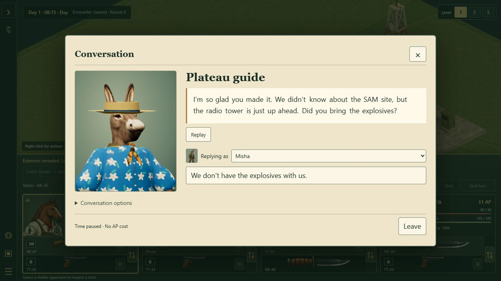
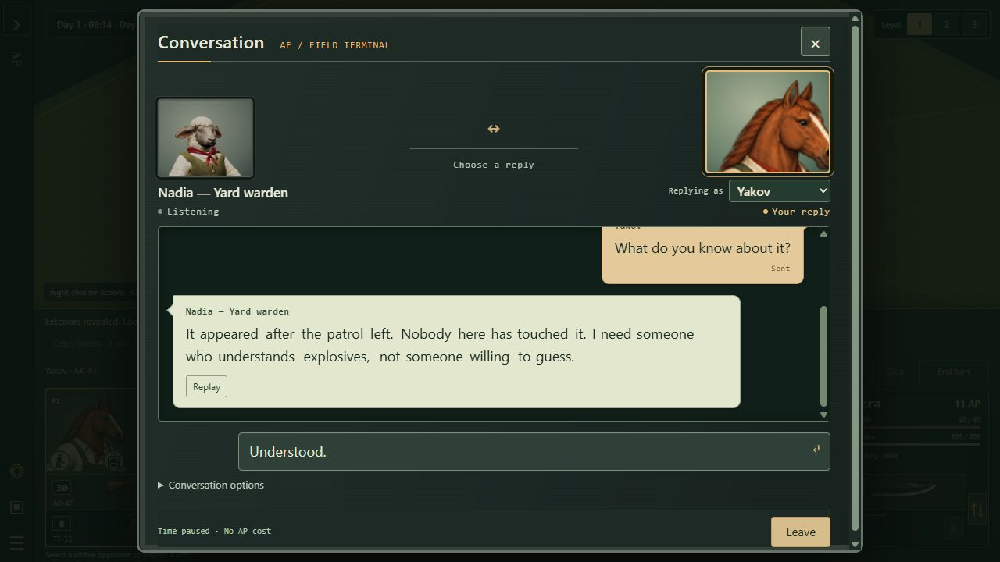
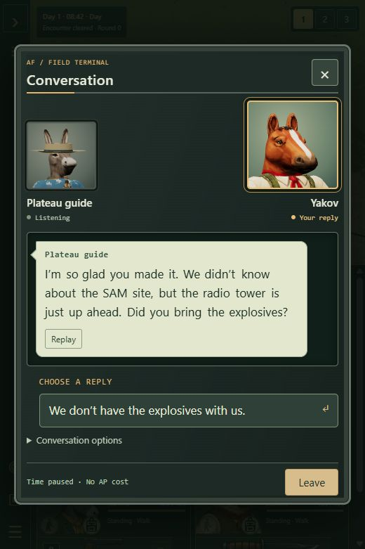

# Dialogue presentation integration — 20 October 2026

Implements the [approved presentation handoff](https://github.com/Syntaxswine/animal-factory-tactics-3d/blob/docs/dialogue-presentation/docs/tactics/DIALOGUE-PRESENTATION-PROPOSAL-2026-10-19.md) on `work/editor-3d`, starting from `6242c50`. This is a presentation layer over the existing dialogue system. The actual plateau still needs the author's guide and mission-role placements; the rehearsal map is not a replacement for it.

## What is wired

- Right-click an eligible NPC to open a stable conversation panel. The NPC's name, close speaking portrait and line are primary; the small mercenary selector says **Replying as**. Personality labels and exact skill odds remain, with the calculation in an expandable explanation.
- The guide keeps his straw hat and blue Hawaiian shirt. Nadia uses the sheep rig. All twelve supported model profiles have compatible mouth assets and framing; a missing mouth holds the original model still. No battle rig, actor facing, visibility or shared battle texture is modified.
- NPC speech is generated locally by Babble Lab, with word spans and mouth motion driven by its synthesis plan. Revealed words stay visible; only the current word is bold. Word widths are reserved before playback. The full line is exposed once to assistive technology.
- Show full line stops the voice and closes the mouth. Replay repeats presentation only. Replies can be selected during speech. Conversation history records the current session's NPC lines and selected replies; Last saved response retains its existing persistence.
- Main-menu Options and Conversation options share speed (0.5–2), text animation, volume/Off and static portrait settings. Motion follows the existing motion preference. Speed changes apply on the next line or Replay, without changing pitch. Settings survive the existing Options submit and reload.

The guide, warden and bright hen profiles are **first auditions**, not approved performances. The existing intro take is untouched. No dialogue wording or content hash was changed to adjust delivery.

## Reused systems and pinned inputs

`DialogueSession`, `dialogue-state`, the existing percentile RNG, strict dialogue schema, dialogue content hashes and atomic encounter/campaign checkpoints still own outcomes. A transient `presentationKey` distinguishes visits, including two visits with identical words. Refreshing choices or switching replying mercs preserves the current NPC performance and committed response. A failed checkpoint cannot expose or speak the candidate result. No audio, rendering object or presentation counter enters a save.

The artist's speaking-head runtime, game/author meshes, builder sources and tests were integrated from `art/speaking-heads` at **f7dfd68**, including its goat corrections. The existing texture-budget metadata was preserved when combining paint changes. See [the artist's historical notes](SPEAKING-HEADS.md) for geometry limitations. Six pre-existing artist tests remain marked TODO; these were not converted into passing assertions or silently removed.

Babble Lab **8f1d23c** is vendored under `dist/tactics/vendor/babble`, with its package metadata, MIT notice and provenance. The source modules are unchanged. Runtime synthesis needs neither a sibling checkout nor a network voice service. Language is separate from voice identity; these auditions use English (`tongue: 0`), not the probe's invented-language seed 7.

## Lifetime, timing and failure rules

| Event | Presentation result | Gameplay result |
| --- | --- | --- |
| Inspect, refresh or change replying merc | Same utterance continues; choices update | No roll or effect |
| Enter another committed node | Old speech stops; new visit starts | Existing dialogue command rules |
| Show full line / Replay | Reveal and stop / repeat the same presentation | No navigation, reroll or consequence |
| Open options or background the tab | Retain offset, stop source, close mouth; explicit Continue/Replay | Time remains paused |
| Close or Escape | Cancel loads/jobs, release portrait and voice resources | Existing pending-checkpoint guard remains |
| Missing audio/model or synthesis error | Readable full line, static/name fallback, working replies and Leave | No altered dialogue outcome |
| Both text animation and voice Off | Instant text, no synthesis job | Normal choices |

The audio clock is used when playing voice; muted timed text uses a pauseable presentation clock. Pausing disconnects the source and Continue schedules a new source at the retained offset. It does not suspend unrelated audio. Each async completion checks its session/utterance generation. Synthesis has a 12-second timeout; portrait preparation has a 10-second cancellation deadline. If first phrase preparation takes over 300 ms, the full text becomes readable and never hides again.

One renderer belongs to an open conversation. Draws are limited to 30 updates/second, with a final neutral-mouth frame, no dynamic shadows or postprocessing, and a maximum 512 × 512 physical output buffer. Static/settled portraits stop drawing. Hidden tabs stop drawing. The world reuses its last image while dialogue is open, redrawing once if its dimensions change; checkpoint/input logic remains alive.

Garment fitting and paint-mask segmentation use a short-lived portrait worker. The transferred bind geometry is identical to the ordinary game rig, tested with four representative species. Projection views are unchanged but yield between uploads/draws. Shader compilation happens while the candidate rig is private: speech frames cannot accidentally draw it early and force synchronous compilation. Closing terminates preparation and disposes owned rigs, skeletons, textures and materials; late texture completion disposes its own result.

The speech worker prepares only the current and next phrase. The PCM cache is bounded to 10 MiB; each phrase and live AudioBuffer are bounded to 2 MiB. Conservatively counting current/next PCM again gives a maximum of 16 MiB. Oversized phrases are rejected before PCM allocation, and slower speech uses shorter chunks. Caching includes text, voice/version, language and rate. Closing clears this cache, workers, sources and animation callbacks; one idle shared AudioContext remains for the page lifetime.

## Authoring and audition

Open `tactics/dialogue-audition.html` from the normal or packaged server. It offers the guide, Nadia and bright hen saying a neutral sentence or their own line. **Compare voices without names or portraits** randomizes their labels independently of gameplay. Save listening notes downloads local JSON containing the notes and measurements; it sends nothing externally. Close performance exposes released resource counts, and choosing a voice opens a fresh performance.

For a recurring NPC:

1. Add a named voice/version in `dialogue-presentation-manifest.js`, with separate `voice` and `language` settings. Map its stable character ID in `CHARACTER_VOICES`. Dialogue-role fallbacks support authored map instances; names, species changes and clothes do not select a new voice.
2. Add any model-specific crop in `PORTRAIT_FRAMES`. Keep the matching appearance/outfit path; `donkey-guide` uses the donkey mouth donor.
3. Optional delivery metadata belongs in `LINE_DELIVERY`, keyed `resource/node/lineIndex`, with the expected `textHash` and voice overrides. Stale metadata is ignored. Do not insert cosmetic keys into strict dialogue JSON or alter a saved definition just to tune a voice.
4. Compare a neutral sentence, the actual scene and a blind audition. Ask a listener which performance feels warm or cautious before revealing the character names. Record confusion and revise the profile. The user approves voices in the actual scene.

Literal control instructions in the guide's existing lines remain intact. Moving them into a separate tutorial hint needs an author-approved copy pass, as the proposal requested; presentation integration does not silently rewrite mission information.

## Evidence and remaining review

Automated checks cover deterministic word spans/timing at 0.5×, 1× and 2×; punctuation, contractions, repeated words, numbers and invented phonemes; pitch preservation; stale preparation; pause/resume offset; delayed synthesis; memory limits; settings migration; stable voices; independent portrait bones and matching bind geometry; retained render-target cleanup; and unchanged committed dialogue outcomes. Both build dependency checks include the new modules and retain the missing-module safeguards.

Packaged browser checks exercised the guide's missing-explosives branch, Nadia's visible 40% check with Misha, saved failure followed by Replay, speaker changes, options pause/Continue, preference persistence through main-menu Save Options/reload, Quick Fight loading, and desktop/narrow dialogue layout. The 390 × 844 view kept readable 17px text and an accessible sticky Leave control. Desktop speech uses 18px text. Enlarged-text/OS scaling and subjective voice approval still need a human review on the target display; browser zoom shortcuts were not effective in this embedded browser.

Performance evidence is from a Windows 10.0.26200 host, Ryzen 7 5800X, 16 logical processors, 64 GiB RAM, embedded Chromium 155, viewport 1280 × 720, DPR 1. These are local measurements, not a guarantee across hardware. The capture runs alongside repository regression tests; cold browser/device initialization can vary.

Validation:

- `npm run check`: **2,687 passed, 0 failed, 6 existing artist TODOs** (2,693 cases); asset validation passed.
- Final focused run after the last playback/upload adjustments: **25 passed**, covering presentation, transferred rigs, paint ownership and both packaging lists. The existing 27 dialogue/tutorial tests also passed.
- `node tools/build-tactics-3d.mjs`: passed; it runs the base build and checks the 3D module closure. The final package was rebuilt after the full test run.
- Vendor source hashes match Babble Lab's pinned source modules.

| Capture at 1× | Speech starts | Portrait ready | Draw p95 | Cue lag p95 | Submitted triangles / calls | UI tasks >50ms |
| --- | ---: | ---: | ---: | ---: | ---: | ---: |
| Guide | 115 ms | 346 ms | 1.2 ms | 17.1 ms | 13,583 / 22 | 0 |
| Nadia | 95 ms | 463 ms | 0.7 ms | 19.0 ms | 11,556 / 15 | 0 |
| Hen | 124 ms | 612 ms | 0.8 ms | 17.3 ms | 10,996 / 14 | 0 |

The guide's cached Replay began in 1 ms. [Raw measurements](images/dialogue-presentation-2026-10-20/measurements.json) and [released resources](images/dialogue-presentation-2026-10-20/released.json) are retained with this record.

The hen's 0.5× and 2× captures had cue lag p95 of 16.5 ms and 12.6 ms respectively, with no observed >50 ms tasks. The output buffer was 260 × 312. After Close performance, the renderer, geometries, textures, workers, pending jobs, PCM cache, sources, AudioBuffers and frame callbacks all reported zero; rapid cancellation before the next portrait's first draw also returned to zero. A reopened performance created one renderer. The idle shared AudioContext is deliberately retained until page exit.

Early captures found a ~160 ms synchronous mask calculation and a ~70 ms rig-fit task. Both moved to the worker. A later graphics stall came from exposing the rig to speech frames before `compileAsync` finished; preparation now keeps it private and warms textures separately. The table records the corrected path.

The audition page reports speech-start latency, cue-start lag, portrait preparation stages, 95th-percentile draw time, geometry/draw calls, resource counts and Long Task observations. Async stage wall time is not itself a UI-thread task duration. Recorded cue lag is the browser's sampled text/mouth timeline; it is not a measurement of sound-device output latency or a substitute for a listening/video comparison.

Remaining artistic acceptance: blind listener comparisons, each recurring voice in its real scene, and the artist's six documented mouth TODOs. No subjective approval is claimed from passing timing tests.

## Follow-up: industrial message terminal

The user's next visual direction replaces the paper form with a dark, worn terminal bezel and a familiar message exchange. Incoming NPC messages align left; selected merc replies align right in amber. Names stay attached to sent messages even when the player changes the replying merc. The last 80 messages are retained for the open conversation, with the existing durable Last saved response still available across visits.

Both participants occupy the upper corners. The NPC portrait grows during speech, and the selected merc's cropped HUD portrait grows when it is their turn to reply. Speaking, Listening, Paused and Your reply labels supplement size and colour. Reduced motion removes the transition. The portrait spaces reserve their full size, so growth does not move the text. The 3D renderer measures the unscaled layout dimensions to avoid reallocating its render buffer during a CSS transition; there is still only one 3D portrait renderer.

A chosen reply is marked Sending until the existing command returns. Checkpoint failures show Not saved and retain the existing retry action. Retry updates that same bubble; abandoning the candidate marks it Not sent. Neither message history nor playback changes the roll/save engine. Long incoming messages start at their first line. Individual word cues never scroll the thread. Leave and Escape remain available.

Validation for this UI follow-up: **52 focused tests passed**, including message attribution, repeated identical lines, failed checkpoints/retries, stale message IDs, presentation timing, the existing dialogue/tutorial rules and packaging closure. The final 3D build passed. Packaged browser checks covered the guide's crate instructions, Nadia's ordinary/personality/40% options, a recorded failure, Replay, replying-merc changes, options pause/Continue and Escape. At 390 × 844, the long guide message began 16px below the message window's top and there was no horizontal overflow. No browser warnings or errors were observed. The earlier full release run above belongs to the initial presentation integration, not a second full-suite run for this styling change.

Babble Lab's local checkout had advanced to `d82c5ab`, adding sample layering and spectral morph auditions. Its core runtime modules had not changed from the game's pinned `8f1d23c`. This UI change does not adopt unreviewed voices or switch the pinned runtime; the dialogue adapter remains the integration boundary for the incoming TTS upgrade.

[Narrow viewport check](images/dialogue-presentation-2026-10-20/terminal-narrow.png)

## Follow-up: acting merc and two close 3D portraits

The latest user direction supersedes the earlier speaker selector and cropped HUD image described above. Both corners now use independent 3D rigs, framed from roughly the collarbone up. Only the speaking rig animates; the listener retains a neutral frame. The two owned renderers, short-lived preparation workers and shared current-utterance player are disposed when dialogue closes. Fallback images remain available for missing/failed model assets.

Right-clicking an identified NPC orders the primary selected merc to a reachable, same-elevation spot within 12 tiles with a clear potential sightline. The normal movement engine handles every step; arrival waits for the visible walking animation, then faces the NPC for free. Combat, fright, casualty, lost identification and replacement orders cancel safely. The talk intention is transient across load/restart; normal saved movement and dialogue outcomes remain unchanged. Once open, the acting merc owns the session. To use a different merc, leave and issue a new talk order with them selected.

Selected replies use that merc's persistent-identity voice, independent of the NPC's dialogue-resource voice. The existing command/checkpoint happens at selection; a presentation gate waits for both that command and the merc's utterance before showing or speaking the NPC response. A failed write never speaks the staged result. Retry saves the same candidate without duplicating the outgoing line. Skip, mute, synthesis failure, closing and late callbacks cannot repeat consequences. Ordinary replies remain ordinary navigation.

The Babble runtime remains pinned at 8f1d23c; this change does not incorporate the ongoing upstream TTS upgrade.

Validation for this follow-up: **71 focused tests passed**, covering talk-range boundaries, movement and interrupted approach orders, fixed speaker identity, checkpoint failure/retry, outgoing speech sequencing, stable merc voices, portrait preparation, existing dialogue/tutorial rules and both packaging closures. The final 3D package built successfully. Packaged browser checks confirmed the actual walk-to-talk flow, two live 3D portrait canvases, voiced player replies preceding NPC responses, the guide with both Yakov and Misha, pause/Continue, no speaker selector, and zero portrait canvases after Leave. The 390 × 844 layout had no horizontal overflow. No browser errors or warnings were observed. This was a focused follow-up run, not another full repository suite.

