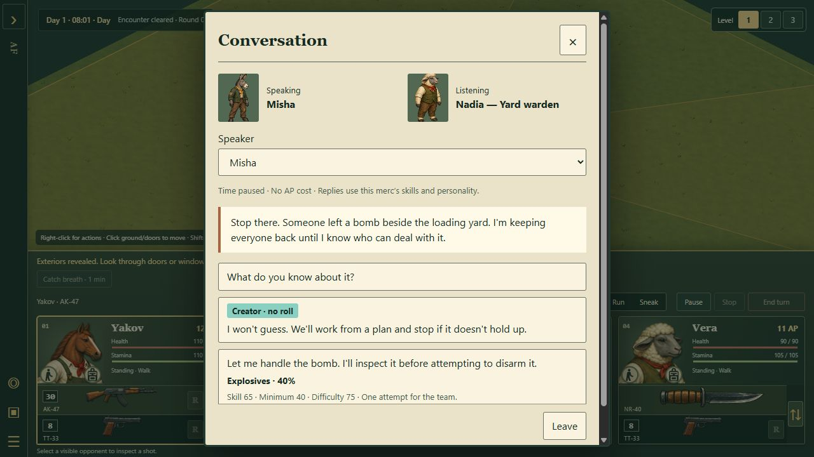

# Dialogue portraits and character voices

Draft for the coder and character artist, 19 October 2026.

Give conversations a recognisable face and voice: one close portrait of the character delivering the line, readable text paced to their speech, and choices clearly belonging to the selected mercenary. Keep the existing dialogue rules and persistence. The next pass is presentation and voice integration.

The user's priorities are animated mouths using the new models, close shots of the head, Babble Lab speech, a bold spoken word, and a speed slider with its current value above it and a way to turn text animation off. Their clarification puts character identity first: bright hen is a useful reference, and each recurring character's voice should say something about that individual. A species-wide pitch change is insufficient.

## Review of the existing work

The reviewed dialogue implementation is [6242c50](https://github.com/Syntaxswine/animal-factory-tactics-3d/commit/6242c5080a497b103acfdd350e858b419366cf7a) on work/editor-3d, including the foundation in 1b1668d. The mouth work is separately on art/speaking-heads at f7dfd68. Babble Lab was inspected at 8f1d23c. These are separate inputs; the game does not yet connect them.

The dialogue foundation is suitable to extend. The focused run passed **27 of 27 tests** covering the dialogue rules, integration and tutorial. A fresh Pages build passed. In that built output, right-clicking Nadia and the plateau guide opened their conversations; changing the replying mercenary updated choices; ordinary replies navigated correctly; the guide supplied the missing-explosives instructions. No browser warnings or errors were captured during those checks. This was a focused dialogue review, not a release review of every change on the builder branch.

Keep the working parts: data-authored dialogue, personality badges with names, exact odds, one stored attempt for the team, read-only previews, atomic checkpoints before revealing outcomes, safe exits, and the pause of tactical/campaign time. The tutorial already responds to carried explosives and radio/SAM destruction. Its fixture demonstrates those connections; authors still need to assign the guide and mission roles in their actual plateau maps.

Four presentation problems are visible now:

| Current behavior | Change for this pass |
| --- | --- |
| The mercenary is labelled “Speaking” while the displayed line is the NPC's; the NPC is labelled “Listening.” | Put the line author's name beside the large portrait. Label the selected mercenary “Replying as.” |
| Both pictures are full-body sprites in 64 × 76 boxes. | Use a portrait framed around the head, neck and upper shoulders. |
| The blue-shirted straw-hat guide uses the ordinary donkey sprite in dialogue. | Resolve the same appearance and outfit as the placed NPC, including the hat. |
| At 1280 × 720, portraits, speaker selection and mechanical explanation push a short conversation into an almost full-height form. | Give the face and actual words priority; compact the speaker control and move the detailed odds calculation into an expandable explanation. |

The modal currently rebuilds its children on render. Attaching audio or a new 3D renderer to that method would risk restarting speech and recreating resources whenever choices refresh. Give playback and the portrait a stable lifetime first.

## Visual direction

Use the game's dark green, warm paper and restrained ochre. Keep the reading surface plain and high contrast. The character's paint supplies most of the texture; heavy scratches, animated static and decorative machinery would compete with their expression. Names can retain the existing serif treatment; dialogue and choices should use the readable UI font at about 18 px on desktop.

On a desktop, aim for a panel around 900–960 px wide, constrained by the viewport. A portrait about 240–280 px wide sits beside the NPC's name and speech. Choices sit under the speech, with a compact “Replying as Misha” selector immediately above them. Leave remains in a stable footer and Escape always works. On narrow displays, use a smaller portrait above the text, then stack choices; preserve readable type instead of shrinking the whole panel.

Frame the character at eye level or a gentle three-quarter angle, facing slightly toward the text. Keep the jaw, neck, hat and distinctive ears readable. Store framing per model profile: one camera crop will not suit a rabbit, a horned bull and a pig. Give the portrait a quiet painted backdrop and soft, fixed lighting. Leave the paused map dimly visible behind the panel so the conversation still belongs to the place.

Use an isolated presentation copy of the character. Close-up framing must not change the battle camera, actor facing, equipment, skeleton or fog visibility. Resolve appearance from the same model/outfit path as gameplay, then map variants such as the guide to their compatible donor mouth. Do not request a nonexistent donkey-guide mouth file or discard the guide's clothing to use the ordinary donkey.

Start with jaw movement, subtle breathing where the rig supports it, and a held attentive pose between lines. Reserve small head accents for phrase boundaries. Constant nodding on every syllable makes everyone look mechanical. Blinking or eye animation is optional work only where a suitable rig exists.

The speaking-head branch already exposes withSpeakingHead, rigSpeakingHead, speechOpen and setJaw. Use its game-level meshes first. Its source now contains a single-loop viewer and explicit skeleton disposal, addressing the earlier scheduling feedback. Integrate and check the latest assets; the older October 15 report is not evidence that those particular defects remain. Full mouth-geometry acceptance still belongs to the asset integration check.

## Voices that describe people

Use a stable, authored voice profile for each recurring character. The profile covers resonance, pitch range, pace, breath/roughness and phrasing. Different characters of the same species should remain distinguishable. Voice identity should survive save/load, a rename, a clothing change and another visit. Map the profile through stable character identity; do not roll a new voice whenever a panel opens.

Bright hen establishes a useful target for clear, expressive animal speech. Keep the user's chosen intro take intact. Babble Lab supports both understandable speech and invented phoneme mappings; voice identity and language configuration are separate settings. Reuse the intended language configuration when assigning a voice, and audition the result before declaring a numeric tongue seed canonical. The timing probe's tongue 7 was only an example.

Proposed first auditions:

| Character | Direction | What the performance should convey |
| --- | --- | --- |
| Plateau guide | Warm, slightly worn resonance; measured phrases; relief in the opening, precise instruction afterward. | Someone glad the squad survived, with practical work still to do. |
| Nadia, yard warden | Firm consonants, economical phrasing, controlled pauses. | Responsibility and caution; reassurance can soften the delivery. |
| Hen reference | Preserve the bright, higher animal character the user liked. | A clear comparison against the approved placeholder, not a replacement for it. |

These are audition directions, not new character lore. Prepare a short neutral sentence and an actual line for each. Compare profiles saying the same sentence so acting and wording do not disguise identical voices. Then compare them on their own dialogue. Avoid obtaining every difference by accelerating or raising the same voice.

For the first pass, voice NPC lines. The player's reply is already readable on its choice button; selecting it can place that reply in the transcript without making the player wait to hear it repeated. Personality-specific choices keep their coloured labels. They do not automatically cause a different voice or disclose an NPC's hidden disposition.

One writing improvement will help the acting: separate the character's explanation from literal control instructions. For example, the guide can say, “The control cabinet is beside the tower. One charge should do it.” A nearby tutorial hint can say “Right-click the radio tower → Plant explosives.” Preserve the mission information, including who must carry the charge, while keeping interface terminology out of the spoken performance where practical. This copy needs author review.

## Speech and text share one timeline

Create one utterance object for the resolved NPC line. It contains its stable presentation key, display text, voice/version, source-text word spans with start/end times, mouth cues and playback state. Derive audio, text and jaw motion from that object. Never estimate highlight timing from word length or advance it using the tactical clock, which is paused during conversation.

Babble Lab already supplies plan.words with c0/c1 text spans and t0/t1 times, plus mouthAt and mouthCues. Its units retain those spans when phonemes change, so readable English can follow invented speech without pretending to translate the audio afterward. The independent probe preserved all 11 source-word spans and scaled all word times correctly at 1.5×; the mouth closed at the end. This establishes the timing interface, not the artistic quality of every voice.

While audio plays, sample the clip's audio timeline. Feed the resulting time to word lookup and mouthAt, then call setJaw with the opening scaled by speechOpen for that model. The latter already accounts for different muzzle lengths. Clamp to the approved speech range rather than using a wide demonstration gape. AudioContext.currentTime is an audio timeline and stops while suspended; use that clock relationship explicitly. [Web Audio timing reference](https://developer.mozilla.org/en-US/docs/Web/API/BaseAudioContext/currentTime)

Reveal complete words at their cue starts, leave already revealed words visible, and bold only the current word. Close punctuation gaps naturally; clear the active emphasis during pauses and at the end. Allocate the paragraph's layout before playback so neither reveal nor font-weight changes move the lines or buttons. Reserve each word's maximum regular/bold width, or use a fixed overlay that does not affect layout. Do not repeatedly replace the full dialogue DOM.

Give a long line a stable reading area with explicit sentence/paragraph breaks. Do not replace the entire sentence with a single flashing word, auto-scroll away from something the player is reading, or advance to another dialogue node when audio ends. The complete line remains available afterward. A lightweight conversation history can retain the lines and chosen replies for the current session, with the existing saved Last response preserved across visits.

For accessibility, expose the complete line once to assistive technology; the decorative word and jaw updates must not produce repeated live announcements. Colour remains supplementary to named personality badges and visible odds.

## Options and interruption rules

Add these to the existing Options menu and make the same controls reachable from the conversation. Extend settings-3d normalization and both read/write paths: the current form submits only difficulty and motion, so adding a UI control without updating serialization would discard it. Dialogue preferences are local presentation settings and take effect without starting a new Quick Fight.

| Control | Proposed default and behavior |
| --- | --- |
| Text and speech speed | A slider from 0.5× to 2.0×, with the current value above it: “Normal · 1.00×”, “Slower · 0.75×” or “Faster · 1.50×”. Default 1.00×. A note explains that speech follows text speed. |
| Text animation | On by default. Off means the entire line appears immediately, with no moving bold emphasis. It never removes the dialogue text. |
| Dialogue voice | Volume slider with an explicit Off/mute state. Independent of text animation. |
| Animated portraits | Follow the existing motion preference by default; allow a static portrait. Reduced motion removes idle/head movement and uses the static fallback for this first pass. |

Retiming should change the synthesis plan before rendering audio so speed changes preserve the character's pitch and resonance. The current Babble runtime's prepare operation synthesizes synchronously; do that work away from the interaction frame. Keep the current utterance at its initial rate if the user changes the slider midway. Update the readout immediately, show “Applies to the next line,” and let Replay restart at the new rate. This is simpler and more predictable than resynchronizing a partly spoken word.

With voice muted, advance the same plan using a pauseable presentation clock and continue timed text. With Text animation Off, show the whole line immediately while voice may continue at the selected speed. With both off, dialogue behaves as readable instant text. A static portrait does not disable speech or text.

Provide “Show full line” while an utterance is playing. It reveals all remaining text, stops that voice and closes the mouth; it never chooses a reply, consumes a roll or advances a node. Replay repeats only the presentation. Choices remain deliberately selectable during speech; choosing one interrupts the old utterance before processing the existing command. Keyboard focus must make that action explicit, so a key used to finish reading cannot also activate a newly appearing choice.

On exit, cancel playback, pending portrait/voice loads and UI callbacks. On backgrounding or opening options, pause the conversation performance and retain its offset; resume through an explicit Continue/Replay action. Babble's existing handle has stop/skip but no pause/resume, so the adapter must schedule a new source at the retained offset. Do not suspend unrelated game audio as a shortcut. Stale asynchronous completions must be rejected by an utterance/session token.

If audio, synthesis or the portrait fails, display the full line with a static image/name and keep choices and Leave usable. Never wait indefinitely for a voice asset. Giving the player control over text progression also follows the [Game Accessibility Guidelines](https://gameaccessibilityguidelines.com/allow-players-to-progress-through-text-prompts-at-their-own-pace/).

## Integration and cost

Keep DialogueSession and the save/roll engine in charge of outcomes. Presentation receives the committed line and appearance. A failed checkpoint must not speak or animate the winning response early. Refreshing choices, changing the replying mercenary, resizing or opening a tooltip must not restart an unchanged NPC utterance. Selecting another node creates a new utterance even when its text happens to be identical.

Use a small presentation manifest for voice profiles, per-model camera framing and optional per-line delivery tags. Key line metadata by dialogue resource/node/line index and expected text hash. This avoids inserting cosmetic fields into the current strict dialogue schema and changing pinned content hashes merely to adjust a voice. Missing or stale optional metadata falls back to the character's normal delivery. Store no audio buffers or rendering objects in campaign saves.

Reuse the existing model and paint loaders, but keep the portrait skeleton independent of the live actor. Start with one active 3D portrait; use a small static image for “Replying as.” Do not preload the entire roster or create a WebGL renderer per line. A dedicated portrait renderer may persist for the open conversation; it must have one render loop and a defined disposal/cache policy.

Start at 30 portrait updates per second with a maximum 512 × 512 physical render buffer. Fixed lighting, no dynamic shadows and no postprocessing should be sufficient for the painted style. Rendering a close crop of a full body still processes that body; cropping alone is not a geometry optimization. Begin with the existing game mesh and measure it before commissioning new portrait assets.

While conversation pauses the world, reuse its last rendered image where practical. Keep required checkpoint, input and async loading logic alive. Stop portrait drawing once the mouth settles if no supported idle motion needs an update, and stop entirely when hidden. Never mutate or dispose shared battle textures while releasing a portrait. Release owned skeletons, bone textures, materials, audio nodes, workers and callbacks on their defined end condition.

Pin and package Babble Lab at an explicit revision with its license. The deployed game must not depend on a sibling checkout, a local absolute path or a cloud TTS request. Use a worker for runtime synthesis of authored/editor text. Cache by text, resolved voice/version, language, rate and timing; reuse one shared audio context and keep a decoded-audio byte budget, initially 16 MiB, rather than relying only on Babble's clip-count limit. Chunk long speeches at phrase boundaries so generating one large line cannot freeze the menu or exhaust the cache. Preserve continuous text and timing through those chunks. Load the current portrait and current/next phrase, not every possible branch outcome.

Before setting a performance promise, measure on a recorded device/browser. Initial acceptance targets are no new synthesis/model-preparation task over 50 ms on the UI thread, stable 30 fps portrait playback after warm-up, and bounded memory through repeated conversations. Record cold-open latency, warm replay latency, submitted geometry/draw calls and retained resources. Slow preparation should show text immediately and allow a static first line; it should never block leaving or choosing.

## First implementation and acceptance

Build one complete presentation path around the existing plateau guide, then reuse it for Nadia and a hen audition. The guide proves outfit fidelity and long instructions; Nadia proves speaker switching and checked responses; the hen proves that the same timeline accommodates a beak. Add the rest of the cast through profiles after that path is reviewed.

Acceptance should demonstrate:

1. The straw hat, blue clothing, ears and restored neck match the placed guide; the NPC delivering the text is visibly identified, while the mercenary is labelled “Replying as.” Framing works at 1280 × 720, a narrow viewport and enlarged text.
2. Voice, bold word and mouth stay aligned at 0.5×, 1× and 2×. Test punctuation, contractions, numbers, repeated words, invented-language phonemes and a long instruction. Use deterministic cue times as the automated oracle; compare a browser recording to those times, aiming within 80 ms under normal load.
3. Text animation Off shows the complete line immediately and stops moving emphasis. Voice Off and static portraits work independently. Preferences survive reload and opening/saving the existing Options form.
4. Skip, Replay, Leave, Escape, speaker changes, resize, rapid replies and background/resume never duplicate audio, leak a loop, alter a roll or reveal an uncommitted response. Closing while a checkpoint is pending retains the existing command guard.
5. Failed audio, a missing mouth asset and delayed synthesis all leave a readable and usable conversation. Headless dialogue remains independent of audio and rendering.
6. The existing 27 focused tests still pass. Add targeted playback, settings migration, cue mapping, async cancellation and resource-lifetime tests; verify both packaging paths include all new dependencies and retain missing-module checks. Run the required full release checks before gameplay integration.
7. Repeatedly open, switch and close conversations: renderer/context count stays bounded, voices stop immediately, and owned resources return to the baseline or the documented bounded cache. Compare the paused scene with and without the portrait on the same device.
8. Audition recurring voices without portraits. Ask listeners to distinguish the guide and warden and describe the intended warmth/caution without being told which is which. Record confusion and revise profiles. The user should also approve each voice in its actual scene; passing timing tests cannot establish character.

Implementation is complete when the guide feels like a particular person, the text is comfortable to follow or skip, and the existing conversation rules behave exactly as before. The speaking-head assets and voice profiles should earn approval in that working scene before a broader cast rollout.
