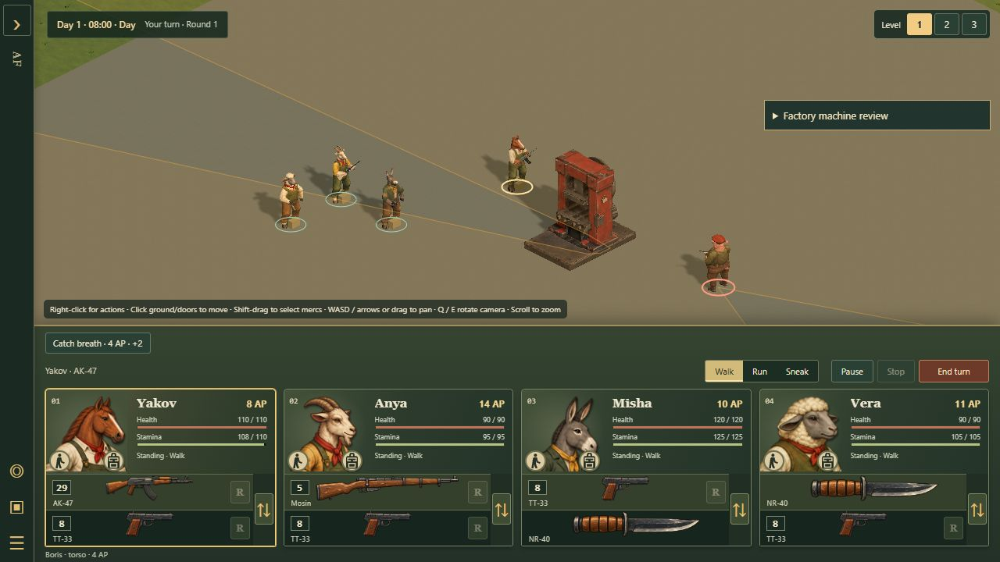
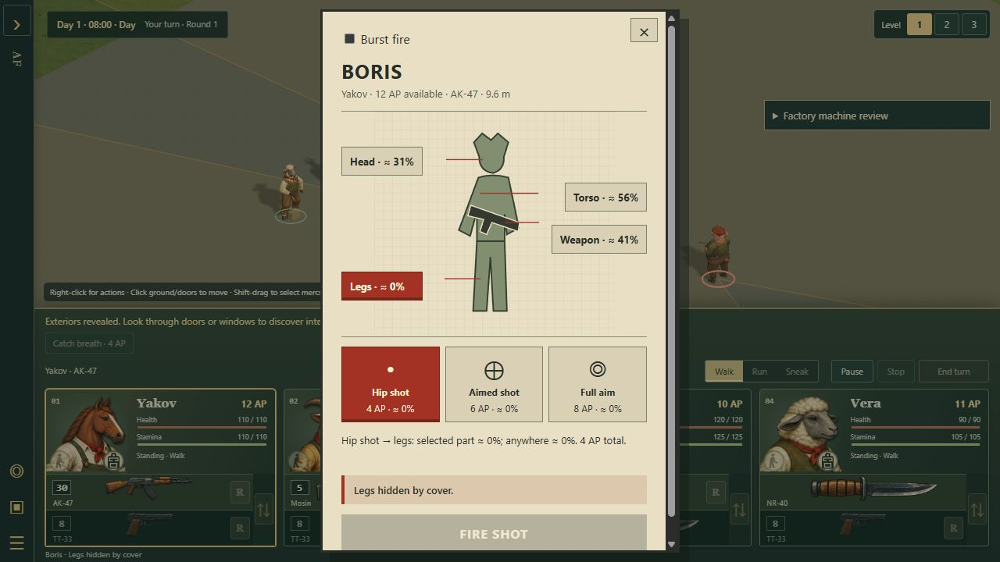

# Factory machines and four-direction scenery integration

Implemented on `work/editor-3d`, following the [factory machine handoff](FACTORY-MACHINE-EDITOR-PROPOSAL-2026-10-20.md). The branch also merges reviewed `main` at `f0dc6b7` while retaining the approved column dialogue layout and canonical terminal/CRT artwork.

## Editor and persistence

- Objects contains a Factory machines group: metalworking lathe, vertical milling machine and power press. The painted cursor model, reservation, working-face arrow and free approach outline precede placement.
- Every kind in `SCENERY_PROPS` supports 0°, 90°, 180° and 270°. The facing selector and R rotate placement; Rotate also rotates the selected object. Q/E still rotate the camera. Selection, Copy settings, deletion and Undo/Redo preserve model and full orientation.
- `rotation` is authoritative when present. A legacy `rotated: true` means 90°, otherwise 0°. New edits also retain `rotated` as the odd-quarter-turn compatibility flag. Unsupported angles reject during map and encounter loading.
- Support, reservation, characters, access, boundaries and overhead floors/objects are checked before a placement or rotation commits. A failed edit leaves the document and undo history unchanged. The mill and press remain at native height.
- Browser designs, JSON, sector variants, Playtest and encounter saves carry full orientation. Reusable scenery blocks can rotate as one undoable edit; four turns return exactly to their original data. This block command deliberately rejects other directional prop families and world-aligned environment data rather than inventing unsupported transformations. Such objects retain their existing individual controls.

## Physics and rendering

`node tools/export-factory-gameplay.mjs` bakes the committed reduced meshes into a versioned BVH, standing clearance and conservative swept movement links, including approaches outside the reservation. `--check` compares deterministic output and source hashes. Baked arrays decode once per family on physical use; simulation requires neither model fetches nor WebGL. No author-resolution mesh loads during gameplay.

The 2 × 3 reservation becomes 3 × 2 on odd quarter turns. A shared transform and inverse cover orientation and anchored origins. Native machine height converts to tactical height by **3 / 2.12**, including within-floor height; render and grenade queries retain native metres. Ground and raised examples, finite cross-floor rays and an independent transformed THREE mesh comparison exercise this conversion.

The same surfaces feed terrain sight, body-zone exposure, preview/committed attacks, guard fire, bullets, rockets and radius-aware grenade sweeps. Machines have no generic 0.8-unit fallback box or unconditional cover bonus. Walking uses standing-body clearance rather than tool openings. A diagonal cannot clip a machine corner just because both endpoints lie outside its reservation. Clear neighboring stairs are checked against a vertical body sweep.

The existing explosion removal policy applies, without new machine HP, production or explosive-barrel behavior. A machine can receive its own blast surface hit; another machine still shields it. Removal invalidates live geometry and removes navigation, sight, grenade and render obstruction. Encounter save/load retains the removal.

Reduced meshes and paint load only for a displayed family or editor preview. Placed instances and cursor previews share geometry/materials and one six-view paint preparation per type in their renderer. Removing an instance does not dispose shared resources. Scene disposal releases the library and textures. The projection supplies albedo to the standard game material, retaining daylight, local-light passes, shadows, fog and interior reveal.

## Rehearsal links

- `tactics/editor-3d.html?editing=1&study=factory-machines`: all three types in four directions, cover targets and a raised lathe. The empty low ceiling at grid 40,16 rejects the mill and press. Its floors are not silently removed.
- `tactics/battle-3d.html?study=factory-machines&layout=cover`: the press blocks leg shots and kneeling sightlines while permitting a standing torso shot through an opening. In the source browser rehearsal, the torso shot dealt **23 damage**, spending 4 AP and one round; the leg option reported **Legs hidden by cover**.
- Replace the layout with `baseline`, `small` or `stress` for empty, three-machine or thirty-machine samples. Expand Factory machine review and select Measure machines. These fixtures suppress autosave and do not replace authored sectors.
- The same paths work in the packaged output. Source editor placement → Playtest, Copy settings, the full four-turn cycle and day/night lighting were exercised through the ordinary UI.

## Cost evidence

Fixed camera, four mercs, identical ground, 1× DPR, 1,236 × approximately 394 rendered pixels. NVIDIA RTX 3080 through ANGLE/D3D11. Ten-second browser samples exclude the first 1.5 seconds. [Raw reports and measurement limits](factory-machine-integration-review/performance.json).

| Scenario | CPU draw median / p95 | Display cadence median / p95 | Draw calls, median | Submitted triangles, median |
| --- | ---: | ---: | ---: | ---: |
| Empty | 2.6 / 3.3 ms | 16.6 / 21.3 ms | 230 | 440,046 |
| 3 machines | 3.4 / 4.1 ms | 16.7 / 17.0 ms | 248 | 486,692 |
| 30 machines | 3.1 / 4.3 ms | 16.4 / 20.5 ms | 474 | 1,005,882 |

Triangle counts include shadow/light passes and ordinary world/character geometry, not just the machines. The small difference between three and thirty machines' CPU medians is sampling noise, not evidence that extra machines are free. These are desktop fixture results, not a low-end hardware or entire campaign performance guarantee; CPU draw excludes the HUD/engine and cadence is not an isolated GPU timer.

Both populated fixtures retain **1,001,598 bytes of shared machine geometry** and an estimated **67,633,152 bytes of shared paint/projection textures**, including mipmaps, validity and projection color/depth targets. The three families each prepare once: approximately **135–176 ms per type**, or approximately **0.62–0.64 seconds total load/preparation** in these runs. Thirty instances do not repeat this work. Driver allocations and other scene textures are separate.

In the stress sample, finite-ray p95 was approximately 0.1 ms, movement-link timings were below the browser timer's approximately 0.1 ms resolution, grenade sweeps were 0.6 / 1.1 ms median/p95 and path queries were 2.4 / 3.3 ms. Grenade sweeps already traverse per-machine BVHs rather than allocating triangles for each instance. Remaining scaling costs include draw calls, shadows and projected paint shading; this evidence does not justify a Rust rewrite.

## Release evidence

The focused machine integration checks cover every scenery kind's four-turn cycle, legacy flags, exact transform inverses, failure atomicity, support/headroom, block composition, independent reduced-mesh rays for every type/orientation at ground and raised levels, movement/diagonal clearance, body zones, actual player/guard shots, grenade radii, blast removal, immediate cache invalidation, saves and shared-resource disposal. Geometry freshness is part of the test suite. Existing helicopter, grenade, save and editor regressions remain included.

- The full repository run completed **2,752 tests: 2,745 passed, six existing speaking-portrait TODOs, and one base-build closure failure**. The review-only module had incorrectly been listed in the base build while referencing the 3D editor. It now belongs to the 3D build; both base and 3D closure tests pass on rerun. The six portrait TODOs are unrelated to this integration.
- The final focused rerun passes **20/20**, including the decorative roof-layer headroom fix, machine physics, persistence, resource ownership and existing editor operations.
- Core reproduction verifies all **20 generated modules**. Both machine and helicopter geometry freshness checks pass.
- Asset validation passes, including registered machine art and entrypoints. The final 3D Pages build passes, preserving transitive module and worker checks. No relevant failure remains unresolved.
- Source and packaged editor → Playtest were exercised through the ordinary UI. Copy settings retained the press at 270°; four Rotate clicks restored 270°. Night lighting darkened the painted models. Temporary test tabs were closed after use. A simultaneous-test-tab autosave conflict was resolved by closing the duplicate test game and repeating the packaged handoff in isolation; the existing save conflict guard correctly prevented an overwrite.

Reproduce the focused checks with `node --test tests/factory-machine-integration.test.mjs tests/editor-3d-editing.test.mjs tests/scenery-integration.test.mjs tests/encounter-save.test.mjs tests/tactics-pages-files.test.mjs`, followed by `node tools/sync-tactics-core.mjs --check`, both geometry exporters with `--check`, `node tools/check-assets.mjs` and `node tools/build-tactics-3d.mjs`. `npm run check` runs the complete repository suite, including its long portrait and rig checks.
