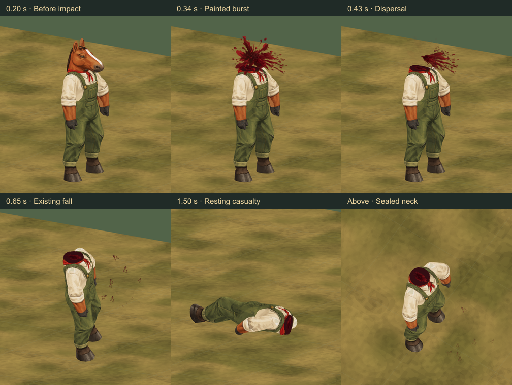
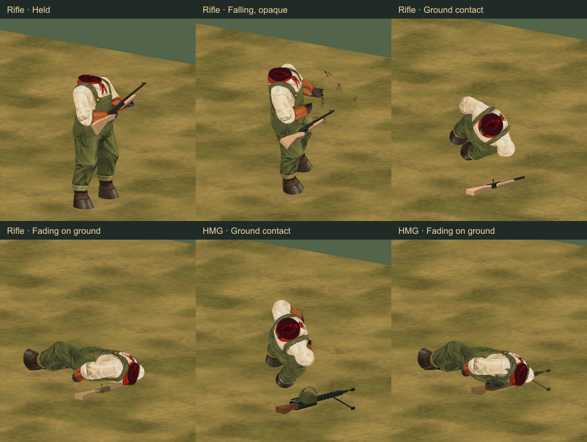
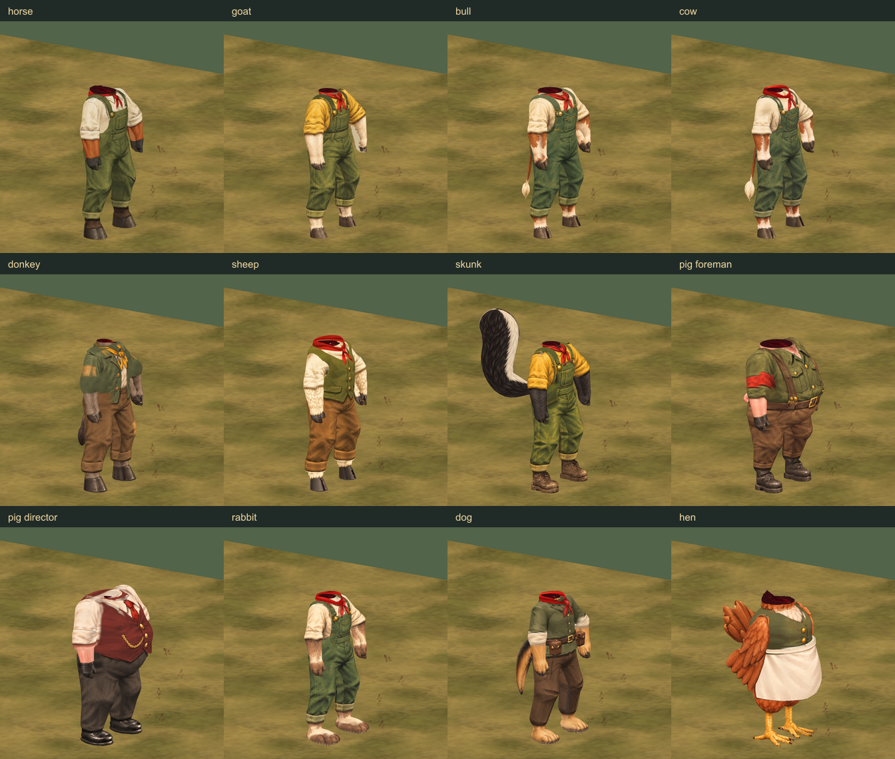
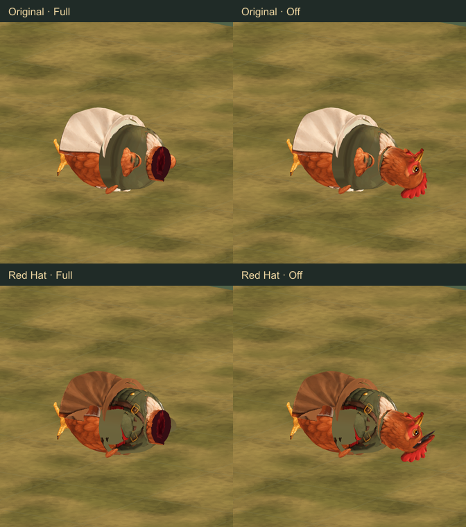

# Painted fatal-head assets

Artist delivery · 21 October 2026 · Independent visual review: **9/10**

This supplies the missing artist presentation for a **fatal-head outcome already
resolved by the game**: a brief painted burst, a few falling generic fragments,
reversible head removal and a sealed painted neck. It reuses the existing
casualty fall, with a separate gun drop that lands before fading. No injury
qualification, damage, permanent
death rule or live battle renderer is changed by this delivery.

[Open the study](http://127.0.0.1:4477/tactics/fatal-head-study.html).
It covers **12 animals, both outfits and the donkey guide: 25 combinations**,
with a close view beside a 55-pixel-per-tile gameplay view. Controls include
standing/kneeling/prone starts, rifle/HMG/unarmed, contrasting backgrounds,
four camera angles, scrubbing, slow playback and an independent still/fade mode.
The hen remains unarmed, matching its native battle rig.



## Painting and resource budget

The new [runtime atlas](../../dist/assets/effects/fatal-head/fatal-head-components-v1.png)
is **512 × 512 RGBA, 174,140 bytes**. Its four cells are a compact burst, torn
directional fan, generic burgundy chips/flecks and dark-maroon surface paint for
the neck seal. There are no identifiable anatomical fragments. Full motion
uses at most **48 instanced cards**, retiring completely within **0.9 seconds**.
Still mode uses one stationary mark fading within 0.18 seconds.

The painting was made with **built-in ImageGen**. The unchanged
[1254 × 1254 source](../../dist/assets/effects/fatal-head/source-v1.png),
[exact prompt](../../dist/assets/effects/fatal-head/generation-prompt.txt),
hashes, cell UVs and pivots are retained in the
[manifest](../../dist/assets/effects/fatal-head/manifest.json). Runtime preparation
only crops, resizes and packs the painted cells with transparent gutters.
Runtime SHA-256:
`40748bf991e0230812c8c063e6e82ff8201ea47644c8473321faa82daf751557`.

The atlas costs approximately **1.33 MiB decoded with mipmaps**. Reduced mode
reuses the previous entry atlas. One emitter adds one instanced draw. The seal
adds a small skinned draw per neck boundary and casts no shadow. Head geometry
is removed, with no duplicate full-body shell. These are isolated asset costs,
not a full-battle frame-time result; the builder must budget simultaneous actors.

## Builder contract

Use the explicit, supplied `fatalHead` outcome and its saved marker from
`GUNSHOT-IMPACT-INTEGRATION.md`. An ordinary head hit, bleeding casualty or
downed unit does not qualify on its own. Do not recalculate lethality or change
HP in this renderer. Receipt identity, visibility/fog, timing and effect settings
remain with the builder.

- **Full:** use the fatal burst and destructive head mask.
- **Reduced:** use the existing small entry spray and ordinary intact-head
  casualty appearance.
- **Off:** show the ordinary intact-head casualty without a spray.
- All three retain the same supplied permanent fatal outcome. The motion
  preference is independent of these presentation choices.
- When rebuilding an actor from a saved fatal marker, apply its selected mask
  without replaying a historical burst. Head-local blood patches must disappear
  with the head. Ordinary body stains remain visible for the current battle.
  The earlier rule still applies: **clear visible stains at battle end**; do not
  carry those cosmetic stains into another encounter.

[createFatalHeadBurst](../../dist/tactics/fatal-head-motion.js) uses the existing
painted-card renderer. Its local **+X** points out from the resolved entrance,
opposite the incoming projectile. Supply a rigid, unscaled render-world frame;
keep the mesh identity under an untransformed scene/root. Cards face the camera
while retaining world-space travel and world-down gravity. Use an event-local
presentation seed. Normal alpha, depth testing, no depth writes, no lights or
shadows. The caller retains ownership of the shared atlas.

```js
const burst = createFatalHeadBurst(sharedFatalAtlas, {seed: visualSeed});
scene.add(burst.mesh);
burst.setFrame(resolvedEntranceWorldFrame);
burst.update(ageSeconds, camera, {floor: supportWorldY, still: stillMotion});
// Retire by 0.9 seconds.
burst.dispose();
```

The study's contact is an authored surface probe for comparison, not a new
collision or penetration solver. It must not replace the builder's live contact.

## Released gun: land, then fade · 22 October follow-up

The follow-up keeps the gun visible when the casualty releases its grasp.
The study releases it at **0.42 seconds**, at the beginning of the body fall.
Its last held world pose is retained exactly; it falls under world-down gravity
and rotates onto its side. Contact uses the actual rigid model vertices, not
the weapon origin or a box corner. The gun remains opaque in flight, settles
against the supplied floor for **0.12 seconds**, then fades over **0.45 seconds**.
It follows the same sequence in Full, Reduced and Off presentation.

The study's former prone HMG carry put its bipod and belt underground. Its
held endpoint now reuses the existing supported prone firing pose, with both
hands solved to the gun. That endpoint is cached and blended into the existing
casualty, avoiding a new pose search each frame. The shared gameplay pose code
is unchanged. All **66 rifle/HMG × armed-species × stance releases** preserve
their source transform exactly. A penetrating capture is rejected explicitly,
so a bad held pose cannot be silently corrected by teleporting the gun upward.



[createCasualtyWeaponDrop](../../dist/tactics/casualty-weapon-drop.js) prepares a
visual proxy with shared weapon geometry/textures and its own materials. It
preserves the painterly shaders and fades without changing the original gun.
The proxy is independent of the falling body's transform. Replay restores the
held gun; no history-dependent integration, timers or per-frame cloning is used.

```js
const drop = createCasualtyWeaponDrop(weapon); // null for unarmed
scene.add(drop.root); // identity, untransformed render-world parent
// Capture the live held pose BEFORE evaluating a pose that releases the grasp.
drop.capture(lastHeldWeaponWorldMatrix, {floor: supportWorldY});
// At release, hide the original held weapon and evaluate the proxy by age:
weapon.root.visible = false;
const visualState = drop.update(secondsSinceRelease);
// Retire when visualState.phase === 'retired'. On replay, restore the carry pose.
drop.dispose(); // before the caller disposes the original weapon
```

The adapter handles rigid guns; the study fits rifle/HMG releases from standing,
kneeling and prone. An attached pack or flexible hose needs its own assembly
adapter. The caller supplies the actual floor level and can supply release
velocity. This is cosmetic: it does not create, destroy or alter a loot item,
and it is not a wall/terrain collision solver. It adds transient material draws,
sharing the original geometry; no extra painting is loaded.
The study's `casualty-weapon-pose.js` holds one authored preview direction;
live integration should capture the builder's current supported weapon pose.

## Native model adapter

[createFatalHeadMask](../../dist/tactics/fatal-head-mask.js) prepares an
**instance-local** geometry replacement for the current native skinned model.
Prepare it before combat rather than clipping geometry on a hit. Preserve the
native lower neck and clothing, remove skull/ear/horn/mane/beard or beak/comb/
wattle surfaces, and cap each real cut boundary separately. The horse discards
a disconnected low-weight jaw island; the donkey uses an authored collar
envelope to remove its connected jaw shelf. The hen has a taller cut clearing
its feathered breast; its retained neck follows the breast through the fall.



```js
const mask = createFatalHeadMask(worker, {
  species: profile.id, texture: sharedFatalAtlas
});

// Existing contact/pose solvers can cache original vertex indices. Evaluate
// them synchronously against the original geometry, then reapply the mask.
mask.withIntactGeometry(() => {
  locomotion.apply(sample);
  posture.apply(sample);
});
mask.setDestroyed(showFullFatalHead);
posture.ground(); // ground the surface actually being displayed

// On actor teardown, before disposing its original model/rig:
mask.dispose();
```

`withIntactGeometry` is synchronous and restores the previous mask even if the
callback throws. Scrubbing before impact, changing settings and disposal restore
the exact original geometry. Shared body paintings, original geometry, skeletons
and caller-owned texture are not disposed or repainted by this adapter.

Head-bone children, including hats, disappear with the head. Head-surface decals
and accessories are captured on first activation, including wounds added after
mask preparation. If adding cosmetics after that activation, call
`mask.refreshAttachments()`; it prunes detached patches and preserves their
original visibility. Forearm stains/accessories are explicitly tested to remain
visible. Do not call this scan per frame.

This adapter targets the existing native `SkinnedMesh` catalog. Unknown models
fall back to ordinary casualty presentation. A batched, morph-target or rewritten
model path needs its own builder adapter; the study does not certify those paths.

## Validation and remaining scope

- Independent review approves the artist asset and native-model adapter at
  **9/10**, after the horse/donkey jaw remnants, hen seal and head-attachment
  filtering were corrected. The reviewer independently reran all **12 fatal-head
  tests**, with no remaining task blocker.
- **28 focused tests pass**: all 12 native cuts and normalized weights, exact
  restoration and instance isolation, hen's actual rendered skeleton and breast
  seal, separate/late head decals, forearm preservation, caller resource
  ownership, seeded motion, world gravity, lifetime, prior entry/exit/stain
  regressions, hashes and both packaging module-closure lists.
- Asset audit and the packaged 3D build pass. **82 browser captures** cover all 25
  outfits before and after the fall, camera/stance/background/settings changes,
  rifle/HMG examples, mobile layout and identical source/packaged appearance.
  Fifty replay/settings cycles retain **14 geometries and 6 textures**. Initial
  mesh and replacement paint loading can both be canceled safely; late work
  releases its resources before renderer disposal.
- The hen's fallen garment/wing silhouette has an inherited folding weakness.
  Identical Full and Off captures preserve the same body pose; this delivery
  fixes the neck seal without changing that existing casualty layer.

Weapon follow-up validation: **35 focused tests pass**, including seven new tests
for exact release vertex alignment, gravity/contact before fading, all armed
species in three stances, deterministic replay (including tail geometry after
arbitrary prone HMG falls), painterly shader preservation and shared-resource
ownership. Independent follow-up review is **9/10**; the reviewer also reran all
seven weapon tests. The packaged build passes. Browser follow-up
also checks rifle/HMG held, falling, grounded, fading and retired frames in all
three stances, other body sizes, presentation settings and armed replay cycles.
Its **52 captures** complete without browser errors. Source and packaged views
match byte-for-byte under matching fresh-start sequences. Fifty armed replay
cycles retain **24 geometries and 7 textures**; the disposable browser exits and
releases its port. See the [weapon validation record](review-images/fatal-head/weapon-drop-validation.json).



The disposable review browser closes in `finally`, with verified process exit
and released port. The existing registered preview on port **4477** retains its
automatic stop on **22 October 2026 at 7:56 PM Eastern**. No extra preview server
is retained. Live gameplay wiring and full-sector performance remain with the
builder.

## Reproduction

Node.js 22+, `sharp` for preparation and review sheets, `playwright` plus installed
Edge for browser review. `SHARP_PATH` and `PLAYWRIGHT_PATH` can point to the bundled
packages. Build before running the packaged review.

```text
node tools/prepare-fatal-head.mjs <original-generated-png>
node --test tests/painted-blood-spray.test.mjs tests/painted-blood-wounds.test.mjs tests/fatal-head-assets.test.mjs tests/casualty-weapon-drop.test.mjs tests/tactics-pages-files.test.mjs
node tools/check-assets.mjs
node tools/build-tactics-3d.mjs
```

Run `tools/review-fatal-head.mjs` with `FATAL_REVIEW_PACKAGED=1` and
`FATAL_REVIEW_HEN=1`. `FATAL_REVIEW_OUTPUT` chooses the evidence directory.
`FATAL_REVIEW_FAST=1` limits roster captures for a focused follow-up.
Use `FATAL_REVIEW_DROP=1` for the armed fall/fade cases; combine with Fast for
the weapon-only follow-up. `tools/compose-fatal-head-review.mjs <evidence-dir>
--weapon-drop` makes its review sheet and compact validation record.
