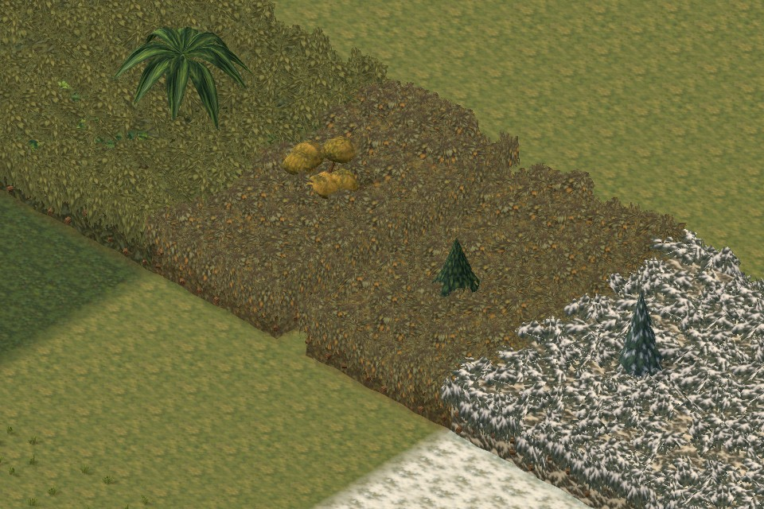
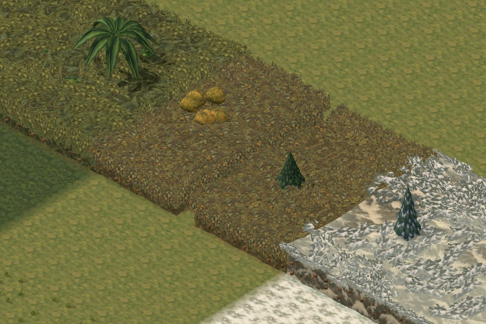
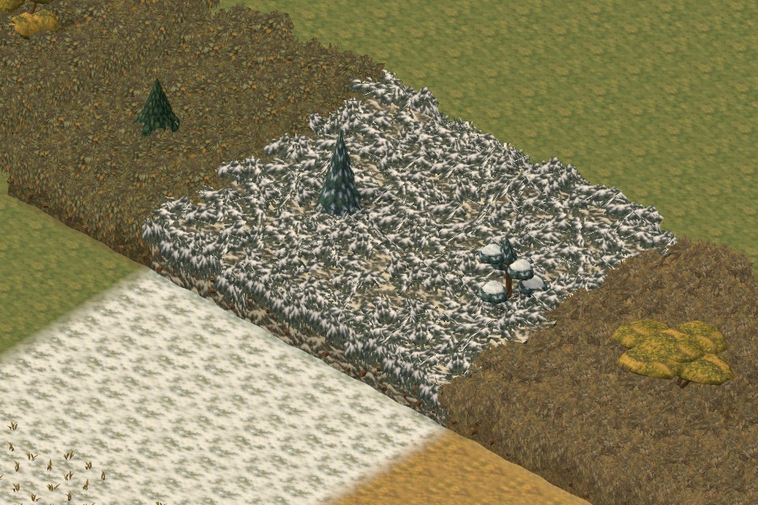
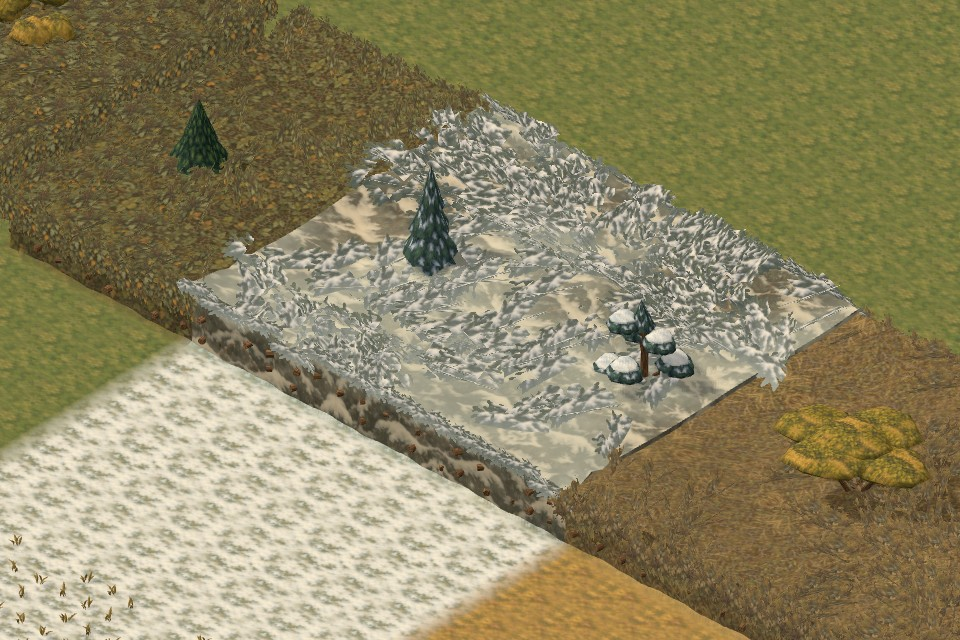
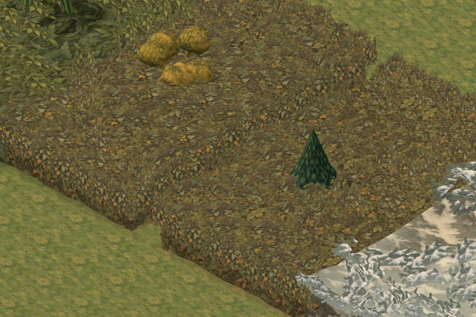
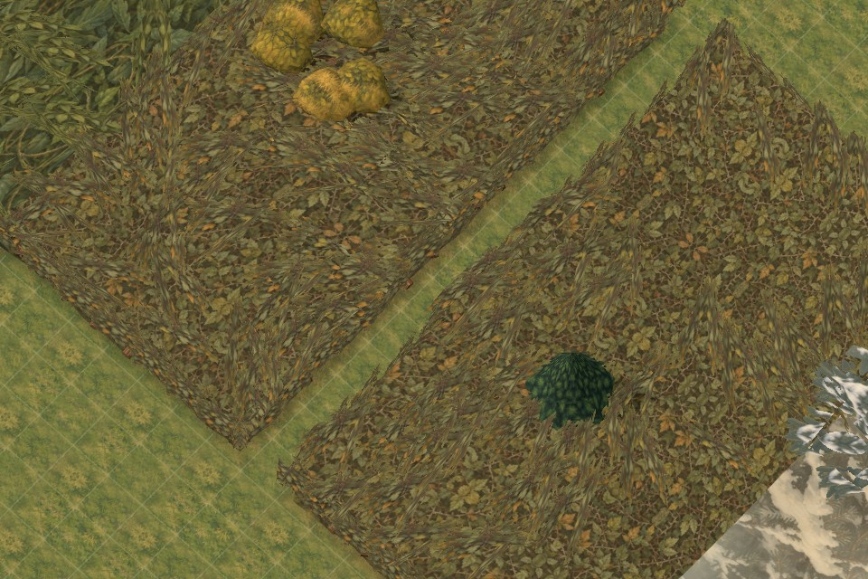

# Foliage canopy and snow polish

Artist follow-up on `work/foliage-canopy-polish`, based on approved canonical `59707c7`. This addresses the two localized art notes in the October 14 integration review. It is ready for architect integration; it does not change the intro.

## Visual changes

Dense canopies now form broader, loosely aligned bough groups with quieter pockets between them. A continuous seeded field controls grouping, height and restrained colour variation across tile and render-chunk boundaries. The opaque backing still fills every blocked tile. Shorter neighbouring crowns lower the shoulder gradually instead of producing repeated isolated peaks.

Snow uses broader patches, fewer crossed fans and a closer colour match between the snow bed and bough bases. Dark tips and branch detail remain visible. The existing tree-model mix and all texture images are retained.

| Temperate before | Temperate after |
| --- | --- |
|  |  |

| Snow before | Snow after |
| --- | --- |
|  |  |

The same one-tile passage remains open with the grid off and on:





The rectangular patches are the existing comparison fixture, not proposed landscape composition.

## Gameplay and rendering contract

- Finite sight envelopes, occupancy, placement margins, fog, saved overlays and movement remain authoritative and unchanged. Cosmetic backing cannot borrow a taller neighbour's crown.
- Fans remain clipped to occupied tiles and their finite height. Quieter canopy areas expose painted backing, not traversable-looking gaps.
- Visible substantial wood and bullet cover are unchanged. Leaves still obstruct sight without becoming bulletproof. Open woodland remains separate from blocked thickets.
- The 24 × 24 spatial chunks, nested distant detail and existing shadow limits remain. No new textures, shadow casters or tree models were added.

## Comparable cost

Both captures use the same map, seed, camera and 960 × 640 canvas. The baseline substitutes only canonical's two screen-art modules, without switching the preview checkout. Submitted triangles include shadow passes.

| View | Draw calls, unchanged | Canonical triangles | Polished triangles |
| --- | ---: | ---: | ---: |
| Five-biome overview | 200 | 265,936 | 263,864 |
| Wetland edge | 84 | 158,250 | 156,508 |
| Temperate | 122 | 141,602 | 139,408 |
| Snow | 134 | 138,588 | 135,578 |
| One-tile passage | 96 | 120,554 | 119,068 |

Known texture storage stays at **56,035,787 bytes (53.4 MiB)**, including finite-envelope masks and excluding driver/shadow targets. [Baseline report](images/foliage-canopy-polish-2026-10-15/before-report.json) and [final report](images/foliage-canopy-polish-2026-10-15/after-report.json) include all views and render samples.

Review caught an initial CPU rebuild regression. Per-build caches and normals sampled at the actual mesh spacing removed the repeated calculations. The final warm seven-run median for the fixture's 1,157 cells was **23.24 ms canonical / 23.57 ms polished**; an independent repeat measured 25.29 / 23.67 ms. Scratch caches are released after generation. [CPU benchmark](images/foliage-canopy-polish-2026-10-15/build-cost.json).

These are bounded fixture measurements, not sustained full-sector battle performance. The final source and packaged Playtests include four squad members, but a representative wooded-sector workload is still needed before increasing foliage detail.

## Validation

- **150/150 affected tests passed**, covering foliage art, finite bounds, visibility, shot cover, save data, tree selection, elevated terrain, LOD, disposal and packaging. The new test checks seeded composition continuity at tile, chunk and sector boundaries.
- Asset audit and `npm run build:tactics-3d` passed, including local module closure.
- Source and packaged editor save → reload → ordinary Playtest passed with four characters and seven foliage regions. No application, asset-loading or shader errors were recorded.
- Twelve final visual configurations cover every family, reverse snow and wetland views, and elevated snow/path views with the grid. All loaded cleanly.
- Independent visual/code review: **9/10**, with the rebuild-cost concern resolved. Final normal-adjusted captures were included in the review.

See [validation and source fingerprints](images/foliage-canopy-polish-2026-10-15/validation.json) and [editor-to-Playtest report](images/foliage-canopy-polish-2026-10-15/integration-report.json). The full canonical suite was not repeated for this localized follow-up.

## Reproduction

```powershell
$foliageTests = @(rg --files tests | Where-Object { $_ -match '(biome-|foliage|mature-tree-3d|tactics-pages-files).*\.test\.mjs$' })
node --test @foliageTests
node tools/check-assets.mjs
npm run build:tactics-3d
node tools/check-foliage-canopy-cost.mjs 59707c7
node tools/check-foliage-skins.mjs canopy
node tools/check-foliage-skins-integration.mjs canopy-integration
```

Browser tools require Playwright/Edge and the existing preview server. `PLAYWRIGHT_PATH` selects the installed package and `REVIEW_URL` overrides the default server. Set `REVIEW_BASELINE_REF=59707c7` only for baseline captures. `REVIEW_VIEWS` can select extra angles such as `snow:reverse,snow:high:grid,path:high:grid`. All diagnostic browsers close in `finally` blocks.
