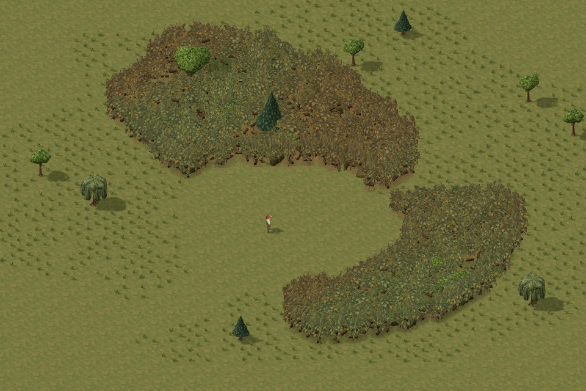
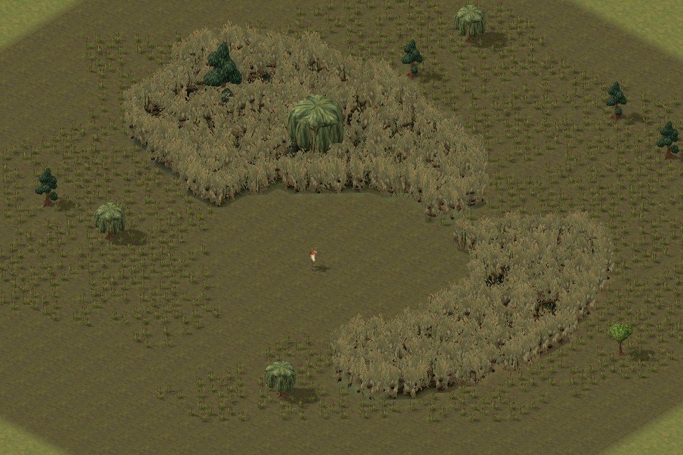
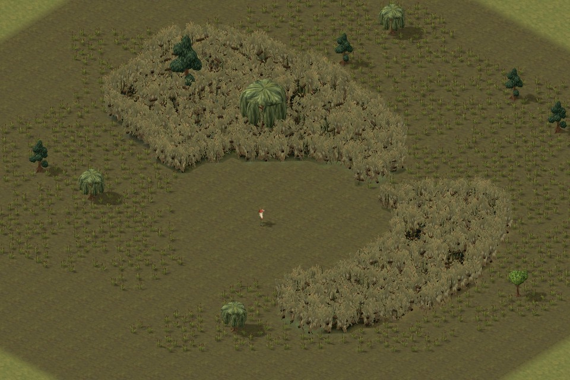
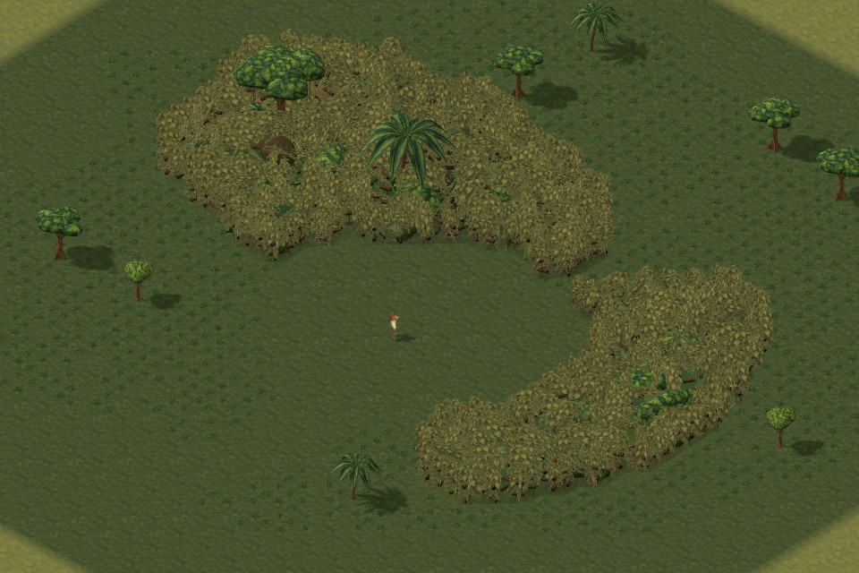
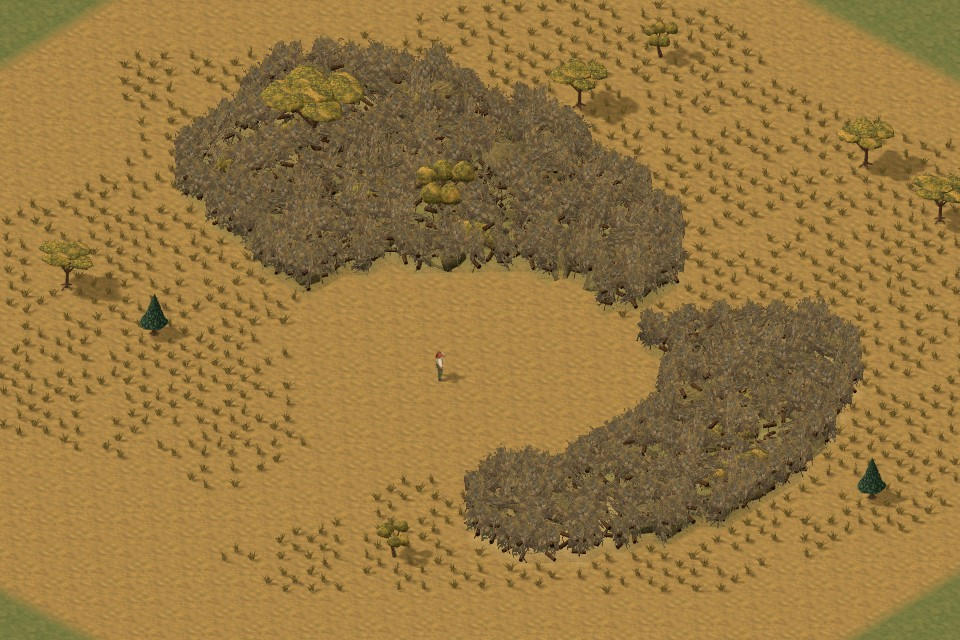
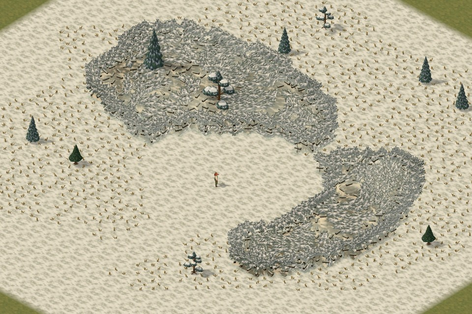
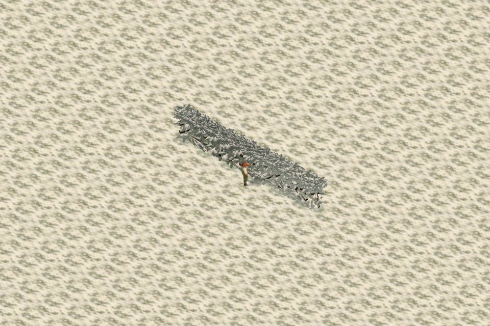

# Foliage composition recovery

Follow-up on `work/foliage-canopy-polish`, replacing the raised-canopy direction in `50cf262`. The user and architect preferred the landscape composition in `85da0d8`: distinct vegetation, visible low ground and wetland water. The broader snow paint remains useful and is retained.

## Latest follow-up: breathing spaces after `c4e60ab`

The user requested small visual resting places within the dense planting, using the old bog as a composition reference. These are **ground/water pockets inside impassable growth**, not new walkable clearings. The copse's saved map and its large clearing are unchanged.

Temperate, jungle, dry and wetland planting now frame sparse, irregular enclosed hollows. Existing leaf fans turn partway around each hollow with unequal setbacks and overlapping tips; low shrub cores and cosmetic root cards yield near the centre. The physical cover branches and their fine supporting stems remain. Upper boundary tips vary in height and lean, while the original body-height foliage band stays in place. The temperate colour treatment, snow geometry and paint, mixed trees, finite sight envelopes, fog and projectile rules are preserved.

After reviewing the live draft, the user requested about 30% fewer openings. A separate deterministic thinning step retains 70% of eligible sites without moving the survivors. In the unchanged copse fixture this reduces **six pockets to four**. It adds no texture images, shadow casters or gameplay obstacles.

| Temperate | Wetlands |
| --- | --- |
|  |  |

Elevated grid views show the unchanged boundaries in [temperate](images/foliage-breathing-spaces-2026-10-15/copse-temperate-high-grid1.jpg) and [wetlands](images/foliage-breathing-spaces-2026-10-15/copse-wetlands-high-grid1.jpg). The same pass was checked in [jungle](images/foliage-breathing-spaces-2026-10-15/copse-jungle-normal-grid0.jpg), [dry grassland](images/foliage-breathing-spaces-2026-10-15/copse-dry-normal-grid0.jpg) and [unchanged snow](images/foliage-breathing-spaces-2026-10-15/copse-snow-normal-grid0.jpg).

Validation for this follow-up:

- **161 focused tests passed**, including foliage sight/cover, map preservation, spatial chunks, biome art, disposal and packaging. The full unrelated suite was not rerun.
- New coverage checks probe **eight actual interior hollows**, with 144 direction/height/LOD cases and 5,904 rays against real geometry and atlas alpha. Rays stop before the copse's outer boundary, so that boundary cannot conceal a defective hollow. All meet the existing 0.4-tile contiguous-gap limit. A dry hollow has isolated pinholes below 0.2 tile; minimum sampled coverage is 90.2%. The stricter one-tile outer-screen checks remain intact.
- **60 browser views passed**: all five habitats, copse and strip, three angles, grid on/off. No page or asset errors. [Context report](images/foliage-breathing-spaces-2026-10-15/context-report.json).
- Source and packaged **save → reload → ordinary Playtest passed**, with four squad models and seven foliage regions. Build and asset audit passed; the packaged art modules match the captured source hashes. [Integration report](images/foliage-breathing-spaces-2026-10-15/integration-report.json).
- Independent review: **9/10 for the user-approved composition with fewer openings**. Steep overhead views still expose some inherited repetitive wood and thin leaf cards. This is a localized art improvement, not a claim that those limitations are solved.

Compared with `c4e60ab`, the normal copse keeps the same draw calls and texture storage: 148 calls for temperate and 220 for wetlands. Submitted triangles increase from 373,076 to 373,416 and from 1,077,626 to 1,078,094 respectively, including shadows. Warm surface generation for the 1,157-cell fixture measures 12.81 ms before / 16.31 ms after. The [generation report](images/foliage-breathing-spaces-2026-10-15/build-cost.json) measures construction cost only; no frame-rate improvement is claimed.

The [validation record](images/foliage-breathing-spaces-2026-10-15/validation.json) includes source hashes and check scope. All six browser helpers created for this follow-up exited. The existing review server retains its fixed shutdown at **2026-10-15 23:23 UTC**. This feature branch does not deploy Pages.

### Architect review of `8368a81`

Approved against canonical `a1f13cc`. The restrained pockets break up the mass without cutting apparent routes through it. They read most clearly in wetlands and elevated views; at the usual three-quarter camera they add subtle variation. Keep this approximate size and frequency. The existing repeated wood and thin leaf cards remain more conspicuous from steep overhead angles; those deserve localized polish rather than more or larger openings.

Independent integration checks: **163 focused tests passed**, including the 144 local hollow coverage cases / 5,904 alpha-tested rays, foliage movement/sight/cover, biome rendering and deployment-module checks. Asset audit and Pages build passed. The unrelated full suite was not repeated. The actual nonempty snow copse has identical Float32 geometry to canonical; the only raw-number difference is roundoff in the upper UV coordinate (`0.92` versus `0.9199999999999999`). No snow appearance change is introduced.

An interleaved warm generation comparison on the 1,157-cell fixture measured **11.12 ms before / 13.34 ms after**. This is a small construction cost, not a gameplay frame-time measurement. The artist's unchanged draw-call/texture counts and small submitted-triangle increase are consistent with the implementation: existing fans are repositioned, with no new materials or per-frame hollow calculation.

Browser review covered normal and elevated wetlands and elevated temperate, including the movement grid. The packaged wetland preview also rendered the new pockets without warning/error log entries. Saved movement, sight and projectile rules remain unchanged; these are enclosed visual pockets within blocked growth.

**The remaining sections record the earlier `c4e60ab` delivery and its baseline measurements.**

## Shape and composition

Temperate, jungle and dry thickets now use separate low shrub bases, overlapping leaf sprays and fine rooted stems. Jittered growing sites group several tiles into uneven clumps. The former continuous high roof and vertical perimeter are removed. Wetlands use curved reeds with visible water at their feet. Broad world-space colour groups break up the temperate fans without changing their alpha coverage.

Snow keeps the existing painted white patches and bough treatment. The underlying drifts now taper according to distance from the real occupied edge. Thin strips receive shallow drifts, while broad interiors can accumulate more snow. Inclined snowy branches explain the remaining tall sight obstruction. A regression test checks that concave shoulders render identically when cell iteration order changes.

The mixed tree collection and its deterministic selection remain unchanged. Substantial branches are visible at their existing cover locations, with darker weathered ends and fine connecting stems. In snow, upward-facing wood receives a painted snow coat while its sides and ends remain dark. The fine stems add no new collision or bullet cover.

This is a composition recovery, not a literal restoration of the old renderer. The old airy tree scatter did not represent the later physical cover rules. Every currently opaque tile still needs enough visible growth to justify blocked sight. Mandatory boundary boughs remain in all levels of detail; shader clipping keeps vegetation out of clear corridors and below the existing finite sight envelopes.

## Review scenes

The study now offers **One-tile strip + horse** and **Copse and clearing**, with all five habitats, three camera angles and the tile grid on or off. The horse uses the ordinary painted model at native scale. These are saveable map fixtures without special renderer-only collision or tree-placement overrides.

The copse deliberately contains blocked undergrowth, open woodland and a clear route. It is more useful for judging landscape composition than the older rectangular patches, which remain available for direct comparison.

| Temperate | Wetlands |
| --- | --- |
|  |  |

| Jungle | Dry grassland |
| --- | --- |
|  |  |

| Snow copse | Snow strip beside the horse |
| --- | --- |
|  |  |

[Elevated clearing with grid](images/foliage-composition-recovery-2026-10-15/copse-temperate-high-grid1.jpg) and [one-tile temperate strip with grid](images/foliage-composition-recovery-2026-10-15/strip-temperate-normal-grid1.jpg) show the occupied boundaries. The [60-view report](images/foliage-composition-recovery-2026-10-15/context-report.json) records camera, native horse scale, geometry cost and source fingerprints. The [24 affected views](images/foliage-composition-recovery-2026-10-15/final-paint-context-report.json) were refreshed after the last temperate/snow paint changes; the images above use that final paint. Neither matrix reported page or asset HTTP errors.

## Gameplay and rendering

Foliage presets, sight and projectile queries, tree selection, movement, saved overlay data and placement margins are unchanged. Leaves still obstruct sight; the existing substantial wood provides projectile cover. The intro is untouched.

Rendering retains 24 × 24 spatial chunks and finite per-fragment clipping. Entirely unknown screen chunks are now skipped using a summed-area summary of the existing fog mask. Partially known chunks retain the original exact fragment mask, including concealed interiors. Hidden chunks can become visible again when explored.

Nearby wood uses tapered six-sided geometry. Distant wood uses crossed tapered cards with the same branch count, transform and extent. Fine connecting stems disappear at distance. No new texture images or shadow casters were introduced.

## Representative battle comparison

The benchmark uses a generated, flat 240 × 240 wooded sector based on the tutorial study regions. It is **not the authored tutorial map**. Both versions use 43,947 saved foliage cells, 31,569 blocked cells, four squad members, Standard difficulty fog and the same camera. Seen tiles match within each comparison: 829 for temperate and 830 for snow. Each run goes through ordinary editor import, save, reload and Playtest. The editor closes before measurement.

| Habitat | Version | Submitted triangles | Draw calls | Median draw CPU | Median RAF interval |
| --- | --- | ---: | ---: | ---: | ---: |
| Temperate | `50cf262` | 569,654 | 421 | 59.9 ms | 66.8 ms |
| Temperate | Recovery | 496,894 | 350 | 66.9 ms | 100.3 ms |
| Snow | `50cf262` | 478,098 | 385 | 56.1 ms | 66.7 ms |
| Snow | Recovery | 428,558 | 302 | 60.3 ms | 66.9 ms |

Submitted triangles include shadows. In the final run, triangles fall about 13% for temperate and 10% for snow; draw calls fall about 17% and 22%. **This does not establish a frame-rate improvement.** CPU draw submission was slower, and the temperate RAF median was worse. This entire session was substantially slower and more variable than the earlier paired run: before the final RGB-only paint, temperate measured 20.1/21.9 ms CPU and snow 24.3/27.3 ms. Current geometry counts were identical across both runs. Retain both reports rather than attributing those large timing swings to the paint alone.

The [final battle report](images/foliage-composition-recovery-2026-10-15/final-paint-battle-report.json) includes all four runs and source hashes, which match the 24 final context captures. The [earlier paired report](images/foliage-composition-recovery-2026-10-15/battle-report.json) is retained for timing context. These are bounded headless Edge samples, not a sustained combat test. The existing fragment-fog boundary still cuts partly explored foliage into tile-shaped slivers; the baseline has the same presentation artifact.

## Validation and review

- `npm run check`: **2,452 passed, zero failed**, followed by a successful asset audit. After the final RGB-only paint changes, all **12 focused screen tests** passed again and the package was rebuilt successfully.
- The coverage regression traces real triangles and atlas alpha at near, far and distant detail. An independent five-seed expansion checked **2,025 cases without failures**. It allows isolated grazing rays at edges, while rejecting character-width holes through dense screens.
- Source and packaged editor save → reload → ordinary Playtest passed with four squad models and seven foliage regions. See the [integration report](images/foliage-composition-recovery-2026-10-15/integration-report.json). After rebuilding the final paint, both affected families also rendered cleanly from the packaged output; see the [packaged paint check](images/foliage-composition-recovery-2026-10-15/packaged-paint-report.json).
- Independent visual/code review: **9/10 for this rendering correction**, after the temperate grouping and snow-coated wood refinements. This is ready for architect review, not a claim of canonical integration.
- Warm CPU generation for the 1,157-cell comparison fixture measured **28.48 ms baseline / 12.00 ms recovery** across seven runs. This measures generation only; see the [build-cost report](images/foliage-composition-recovery-2026-10-15/build-cost.json).

The [validation summary](images/foliage-composition-recovery-2026-10-15/validation.json) records final source hashes and the scope of each check. The retained local preview on port 4476 has its existing automatic shutdown at **2026-10-15 23:23 UTC**. All diagnostic browser helpers have exited and have cleanup receipts. The feature branch does not publish Pages; the architect owns canonical integration.

## Reproduction

```powershell
npm run check
npm run build:tactics-3d
node tools/check-foliage-skins-integration.mjs recovery-integration
node tools/check-foliage-context.mjs recovery-context
node tools/benchmark-foliage-battle.mjs recovery-battle
node tools/check-foliage-canopy-cost.mjs 50cf262
```

Browser tools use the existing preview server on port 4476, with `REVIEW_URL` available as an override. `PLAYWRIGHT_PATH` selects the installed Playwright package. The battle benchmark defaults to baseline `50cf262`; `REVIEW_BASELINE_REF` overrides it. `REVIEW_FAMILIES`, `REVIEW_MODES`, `REVIEW_ANGLES` and `REVIEW_GRIDS` can narrow the context matrix. Temporary browser helpers record process identity and close in `finally` blocks.
