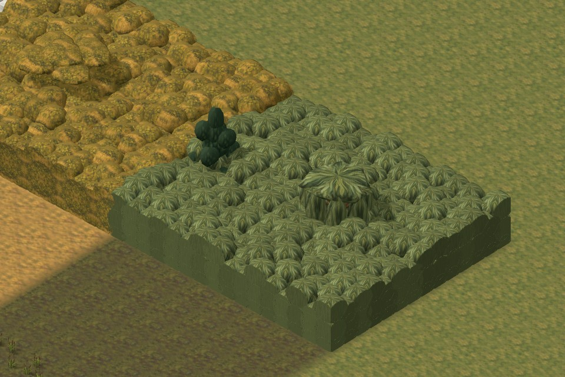
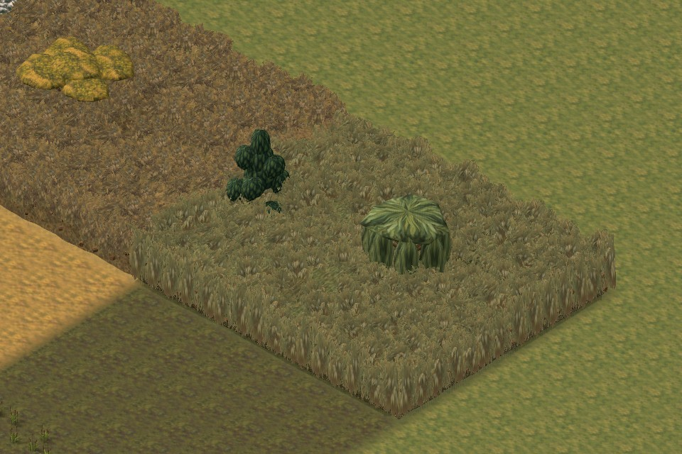
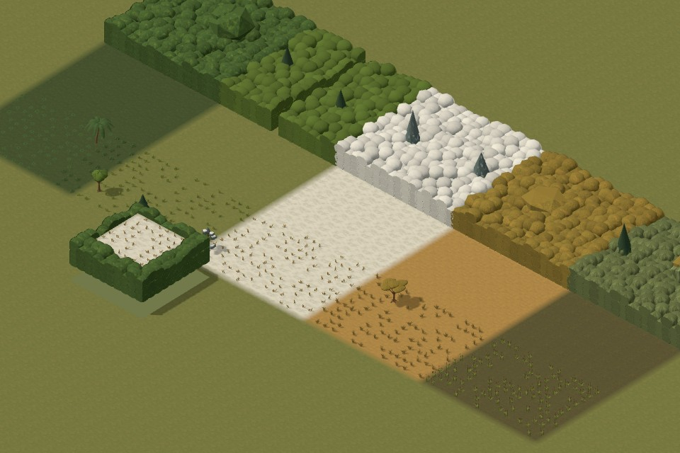
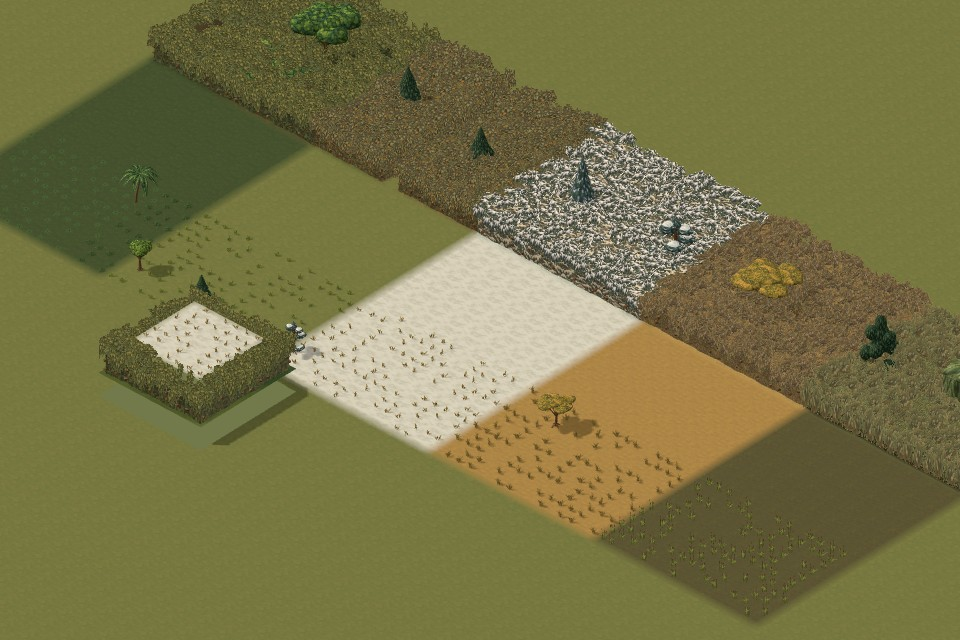
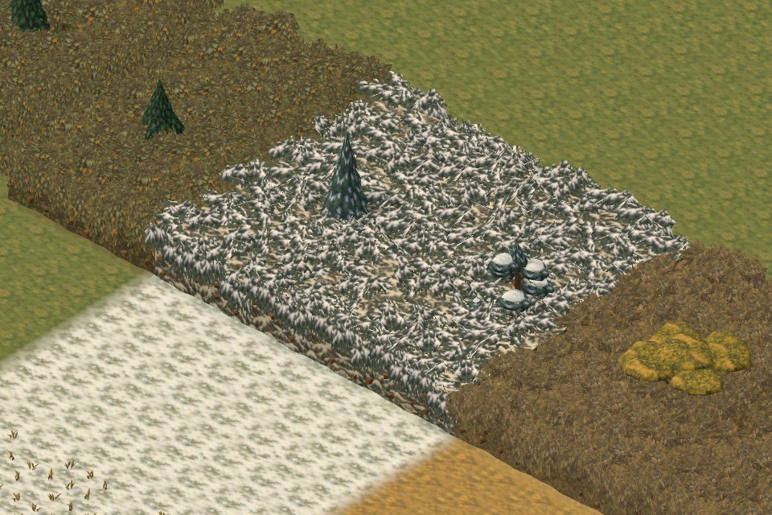
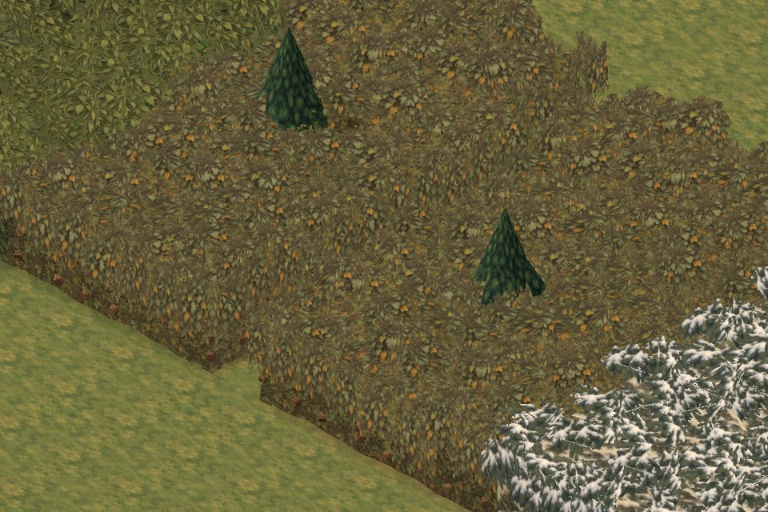
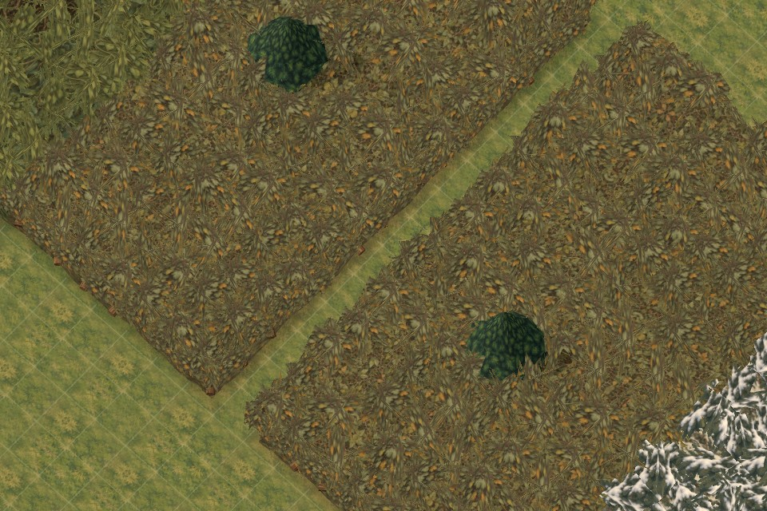

# Painterly foliage screens and restored tree presentation

Follow-up: [actual tree-model mixing within each habitat](TREE-MODEL-MIX-2026-10-14.md) implements the user's later clarification. The measurements below record the earlier `6ef88ba` skin/detail pass.

Artist branch: `work/foliage-skins`, based on coder handoff `1119290` / integration `e0102b3`. The architect owns canonical integration. This delivery does not merge the older artist branch or change the unrelated loading screen.

## Result

Dense growth now uses dedicated painted skins and overlapping cutout boughs instead of repeated clipped domes. Wetlands have upright reeds, drooping willow leaves and darker roots; temperate brambles, jungle foliage, dry thorn scrub and snow-laden evergreen boughs each have their own treatment. The solid backing is recessed behind a staggered foliage edge.

The user's later concern about the old trees led to a separate presentation correction. The existing tree meshes and atlases had survived integration, but normal overview zoom selected cone/disc substitutes and averaged away their painted branches. Full authored crowns now remain visible when their projected height exceeds 26 pixels (22-pixel exit hysteresis). Coarse tree paint survives farther zoom. No tree was moved, enlarged, recoloured or resculpted; original temperate broadleaf/pine designs and the other biome families remain available.

The user clarified that old and new trees should coexist for variety. This keeps all ten tree designs: the original broadleaf and pine reused in temperate woods, plus jungle canopy/palm, snowy spruce/alpine pine, dry acacia/scrub, and wetland cypress/willow. Preserve that mix when integrating; do not globally replace one collection with the other.

## Same-camera comparison

Both versions use the real five-biome map, identical seed, 960 × 640 canvas, lighting and camera. The rectangle layout is a test fixture, not a proposed map composition.

Wetland edge before:



Wetland edge after:



Overview before:



Overview after, including restored tree crowns:





The one-cell route is clear with the grid both off and on:





## Gameplay contract retained

- The renderer reads the existing finite foliage envelopes. It does not write presets, masks, seeds, placement, ground support, movement, sight, shot cover or save data.
- Opaque backing stays in occupied tiles and below the owning cell's crown. A regression test covers the case where borrowing a taller neighbour would conceal an elevated sight line.
- Overlapping painted fans are clipped to occupied cells and their finite top, including raised ground and one-cell passages. Fog visibility remains in the same shader chain.
- Leaves and reeds still do not stop bullets. Rendered substantial wood uses the existing beam endpoints/radii.
- Shared tree parts, atlas files, positions, size, trunk grounding and shot geometry are unchanged. Open woodland remains sparse between trunks.

## Rendering and ownership

The backing and painted fans are grouped in 24 × 24 spatial chunks. Near views use two or three crown fans; overviews use two; very distant views use one. The opaque core remains at every scale. There are no individual stem draw calls, alpha-blended layers or new foliage shadow casters. Existing nearby tree-shadow limits remain.

The two new 1536 × 1024 atlases add 16 MiB of estimated RGBA GPU storage with mipmaps. Six finite-envelope maps in this fixture add about 5.27 MiB. Empty layers allocate no envelope map. The measured known texture allocation increases from 32.2 to 53.4 MiB; this estimate excludes driver/shadow targets and pre-existing shader-only ground-weight allocations. It is not a claim of total GPU memory.

| Same camera | Calls before → after | Triangles before → after |
| --- | ---: | ---: |
| All five, 14 px/tile | 178 → 200 | 292,128 → 263,592 |
| Wetland edge, 32 px/tile | 84 → 84 | 178,200 → 158,250 |
| Temperate, 32 px/tile | 122 → 122 | 171,382 → 139,742 |
| Snow, 32 px/tile | 133 → 133 | 175,502 → 138,340 |
| Narrow path, 52 px/tile | 99 → 97 | 148,914 → 118,794 |

The overview's extra calls retain the authored tree crowns. Geometry totals include submitted shadow passes. Full-resolution paint does cost additional texture memory. In the final isolated samples, overview CPU submission / synchronized render medians were 2.1 / 3.1 ms (baseline 1.4 / 2.0 ms); the wetland edge was 0.7 / 1.2 ms (baseline 0.9 / 1.6 ms). These are CPU submission plus `gl.finish`, not display FPS. The restored tree detail is a deliberate quality/cost tradeoff.

The final ordinary battle checks recorded requestAnimationFrame median / p95 intervals of 21.1 / 31.8 ms for source and 16.5 / 21.5 ms for the packaged build. Those short samples include browser scheduling and are not isolated GPU timings or a sustained full-sector battle benchmark. See [final isolated render samples](images/foliage-skins-2026-10-14/performance-report.json), [all-view geometry and error checks](images/foliage-skins-2026-10-14/after-report.json), and [editor/battle checks](images/foliage-skins-2026-10-14/integration-report.json). The all-view capture overlapped CPU-heavy tests; use the isolated report for final render timing.

## Assets and reproduction

- `dist/assets/environment/foliage-screens/`: opaque and transparent atlases, exact image-generation prompts and generated SHA-256 manifest.
- `foliage-screen-surface.js`: cosmetic core, bough fans and chunk construction.
- `foliage-screen-paint.js`: dedicated panel sampling, padded UVs and bounded mip use.
- `foliage-screen-scene.js`: shared materials, finite clipping, LOD and owned-resource disposal.
- `biome-terrain.js` / `biome-foliage-paint.js`: retain authored trees and coarse tree paint at normal gameplay zoom.
- `tactics/foliage-skins-review.html`: all five families, reverse/elevated views, grid and ordinary editor link.

Run `node tools/export-biome-manifest.mjs` after changing tracked art sources, then `npm run build:tactics-3d`. The build includes new modules and both atlases.

The tree-paint shader shares a source file with ground paint. Its source fingerprint changed, while the five existing connected-ground sheets did not. `tools/refresh-connected-ground-fingerprints.mjs` regenerated each sheet and required identical decoded pixels before refreshing that fingerprint. [Pixel verification](images/foliage-skins-2026-10-14/ground-provenance.json) records all five results; no ground PNG was replaced.

Browser checks require Playwright, Edge and a local preview:

```text
node tools/check-foliage-skins.mjs release
node tools/check-foliage-skins-integration.mjs
```

`PLAYWRIGHT_PATH` may point to the installed Playwright package; `REVIEW_URL` selects the source server. The integration check also uses its `/packaged/` route. Each browser closes in a finally block. `tools/serve-foliage-skins.mjs` is a read-only preview with a real fixed 24-hour shutdown and a STOP marker.

## Validation and review

- Independent visual/code review: **9/10**, after correcting the snow boughs, far-screen coverage, atlas borders, redundant seam triangles and tree presentation.
- Final affected suite: **140/140 passed**, covering foliage, geometry, finite heights, passages, LOD, fog, resource disposal and packaging. Existing sight/shot, save, elevated-ground and tree-grounding regressions remain in the suite.
- Source and packaged ordinary editor save → load → Playtest: passed, four characters and seven biome regions loaded without diagnostics or browser errors.
- The full project test run passed **2,355 of 2,357** tests. Its two failures were the stale connected-ground fingerprint and the review page being included in the base build instead of the 3D build. Both were corrected and their files rerun: **13/13 passed**. The broader affected foliage checks, final asset audit and packaged 3D build also passed; see the [validation record](images/foliage-skins-2026-10-14/validation.json). The entire project suite was not repeated after these delivery-only fixes.

No further art hold was requested by the independent reviewer. The broader gameplay rollout remains the architect's decision. Review exact source captures and final check evidence before integrating.
