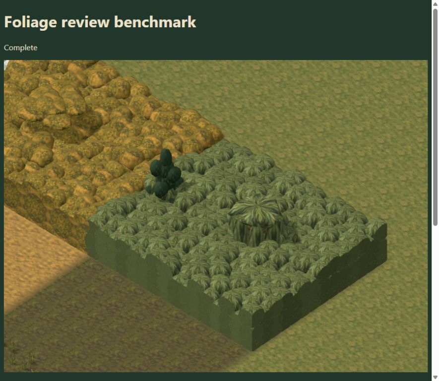

# Foliage skins artist handoff

The next pass is visual refinement of the foliage integration at `e0102b3` on `work/editor-3d`. The user wants the artist to take over the skins. Keep the game's painterly finish and make large procedural areas look like vegetation rather than repeated clipped blocks.

The user's wetland direction is: "the bog is still used as a texture. it can be part of the procedurally generated part of the content as long as it also addresses the other needs, blocking movement and line of sight."

## Priorities

1. Improve the dense wetland first. Paint reeds, willow leaves, tangled roots and waterlogged wood as distinct materials. Retain irregular pockets of bog water, mud and unsafe land beneath the growth, without creating a broad apparent walkable corridor or a clear sight line through the screen.
2. Reduce the obvious repeated dome pattern and flat, cut-looking sides. Vary the scale and direction of painted clusters, with broad color variation, restrained highlights and shadows where masses meet. Avoid deep black patches that resemble missing textures.
3. Give each family its own dense vegetation language: temperate brambles and branches; jungle broad leaves and vines; snow-covered evergreen boughs; dry thorn scrub; wetland reeds and willow growth. Match the neighboring ground palette.
4. Keep open woodland spacious. Trees and tall grass should read as light woods with routes between trunks, distinct from the dense obstacle presets.

The current screen uses clipped low-poly ellipsoids with painted caps at exposed edges. A skin alone will not remove every straight silhouette. Small render-side silhouette/UV changes are reasonable if needed; preserve the minimum character-height screen and recognizable occupied footprint. If a proposed visual shape requires different collision bounds, identify that explicitly for gameplay integration.

## Gameplay contract

- Open woodland is walkable between its trunks. Trunks block intersecting sight rays and shots.
- Dense thicket and dense wetland thicket block walking and sight through finite vegetation volumes. Low decorative density must still show a convincing barrier.
- Leaves and reeds are not bulletproof. Visible substantial wood must explain the separate shot-cover volumes.
- Elevated observers can see over the screen when their rays clear its top. Avoid making a visibly low shrub stand in for a much taller invisible barrier.
- Keep clearings, paths, starts and access points readable. Cosmetic leaves may soften an edge, but must not visually close a walkable route or open a blocked one.
- Preserve deterministic placement, seeds, preset IDs, actual ground/floor support, fog masking and distant screen coverage. Camera angle and LOD must not change gameplay obstruction.

## Source entry points

Paths are relative to the repository root. Bring `e0102b3` into the artist's review checkout before evaluating the new screens; the older standalone plant study does not contain this complete integration.

| File or directory | Purpose |
| --- | --- |
| `dist/assets/environment/biome-foliage/foliage-atlas-v1.png` | Existing family skins |
| `dist/assets/environment/painted/foliage-atlas-v1.png` | Shared original bark and temperate foliage |
| `dist/assets/environment/biome-foliage/ground-atlas-v1.png` | Ground source palette |
| `dist/tactics/biome-foliage-data.js` | Atlas panels and material identities |
| `dist/tactics/biome-foliage-paint.js` | Material sampling, UV/triplanar projection and distant filtering |
| `dist/tactics/foliage-screen-scene.js` | New dense masses, boundary caps and visible deadfall |
| `dist/tactics/biome-plant-parts.js`, `biome-foliage-models.js` | Shared plant shape descriptions and rendered models |
| `dist/tactics/foliage-obstacles.js`, `foliage-presets.js` | Authoritative sight/shot shapes and preset contract |

Reusing an atlas panel also changes its existing tree/plant users. Check those alongside the dense screens, or introduce dedicated screen paint if sharing creates a mismatch. Regenerate the biome manifest with `node tools/export-biome-manifest.mjs` after changing tracked source assets or plant geometry; it also updates exact tree-grounding data. Preserve asset provenance and generation prompts for new artwork.

## Review and delivery

Use `tactics/editor-3d.html?editing=1&study=biomes` and its ordinary Playtest. Show all five families at normal gameplay scale, a close wetland view, and reverse/elevated views. Include a path edge and two adjoining painted regions so repeating seams and cut faces are visible. The reference capture above is the current implementation, not a target aesthetic.

Keep shared materials and chunk instancing. Avoid per-stem draw calls or many overlapping transparent layers. Compare the same camera and fixture before and after; report draw calls, triangles, texture cost and frame timing. Existing measurements and integration checks are in [the foliage integration notes](FOLIAGE-SIGHT-INTEGRATION-2026-10-14.md).

Deliver the revised skins and any necessary render adjustments with screenshots, relevant asset/foliage checks, and a packaged build. Flag shape changes that require updated collision or grounding tests. The architect handles canonical integration; this handoff does not authorize overwriting either branch's unrelated work.
