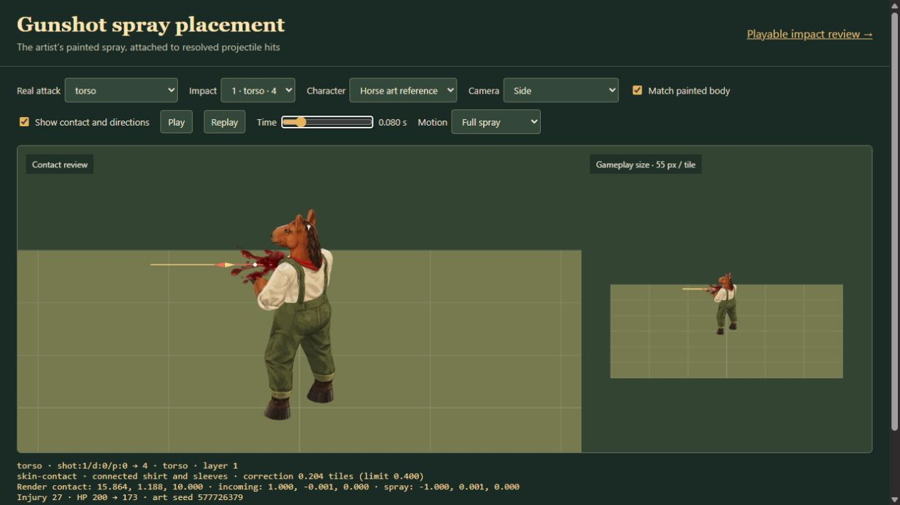
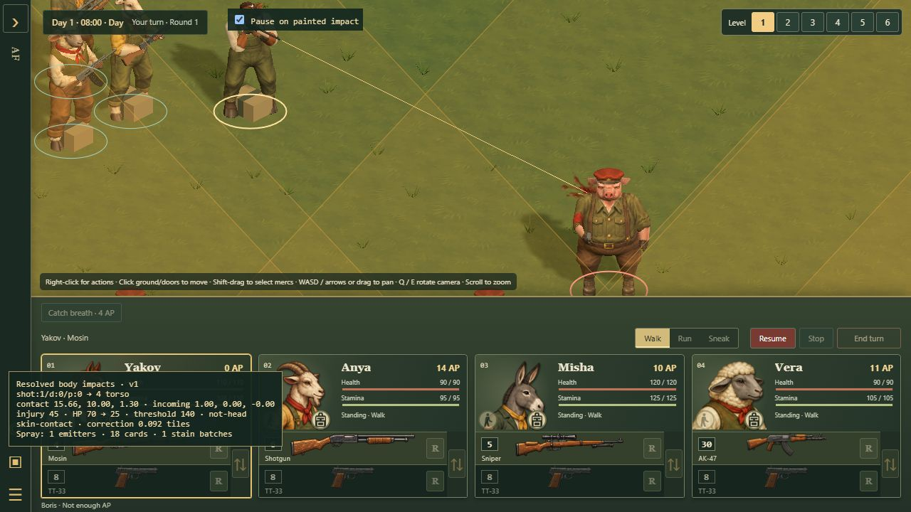
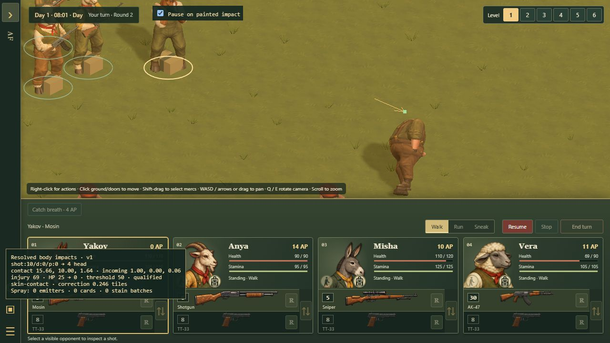

# Gunshot impact integration

Ordinary gunshot wounds play the artist's painted entry spray and skinned entry stains during battle. Qualifying fatal heads now use the approved burst, native masks and neck seals in the live character-batching path. Casualties release their displayed weapons, which land before fading. All these effects consume committed outcomes; ordinary hit and damage rules remain in force. A qualifying head hit commits a permanent death even on Easy, while other lethal gunshots retain their existing casualty rules. Gameplay-qualified exit effects remain separate work.

## Fatal head rule

For each damaging bullet or pellet, use its resolved injury after resistance and the existing head multiplier, before HP is clamped. The threshold is `max(2 × HP at action start, 0.5 × maximum HP)`. Only an actual head impact meeting that threshold and leaving zero HP qualifies. Constants live in `FATAL_HEAD_RULE` in [gunshot-impacts.js](../../dist/tactics/gunshot-impacts.js).

Starting HP is captured for the whole firing action: a burst, both shots from dual pistols, or all pellets of a shell. Earlier hits cannot lower the threshold. A retaliation has its own action and snapshot. Pellets never pool damage, and a natural critical success changes accuracy without supplying extra damage. A fuel-tank rupture keeps its existing fire presentation and emits no body-impact record for that impact.

The persistent unit field `fatalHead = {version: 1, impactId}` identifies the committed outcome. It is validated against zero HP and a dead casualty, retained by encounter and campaign saves, and held back by shot playback until the matching discharge. It must never be used to change HP from rendering code. Loading restores this outcome without replaying the transient shot.

## Artist data contract

Read [gunshot-impacts.v1.json](../../dist/tactics/fixtures/gunshot-impacts.v1.json). Its eleven cases are resolved by the actual attack command, including an incidental victim, a retaliation, bursts, shotgun pellets, dual pistols and layer six. `source.revision` identifies the base commit and `source.sourceSha256` identifies the exact producing sources, including changes made after that commit. Hashes use UTF-8 text with LF line endings so Windows and Linux produce the same result. Run `node tools/generate-gunshot-impact-fixture.mjs --check` to verify the source hashes and reproduce the attacks.

Each firing event has an ordered `bodyImpacts` array. `validBodyImpact` in [gunshot-impacts.js](../../dist/tactics/gunshot-impacts.js) validates the shared records.

| Fields | Meaning |
| --- | --- |
| `version`, `coordinates` | Version 1 uses tactical `{x, y, h}`: horizontal tile coordinates and logical height, with 3 logical units per layer. |
| `id`, `attackId`, `dischargeId`, `projectileId`, `projectileIndex` | Stable encounter-local identities. A pellet has its own index within its shell's discharge. Consume an impact once by `id`. |
| `shooterId`, `victimId`, `zone` | Actual participants and resolved region, which can differ from the selected target and region. A weapon-zone body collision can still inflict an ordinary wound under existing rules; it cannot qualify as a head hit. A weapon-only collision with no body injury produces no record. |
| `contact`, `incoming`, `origin`, `originSupport` | Authoritative contact, normalized incoming ray and launch snapshot. There is no exit-point or penetration claim. |
| `victim` | Species, stance, heading, position and support at impact. Support contains `kind`, `level`, `baseHeight` and `offset`; do not look up the person's later position to place this effect. |
| `hpBefore`, `hpAtActionStart`, `maxHp`, `injuryDamage`, `hpAfter` | Per-impact health and resolved damage, preserving overkill. |
| `casualtyBefore`, `casualtyAfter`, `fatalHead`, `threshold`, `qualificationReason` | Explicit injury/fatality result and its explanation. |
| `visualSeed` | A deterministic hash of the impact identity. Use a local generator; never consume combat RNG. |

Use `impactFrame(receipt)` in [shot-coordinates.js](../../dist/tactics/shot-coordinates.js) to obtain rendered contact, origin and incoming direction. It shares the game's floor spacing and body scale and preserves tower/cliff offsets. A bounded correction to the animated skin may adjust presentation only; it cannot select a new victim, region or damage.

## Painted spray placement

The approved painted skins and ordinary motion are preserved. The asset's local **+X** is the emission axis. [gunshotSprayFrame](../../dist/tactics/gunshot-spray-frame.js) maps it to **negative incoming**: a short entrance fan back toward the incoming bullet. World up determines roll, with a stable alternate axis for vertical hits. The camera never determines that transform; camera-facing cards display the painted texture while droplets retain their world trajectories. Gravity remains world down. There is no forward exit jet without an independently resolved exit.

Call the helper once for an eligible impact at its matching discharge, using only the actual victim's authored body parts. Capture the recorded stance, heading and support before the normal casualty fall, including when reduced motion skips straight to the fallen pose. First try the original ray within **0.4 tile** of its contact. If it passes through a gap between visible limbs, choose the nearest entrance-facing triangle in that same radius and recorded body region. Interpolated skin weights classify the region. The torso includes arms; a weapon-region body injury may use torso or arms. Held equipment is excluded.

The correction changes presentation only. A corrected trace terminates at the same point as its spray. The effect retains that world frame while the victim moves or falls; the retained stain follows the source triangles and their bone weights. An absent, wrong-victim, wrong-region or distant surface cannot receive a stain or floating blood spray. No correction changes the victim, zone, hit odds, damage, RNG or penetration outcome.

```js
const placement = gunshotSprayFrame(receipt, {
  model: {victimId: receipt.victimId, parts: victimModel.worker.parts}
});
if (placement.surfaceSource) {
  blood.pool.spawn(placement, presentationTime, {seed: receipt.visualSeed});
}
// BattleBlood owns visibility, pooling, stains, retirement and shared atlases.
```

Open `tactics/gunshot-spray-study.html` in the 3D packaged build to inspect the shared attack fixture with the painted asset. Gold shows the incoming bullet, red the outgoing entrance fan, white the combat contact and green the corrected skin contact. The panel reports the correction and fallback reason. The camera control verifies direction from both sides; Horse and Hen are explicitly labelled art references, while Actual victim uses the species in the receipt. The two panels show close-up and gameplay scale, with pause and scrubbing. Selecting an attack or inspecting the effect never rerolls combat.

All **20 fixture impacts** now anchor to matching skin. The previous leg, incidental-goat and sixth-pellet gaps use region corrections of approximately 0.086, 0.162 and 0.136 tiles. Automated checks also cover horse and hen head, torso and legs in standing, kneeling and prone poses, wrong-region rejection, distant geometry and exit-only faces. The painted root remains at contact and droplet positions remain unchanged when the camera turns.



## Playback and visibility

`BattleCombat.active.event.bodyImpacts` follows the matching discharge. `canPresentBodyImpact` combines character knowledge and current contact visibility. Effects should use normal scene depth testing as well. Easy's revealed scenery and camera cutaways do not grant knowledge of an undiscovered victim. Skip a hidden impact when it occurs; do not queue it for discovery later.

[BattleBlood](../../dist/tactics/battle-blood.js) consumes an impact once after discharge, even if its shooter is unseen. The renderer captures the victim's living surface before posing the casualty. Spray lifetime is independent of the shorter shot/trace phase and does not keep the action queue busy. Presentation time pauses both travel and fading. Current fog and interior concealment gate particles, and ordinary depth testing handles scenery occlusion. Bounded traces through cached world geometry clip nearby walls; the recorded support clips droplets at the correct floor.

Reset, loading another encounter, restart and disposal clear cosmetics without replay. Stains belong to the current battle and are not serialized into campaign or encounter saves; reloading restores simulation outcomes, including fatal-head state, without replaying spray. Battle end clears retained stains after the matching combat playback. Source weights and bounds are refreshed when an existing actor changes pose or is temporarily rebound; shared character materials, textures and skeletons are never owned by the stain layer.

Bullet traces can enter the visible area from an unseen shooter, leave it and re-enter elsewhere. Each visible run is separate; fog gaps are never joined. No hidden muzzle flash, actor or detection flag is added. Trace geometry uses a fixed buffer, including during repeated shots.

Open `tactics/battle-3d.html?study=gunshot-impacts` in the packaged build for a playable review map, or append `impactDebug=1` to an ordinary encounter. The overlay shows actual contact, region, injury, qualification, surface correction and live effect counts. Its optional **Pause on painted impact** checkbox pauses the ordinary presentation clock when the first painted cards appear. Resume continues the same attack. The review uses the normal shot planner, RNG and damage.



## Preferences and limits

**Blood effects: Full / Reduced / Off** is saved alongside the player's other settings, available on the title screen and in the battle command drawer. Reduced uses five cards per ordinary hit and retains one stain actor batch. Off clears blood immediately and keeps non-blood impact feedback; changing back never replays an old hit. Reduced motion independently uses one short still/fade card. Every setting preserves the same damage, ammo, AP, RNG and casualty result.

| Resource | Limit |
| --- | --- |
| Concurrent emitters | At most 12 across ordinary and fatal effects |
| Live cards | Shared admission cap of 216; 18 per ordinary Full hit, 48 per fatal Full hit, 5 per Reduced hit |
| Allocated card storage | 216 ordinary + 192 fatal cards, reused; the shared live cap still applies |
| Lifetime | Ordinary 0.48 seconds; fatal 0.9 seconds; still/fade within 0.18 seconds |
| Spray draw work | At most two shared instanced meshes, one per atlas |
| Retained stains | Four patches on each of the two most recently wounded actors; one actor in Reduced |
| Stain draw work | One merged skinned mesh per retained actor |
| Spray and stain main-pass draws | At most four, before additional render passes; neck seals and weapon proxies are accounted separately below |
| Patch geometry | At most 256 triangles per patch, 1,024 per retained actor |
| Projection work per frame | At most two new stamps; pellets share a retained patch per victim and region |
| Shared skins | Entry, stain and fatal atlases, each 512 × 512; about 4 MiB decoded with mipmaps |

Overflow omits cosmetic sprays and retires the oldest retained actor's patches. Older wounds still apply mechanically. Pool meshes, attributes and motion records are reused; no per-hit mesh, material, image decoding or model fetch is needed. Assets and materials are prepared before the first hit. Vertex projection reuses buffers, skins each queried vertex once per call, and invalidates those values on every new pose/contact. An [uncapped projector audit](review-images/gunshot-stain-equivalence.json) against the approved adapter at `00fe001` produced identical stain positions, UVs, selected triangles and bone weights in 25 varied posed contacts. Runtime patches additionally obey the 256-triangle cap above.

A [warm Node CPU benchmark](review-images/gunshot-entry-cpu.json), repeated after the full release run finished, compares the approved projector with this revision on the same horse torso contact. At p95 per-operation wall time fell from 1.50 to 0.35 ms for projection; full capture, including posing, bounds, contact correction and a stain, took 3.58 ms. Updating twelve emitters/216 cards measured 0.21 ms p95, excluding retained stains, rendering and GPU costs. Samples average batches to reduce Windows timer quantization; process CPU counters are included but remain coarse for sub-millisecond operations. This is a CPU-only sample, not proof that hit frames meet 60 FPS; capture and full-game GPU work remain profiling priorities.

## Fatal presentation and released weapons

The [live fatal adapter](../../dist/tactics/battle-fatal-head.js) prepares the artist's instance-local mask during actor loading. Pose/contact solvers use original geometry; the mask is applied afterwards. Character batches now accept both indexed and non-indexed native surfaces and rebuild their render copy when the mask changes. Unknown masks retain the ordinary entry/casualty appearance. Each authored neck boundary adds one small skinned seal while visible; these persistent per-casualty draws are additional to the transient spray/stain budget.

Full uses the committed `fatalHead` marker, after the matching discharge, to remove the head and play the fatal burst. Reduced uses the ordinary small entry spray and an intact-head casualty. Off keeps the intact-head casualty without blood. Reduced motion is independent: Full still uses its selected mask, with one stationary fading mark. Loading a saved fatality applies the selected mask without a historical burst or weapon fall. Visibility/concealment gates effects; later discovery does not replay hidden impacts. An impact on a previously stabilized casualty uses its fallen pre-impact pose for surface placement.

Head-local patches are retired with the head. Remaining patches read their original source vertex indices and current skin bindings; affected triangles crossing the removed boundary are omitted. Body and forearm stains remain under the same global retention cap. Mask disposal restores original geometry before the actor/rig is destroyed, without owning shared paintings, skeletons or atlases. An inactive mask leaves fire/ash attachment visibility to the fire controller.

[BattleWeaponDrops](../../dist/tactics/battle-weapon-drops.js) captures the last displayed living weapon matrices before the casualty pose releases the grasp. Primary and paired one-handed items produce independent cosmetic proxies; unarmed actors produce none. The original held objects are hidden while down. The engine retains its single inventory/loot item, drop chance, ammo and condition. Proxies have no picking or damage behavior and retire if the associated real item is taken, if visibility is lost, on reset/load, or after their fade. Revival returns equipment presentation to the unit's current loadout.

Weapon parts are batched by material while preserving UVs and object-space painted coordinates. There are at most two released casualty assemblies at once, up to two held items each, and nine material draws per item: a conservative limit of 36 transient main-pass draws. Original weapon resources are shared read-only during capture; private proxy geometry and materials are disposed on retirement. The fuel lance, hose and backpack are snapshotted together rather than leaving attached pieces suspended at the old body pose.

The artist's analytic release uses world-down acceleration of 9.81 render units/s² and finds the first contact of the rotating rigid surface with the captured support plane. It remains opaque in flight, settles for 0.12 seconds, then fades for 0.45 seconds. It is a cosmetic rigid approximation, including the frozen hose shape, rather than a calibrated SI rigid-body, flexible-tether or wall/roof-edge collision solver. No blast or dropped-grenade detonation is inferred. Embedded starting poses are rejected rather than translated upwards at death. Living prone one-handed/flame holds are kept level; HMG/RPG holds reuse the supported shoulder/hand solution, including the existing compact RPG carry for short-armed pigs.

Exit spray and exit stains remain artist studies: gameplay receipts do not contain a penetration result or exit contact. Live entry effects do not infer either from body bounds.

The checks cover threshold boundaries, resistance, incidental regions, casualties, per-pellet association, hidden-source traces, saved outcomes, event deduplication, six layers and support snapshots. Fifty pooled saturation/reset cycles retain the same geometry, instance attributes and motion buffers. GPU frame-time targets still require a controlled browser/GPU measurement; bounded draw counts and CPU-only measurements do not establish a 60 FPS claim.

## Release checks

Canonical `c87358d` was reconciled in `00fe001`, retaining the shared six-layer coordinate/visibility handling, hidden-source traces and canonical's release repairs. The fresh full release run (`node --test --test-concurrency=4 tests/*.test.mjs`) completed with **2,871 passed, zero failures and six pre-existing speaking-head TODOs**, exit code 0. The final projection, pool, settings, lifetime, ownership, visibility and artist subset was rerun after the last changes: **41 passed**. The integration pass also passed 53 combat/aim/renderer/asset/module-list checks. Core and fixture reproduction, asset audit, release syntax checks and the packaged build pass.

In the packaged game, a normal full-aim torso shot reduced Boris from 70 to 25 HP, with one emitter, 18 cards and one stain batch. Yakov spent 12 AP and one rifle round. Off immediately removed the blood; restoring Full did not replay it. Save/load restored the shot's AP and ammo costs without replaying or restoring cosmetic blood. Checked pages had no browser warning/error messages. The temporary review tab and registered server were closed, with port 4496 released.

### Fatal/weapon follow-up — 22 October 2026

Canonical `781246a` supplies the approved art and review. Live tests cover masked batches on all twelve animals, saved fatalities, matching discharges (including first-observed and already stabilized casualties), body/head stain separation, shared particle limits, pause/settings, transfers, paired sidearms and resource ownership. All twelve weapon kinds have supported surface/fade checks on layer 6; the horse's three living stances and the armed roster's prone HMG/RPG/flamethrower releases are checked through the actual renderer pose path.

The packaged battle used ordinary player commands: a 45-injury torso shot left Boris at 25 HP; a later 69-injury head shot met the resulting 50-point fatal threshold. Full removed the head, Off restored the ordinary casualty, and switching back did not replay the burst. Save/load retained the dead appearance, 0 AP and three loaded Mosin rounds without replaying cosmetics. The checked pages had no application warning/error logs. These are live battle results, not forced rolls or the artist's authored contact probe.




The fresh full regression run completed with **2,916 passed, zero failures and six existing speaking-head TODOs**, exit code 0. Final focused runs passed 74 effect/packaging checks (including the additional stabilized-casualty regression) and 42 pose/offhand checks. The packaged build, asset audit, 11-case impact-fixture reproduction, core reproduction and changed-module syntax checks pass. The review tab and registered temporary server are closed; port 4497 was released and its restart record retained.

After the full test runner exited, `node tools/measure-fatal-live.mjs` recorded [reproducible CPU and resource evidence](review-images/fatal-live-resources.json) on Node 24.15 / Ryzen 7 5800X. For a warm pig-foreman model, the fatal wrapper plus character-batch sync measured **0.048 ms p95**, excluding rig posing. Switching masks, skinning bounds and rebuilding that model's batch measured **1.46 ms p95**. All twelve native animal masks produced one neck-seal draw each. Measured released assemblies used three to seven material draws per item, below the conservative nine-draw cap. The report includes per-model preparation, per-weapon construction timings and source hashes. These are Node wall-time samples with uncontrolled background OS work; they exclude shader compilation, browser/GPU rendering and whole-sector frame time. They do not establish 60 FPS.
