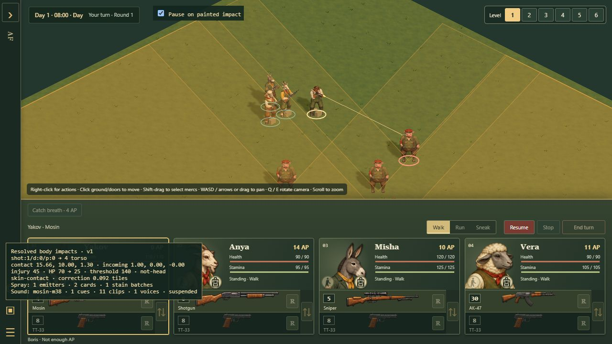

# Hostile review follow-up — 22–23 October 2026

This addresses the review of `04cdcaa3764544c85332f16eb8612192aac5cbb8`.
The six functional defects are fixed. Dense rendering and movement are much
cheaper, but **H2 is not an unconditional 60 FPS approval**. Keep the performance
gate open wherever the recorded frame intervals exceed the target. These are
coding-branch changes; this document does not approve a canonical release.

## Disposition

| Finding | Change and evidence |
| --- | --- |
| H1 | Ordinary movement marks a checkpoint dirty; it does not save each tile. A fixed 30-second deadline cannot be postponed by further walking. Round/outcome boundaries, hiding a dirty tab, explicit saves and existing durable transactions retain checkpoints. Snapshot preparation clones the persistent graph once, copies validated string-only terrain rows directly, and avoids validating the same definition repeatedly within one pass. Later edits are still revalidated. Real IndexedDB tests preserve actor identity, reload, failed writes, competing-tab CAS, pending-transition rejection, leaving and revisiting. |
| H2 | Bounded tree shadow silhouettes; nearby solid thicket shadows instead of every overlapping leaf card/twig; no redundant base-ground slabs or ground shadow casters; exact rigid fixture/equipment batches; reusable static terrain transforms. Visibility uses smaller foliage search buckets, allocation-free leaf equations, ordered grid traversal and an early boolean return where only terrain occlusion is needed. Weapon/contact queries still find the nearest hit. See the measurements and limits below. |
| H3 | A committed command leaving a planner synchronizes the cosmetic audio pause before capturing its event. Cancelled, muted, hidden, historical and genuinely paused cues remain consumed, without a deferred replay queue. Real attacks cover pistol, shotgun, automatic single/burst, sniper, rifle and RPG, including reduced motion. |
| H4 | Camera-right ground components are matrix elements 0 and 2. Tests compare both ground axes and the centered source against real projected positions at all four camera rotations. |
| H5 | Projectile contacts capture `surfaceKind`/`propKind` before destruction. Audio uses that committed contact, or joins its exact structure identity. Real corrugated, steel and brick attacks, intervening cover, destruction and pellet deduplication are covered. Unknown surfaces stay silent. Current window assets are openings with frames, not glass panes; only an explicitly supported glass contact selects glass. No new combat randomness is introduced. |
| H6 | Guard/NPC duplication uses the shared six-layer authoring limit. Tests cover every layer, support, bounds, occupancy, fresh IDs, script-name conflicts, patrol offsets, export and undo/redo. |
| H7 | Optional cosmetics have a separately classified loading manager while sharing progress. Blood Off requests no atlases. Partial failures dispose successful textures and allow entry; mandatory artwork failures still block entry. Off → Full can retry, and actors acquire their fatal mask when an atlas becomes available later. All three missing atlases, partial completion and disposal during loading are covered. |

## Checkpoint measurements

Browser: Chrome 155 on Windows, this review machine. Six real checkpoints per
case; preparation and IndexedDB wall time are measured separately. With six
samples, the reported p95 is the largest observation, not a population guarantee.

| Initialized sectors | Preparation median / p95 | IndexedDB median / p95 | Entire checkpoint median / p95 |
| --- | --- | --- | --- |
| 2 | 9.4 / 12.8 ms | 55.4 / 62.8 ms | 64.6 / 75.6 ms |
| 6 | 16.1 / 22.0 ms | 139.4 / 149.1 ms | 157.0 / 164.4 ms |

The browser harness enforces a **50 ms preparation p95** and **300 ms full
checkpoint p95** for these representative cases. Both passed. The five-tile walk
caused zero writes before its deadline, then one scheduled write. Five additional
explicit writes supplied timing samples. Storage time includes browser record
serialization; it is not a pure disk-service measurement. The save format remains
unchanged, and terrain rows in a saved record share no mutable rows with play.

The earlier six-sector CPU probe measured about 104 ms preparing a checkpoint;
after direct validated-row copying it measured about 17–23 ms. The original
review's 212–278 ms measurements used its original redundant-clone implementation
and a different run. Do not treat the separate runs as a controlled disk benchmark.

Reproduce in an isolated preview origin by copying
`tools/review-campaign-checkpoints.html` beside the packaged campaign modules and
clicking **Run checkpoint journey**. It uses the actual campaign, movement,
validation and IndexedDB APIs; its injected storage failure and gated write are
test controls. It replaces that preview origin's test `continue` slot and refuses
to overwrite an existing non-test campaign.

## Rendering and movement measurements

Target: **16.7 ms CPU draw and GPU time at p95**, with actual display intervals
reported separately. A favorable median is not a guarantee of smooth 60 FPS.
The repeatable input is the shipped `tree-cover` sector fixture: five biomes,
`trees-v1`, 1236 × 394 CSS-pixel battlefield, DPR 1, RTX 3080 / ANGLE D3D11.
Each run warms for five seconds and samples for sixty, with day/night,
close/reverse/overview framing, vegetation cutaways, four mercs, local lights,
interior fog, a furnished room and fire. Workload counters include the warm-up;
stage 0 therefore includes those initial actions. GPU queries sample throughout
the route, including warm-up. No background regression runner ran during captures.

The profiler now ends real turns when AP runs low and records accepted orders,
shots and completed movement, rather than merely claiming continued combat.
Per-stage counters expose rejected attempts too. It also measures shadow
submission separately and provides an opt-in full-detail comparison and one-frame
caster breakdown. It does not refill AP or invent combat outcomes.

The full-shadow sustained comparison recorded CPU median/p95 **19.1/25.1 ms**
and GPU **16.8/22.8 ms**. The original external review recorded worse timings;
those runs have different ambient conditions. During the optimization, a sampled
frame attributed **626 of 1,224 shadow submissions** to thicket artwork and 216
to weapons. This motivated the changes; foliage placement, movement and sight
volumes are unchanged. Static batches preserve actual triangles, UVs, normals,
materials, parent groups and anchors. Object-space-painted guns and deforming
fuel equipment retain their original draws. Moving characters, doors,
searchlights, destruction and cutaways are not hidden behind stale shadow maps.

Ordered foliage searches were checked against brute-force nearest intersections
in both coordinate spaces, including boundaries, reverse and degenerate rays.
The scalar leaf equations match the previous equations. Malformed nonfinite
rays terminate safely. A separate sampled Node CPU reproduction of eight real
squad orders completed the same 106 individual steps: group-step median/p95 fell
from **967/997 ms** to **336/374 ms**. Inspector sampling adds overhead, and this
is not a browser frame-time measurement. It identifies terrain visibility as a
remaining expensive operation, not a reason to promise a language-port speedup.

The final five native runs met the CPU/GPU render p95 target, with matching
source hashes and no application diagnostics:

| Biome | CPU draw p95 | GPU p95 | Display interval median / p95 / p99 | Completed movement / accepted shots |
| --- | --- | --- | --- | --- |
| Jungle | 11.9 ms | 16.55 ms | 16.7 / 18.6 / 60.9 ms | 88 / 6 |
| Temperate | 14.1 ms | 16.08 ms | 16.7 / 20.4 / 126.3 ms | 92 / 7 |
| Snow | 11.7 ms | 16.52 ms | 16.7 / 17.7 / 93.1 ms | 92 / 7 |
| Dry grassland | 11.9 ms | 16.48 ms | 16.7 / 17.9 / 62.5 ms | 88 / 5 |
| Wetlands | 11.3 ms | 16.36 ms | 16.7 / 18.9 / 61.0 ms | 88 / 6 |

These frame tails still matter. Fresh terrain visibility, simulation and changes
of view can interrupt an otherwise fast renderer. The mean frame rate is below
the median's roughly 60 FPS; a subsequent performance pass should measure and
reduce those stalls. Do not describe the entire populated game as locked at 60.

Final native measurements are stored with their source hashes in
`evidence/oct22-hostile-fixes/`. They must be read together with their completed
movement/shot counts: faster simulation can fit more work into the same minute.
Hashes describe the bytes served by the Windows preview; Git checkout line-ending
conversion can change byte hashes without changing the implementation.
Texture/geometry estimates are not total process RAM. There is no certification
for other devices, viewports or an entire finished campaign.

## Packaged gameplay checks

Normal popup → Fire was exercised for pistol, shotgun, automatic single/burst,
sniper and rifle in the playable impact encounter, with decoded clips. The rifle
spent 12 AP and one round, inflicted 45 injury (Boris 70 → 25), and presented one
spray/stain and one Mosin cue. A supported stray/friendly interception in the
sniper check was not counted as a hit on the originally selected enemy.

Ordinary Quick Fight, using heavy/doctor/demolition/rifleman presets, exercised
RPG equipment, right-click ground targeting and popup → Fire. It spent 7 AP and
the loaded rocket; the resulting blast chain scheduled four audio cues, including
its explosion effects. The nearby doctor took splash damage. Quicksave and
Quickload retained the outcome, loaded paused, and did not replay a shot or cue.

The missing-stain-atlas native check temporarily renamed only the generated
packaged copy, with restoration in `finally`. Full entered gameplay with one
useful cosmetic warning. Off entered without that failure. After restoration,
Off → Full loaded the artwork and the rifle shot above used it successfully.
Simulation tests separately verify fatal outcomes/save validity without artwork.
The checked post-reload application warning/error log was empty. Cue scheduling
and WebAudio decoding were observed; no physical-speaker recording was made.

The campaign browser harness covers save/load, CAS, failed persistence and
leave/revisit through the actual campaign APIs. It is not an uncoached UI playtest
of a complete campaign route. The live opening remains the two-sector foundation;
the 450-sector campaign, separate logistics tester and outstanding art studies
have not become complete integrations through this pass.

## Validation and delivery

Final regression, generated-core, fixture, asset and packaging results are recorded
in [the validation record](evidence/oct22-hostile-fixes/validation.json):

- Full catalogue: 2,990 checks, 2,983 passes, one stale-manifest failure and six
  existing speaking-head TODOs. The exporter updated four source hashes; the
  55 affected tests then passed. The full catalogue was not repeated after this
  metadata-only correction.
- Final focused run after correction: **1,053 passes across 122 files**, zero
  failures, skips or TODOs.
- All 20 generated core modules and eleven real-attack fixture cases reproduce;
  37 changed/new JavaScript modules and the HTML review module parse.
- Asset audit and the 3D Pages build pass, including module/worker closure checks.
  The build contains 434 app files plus assets.

Raw CPU profiles, native screenshots and intermediate
comparisons remain in the local `artifacts/oct22-review-fixes/` bundle. The two
review tools above preserve the reproduction workflow. Temporary previews and
review tabs are retired after verification; no user/artist preview is stopped.
