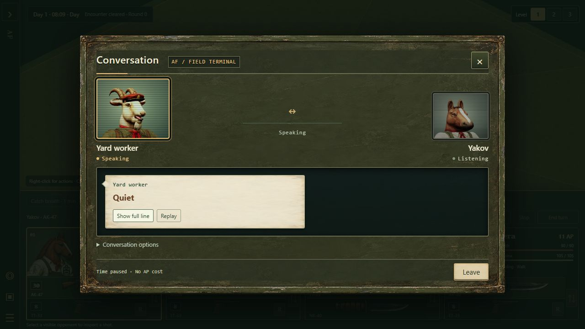
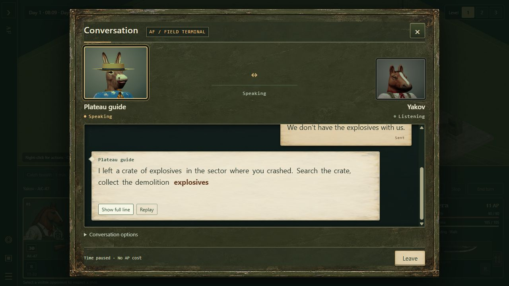
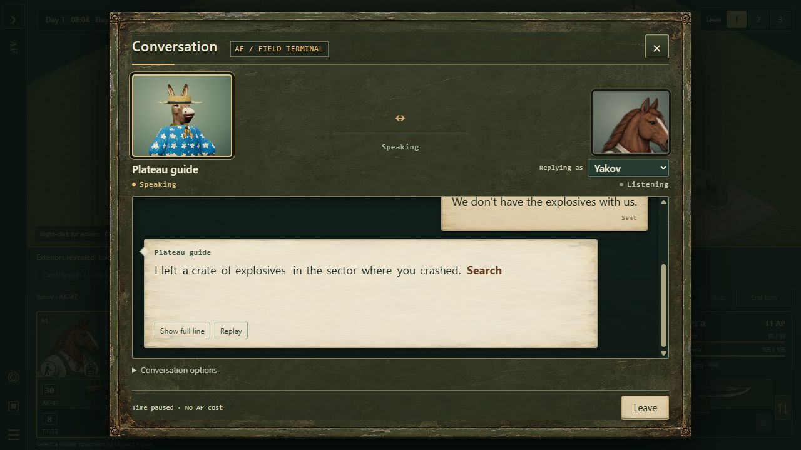

# October 20 integration review

Reviewed canonical `af42810`, coding branch `c29241ae`, and animation branch
`4e27c6fa`, followed by the newly pushed animation `2c5826aa` and painted dialogue
terminal `ee4ae6fb`. Animation checks used an isolated checkout of each pushed
commit. Other agents' working files were not changed.

## CRT scanlines and highlight follow-up: `45cefaf6`

**Approved.** The lines now read clearly at the actual portrait size. Drawing
2px dark / 2px clear bands in CSS solves the loss of detail from shrinking the
original texture. The 20% Multiply treatment preserves facial features, and
the neutral Color Dodge highlight beneath the glass restores central brightness
without an obvious white patch. Keep this strength.

The integrated version retains both animated participant portraits and the
acting merc's fixed identity. The artist branch predated that functionality;
merge reconciliation added its decorative light to both current frames without
restoring the obsolete speaker selector or single-portrait review API.

Compared with the previous glass overlay, this adds two static CSS layers per
portrait and no new runtime image downloads, model geometry, lights, or animation
loop. Blending still adds browser compositing work over changing portrait pixels;
this is an implementation assessment, not a GPU/FPS measurement. The existing
CRT WebP is unchanged.

**Validation:** all 60 focused dialogue and packaging tests pass. The packaged
page was reviewed at 1280×720 and 390×844: scanlines remain visible, faces and text
remain readable, the narrow dialog has no horizontal overflow, both portrait
canvases load, and Replay works. Computed styles confirm the light → glass →
scanline order, isolated blending, and pointer-transparent layers. Browser
warning/error logs were empty. Leaving dialogue removes both portrait canvases.
The standalone Playwright review script was reconciled and syntax-checked;
this integration's browser checks used the in-app browser.

## Blocked movement: approach the barrier, then stop

The player's clarified rule supersedes immediate rejection of an unreachable
conversation: walk as far toward the target as the available route permits,
then stop. A complete route around an obstacle takes priority. If the merc is
already as close as possible, the order produces no movement.

This now applies to 3D ground orders, group destinations, and conversation
approaches. Footprints preview the reachable endpoint and warn when the hovered
destination is blocked. Movement still pays normal AP and stamina, respects
occupancy and floor connections, and can stop earlier for combat or cancellation.
Planning uses discovered geometry; it does not reveal hidden obstacles.
An unreachable conversation ends at the barrier without opening dialogue.

The movement search keeps its best reachable endpoint during the same graph
search. Strict `pathTo`/`navigationPath` queries remain exact unless explicitly
asked for a partial route, preserving AI and interaction eligibility checks.
Conversation planning reuses its existing reachability result: the sealed-sector
regression now performs one exhausted path search, one reachability pass, and
one short route to the reachable stopping point. Queued movement targets that
point rather than repeatedly searching for the impossible original destination.
The generated core change is recorded in `tools/core-partial-route-adapter.mjs`.

**Validation:** 129 targeted tests pass, including blocked ground, occupied
destinations, viable detours, changing barriers, fog-of-war, AP interruption,
multi-floor movement, formation separation, dialogue cancellation, save/load,
climbing, ramps, and deployment file coverage. Asset validation, core
reproduction, JavaScript syntax checks, and the Pages build pass. This follow-up
was verified through the simulation and preview APIs; it adds no new browser
visual or frame-time benchmark.

## Later dialogue follow-up: `3aac80db` and `7bf61901`

**Approved with two corrections.** The acting merc now approaches the NPC,
stops at a clear same-elevation talking position within 12 tiles, and owns the
conversation. Both participants have close 3D portraits. The merc speaks the
selected reply before the NPC's response appears; pause/Continue preserves that
order. Opening another conversation with a different merc is how the player
changes the acting character.

The closer framing resolves much of the earlier excess-shirt problem. The
artist's green CRT glass at 30% Color Burn gives the portraits a restrained field
monitor treatment. Keep this strength; the inactive portrait is already darkened
by the speaker emphasis. The message text remains outside the effect.

Mercs without an authored casting entry get repeatable pitch/tract variation from
their persistent identity. That is a useful placeholder, but individual voice
casting is still needed to express character and personality. This review checks
the presentation and sequencing; it does not substitute for listening approval
of the final voices.

### Corrections made before integration

- **Paused cancellation:** a talk order issued while paused promised that Escape
  would cancel, but ignored Escape and disabled Stop. Resuming then executed the
  unwanted order. Both controls now cancel that pending intention while paused.
  Packaged browser review reproduced the original behavior and verified Escape,
  Stop, resuming without movement, and an uncancelled walk into conversation.
- **Unreachable talking positions:** the submitted route finder repeated a full
  path search for hundreds of possible positions across the same sealed boundary.
  An independent fully revealed 240 × 240 sector reproduction took **74.1 s**.
  After the first failed route, the code now computes reachability once and skips
  disconnected positions. The same reproduction took **1.08 s**, including
  concurrent focused checks. A regression uses the real movement engine and
  verifies that the sealed case performs one path search and one reachability
  pass. This is a major improvement, but the worst-case synchronous query still
  has a noticeable pause; moving expensive navigation preparation off the UI
  thread remains a performance follow-up.

The code and those fixes are recorded in `4387a07a`. Merge reconciliation retained
the painted message surfaces while removing the superseded speaker selector.

### Rendering and verification

The new CRT WebP adds **69,356 bytes** to runtime transfer and approximately
**6 MiB** of decoded RGBA pixels, shared by both portraits. The three UI material
images together are about 549 KiB transferred / 18 MiB decoded. The PNG beside
the WebP is a reusable source asset, not the runtime image. Actual browser and
GPU allocation differs from this pixel estimate.

Two portrait renderers now remain resident during conversation, so model/paint
memory and setup work increase relative to the previous single animated portrait.
Preparation is sequential; only the speaker continues rendering changing mouth
poses, while the listener retains a neutral frame. The CRT is two small isolated
CSS blend surfaces, with no additional scene geometry or lights. This review did
not measure GPU frame completion time.

- **58 focused tests passed:** movement, cancellation ownership, blocked approach,
  fixed speaker, dialogue/checkpoint rules, outgoing reply gating, presentation,
  existing playback regressions and deployment closure.
- **26 additional tutorial and context-action tests passed** (84 distinct checks
  in this follow-up). The artist's browser review script was updated to the new
  `portraits.npc` / `portraits.merc` diagnostics and syntax-checked. Browser
  verification in this review used the in-app browser rather than running that
  separate automation script.
- Asset audit and generated-core consistency checks passed. The final Pages build
  includes the CRT image with the same SHA-256 as the reviewed source.
- Packaged browser: two live portrait canvases, no speaker selector, ordered reply
  handoff, pause/Continue, Replay, close cleanup, and 390 × 844 layout with no
  horizontal dialogue overflow. No warnings or errors were observed.
- At the 1280 × 720 review viewport, each portrait canvas was 156 × 128 pixels.
  Both overlays had isolated `color-burn`, opacity `0.3`, and no pointer handling.

These are focused follow-up checks, not a second local run of the full suite
listed below. The earlier `2d251f27` deployment completed successfully before
this review began.

## Earlier follow-up decisions

**Approved:** the coding integration and review corrections are on canonical as
`3366bb16`. The painted dialogue terminal at `ee4ae6fb` also passes review and
merges cleanly with that integration.

The worn olive metal, restrained brass edges and pale message stock fit the
characters and industrial setting. The textures leave the text area quiet;
incoming and outgoing messages remain distinguishable. Packaged browser review
covered the contextual guide reply, history, options and keyboard access at
1280 × 720, 390 × 844 and 320 × 640. Narrow layouts scroll without horizontal
dialogue overflow; the close control and footer remain accessible. No browser
errors or warnings were recorded.

The skin adds two shared 1254 × 1254 static WebP images: **493,142 bytes combined**
(about 482 KiB transferred), or approximately **12 MiB of uncompressed RGBA
pixels** for both. Actual browser/GPU storage may differ. They are reused by CSS;
the skin adds no 3D geometry or scene lights. CSS text/layout and active portrait
rendering still have their existing costs. The guide's head framing remains the
next polish item: too much of the small portrait is occupied by the shirt.

**Still held:** the natural traversal set at `2c5826aa`. The pig director improves,
but a final-pose scan still finds a **52.2 cm knee displacement in one 60 Hz step**
near 2.533 s, and a **4.55 cm jump in 1 ms** near 0.838 s. Its largest leg-target
reach shortfall is **88.8 cm** near 1.567 s. These remain substantial defects,
not a request for subtler stylistic polish.

The reported world position still finishes one tile behind the visible character,
and the adapter still reports the weapon as carried throughout. The wall study's
cached obstacle-height issue and the pre-balance clearance assertions are unchanged.
All **12 existing traversal tests pass again**, so they still need the final-pose
coverage described below.

The latest independent constructor measurements were approximately 1.14 s for
the horse window, 1.13 s for the low wall, 2.88 s for the horse full wall and
2.96 s for the pig director full wall. This is faster, but still unsuitable for
a synchronous solve when a gameplay move starts. The horse's full-wall pose also
retains an approximately 8.8 cm leg-target reach shortfall.

The follow-up ran **47 dialogue and packaging tests**, the asset audit, source/
packaged texture hash checks and the browser review above. All passed. The full
2,707-pass integration check below belongs to `3366bb16`; it was not needlessly
repeated locally for the subsequent CSS/assets-only skin.

## Coding branch

The dialogue, tutorial, hedge and climbing-rule work is suitable for integration
with the fixes below. The new natural traversal studies remain separate.

### Corrections made during review

- **Ordinary movement during alerts.** The climbing adapter had broadened the AP
  gate and deduction for every step, so a distant alerted guard made solo and
  group walking cost AP; at zero AP they could not move. All four independent
  reproductions failed on the submitted branch. The adapter now charges ordinary
  movement only in turn mode and charges climbs under the shared combat rules.
  Twelve regression cases cover solo/group movement, zero AP, stairs, turn mode,
  and successful/failed climbs. Generated core and its manifest were regenerated.
- **Continue between speech phrases.** A completed phrase remained in `clip`
  while the next phrase loaded. Pausing and continuing in that interval could
  restart the old phrase. Clear the completed clip and offset before waiting.
- **Late speech preparation.** A stale completion cleared the current line's
  prefetch before checking its generation. It could unnecessarily synthesize the
  next phrase twice. Check the generation before touching current state.
  Both playback regressions were reproduced with deferred preparation and pass
  after the corrections.
- **Merge reconciliation.** Keep the artist's joined hedge form through the
  coder's shared rendering/collision surface extraction, persistent planting
  seeds, and gameplay wiring. Keep the complete packaging lists and both the
  hedge HTML entry-point and module-dependency checks.

### Dialogue presentation

The industrial message terminal is a useful direction. Incoming and outgoing
bubbles make the conversation history easy to follow. Attribution stays with
the merc who sent a reply, and the active portrait changes with the conversation.
The tutorial guide responds to the actual supplies and objectives.

Browser review exercised right-click dialogue, a contextual reply, history,
Replay, options pause, the speed label, instant text, muted voice, dismissal,
the guide and hen auditions, and resource release. The encounter clock held at
08:07 while the conversation was open.

**Next visual pass:** tighten the guide's crop. The current portrait spends too
much of its small box on the shirt, while the merc's static portrait fills its
box with the head. Match their apparent head size and retain the hat/ears where
possible. The painted follow-up above supplies the industrial material treatment
while preserving text contrast and the distinction between replies and received
text. The framing note is polish, not a reason to withhold the working dialogue
system.

The three authored voice profiles are an initial audition set. Stable identity
selects the profile, and text/word cues follow the same synthesized timing plan.
Other characters use the fallback profile. This review verifies that mechanism;
it does not replace the user's listening approval of each character's voice.
The previously approved intro recording is unchanged.

### Local presentation measurements

Embedded Chromium 155, 1280 × 720, recorded while regression tests were running:

| Audition | Playback started | Portrait ready | CPU draw p95 | Triangles / calls | Cue lag p95 |
|---|---:|---:|---:|---:|---:|
| Guide | 121 ms | 480 ms | 1.7 ms | 13,583 / 22 | 10.1 ms |
| Hen | 191 ms | 666 ms | 1.8 ms | 10,996 / 14 | 17.3 ms |

These are local preparation/CPU submission and UI-clock measurements, not
whole-game FPS, GPU completion time, or measured speaker-output latency. The
hen run recorded one 52 ms long task; the guide run recorded none. Closing the
hen performance left zero owned workers, pending jobs, cached PCM, sources,
animation frames, renderers, geometries and textures.

### Hedge integration

The joined forms now have matching finite sight geometry. Leaves conceal;
the visible wood stops projectiles. Short hedges can be seen over, tall hedges
screen standing characters, and an omitted tile remains an actual gate.
Tests compare the collision queries with the rendered surfaces and exercise
upper floors, save/import, editor undo and cache invalidation.

Geometry persists across visibility and camera updates. Dense planting still
has a cold preparation cost; the builder's 1,024-cell stress measurement is
documented in [the hedge integration report](HEDGE-GAMEPLAY-INTEGRATION-2026-10-19.md).
Do not present that stress result as a steady rendering cost.

## Natural traversal at `4e27c6fa`: original findings

The horse's movements improve substantially, and the hen's wing-assisted hop is
a sensible species-specific solution. However, the complete set at `4e27c6fa`
is not ready to replace gameplay traversal.

### 1. Pig director wall climb has a serious intermediate-pose regression

In the final balanced motion, the left knee moves **57.1 cm in one 60 Hz step**
near 3.617 s. A finer scan finds a **17.4 cm jump in 1 ms** near 0.828 s.
The largest leg target exceeds the available reach by **95.5 cm** near 1.604 s.
The visible pose at 1.60 s lifts the body far above the intended wall contacts.

The horse's largest limb changes in the same 60 Hz scan are:

| Motion | Previously reviewed `5580fc5` | `4e27c6fa` |
|---|---:|---:|
| Window | 38.2 cm | 13.4 cm |
| Low wall | 53.2 cm | 15.8 cm |
| Full wall | 37.7 cm | 12.0 cm |

The remaining large pig discontinuity needs correcting before roster approval.
Keep the improvements to the horse; do not rebuild all three motions from scratch.

The branch's **12 tests pass**, but the mammal clearance assertions read
`motion.fit`, whose report was produced before the balance adjustment. That is
not an independent measurement of the final balanced pose. Add final-pose
sampling across the roster, with limb continuity, reachable contacts and actual
surface clearance checked after balancing. Preserve the endpoint/restoration
tests as well.

### 2. The battle adapter's reported position stays at the starting tile

For a window crossing from `(7,7,1)` to `(8,7,1)`, the character's hips finish
over the destination, but `apply(1).worldRoot` remains `[7,2.12,7]`, rather than
`[8,2.12,7]`. Gameplay uses that reported position for selection rings,
presentation selection and foliage cutaways. Return the moving presentation
anchor while retaining the authored pose's local frame. Check every heading
and raised floors.

### 3. Equipment and preparation still need integration work

The adapter reports `equipmentState: 'carried'` throughout. Reuse the existing
shared stow/draw lifecycle before replacing the current traversal; this does
not require a separate body animation for every weapon.

The balance/fitting work runs synchronously in the motion constructor. The
independent four-motion probe took seconds per construction under concurrent
test load. A separate probe after this review's other checks completed measured
0.98 s for the horse window, 0.96 s for the low wall, 4.21 s for the horse full
wall and 4.74 s for the pig director full wall. Other user applications were
left running. These are constructor CPU times, not FPS.

Prepare/cache this work outside an accepted gameplay move, and measure the cold
start in the browser too. A synchronous solve inside `BattleTraversal.pose`
would stall the game.

The waist-high wall remains a proposed gameplay object. The study still needs
to reset the wall instance height when switching from the short wall back to
the full wall; otherwise comparisons can use the wrong obstacle.

| After switching from the low wall | After reloading the full wall |
|---|---|
|  |  |

This review did not rerun the external phantom-wrench force audit. The limb,
reach, endpoint and browser findings above are independent checks.

## Babble Lab

Also checked `8b62ac5`: the audition now defaults the sampled-hen timbre mix to
70%, with the full slider available. Eleven targeted audition/morph tests pass.
The core `src` modules are unchanged since the game's pinned `8f1d23c`.
The new audition/export tools are therefore not a missing runtime engine
upgrade. Choose/export a take and its timing data deliberately when applying
that timbre to game content.

## Verification record

Local evidence is in `artifacts/oct20-updates/` in the review checkout:
regression logs, independent traversal measurements, dialogue timing/resource
records and screenshots.

- Full `npm run check`: **2,707 passed, zero failures, six existing mouth-model
  TODOs** (2,713 cases); asset audit passed. The TODOs remain visible rather than
  being silently relaxed.
- Core regeneration: all 20 modules and the manifest match their adapters.
- The deployment regression built the complete Pages output. Its dialogue
  performance, terminal, hedge layout and engine files match the reviewed source.
- Packaged browser smoke: the tutorial map, guide conversation, speaking
  portrait and message UI load without browser warnings or errors.
- Natural traversal branch: 12 existing tests pass; the independent intermediate
  pose and adapter checks above identify the approval blockers those tests miss.
- Babble Lab: 11 targeted tests pass.
