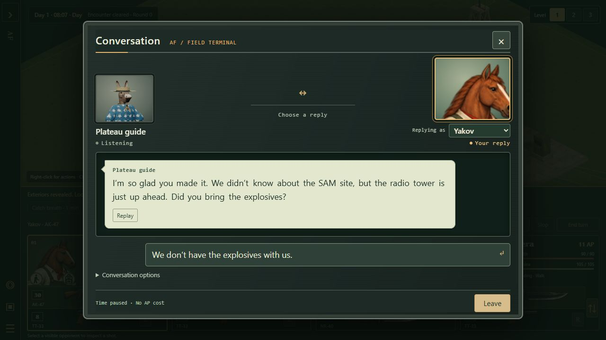
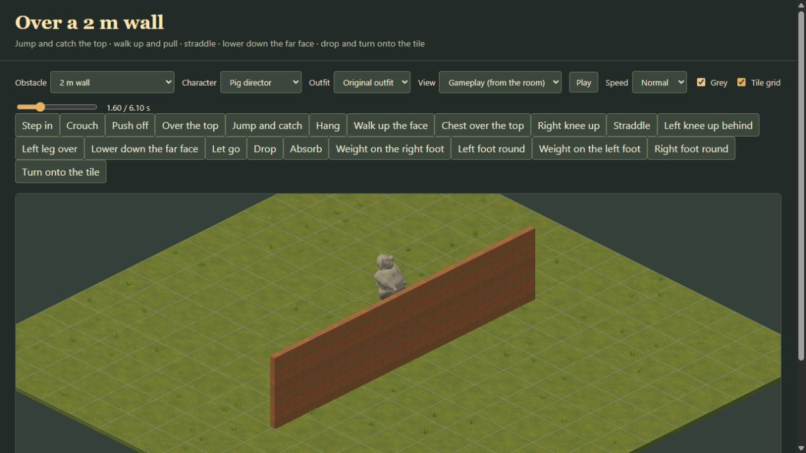
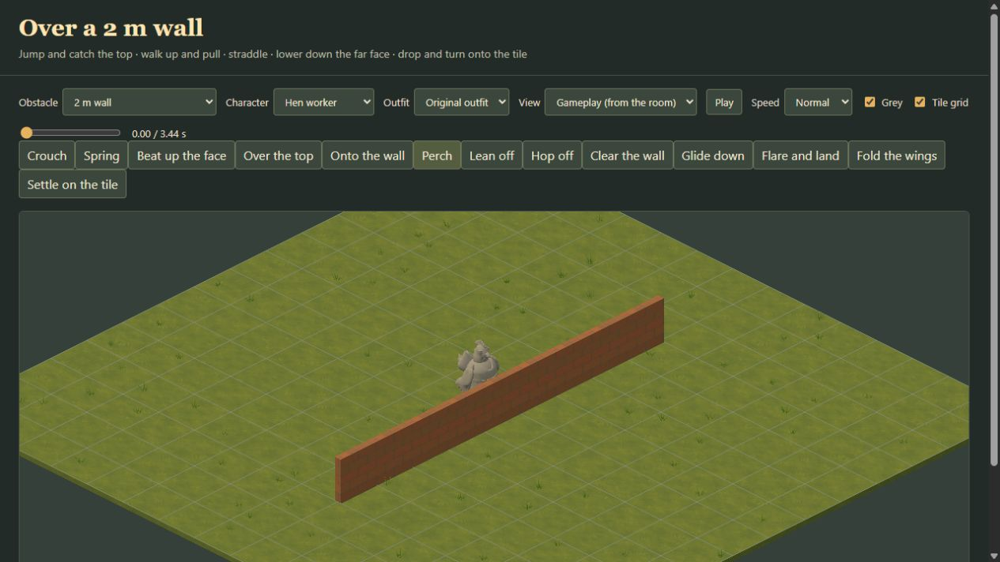
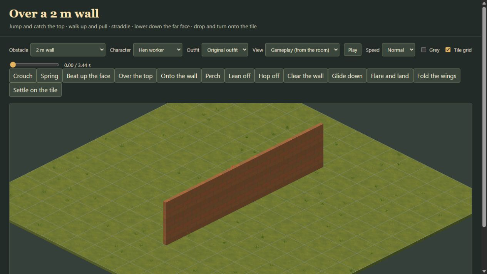

# October 20 integration review

Reviewed canonical `af42810`, coding branch `c29241ae`, and animation branch
`4e27c6fa`. The animation checkout was isolated at the pushed commit; the
artist's newer uncommitted edits were not included.

## Coding branch

The dialogue, tutorial, hedge and climbing-rule work is suitable for integration
with the fixes below. The new natural traversal studies remain separate.

### Corrections made during review

- **Ordinary movement during alerts.** The climbing adapter had broadened the AP
  gate and deduction for every step, so a distant alerted guard made solo and
  group walking cost AP; at zero AP they could not move. All four independent
  reproductions failed on the submitted branch. The adapter now charges ordinary
  movement only in turn mode and charges climbs under the shared combat rules.
  Twelve regression cases cover solo/group movement, zero AP, stairs, turn mode,
  and successful/failed climbs. Generated core and its manifest were regenerated.
- **Continue between speech phrases.** A completed phrase remained in `clip`
  while the next phrase loaded. Pausing and continuing in that interval could
  restart the old phrase. Clear the completed clip and offset before waiting.
- **Late speech preparation.** A stale completion cleared the current line's
  prefetch before checking its generation. It could unnecessarily synthesize the
  next phrase twice. Check the generation before touching current state.
  Both playback regressions were reproduced with deferred preparation and pass
  after the corrections.
- **Merge reconciliation.** Keep the artist's joined hedge form through the
  coder's shared rendering/collision surface extraction, persistent planting
  seeds, and gameplay wiring. Keep the complete packaging lists and both the
  hedge HTML entry-point and module-dependency checks.

### Dialogue presentation

The industrial message terminal is a useful direction. Incoming and outgoing
bubbles make the conversation history easy to follow. Attribution stays with
the merc who sent a reply, and the active portrait changes with the conversation.
The tutorial guide responds to the actual supplies and objectives.

Browser review exercised right-click dialogue, a contextual reply, history,
Replay, options pause, the speed label, instant text, muted voice, dismissal,
the guide and hen auditions, and resource release. The encounter clock held at
08:07 while the conversation was open.

**Next visual pass:** tighten the guide's crop. The current portrait spends too
much of its small box on the shirt, while the merc's static portrait fills its
box with the head. Match their apparent head size and retain the hat/ears where
possible. Apply the artist's industrial paint treatment without reducing the
message text's contrast or the distinction between replies and received text.
These are polish notes, not reasons to withhold the working dialogue system.

The three authored voice profiles are an initial audition set. Stable identity
selects the profile, and text/word cues follow the same synthesized timing plan.
Other characters use the fallback profile. This review verifies that mechanism;
it does not replace the user's listening approval of each character's voice.
The previously approved intro recording is unchanged.

### Local presentation measurements

Embedded Chromium 155, 1280 × 720, recorded while regression tests were running:

| Audition | Playback started | Portrait ready | CPU draw p95 | Triangles / calls | Cue lag p95 |
|---|---:|---:|---:|---:|---:|
| Guide | 121 ms | 480 ms | 1.7 ms | 13,583 / 22 | 10.1 ms |
| Hen | 191 ms | 666 ms | 1.8 ms | 10,996 / 14 | 17.3 ms |

These are local preparation/CPU submission and UI-clock measurements, not
whole-game FPS, GPU completion time, or measured speaker-output latency. The
hen run recorded one 52 ms long task; the guide run recorded none. Closing the
hen performance left zero owned workers, pending jobs, cached PCM, sources,
animation frames, renderers, geometries and textures.

### Hedge integration

The joined forms now have matching finite sight geometry. Leaves conceal;
the visible wood stops projectiles. Short hedges can be seen over, tall hedges
screen standing characters, and an omitted tile remains an actual gate.
Tests compare the collision queries with the rendered surfaces and exercise
upper floors, save/import, editor undo and cache invalidation.

Geometry persists across visibility and camera updates. Dense planting still
has a cold preparation cost; the builder's 1,024-cell stress measurement is
documented in [the hedge integration report](HEDGE-GAMEPLAY-INTEGRATION-2026-10-19.md).
Do not present that stress result as a steady rendering cost.

## Natural traversal: hold for revision

The horse's movements improve substantially, and the hen's wing-assisted hop is
a sensible species-specific solution. However, the complete set at `4e27c6fa`
is not ready to replace gameplay traversal.

### 1. Pig director wall climb has a serious intermediate-pose regression

In the final balanced motion, the left knee moves **57.1 cm in one 60 Hz step**
near 3.617 s. A finer scan finds a **17.4 cm jump in 1 ms** near 0.828 s.
The largest leg target exceeds the available reach by **95.5 cm** near 1.604 s.
The visible pose at 1.60 s lifts the body far above the intended wall contacts.

The horse's largest limb changes in the same 60 Hz scan are:

| Motion | Previously reviewed `5580fc5` | `4e27c6fa` |
|---|---:|---:|
| Window | 38.2 cm | 13.4 cm |
| Low wall | 53.2 cm | 15.8 cm |
| Full wall | 37.7 cm | 12.0 cm |

The remaining large pig discontinuity needs correcting before roster approval.
Keep the improvements to the horse; do not rebuild all three motions from scratch.

The branch's **12 tests pass**, but the mammal clearance assertions read
`motion.fit`, whose report was produced before the balance adjustment. That is
not an independent measurement of the final balanced pose. Add final-pose
sampling across the roster, with limb continuity, reachable contacts and actual
surface clearance checked after balancing. Preserve the endpoint/restoration
tests as well.

### 2. The battle adapter's reported position stays at the starting tile

For a window crossing from `(7,7,1)` to `(8,7,1)`, the character's hips finish
over the destination, but `apply(1).worldRoot` remains `[7,2.12,7]`, rather than
`[8,2.12,7]`. Gameplay uses that reported position for selection rings,
presentation selection and foliage cutaways. Return the moving presentation
anchor while retaining the authored pose's local frame. Check every heading
and raised floors.

### 3. Equipment and preparation still need integration work

The adapter reports `equipmentState: 'carried'` throughout. Reuse the existing
shared stow/draw lifecycle before replacing the current traversal; this does
not require a separate body animation for every weapon.

The balance/fitting work runs synchronously in the motion constructor. The
independent four-motion probe took seconds per construction under concurrent
test load. A separate probe after this review's other checks completed measured
0.98 s for the horse window, 0.96 s for the low wall, 4.21 s for the horse full
wall and 4.74 s for the pig director full wall. Other user applications were
left running. These are constructor CPU times, not FPS.

Prepare/cache this work outside an accepted gameplay move, and measure the cold
start in the browser too. A synchronous solve inside `BattleTraversal.pose`
would stall the game.

The waist-high wall remains a proposed gameplay object. The study still needs
to reset the wall instance height when switching from the short wall back to
the full wall; otherwise comparisons can use the wrong obstacle.

| After switching from the low wall | After reloading the full wall |
|---|---|
|  |  |

This review did not rerun the external phantom-wrench force audit. The limb,
reach, endpoint and browser findings above are independent checks.

## Babble Lab

Also checked `8b62ac5`: the audition now defaults the sampled-hen timbre mix to
70%, with the full slider available. Eleven targeted audition/morph tests pass.
The core `src` modules are unchanged since the game's pinned `8f1d23c`.
The new audition/export tools are therefore not a missing runtime engine
upgrade. Choose/export a take and its timing data deliberately when applying
that timbre to game content.

## Verification record

Local evidence is in `artifacts/oct20-updates/` in the review checkout:
regression logs, independent traversal measurements, dialogue timing/resource
records and screenshots.

- Full `npm run check`: **2,707 passed, zero failures, six existing mouth-model
  TODOs** (2,713 cases); asset audit passed. The TODOs remain visible rather than
  being silently relaxed.
- Core regeneration: all 20 modules and the manifest match their adapters.
- The deployment regression built the complete Pages output. Its dialogue
  performance, terminal, hedge layout and engine files match the reviewed source.
- Packaged browser smoke: the tutorial map, guide conversation, speaking
  portrait and message UI load without browser warnings or errors.
- Natural traversal branch: 12 existing tests pass; the independent intermediate
  pose and adapter checks above identify the approval blockers those tests miss.
- Babble Lab: 11 targeted tests pass.
