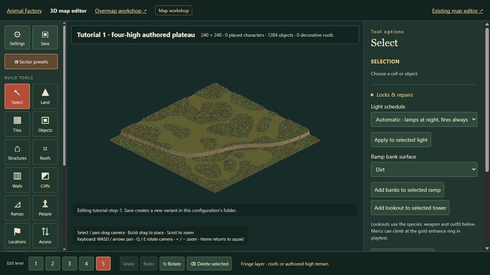

# October 21 integration review

## Five authored layers and the raised tutorial: `78cce722`

**Approved after four height-limit corrections.** Four ordinary layers plus a
fifth for authored high terrain are now supported. The tutorial summit uses
layer five, with two doubled cliff tiers and a four-stage town descent. Existing
three-layer maps keep their shape; legacy decorative roofs keep their height.
The pinned opening campaign from `7c025a11` remains separate from this terrain.

The broad migration is useful: one layer definition supplies the editor,
generated core, foliage, floor destruction, grenade planning and save validation.
The authored draft's trees and clearings are preserved. Its four existing
disconnected start/exit warnings remain; those markers need a connected clearing
before that variant becomes a playable encounter. This review does not repaint
the user's layout to hide the warnings.

### Corrections made during review

- A collapse from layer five skipped an intact layer-four floor and landed at
  ground level. Fall landing searches now cover every supported layer and still
  stop at an occupied floor instead of passing through it.
- Bullet flashes, traces and impact visibility capped their lookup at layer
  three. They now use the actual supported layer, without exposing effects
  through visibility on a lower floor.
- Blast visibility capped at layer four, hiding a discovered layer-five blast
  or revealing it through the wrong floor's visibility. It now follows the
  shared maximum.
- Hybrid projectile events reported upper impacts as layer three. Their event
  heights now retain the actual hit layer.

All four independent regressions failed on the submitted implementation and
pass with these fixes. Existing arch tests also assumed the global layer limit
equalled every blank map's capacity. Their fixtures now explicitly declare the
capacity required for the large arch. Legacy three-layer rejection is retained
as a separate assertion; invalid height placement is still rejected.

### Verification and limits

**166 focused tests pass**, covering campaign saves, legacy encounters, extended
layers, arch rotations and placement, collapse/falls, shot and blast visibility,
hybrid combat, tutorial seams and descent connectivity, blocks, editing and
deployment imports. Core reproduction, the asset audit and the Pages build pass.
The full project suite was not rerun locally.

Packaged browser review loaded the raised forested plateau with layer five
selected. A small independent fixture imported through the normal file chooser,
launched through Playtest, and rendered its squad on layer five with all five
gameplay controls present. Browser-control focus/input timeouts prevented a
complete interactive movement check; this is not a measured gameplay FPS result.
The plateau page's application warning/error log was empty. Simulation tests
verify the four-stage descent and cross-layer connectivity.

One synchronous validation of the exact generated town sector took **6.66 s**
in Node. Moving expensive validation off the interaction thread remains a useful
performance follow-up. Do not infer a browser timing from that measurement.

## Window motion: `d3fec1f0`

**Hold for gameplay integration.** The new hand placement and donkey arm work
are worthwhile, but the submitted report describes the remaining final-pose
clearance defect: `fit.report` is measured before later balance and body-band
adjustments. Source inspection confirms that order. A passing fit test therefore
does not certify the pose actually shown in the game.

The author's final-pose measurements report window trouser penetration of about
13–19 cm on several animals and climb head/wall intersections of about 4.5–9.8 cm.
Those numbers are the author's measurements, not fresh independent physics runs.
The `anim/window-honest-wip` branch explicitly records three failing tests.
Neither animation branch was merged here.

The next gate should measure the complete pose after all balance, contact and
tail adjustments, including clothing and limbs. Correct those intersections
before tuning the smaller remaining force spikes. Preserve the improved floor
hand contacts and donkey elbow rather than rebuilding the sequence wholesale.
