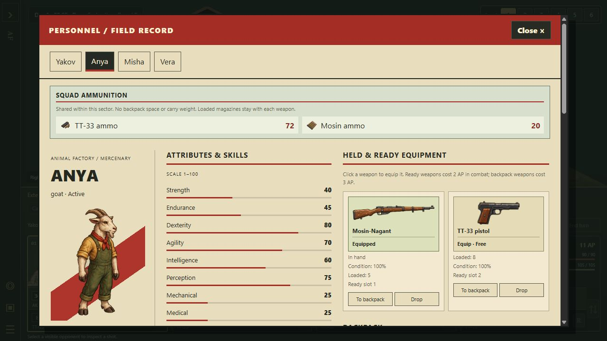
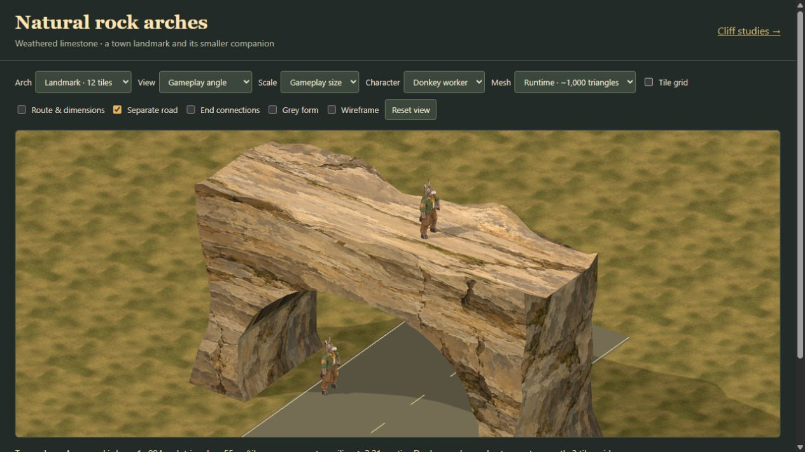

# October 21 integration review

## Sixth layer, common ammunition and release repair: `615b3340`, `977841bd`

**Approved with release repairs.** Maps now support five ordinary layers and a
sixth fringe layer above the tutorial summit. Legacy three-, four- and five-layer
documents retain their declared capacity and heights. The painted arches still
require the same layer-four and layer-two tops; their exported five-layer plan
describes minimum asset needs, not a maximum for the map engine.

Reserve ammunition is now common within a sector, without backpack cells or
carry weight. Loaded magazines remain on individual weapons, quantities remain
finite, and reload/AP/jam rules remain. Serialized shares travel with people;
splitting groups and crossing sectors conserves quantities without drawing
supplies from a remote sector. New hires, deaths and old-save migration are
covered by the submitted regression tests. Guards retain personal reserves.

### Repairing the previous failed deployment

The full Pages check for `f1337165` failed, so that integration did not deploy.
Its 12 failures exposed remaining coupling to old map assumptions:

- The approved intro and its repaint tools read the editable tutorial terrain.
  Raising the cliffs changed the camera/terrain relationship. They now use
  `intro-sprites/crash-sector-map.json`, byte-identical to the map on the last
  successful canonical `7c025a11` (normalized SHA-256
  `18911c2ea7b399d2898e8aea703133ded8e85c789d3f8010d43405da83695b91`).
  Composition, clearance and cliff-plant checks pass against that pinned set.
  No approved sprite frames or blended intro audio were repainted or replaced.
- The foliage source manifest was stale after the layer migration. It was
  regenerated with its existing exporter. The foliage study's provenance now
  checks the deliberately doubled 1,284 cliff props rather than the old 642.
- Renderer and roof tests still treated the old decorative fourth layer as the
  current maximum. They now use the shared limits while retaining checks for
  roof isolation, invalid occupants, overlap, undo and block preservation.

I also corrected the physical height in the earlier upper-blast regression:
its height and explicit floor had used inconsistent units, hidden by the old
clamp. Fall, impact and effect-visibility regressions now exercise every upper
layer supported by the shared constant.

### Verification

The 100-check release-repair set passes. A full local run then completed
**2,809 tests: 2,802 passed, one failed, six existing TODOs**. Its only failure
was an obsolete character-sheet assertion expecting ammo inside the backpack.
After that test-only correction, the character-sheet and shared-ammo files pass
18/18. The full 23-minute run was not repeated after that assertion update;
the deployment workflow will run it again. No runtime behavior was changed to
make the assertion pass.

Core reproduction, changed-JavaScript syntax checks and the asset audit pass.
Source-browser review collected eight pistol rounds and verified the reserve
changed from 64 to 72 on both Yakov's and Anya's sheets; rifle reserves stayed at
20 and ammunition occupied neither backpack. All six gameplay level buttons
were present. The editor imported an independently generated connected six-layer
fixture and selected layer six. That is an import/control check, not a complete
interactive six-floor playthrough. Browser application warning/error logs were
empty on the ammunition view.

## Painted natural arches: `39db2e79`

**Approved as reusable art and a packaged study.** The warm limestone, broad
painted strata and sheltered underside fit the character palette. At gameplay
size both the landmark and shallow companion read clearly. The flat walking
strip is legible, with irregular rims around it. Judge their final roots where
they meet surrounding terrain; the freestanding study does not show that join.

The large and small runtime meshes contain **994 and 952 triangles**, each one
mesh/material submission per ordinary render pass. Instances share geometry and
one 564,670-byte WebP atlas (about 6 MiB of decoded RGBA pixels, excluding mipmaps
and other allocation). This is a reasonable asset budget; no whole-game FPS or
GPU-memory benchmark was run. Front/rear faces deliberately suppress received
dynamic shadows to avoid triangulation stripes. The top and underside still
receive shadows, and the whole rock casts them. Preserve that limited scope.

Eleven focused geometry/actor/packaging tests pass, including the complete
native-body and fitted-hat clearance check. Packaged browser views of both
runtime arches at 55 px/tile load without application warnings/errors. Weapons
are outside that clearance claim. The low companion's clearance is tight; do
not thicken its underside without repeating the complete-model check.

The merged handoff now acknowledges `0715e800`'s completed layer schema instead
of asking the coder to repeat that migration. Export metadata was rebuilt to
match. **These painted models are not yet the gameplay props.** The remaining
work is the final collision bake, rotations and origin mapping, the independent
upper walking strip, end approaches, and an above/below save-and-playtest check.
Retain the open underpass for sight, bullets and grenades. Do not use a solid
bounding box or imply the artist's contacts are already an engine route.

## Five authored layers and the raised tutorial: `78cce722`

**Approved after four height-limit corrections.** Four ordinary layers plus a
fifth for authored high terrain are now supported. The tutorial summit uses
layer five, with two doubled cliff tiers and a four-stage town descent. Existing
three-layer maps keep their shape; legacy decorative roofs keep their height.
The pinned opening campaign from `7c025a11` remains separate from this terrain.

The broad migration is useful: one layer definition supplies the editor,
generated core, foliage, floor destruction, grenade planning and save validation.
The authored draft's trees and clearings are preserved. Its four existing
disconnected start/exit warnings remain; those markers need a connected clearing
before that variant becomes a playable encounter. This review does not repaint
the user's layout to hide the warnings.

### Corrections made during review

- A collapse from layer five skipped an intact layer-four floor and landed at
  ground level. Fall landing searches now cover every supported layer and still
  stop at an occupied floor instead of passing through it.
- Bullet flashes, traces and impact visibility capped their lookup at layer
  three. They now use the actual supported layer, without exposing effects
  through visibility on a lower floor.
- Blast visibility capped at layer four, hiding a discovered layer-five blast
  or revealing it through the wrong floor's visibility. It now follows the
  shared maximum.
- Hybrid projectile events reported upper impacts as layer three. Their event
  heights now retain the actual hit layer.

All four independent regressions failed on the submitted implementation and
pass with these fixes. Existing arch tests also assumed the global layer limit
equalled every blank map's capacity. Their fixtures now explicitly declare the
capacity required for the large arch. Legacy three-layer rejection is retained
as a separate assertion; invalid height placement is still rejected.

### Verification and limits

**166 focused tests pass**, covering campaign saves, legacy encounters, extended
layers, arch rotations and placement, collapse/falls, shot and blast visibility,
hybrid combat, tutorial seams and descent connectivity, blocks, editing and
deployment imports. Core reproduction, the asset audit and the Pages build pass.
The full project suite was not rerun locally.

Packaged browser review loaded the raised forested plateau with layer five
selected. A small independent fixture imported through the normal file chooser,
launched through Playtest, and rendered its squad on layer five with all five
gameplay controls present. Browser-control focus/input timeouts prevented a
complete interactive movement check; this is not a measured gameplay FPS result.
The plateau page's application warning/error log was empty. Simulation tests
verify the four-stage descent and cross-layer connectivity.

One synchronous validation of the exact generated town sector took **6.66 s**
in Node. Moving expensive validation off the interaction thread remains a useful
performance follow-up. Do not infer a browser timing from that measurement.

## Window motion: `d3fec1f0`

**Hold for gameplay integration.** The new hand placement and donkey arm work
are worthwhile, but the submitted report describes the remaining final-pose
clearance defect: `fit.report` is measured before later balance and body-band
adjustments. Source inspection confirms that order. A passing fit test therefore
does not certify the pose actually shown in the game.

The author's final-pose measurements report window trouser penetration of about
13–19 cm on several animals and climb head/wall intersections of about 4.5–9.8 cm.
Those numbers are the author's measurements, not fresh independent physics runs.
The `anim/window-honest-wip` branch explicitly records three failing tests.
Neither animation branch was merged here.

The next gate should measure the complete pose after all balance, contact and
tail adjustments, including clothing and limbs. Correct those intersections
before tuning the smaller remaining force spikes. Preserve the improved floor
hand contacts and donkey elbow rather than rebuilding the sequence wholesale.
