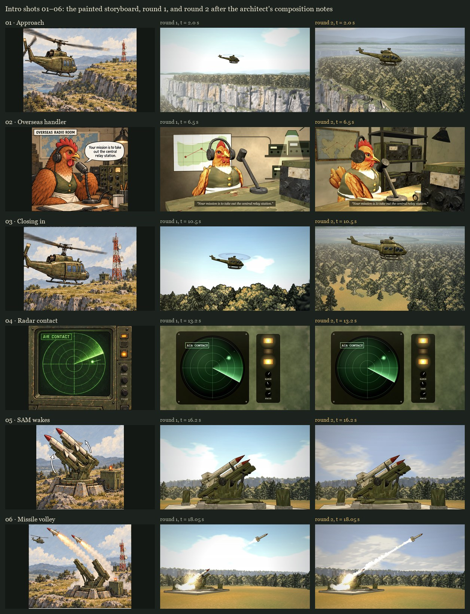

# Intro, storyboard 01–07: approach, ambush and the cut into the crash

**Status (October 14, 2026): round 3, the animation round, for the architect's review.**
- Every shot animates at 20 fps.
- Shot 07 cuts back to the aircraft at 19.4 s and hands over to the approved crash player ([INTRO-SPRITE-PROOF.md](INTRO-SPRITE-PROOF.md)) at 20.2 s.
- One page plays the whole intro, 0–35 s: `tactics/intro-sprites/intro.html`.
- The crash player and its plates are unchanged.

Round 2 was the architect's composition pass on round 1 (`7574e32`). Its notes and changes are below the animation round.

> **Direction (the user, 2026-10-13), after the crash sequence was merged:** "go ahead and clean up the merged branches, then we can start with the next part of the intro". The next item on the intro handoff's checklist is "Apply the accepted treatment to approach, overseas briefing, radar and the remote SAM cutaway." Round 1 followed the method the crash used: keyframes first, checked before any in-between animation.

> **The architect's review of round 1 (`7574e32`), 2026-10-14, as relayed by the user:**
> I reviewed `7574e32` in PR #11. The launch direction works, but I'd do one focused composition pass before animating.
> My recommendations for the four choices:
> 1. Shot 01: bring the helicopter closer. Keep enough cliff and plateau to establish the location, but give the aircraft more presence, closer to the storyboard. Currently the pale sky dominates.
> 2. Shot 03: show more plateau. Include recognizable terrain beneath or behind the aircraft so we understand where it is flying. Preserve the direction of travel.
> 3. SAM site: keep the separate set. It represents a remote location; there's no benefit in forcing it into an unrelated tutorial sector.
> 4. Hen: keep the game's hen, with simple beak movement during her line. Her pose needs more attention than her identity: turn her toward the microphone and give her a slight forward lean or a wing resting on the desk.
>
> I approve the steeper launcher angle and wider volley camera. They make the action easier to read.
> Two visual issues deserve correction:
> * Washed-out skies: the missile trail disappears into the white background. Adjust these new shots while preserving the approved crash's appearance.
> * Radio room: the flat background radios, map and lamp look noticeably simpler than the hen and foreground equipment. Bring their shading and paint treatment closer together.
>
> All 28 intro and deployment checks I ran passed. I've left the PR unmerged for this revision; the completed animation and transition into the crash still need review.



## Round 3: the animation round

> The architect, on round 1: "I've left the PR unmerged for this revision; the completed animation and transition into the crash still need review."

| Shot | Animated by | Since |
| --- | --- | --- |
| 01, 03 · the aircraft | its lens bake at 20 fps, the window following it | round 1 (the cameras of round 2) |
| 02 · the handler | her head and beak at 20 fps over the room's plate | round 2 |
| 04 · the radar | code-drawn, a function of time | round 1 |
| 05, 06 · the launcher | its bake at 20 fps, in layers (below), and the painted launch along the baked flights | round 3 |
| 07 · incoming | the crash player's wide view before it starts (below) | round 3 |

**07, the cut into the crash (19.4–20.2 s).** The storyboard's 07 cuts back from the remote SAM to the aircraft, in the crash sector, before the hit at 20.5 s. It is drawn in the crash player's own wide view:
- its painted plate (`plate/crash-plate.webp`, unchanged);
- its camera, which holds its first framing until 20.2 s (`trajectory.js` `cameraAt`). So the plate, built to contain every camera frame from 20.2 s, already contains 07, and needs no repaint. Round 1's doc said it would.
- the aircraft on the approach, baked for those 0.8 s by the crash's own tool in the crash's own view (`tools/bake-intro-heli-sequence.mjs --approach`, into `heli-07/`), with its ground shadow and the painted rotor;
- the crash's missile schedule, drawn as the proof draws it. The missiles enter from screen left as the proof starts.

The pre-roll's yaw is taken relative to the approach's heading at 20.2 s. The crash's frames hold the study's yaw, 0, until the hit, so the aircraft meets them without a jump. At 20.2 s the player hands over to `proof.js`.

**The whole intro in one player.** `intro.html` runs `ambush-player.js` to 20.2 s and the crash player (`proof.js`) after it, on one canvas, one timeline. It has buttons for every shot and the crash's keyframes. `ambush.html` (stills) runs the same player.

**The launcher, baked in layers.** Baked whole, a frame held the launcher and any missile in flight, so its crop spanned most of the screen once a missile was away. 05 and 06 took 32 sprite sheets, 537 MB once decoded. The launcher bake (`tools/bake-intro-sam.mjs`) now keeps three layers:
- the static slab, footings and cabinets, baked once;
- per frame, the turret (turntable, cradle, rails and the missiles still on them);
- per frame, each missile in flight.

Each layer is rendered with the others as depth-only occluders, so a cabinet in front of the turret still hides it. The player draws the base, the turret, the smoke, then the missiles over their own trails. Every bake also trims its sprite sheets to what they hold.

| Measured | |
| --- | --- |
| Whole-intro playback, 30 fps, 0–35 s, through `intro.html`; the same from the built Pages output | 1,051 frames, 0 over budget, no page errors |
| The crash's 15 strip moments, through `intro.html` | byte-identical to `2152bd0`'s `proof.html` |
| The cut at 20.2 s: the pre-roll's last frame vs the proof's first | attitude within 0.004 rad, rotor hub within 0.5 px, the same point on the path |
| The launcher, 05 + 06 | 6 sprite sheets, 2.7 MB, 84 MB decoded (in one piece: 32 sheets, 5.6 MB, 537 MB) |
| Decoded memory, the whole intro, every sheet and plate | 466 MB: 0–20.2 s takes 281 MB, the crash 184 MB |
| `tests/intro-ambush.test.mjs` | 16 tests, 3 new: every shot at 20 fps from its first moment to its last; the launcher's layers; the cut into the crash |
| Mutants, animation round (sandbox copy) | 9/9 caught: 07's last frame missing, 07 with the absolute heading (a 3.3° jump at the cut), 07 without a shadow, the crash camera moving before 20.2 s, 06 and the room at 10 fps, 06 drawing a missile before launch, 06 losing its first missile, 05 without its base |

The whole intro, every half second: [0–20 s](intro-ambush/round-3/intro-strip-0-20.jpg) and [19–35 s](intro-ambush/round-3/intro-strip-19-35.jpg).

A video of the whole intro is made by `tools/record-intro-proof.mjs --page intro --video`. It is not committed: it runs to 23 MB.

## Round 2: the notes and what changed

| Note | Change | Measured |
| --- | --- | --- |
| 01: closer, more presence, less sky | The camera rises above the aircraft's height and comes in along the south wall: the aircraft climbs over the rim with the plateau forest below it, the wall to its left and the far rims behind. A 46° lens; a 3000 px plate the window pans across, following the aircraft (`follow` 0.8). | The aircraft is 430–515 px long, whole in the frame for all 4 s (round 1: 213 px). The frame is 0.19 sky and 0.61 plateau (round 1: 0.56 and 0.09). Terrain is behind the aircraft at every sampled time (round 1: none). |
| 03: more plateau, terrain under the aircraft | The camera rises above the aircraft and looks down across the plateau's woods and meadows, in the same direction of travel. Same lens and panning plate as 01. | 594–635 px long, whole in the frame for all 3 s (round 1: 352). 0.04 sky and 0.93 plateau (round 1: 0.85 and 0.15). Terrain is behind the aircraft throughout (round 1: never). |
| SAM site | Kept, as the architect advised. | — |
| The hen: beak, turn, lean, wing | Her whole body turns 26° toward the microphone and her head a further 17°. She leans in from the hips, and her near wing rests on the signal pad on the desk (`HEN_POSE`). Her beak is split at the mouth seam the model carries, and the lower mandible hangs on a jaw bone at the gape. It opens and closes once per syllable of her line, wider on stressed syllables, and is shut outside the line (`LINE_SPEECH`, `beakAt`). Her head nods on stressed syllables; her body holds still. | 14 beak movements for the line's 14 syllables, between 4.95 and 7.81 s, up to 0.3 rad (17°). Baked at 20 fps. |
| Washed-out skies | The new shots get their own sky, hills, clouds and haze (`AMBUSH_ATMOSPHERE` in `ambush.js`). The frame grade turns any plate colour much above 165 into white, and round 1's sky, clouds and haze all sat above that. The new values sit below it, chosen through the grade to land on the storyboard's sky. The trail puffs now overlap into one plume that widens behind the missile, as the storyboard draws it; spaced as in round 1, they read as a string of beads against the darker sky. The crash's close-up keeps its own sky. | In the stills, under 1% of the sky clips (round 1: 3–30%). The sky's median luminance is about 170 (round 1: 197–228; the storyboard: 177–184). Through the grade, the trail is 60 levels brighter than the new horizon; it was level with round 1's, both clipped to white. |
| The radio room's treatment | The room is modelled now, not painted: the plaster corner, the map board, an equipment rack of five radio sets, the swing-arm lamp, a mug and a signal pad (`room-set.js`). They use the study's atlas paint, the same as the desk and transceiver, and render in the same pass under one light. So the room, the hen and her desk are inked and split-toned together. | One render per frame. The bake stores the frame once as a plate and, per frame, only the 359×417 px rectangle that changes around her head, feathered 12 px into the plate. 103 frames, 3.2 MB. |

The architect approved the steeper launch and the wider volley camera, so they stay.

## Shots

| Shot | Time | Keyframe | What it has to establish |
| --- | --- | --- | --- |
| 01 · Approach | 0–4 s | [t = 2.0 s](intro-ambush/round-2/keyframe-01.jpg) | The olive helicopter climbs over the butte's south rim, left to right, above the plateau forest. The fractured limestone wall falls away to its left, and the plateau's far rims lie in the haze behind. |
| 02 · Overseas handler | 4–9 s | [t = 6.5 s](intro-ambush/round-2/keyframe-02.jpg) | The hen at her radio desk in another country, turned into the microphone, wing on the desk, beak moving with her line: “Your mission is to take out the central relay station.” A map behind her, an equipment rack, a lamp over the desk. |
| 03 · Closing in | 9–12 s | [t = 10.5 s](intro-ambush/round-2/keyframe-03.jpg) | Back on the aircraft, same direction of travel, low over the plateau's woods and meadows. |
| 04 · Radar contact | 12–14 s | [t = 13.2 s](intro-ambush/round-2/keyframe-04.jpg) | The sweep meets a new contact (it lights at 12.55 s); AIR CONTACT and an amber lamp come on. |
| 05 · SAM wakes | 14–17 s | [t = 16.2 s](intro-ambush/round-2/keyframe-05.jpg) | In its own sector, the twin-rail launcher turns and raises its loaded rails against the sky. |
| 06 · Missile volley | 17–19.4 s | [t = 18.05 s](intro-ambush/round-2/keyframe-06.jpg) | The first missile climbs away to the right on a white plume. The second ignites on its rail in a blast of smoke. |
| 07 · Incoming | 19.4–20.2 s | [t = 19.8 s](intro-ambush/round-3/keyframe-07.jpg) | The cut back to the aircraft in the crash sector's wide view, over the plateau above the two-tier wall; the crash player takes over at 20.2 s, and the missiles arrive from screen left. |

Round 1's keyframes are in [`intro-ambush/round-1/`](intro-ambush/round-1/), beside their [contact sheet](intro-ambush/contact-sheet-round-1.jpg).

The three places stay apart, as the storyboard's geography correction requires. The plateau shots (01, 03) use the crash sector. The radio room (02) is overseas. The radar and the launcher (04–06) are in the SAM's own sector. The relay is never shown.

## How each shot is made

All of it is the crash sequence's treatment: painted plates, the game's own art, the 3D study's models baked into inked sprites, and deterministic 2D effects. Every frame is a function of time, so stills and playback agree. The stills are frames of the player (`ambush.html`, `ambush-player.js`).

- **01 and 03, the approach.** These are perspective plates through the close-up's lens and tracer (`closeup.js`), over the same 4× butte, with the game's foliage sprites, the sky and the haze.
  - Each camera sits off the aircraft's right side, so the nose stays toward screen right, and above it, so the plateau is behind it.
  - Close up, the aircraft crosses the 1600 px window in about two seconds. So each plate is 3000 px wide, the lens still 46° across the window, and the window follows the aircraft (`ambush.js` `lensWindow`, `follow`).
  - The aircraft is the intact intro rig, baked through each shot's lens at the plate's full size (`tools/bake-intro-heli-lens.mjs`), with the painted rotor disc. The bake and the plate share one projection, so the sprite stays registered as the window pans.
  - The flight comes from `trajectory.js` (`approachPath`): one smooth heading and speed profile, integrated back from the crash player's first key.
  - It runs in over the southern lowland and crosses the south rim at about 1.8 s. It heads north-east over the plateau at 10.5 tiles/s, then makes an easy right turn from 9 s onto the hit line.
  - It meets the approved path at 20.2 s in place, direction and speed. It banks up to 7° in the turn, with the nose a little down for cruise.
- **02, the handler.** This is Codex's radio room from the 3D study (`intro-radio-room.js`): the game's hen with headphones, her desk, transceiver and microphone. It now stands in a modelled room (`room-set.js`, `buildRoomSet`).
  - The bake (`tools/bake-intro-room.mjs`) poses her (`poseHen`): turn, lean, wing and head, and the beak through a jaw bone added at the gape (`rigBeak`).
  - It restages the microphone a little lower and farther out (`ROOM_MIC`), so the open beak shows above the grille.
  - It lights the room with a cool fill, a warm key and the lamp's pool on the desk (`ROOM_LIGHT`). Her own paint is unlit (the study's model paint), so she keeps her painted light.
  - Each frame is one render, inked (with a depth pass that follows her skinning) and split-toned.
  - A location card opens the shot, and her line runs as a subtitle.
- **04, the radar.** It is code-drawn, as the study's was, in the same language:
  - a worn olive console;
  - a green scope with range rings, ground clutter and a sweep that fades behind it;
  - the contact lighting as the sweep reaches it and keeping an afterglow;
  - an AIR CONTACT tag, three amber lamps and the RANGE, GAIN and FOCUS knobs.
- **05 and 06, the SAM.** The SAM's sector is a generated cinematic set (`sam-sector.js`): grassland with forest patches, the launcher in a clearing, and a one-tier escarpment across the view. It is painted by the same tracer, under the new sky.
  - The launcher is Codex's, from the study (`intro-launcher.js`: the approved site slab and cabinets, turntable, cradle and missiles), baked through each shot's lens (`tools/bake-intro-sam.mjs`).
  - The launch follows the storyboard, not the study: the cradle rises to 0.62 rad (35°), and each missile leaves along its rail, accelerating, then eases toward a 0.2 rad climb (`SAM_LAUNCH`). The launch times are the study's, 17.4 and 17.95 s. The missiles leave toward screen right, because the crash player brings them in from screen left.
  - The smoke, flames and ignition are painted along the baked flights (`ambush-player.js`). The trail's puffs are spaced by distance flown, so a fast missile's trail stays continuous, and they grow from 0.9 tile so they merge into a plume, lit warm by the motor for their first tenth of a second.

## Found while building

- **A seam in the sky at due west.** The sky's hills and clouds are noise keyed on the bearing, and `atan2`'s bearing jumps a full turn at due west. 01's wide plate looks across it, which cut its hills and clouds off along a vertical line. Bearings are now taken within half a turn of the camera's own (`closeup.js` `sky`). The close-up looks north and never reaches the jump, so its bearings, and its plate, are unchanged.
- **The ink's depth pass read the hen's rest pose.** The ink finds overlaps from a depth pass whose shader ignored skinning. For the aircraft and launcher, which are not skinned, that was right. For the posed hen it would have inked the edges of her rest pose. `ink.js` `renderPasses` now takes `{skinned: true}`, used only by the room's bake.
- **Wide plates, planar lens.** The pan across a 3000 px plate slides a window over one flat projection, like a shift lens, rather than turning the camera. Toward the plate's ends this stretches things sideways, up to 1.3× on the aircraft at 01's first frame. The aircraft is baked through the same projection, so it stays registered with the ground under it.

## Measured

- **The approach:** the hand-over at 20.2 s matches position, with velocity within 0.05 tiles/s. The path is smooth, with no 10 ms step longer than 0.12 tiles, and clears the tallest tree the plateau can grow by more than 3 units.
- **Screen direction:** the nose crosses its lens to the right in 01 and 03, and both missiles go right and up in 05 and 06.
- **The approved crash sequence after this round's shared-module changes.** Two shared modules changed:
  - `closeup.js`: the atmosphere option, the bearing fix and an exported `sky`;
  - `ink.js`: the opt-in skinned depth pass.

  Checked against the approved crash:
  - The close-up's painter, repainted at half size before and after the changes, is pixel-identical.
  - The crash player's 15 strip moments render byte-identical to `2152bd0`. As instrument checks, two runs of this branch are identical, and the two servers served different trees.
  - The 18 crash tests pass.
- **`tests/intro-ambush.test.mjs`, 13 tests.** Five are new this round:
  - the aircraft's presence and place in the frame;
  - the framing on the plateau, not the sky, and terrain behind the aircraft;
  - the sky keeping the trail visible, with the crash's sky unchanged;
  - no seam across the wide plates;
  - the hen's line: one beak movement per syllable, shut outside it, her body still.

  The plates-and-frames test now also checks the room's bake against the current room, light, microphone, pose and line.
- **Mutation check, round 2, all 12 mutants caught:**

  | Mutant | Caught by |
  | --- | --- |
  | 01's camera back to round 1's | presence, framing, seam (no wrap to find), plate spec |
  | 03's camera back to round 1's | presence, framing, plate spec |
  | 01's window not following the aircraft | presence (it leaves the frame) |
  | the new horizon as bright as the close-up's | the sky test, plate spec |
  | the plates painted without the new atmosphere | the sky test, plate spec |
  | the sky's bearing not unwrapped | the seam test |
  | the beak open before her line | the line test |
  | the beak opening past its limit | the line test |
  | her body swaying while she speaks | the line test |
  | her facing the camera, as in round 1 | the line test, the room's spec |
  | the microphone moved after the room was baked | the room's spec |
  | the room set changed after the bake | the room's spec |

  Round 1's eight mutants are recorded in its PR and commit.

## Not done yet

- **Sound.** The storyboard's sound plan is in its README.
- **Campaign startup.** The architect's note on the crash's merge stands: the intro plays as a standalone page, not yet at the start of a campaign.
- **Streaming the frames.** The player decodes every sheet up front, as the crash player does: 466 MB for the whole intro. A game build would decode a few seconds ahead instead.
- **One look to flag.** The new shots' sky is deeper than the crash close-up's (21.2–23.6 s), which keeps the approved, brighter sky. The crash's wide shots show no sky, so the change shows only at the close-up.

## Reproduce

```powershell
# This checkout on :4498 (tools/serve.mjs); a checkout with Codex's 3D study
# (work/utility-helicopter) on :4496 for the three bakes.
node tools/render-intro-closeup.mjs --shot 01 http://127.0.0.1:4498        # plates: 01, 03, 05, 06
node tools/bake-intro-heli-lens.mjs --shot 01 --study http://127.0.0.1:4496 # aircraft: 01, 03
node tools/bake-intro-room.mjs --study http://127.0.0.1:4496                # the room at 20 fps (or --times 6.5)
node tools/bake-intro-sam.mjs --shot 05 --study http://127.0.0.1:4496      # the launcher in layers: 05, 06
node tools/bake-intro-heli-sequence.mjs --approach http://127.0.0.1:4496    # 07's pre-roll
node tools/record-intro-proof.mjs --page intro --video --base http://127.0.0.1:4498   # the whole intro, paced, with its budget count
node tools/preview-intro-rock.mjs closeup --cam x,y,h,tx,ty,th,hfov --mark x,y,h   # fast framing, no browser
node --test tests/intro-ambush.test.mjs
```

The player for the whole intro is `tactics/intro-sprites/intro.html` (`?t=19.4` opens at a moment, `&play` plays); the stills page is `ambush.html?shot=01` (or `?t=`). The 3D Pages build publishes it with the rest of `intro-sprites/`, and its import check includes it (`tools/build-tactics-3d.mjs`). `closeup.html?shot=05` paints a plate, and `closeup.html?sector=sam&cam=…` previews the SAM's set through any camera.

A note on the fast previews: `preview-intro-rock.mjs --cam … --width W` spreads the field of view across all W pixels. To preview a shot as the window shows it, pass `--width 1600 --height 900` with the shot's own field of view; a wider W with the same field of view magnifies the scene.
