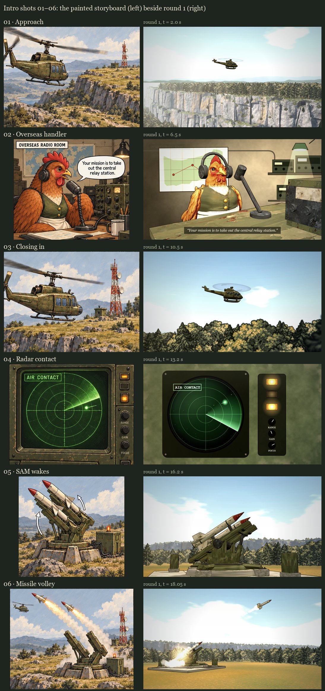

# Intro, storyboard 01–06: approach and ambush

**Status (October 13, 2026): round 1, six keyframes for the user. No in-between animation yet.** This part covers the first 20.2 s of the intro, up to the moment where the approved crash player ([INTRO-SPRITE-PROOF.md](INTRO-SPRITE-PROOF.md)) begins. The crash player and its plates are unchanged.

> **Direction (the user, 2026-10-13), after the crash sequence was merged:** "go ahead and clean up the merged branches, then we can start with the next part of the intro". The next item on the intro handoff's checklist is "Apply the accepted treatment to approach, overseas briefing, radar and the remote SAM cutaway." This round follows the method the crash used: keyframes first, checked with the user before any in-between animation.



| Shot | Time | Keyframe | What it has to establish |
| --- | --- | --- | --- |
| 01 · Approach | 0–4 s | [t = 2.0 s](intro-ambush/keyframe-01.jpg) | The olive helicopter flies left to right over the crash sector's butte: the sunlit south wall of fractured limestone, the plateau forest on top, the lowland woods below, hills in the haze. |
| 02 · Overseas handler | 4–9 s | [t = 6.5 s](intro-ambush/keyframe-02.jpg) | The hen at her radio desk in another country, with headphones, desk microphone and transceiver, a map on the wall and a desk lamp. Her line: “Your mission is to take out the central relay station.” |
| 03 · Closing in | 9–12 s | [t = 10.5 s](intro-ambush/keyframe-03.jpg) | Back on the aircraft, same direction of travel, passing low over the plateau's treetops against the sky. |
| 04 · Radar contact | 12–14 s | [t = 13.2 s](intro-ambush/keyframe-04.jpg) | The sweep meets a new contact (it lights at 12.55 s); AIR CONTACT and an amber lamp come on. |
| 05 · SAM wakes | 14–17 s | [t = 16.2 s](intro-ambush/keyframe-05.jpg) | In its own sector, the twin-rail launcher turns and raises its loaded rails against the sky. |
| 06 · Missile volley | 17–19.4 s | [t = 18.05 s](intro-ambush/keyframe-06.jpg) | The first missile climbs away to the right with its trail, and the second ignites on its rail in a blast of smoke. |
| 07 · Incoming | 19.4–20.2 s | (the crash player's opening) | The cut back to the aircraft in the crash sector, where the missiles arrive from screen left. |

The three places stay apart, as the storyboard's geography correction requires. The plateau shots (01, 03) use the crash sector. The radio room (02) is overseas. The radar and the launcher (04–06) are in the SAM's own sector. The relay is never shown.

## How each shot is made

All of it is the crash sequence's treatment: painted plates, the game's own art, the 3D study's models baked into inked sprites, and deterministic 2D effects. Every frame is a function of time, so stills and playback agree. The stills are frames of the player (`ambush.html`, `ambush-player.js`).

- **01 and 03, the approach.** These are perspective plates through the close-up's lens and tracer (`closeup.js`), over the same 4× butte, with the game's foliage sprites, the sky and the haze. Each camera sits off the aircraft's right side, so the nose stays toward screen right.
  - The aircraft is the intact intro rig, baked through each shot's own lens (`tools/bake-intro-heli-lens.mjs`), with the painted rotor disc.
  - The flight comes from `trajectory.js` (`approachPath`): one smooth heading and speed profile, integrated back from the crash player's first key.
  - It runs in over the southern lowland and crosses the south rim at about 1.8 s. It heads north-east over the plateau at 10.5 tiles/s, then makes an easy right turn from 9 s onto the hit line.
  - It meets the approved path at 20.2 s in place, direction and speed. It banks up to 7° in the turn, with the nose a little down for cruise.
- **02, the handler.** This is Codex's radio room from the 3D study (`intro-radio-room.js`): the game's hen with headphones, her desk, transceiver, dials and microphone.
  - It is baked inked and split-toned (`tools/bake-intro-room.mjs`), without the study's flat backdrop.
  - The room behind her is painted in code: lamp-lit plaster, a pinned map with a red string, radio sets on a shelf, a green desk lamp and conduit.
  - A location card opens the shot, and her line runs as a subtitle.
- **04, the radar.** It is code-drawn, as the study's was, in the same language:
  - a worn olive console;
  - a green scope with range rings, ground clutter and a sweep that fades behind it;
  - the contact lighting as the sweep reaches it and keeping an afterglow;
  - an AIR CONTACT tag, three amber lamps and the RANGE, GAIN and FOCUS knobs.
- **05 and 06, the SAM.** The SAM's sector is a generated cinematic set (`sam-sector.js`): grassland with forest patches, the launcher in a clearing, and a one-tier escarpment across the view. It is painted by the same tracer.
  - The launcher is Codex's, from the study (`intro-launcher.js`: the approved site slab and cabinets, turntable, cradle and missiles), baked through each shot's lens (`tools/bake-intro-sam.mjs`).
  - The smoke, flames and ignition are painted along the baked flights (`ambush-player.js`). The trail puffs are spaced by distance flown, so a fast missile's trail stays continuous.

## Departures, for the user to accept or reject

1. **01 is an establishing view.** The storyboard's panel 01 has the aircraft large in the foreground. Here it is small against the sky above the butte's wall, so the plateau reads as a butte before we arrive.
2. **03 is a treetop pass.** The aircraft is large and the plateau reads as forest. The storyboard's panel 03 shows more of the ground.
3. **The SAM's sector is invented.** The tutorial reserves its sectors (`TOO / XXO / XSO`, [SECTOR-LIBRARY.md](SECTOR-LIBRARY.md)), and none is authored as the SAM site. The study built "independent crash and SAM terrain/forest sets" too. A real sector can replace the set once one is chosen.
4. **The launch follows the storyboard, not the study.**
   - The study raises the rails to only 0.25 rad, and its missiles leave almost level. From any camera close enough to show the launcher, a missile was out of frame within half a second, and the volley read as weak.
   - Here the cradle rises to 0.62 rad (35°) during the wake. Each missile leaves along its rail, accelerating, then eases toward a 0.2 rad climb (`SAM_LAUNCH` in `ambush.js`).
   - The launch times are the study's, 17.4 and 17.95 s. The missiles leave toward screen right because the crash player brings them in from screen left.
5. **Shot 06 has its own, wider camera.** From shot 05's camera the volley leaves the frame too fast.
6. **The hen's beak does not move.** The study has no lip-sync either. Her line is a subtitle, not the storyboard's speech balloon.

## Measured

- **The hand-over at 20.2 s:** the same position, and the velocity within 0.05 tiles/s.
- **The approach:** smooth, with no 10 ms step longer than 0.12 tiles. It clears the tallest tree the plateau can grow by more than 3 units (worst 4.9).
- **Screen direction:** the nose crosses its lens to the right in 01 and 03, and both missiles go right and up in 05 and 06.
- **The approved crash sequence after the shared-module changes:** `closeup.js` gained a camera argument for its spec and a `keepClear` option for its painter, and `trajectory.js` gained the approach. The 15 strip moments of the crash player render byte-identical to `2152bd0`. The 18 crash tests pass.
- **`tests/intro-ambush.test.mjs`, 8 tests:** the shots tile 0–20.2 s; the hand-over; the rim crossing and tree clearance; the bank; the nose toward screen right; the missiles toward screen right; the SAM set (deterministic, an empty clearing); and every shot's plate and frames, painted for the shot as it is now.
- **Mutation check, all 8 mutants caught:**

  | Mutant | Caught by |
  | --- | --- |
  | the hand-over heading ignoring the crash path's slight drift | the hand-over |
  | shot 01's camera turned around | screen direction and the plate spec |
  | the look direction flipped | missile direction and the plate spec |
  | the launcher's keep-clear removed | the empty clearing |
  | the forest's clearing removed | the plate spec, via the set's content hash |
  | shot 05's camera nudged after its plate was painted | the plate spec |
  | the approach slowed so it starts over the plateau | the rim crossing and screen direction |
  | no bank in the turn | the bank |

## Not done yet

- **In-betweens.** The aircraft bakes cover shots 01 and 03 at 20 fps. The room and the launcher were baked only at their keyframe times; the full bakes come with the animation round.
- **The cut back, 19.4–20.2 s.** The crash player starts at 20.2 s. Starting it 0.8 s earlier means a repaint of the wide plate (its geometry covers every camera frame) and a bake of the aircraft frames from 19.4 s.
- **Sound, and the hen's beak.**
- **The skies clip near the horizon.** The big-sky shots (01, 03, 06) clip to white just above the horizon after the frame grade, as the approved close-up's sky does. Darkening the horizon would change the shared sky.

## Questions for the user

1. **01:** keep the establishing view of the butte, or bring the aircraft into the foreground as the storyboard does?
2. **03:** keep the treetop pass, or show more of the plateau below the aircraft?
3. **The SAM's sector:** keep an invented set, or put it on a real tutorial sector?
4. **The hen:** is the baked game hen right for her, and should her beak move with the line?

## Reproduce

```powershell
# This checkout on :4498 (tools/serve.mjs); a checkout with Codex's 3D study
# (work/utility-helicopter) on :4496 for the three bakes.
node tools/render-intro-closeup.mjs --shot 01 http://127.0.0.1:4498        # plates: 01, 03, 05, 06
node tools/bake-intro-heli-lens.mjs --shot 01 --study http://127.0.0.1:4496 # aircraft: 01, 03
node tools/bake-intro-room.mjs --times 6.5 --study http://127.0.0.1:4496    # the hen
node tools/bake-intro-sam.mjs --shot 05 --times 15,16.2 --study http://127.0.0.1:4496
node tools/bake-intro-sam.mjs --shot 06 --times 17.55,17.8,18.05,18.3,18.6 --study http://127.0.0.1:4496
node tools/preview-intro-rock.mjs closeup --cam x,y,h,tx,ty,th,hfov --mark x,y,h   # fast framing, no browser
node --test tests/intro-ambush.test.mjs
```

The stills page is `tactics/intro-sprites/ambush.html?shot=01` (or `?t=` for any moment). The 3D Pages build publishes it with the rest of `intro-sprites/`, and its import check now includes it (`tools/build-tactics-3d.mjs`). `closeup.html?shot=05` paints a plate, and `closeup.html?sector=sam&cam=…` previews the SAM's set through any camera. The bakes load the study from the `--study` server and serve this checkout's `intro-sprites/` to it from disk.
