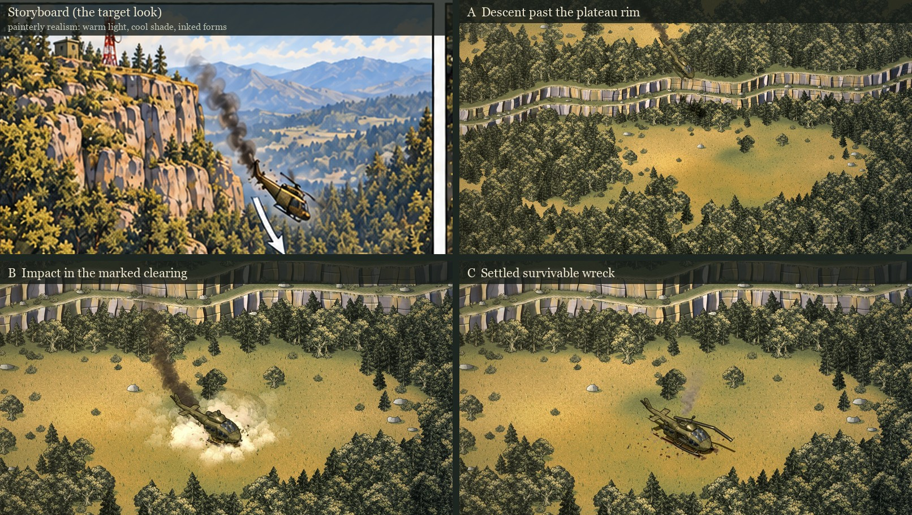

# Intro sprite proof: descent and crash

**Status (October 12, 2026): composition accepted; round 2 of the aesthetics is waiting for the user.** Nothing here changes the 3D study.

> **Direction (the user, 2026-10-12), on the round 1 keyframes:** "this version of the crash resolves a lot of my conflicts with it."
>
> **Direction (the user, 2026-10-12), on the animated proof:** "the composition is addressed well, but the aesthetics could be improved a little bit. cut scenes should be a bit higher quality than the game but speak in the same visual language of the sprites. these examples are closer to the style of the games sprite aesthetics. you have translated the gameplay parts of the style well so far." The examples were the goat flamethrower sprite and storyboard sheet 01–06.
>
> **Direction (the user, 2026-10-12), on a crop of the storyboard's cliff:** "this painterly realism is what you should be pointing to"



| Keyframe | What it has to establish |
| --- | --- |
| [A · Descent past the plateau rim](intro-sprites/keyframe-A.jpg), t = 23.0 s | The curved two-tier rim, plateau woods above it, the lower woods and the open clearing below it. The hit aircraft drops off the rim, nose down, trailing smoke back to the hit. |
| [B · Impact in the marked clearing](intro-sprites/keyframe-B.jpg), t = 26.6 s | The rim stays visible behind the clearing. The skids plant and gouge with the rotor still turning, and rotor-wash dust and soil burst outward. |
| [C · Settled survivable wreck](intro-sprites/keyframe-C.jpg), t = 34.7 s | Same camera as B. The wreck is in the user's circle: upright cabin, damaged tail still attached, crushed skids, broken rotor, an open starboard door facing the camera, thin engine smoke, and skid gouges back to touchdown. |

The stills are frames of the animated proof at those times. Comparisons:

- [Round 1 beside round 2](intro-sprites/aesthetic-before-after.jpg)
- [The 3D shot 12 beside round 1](intro-sprites/before-after-closing-frame.jpg)
- [Round 1 contact sheet](intro-sprites/contact-sheet-round-1.jpg)

## Round 2: the sprites' visual language

The direction was to keep the composition and to paint it the way the game's sprites and the storyboard are painted. That style is painterly realism with inked forms. Every element below now uses the game's own art, or follows the storyboard's rules where the game has no art for it.

| Element | Round 1 | Round 2 |
| --- | --- | --- |
| Trees and shrubs | Drawn in code | **The game's own painted sprites**, from `dist/assets/environment/foliage/` (`tree-pine.png`, `tree-broadleaf.png`, `bush.png`). Each is cropped to its alpha and stepwise downscaled in 5 tints × 2 flips. Each gets an ink contour like the character sprites, and its own silhouette sheared along the sun as its cast shadow. |
| Ground | Noise colours | **The game's ground paintings** (`ground-grass.png` and `ground-dirt.png`), sampled on two rotated grids to hide the repeat. Brushwork grass strokes take their colour from the paint beneath them, and grass tufts hang over each lip and sprout at each foot. |
| Cliff faces | Banded noise | **Inked limestone pillars**, following the storyboard. Each pillar facet has its own normal, lit warm by the key light and cool by the sky. Dark crevices widen toward the foot, with the odd bedding joint and hairline crack, ochre staining, moss under the lip and rain streaks. An ink line runs along every lip and foot. |
| Rocks | Flat shapes | Weathered boulders with an ink contour, a lit crown and a cool shaded flank. Grass grows over each boulder's foot, and a few stand out in the meadow. |
| Aircraft | Plain render | **An ink pass** (`ink.js`) from colour, normal and depth renders of the same pose. It draws the silhouette, the creases where normals turn more than 38°, and the lines where parts overlap. |
| Light | A warm wash | The measured grade and split tone below. |

### The grade, measured against the storyboard

All figures below are measured on the actual images. Luminance is given as p10 / p50 / p90. Foliage is the lower forest of frame C, split at value 0.45, with mean HSV values. The cliff ratio counts warm ochre pixels (hue 10–38°, saturation ≥ 0.2) against grey ones (saturation < 0.2) in the cliff band.

| Measure | Storyboard | Round 1 | Round 2 |
| --- | --- | --- | --- |
| Frame luminance | 42–59 / 104–120 / 169–188 | 70 / 117 / 147 | 53 / 119 / 163 |
| Lit foliage: hue, saturation, value | 40–43°, .50–.61, 155–164 | 62°, .51, 138 | 46°, .52, 162 |
| Shaded foliage: hue, saturation, value | 64–98°, .32–.33, 56–66 | 72°, .55, 83 | 62°, .32, 70 |
| Cliff face, warm ochre : grey | 1 : 1.1–1.8 | 1 : 26 (almost no warm rock) | 1 : 2.2 |

Round 1 was cool green throughout, with saturated shade and no light/shade split. The storyboard's main painterly move is that split: warm gold where the sun lands, cool grey-green in the shade, and grey limestone with ochre patches. CSS filters move every tone together, so `grade.js` applies the split per pixel, once, on static art:

- on the plate, at full strength;
- on each aircraft frame, at a milder setting so the olive paint stays warm.

The hue shift scales with saturation, so ochre-grey rock keeps the cliff's own cool light instead of being pushed toward foliage green. The tone grade (`GRADE` in `plate.js`) is one filtered copy per frame.

Two targets turned out to be proxies:

- **Average saturation.** Matching the storyboard's mean (0.29–0.33) turned the frame sepia. That mean is low because of its grey rock and sky, not because its foliage is grey. The fix was to measure per material.
- **The warm-rock class mean.** Matching its hue on its own turned every cliff face salmon-pink. The storyboard's rock is mostly grey with warm patches, so the measure that counts is the warm-to-grey ratio.

### One renderer

The stills used to have their own renderer beside the player, and the two drifted apart: B's dust came out grey-green under the split tone. The stills page now renders the player at `KEYFRAME_TIMES` (A 23.0, B 26.6, C 34.7 s). The old still renderer and its five aircraft stills (`tools/bake-intro-heli-sprites.mjs` and `dist/tactics/intro-sprites/heli/`) are removed.

### Playback cost

Measured in the preview browser on the first playback after load, 444 frames at 1/30 s:

| Stage | Frames over 33 ms | Worst frame |
| --- | --- | --- |
| Before the fixes | 13 | 92 ms |
| After the fixes | 1 | 34 ms |

After the fixes, the median frame takes 0.8 ms and the 95th percentile 1.9 ms.

The stalls had two causes:

- the browser decoded each 2048 px sheet lazily on its first draw;
- each puff texture was uploaded on its first use.

The fixes:

- the sheets and the plate are decoded as `ImageBitmap`s at load;
- puff sprites are kept at 256 px;
- a 168 ms warm-up pass over the timeline touches every texture before the page reports ready.

The recorded video went 0 of 445 frames over budget.

## The approach

- **Camera.** All frames use the game camera: azimuth 45°, elevation 30°, a 2:1 tile diamond. The 3D game and the 2D sprite line already share this camera (`GAME_CAMERA` in `hybrid-world.js`). The user's marked map was captured from the same direction, so it shows the same rim-above-clearing relationship as the keyframes. The intro can then end on the frame where play starts.
- **Terrain is the real map.** Each pixel's view ray is marched through `sector-library/tutorial-step-1/rough-plateau.json` (levels 0/1/2, 2.12 units per level as in `DIMENSIONS.floorSpacing`). Tops, the faces of both tiers, the narrow shelf, the scree apron and the lip are all painted from that hit.
- **Woodland is the user's map.** `crash-sector-woodland.json` classifies every tile from the marked screenshot by canopy texture (7×7 luminance deviation > 5). The user's white circle has been cleared to open ground. The clearing's centre is tile (205.5, 104), about 25 tiles from the rim.
- **The aircraft comes from the existing rig** (see Animated proof).

## What made the rim read (and why the 3D set lost it)

The game's trees are 2.3 units tall (pine, `foliage-models.js`), or 1.8× that for the large variant. The two tiers together are 4.24 units. The first draft painted trees at twice the game's scale, and the woods buried the rim completely. The 3D set failed the same way; its reviews covered mechanics, not composition. At game scale, with a 1.7-tile scree apron at each cliff foot and the lip's trees set back 1.1 tiles, the rim reads as a pale stepped band.

## Departures from the data (please check)

1. **The rim is bent into lobes and bays, about ±1.5 tiles, roughly 14 tiles apart.** The tile data is a staircase with no natural outline. Without the warp the rim reads as a ruled masonry wall. The warp moves the rim and never adds ground anywhere else.
2. **Copses and lone trees in the open ground** start 10.5 tiles from the circle and leave a sight lane to the door. This follows the requirement for more trees around the aircraft while the landing and exit space stays open. The user's woodland masses themselves are unchanged.
3. The classifier leaves a few single-tile woodland specks in open ground. They show up as lone trees.

## Animated proof

[`tactics/intro-sprites/proof.html`](../../dist/tactics/intro-sprites/proof.html) plays 20.2–35 s of the intro: the missile hit, the drop past the rim, contact, the rotor strike, the door opening and the hold. It can scrub, run at 0.25–1× speed and jump to A/B/C, and takes `?t=` and `?play` URL parameters.


[Playback recording, 1600 × 900, 30 fps, 15.2 s (WebM)](intro-sprites/proof-playback.webm).

| Layer | What it is |
| --- | --- |
| Plate | One static painting at the crash zoom (52 px tiles): terrain, the game's flora sprites and their shadows, split-toned, 3139 × 2051 px. It covers every frame of the camera path. `tools/render-intro-plate.mjs` writes `plate/crash-plate.webp` (3.3 MB) and its geometry. The player repaints live if the stored plate no longer matches the camera path. |
| Aircraft | `tools/bake-intro-heli-sequence.mjs` photographs the intro rig at 20 fps from 20.2 to 31.8 s: 233 frames in 4 sprite sheets and 3 shadow sheets (2.4 MB of WebP). The frames are inked and given the aircraft's split tone. The rig supplies roll, yaw, skid compression, rotor strike, fragment and door; the pitch comes from `trajectory.js`. The rails are planted with the study's own `landingSupportHeight`. Each frame also records the tail, engine and blade-tip points and the rotor-disc axes. |
| Motion | `trajectory.js`, which is pure. The flight is a Hermite path: the hit over the summit, the rim crossed at about 22 s, a steepening drop, then a flare (nose 0.16 up at contact, so the skid rears touch first) and contact at 26 s. The slide copies the study's slide profile at 1.5× length and stops on the circle's centre. The study's event times are kept: hit 20.5, contact 26, rotor strike 28.25, door 30.6. |
| Camera | Opens over the plateau, settles on the A framing at 22.9 s, then a log-zoom push-in reaches the locked B/C framing at 25.9 s. |
| Effects | All deterministic, so scrubbing and recording agree: two missiles (one hits the tail, one passes and leaves the frame), the flash and tail shards, tail smoke until the aircraft settles, a thin engine plume, rotor-wash dust, the contact burst, slide scrape, rotor-strike spray, ballistic clods that land and stay, and gouges that grow without reshuffling. The puffs are cut from the painted smoke atlas. |

`tools/record-intro-proof.mjs` writes stills (`--frames`) and the WebM (`--video`). The video is paced frame by frame through `MediaRecorder`.

`tests/intro-sprites.test.mjs` has 10 tests:

- the wreck rests in the circle;
- the flight is continuous, lands at contact and only slides forward;
- the hit is over the summit;
- the nose is up at contact;
- the plate contains every camera frame;
- the committed plate matches the camera path;
- the frame manifest is complete;
- no tree stands in the pocket or the door lane;
- every tree keeps the rim apron and lip setback, at game scale;
- the split tone cools and greys shade and warms light, leaves grey rock and sky alone, and keeps ochre rock's hue.

Mutation checks:

- With the exit rule removed, 15 trees enter the door lane, so that clause can fail.
- All 6 split-tone mutants fail the test: no cool shift, no grey guard, no band limit, no warm shift, no shade desaturation, no saturation weighting. The first grey-rock probe was too neutral to catch a missing guard. The probe is now a shaded rock at saturation .05.

## Layers and animation readiness

The proof is built from three kinds of layer: one static plate, whole-aircraft frames, and 2D effects. This works only because nothing static ever stands in front of the aircraft: the trees ring the clearing, and the drop passes well above the canopy. A scene where trees must cover a moving sprite needs the plate split into depth bands.

Not done yet:

- depth-banded plates;
- per-part aircraft sprites, for a sheet a game engine can recombine (fuselage, main and tail rotors, fragment);
- the approach, briefing, radar and SAM cutaway in this treatment;
- sound.

## Questions for the user

1. Is round 2 the right reading of "the same visual language of the sprites"? In particular:
   - the weight of the ink;
   - the golden late-summer grass, as in the storyboard (a greener spring is a single grade change);
   - the cliff's pillars.
2. Should the game camera stay, or should the descent use a lower cinematic angle with the game camera kept for C?
3. Are the copses in the open ground welcome, or should the open ground stay exactly as the map paints it?

## Reproduce

```powershell
$env:PORT=4496; node tools/serve.mjs              # serves dist/
node tools/bake-intro-heli-sequence.mjs           # 233 inked aircraft frames -> dist/tactics/intro-sprites/heli-seq/
node tools/render-intro-plate.mjs                 # static plate -> dist/tactics/intro-sprites/plate/
node tools/render-intro-keyframes.mjs A,B,C       # stills (player frames) -> docs/tactics/intro-sprites/keyframe-*.png
node tools/record-intro-proof.mjs --video         # WebM -> docs/tactics/intro-sprites/proof-playback.webm
node --test tests/intro-sprites.test.mjs
```

The stills page is `tactics/intro-sprites/keyframes.html?shot=A|B|C`. The committed review images are JPEG conversions of the tool's PNGs.
