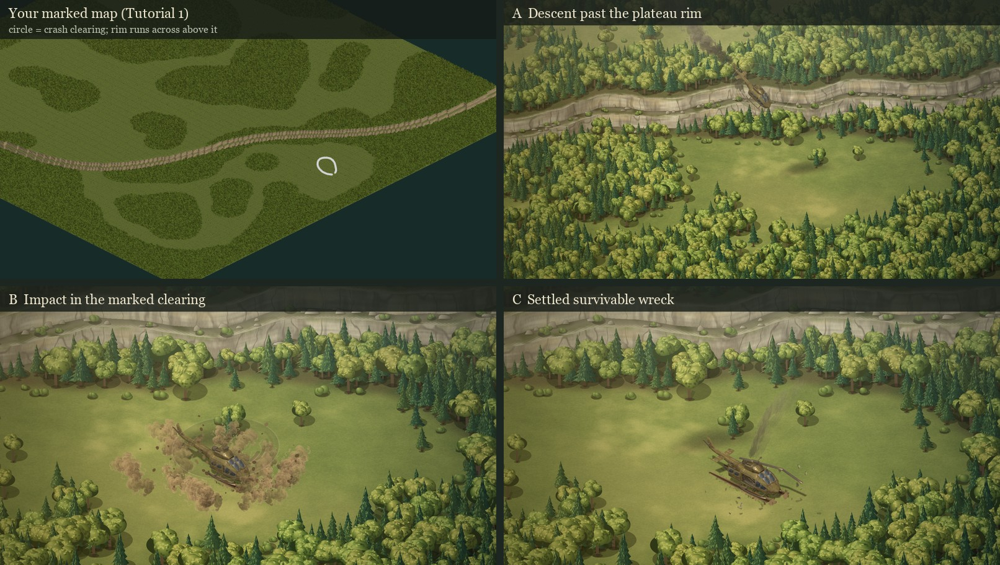

# Intro sprite proof: descent and crash keyframes

**Status (October 12, 2026): round 1 keyframes shown to the user; animated A → B → C proof built.** Nothing here changes the 3D study.

> **Direction (the user, 2026-10-12), on the round 1 keyframes:** "this version of the crash resolves a lot of my conflicts with it."

The four questions below are still open. The animated proof keeps the round 1 choices: the game camera, painted trees, and copses in the open ground. The keyframes are the compositions the [Claude handoff](INTRO-CLAUDE-HANDOFF.md) asks to show the user before any in-between animation.



| Keyframe | What it has to establish |
| --- | --- |
| [A · Descent past the plateau rim](intro-sprites/keyframe-A.jpg) | The curved two-tier rim, plateau woods above it, the lower woods and the open clearing below it. The hit aircraft drops off the rim, nose down, with a smoke trail back to the hit. Its ground shadow, well ahead of it, shows the altitude. |
| [B · Impact in the marked clearing](intro-sprites/keyframe-B.jpg) | The rim stays visible behind the clearing. The skids plant and gouge with the rotor still turning, and rotor-wash dust and clods burst outward. |
| [C · Settled survivable wreck](intro-sprites/keyframe-C.jpg) | Same camera as B. The wreck is in the user's circle: upright cabin, damaged tail still attached, crushed skids, broken rotor, an open starboard door facing the camera, thin engine smoke, and skid gouges back to touchdown. |

[Before and after: the 3D shot 12 beside keyframe C](intro-sprites/before-after-closing-frame.jpg).

## The approach

- **Camera.** All three frames use the game camera: azimuth 45°, elevation 30°, a 2:1 tile diamond. The 3D game and the 2D sprite line already share this camera (`GAME_CAMERA` in `hybrid-world.js`). The user's marked map was captured from the same direction, so it shows the same rim-above-clearing relationship as the keyframes. The intro can then end on the frame where play starts.
- **Terrain is the real map.** Each pixel's view ray is marched through `sector-library/tutorial-step-1/rough-plateau.json` (levels 0/1/2, 2.12 units per level as in `DIMENSIONS.floorSpacing`). Tops, the faces of both tiers, the narrow shelf, the scree apron and the lip are all painted from that hit.
- **Woodland is the user's map.** `crash-sector-woodland.json` classifies every tile from the marked screenshot, using canopy texture (7×7 luminance deviation > 5). The user's white circle has been cleared to open ground. The clearing's centre is tile (205.5, 104), about 25 tiles from the rim.
- **The aircraft comes from the existing rig.** `tools/bake-intro-heli-sprites.mjs` sets the intro study's helicopter to t = 23.0 / 25.3 / 26.85 / 28.3 / 34.7 s and photographs it on a transparent background through the game camera. The rig supplies the damaged tail, skid compression, rotor break and door that are already built. The tool records a ground-shadow silhouette under the study's sun, the model origin as anchor, and the rotor-disc axes. Flight bakes hide the blades and paint a spinning disc instead.
  - The study's warm grade made the olive paint read gold, so the bake uses neutral light and the keyframe applies its own light.
- **Painted in 2D:** pines, broadleaves, shrubs, scree, ground shadows, the rotor disc, smoke (reusing the painted smoke atlas), dust, clods, gouges, debris, the light grade and haze.

## What made the rim read (and why the 3D set lost it)

The game's trees are 2.3 units tall (pine, `foliage-models.js`), or 1.8× that for the large variant. The two tiers together are 4.24 units. The first draft painted trees at twice the game's scale, and the woods buried the rim completely, which is the same failure as the 3D set (whose reviews covered mechanics, not composition). At game scale, with a 1.7-tile scree apron at each cliff foot and the lip's trees set back 1.1 tiles, the rim reads as a pale stepped band.

## Departures from the data (please check)

1. **The rim is bent into lobes and bays, about ±1.5 tiles, roughly 14 tiles apart.** The tile data is a staircase with no natural outline. Without the warp the rim reads as a ruled masonry wall. The warp moves the rim and never adds ground anywhere else.
2. **Copses and lone trees in the open ground** start 10.5 tiles from the circle and leave a sight lane to the door. This follows the requirement for more trees around the aircraft while the landing and exit space stays open. The user's woodland masses themselves are unchanged.
3. The classifier leaves a few single-tile woodland specks in open ground. They show up as lone trees.

## Animated proof (round 1)

[`tactics/intro-sprites/proof.html`](../../dist/tactics/intro-sprites/proof.html) plays 20.2–35 s of the intro: the missile hit, the drop past the rim, contact, the rotor strike, the door opening and the hold. It has scrubbing, 0.25–1× speed and A/B/C jump buttons, and `?t=` and `?play` URL parameters.


[Playback recording, 1600 × 900, 30 fps, 15.2 s (WebM)](intro-sprites/proof-playback.webm).

| Layer | What it is |
| --- | --- |
| Plate | One static painting: terrain, flora and flora shadows, 3139 × 2051 px at the crash zoom (52 px tiles). It covers every frame of the camera path. `tools/render-intro-plate.mjs` writes `plate/crash-plate.webp` (2.3 MB) and its geometry. The player repaints live if the stored plate no longer matches the camera path. |
| Aircraft | `tools/bake-intro-heli-sequence.mjs` photographs the intro rig at 20 fps from 20.2 to 31.8 s: 233 frames in 4 sprite sheets and 3 shadow sheets (1.8 MB of WebP). It uses the study's roll, yaw, skid compression, rotor strike, fragment and door, with the pitch from `trajectory.js`. The rails are planted with the study's own `landingSupportHeight`. Each frame also records the tail, engine and blade-tip points and the rotor-disc axes. |
| Motion | `trajectory.js`, which is pure. The flight is a Hermite path with the hit over the summit, the rim crossed at about 22 s, a steepening drop, a flare (nose 0.16 up at contact, so the skid rears touch first) and contact at 26 s. The slide copies the study's slide profile at 1.5× length and stops on the circle's centre. The study's event times are kept: hit 20.5, contact 26, rotor strike 28.25, door 30.6. |
| Camera | Opens over the plateau, settles on the A framing at 22.9 s, then a log-zoom push-in reaches the locked B/C framing at 25.9 s. |
| Effects | All deterministic, so scrubbing and recording agree: two missiles (one hits the tail, one passes and leaves the frame), the flash and tail shards, tail smoke until the aircraft settles, a thin engine plume, rotor-wash dust, the contact burst, slide scrape, rotor-strike spray, ballistic clods that land and stay, and gouges that grow without reshuffling. The puffs are cut from the painted smoke atlas. |

`tools/record-intro-proof.mjs` writes stills (`--frames`) and the WebM (`--video`). The video is paced frame by frame through `MediaRecorder`, so its timing is the proof's timing; 0 of 445 frames went over budget.

`tests/intro-sprites.test.mjs` has 9 tests:

- the wreck rests in the circle;
- the flight is continuous, lands at contact and only slides forward;
- the hit is over the summit;
- the nose is up at contact;
- the plate contains every camera frame;
- the committed plate matches the camera path;
- the frame manifest is complete;
- no tree stands in the pocket or the door lane;
- every tree keeps the rim apron and lip setback, at game scale.

With the exit rule removed, 15 trees enter the door lane, so that clause can fail.

## Layers and animation readiness

`render-intro-keyframes.mjs --layers` writes `ground`, `shadows`, `objects` and `atmosphere` for each frame. The animated proof uses one static plate under whole-aircraft frames and 2D effects.

This works only because nothing static ever stands in front of the aircraft: the trees ring the clearing, and the drop passes well above the canopy. A scene where trees must cover a moving sprite needs the plate split into depth bands.

Not done yet:

- depth-banded plates;
- per-part aircraft sprites, for a sheet a game engine can recombine (fuselage, main and tail rotors, fragment);
- the approach, briefing, radar and SAM cutaway in this treatment;
- sound.

## Questions for the user

1. Do A, B and C read as your marked clearing under the curved rim?
2. Should the game camera stay, or should the descent use a lower cinematic angle with the game camera kept for C?
3. Are the painted trees the right style, or should the forest use hand-painted sprite sheets like the storyboards?
4. Are the copses in the open ground welcome, or should the open ground stay exactly as the map paints it?

## Reproduce

```powershell
$env:PORT=4496; node tools/serve.mjs              # serves dist/
node tools/bake-intro-heli-sprites.mjs            # aircraft sprites -> dist/tactics/intro-sprites/heli/
node tools/render-intro-keyframes.mjs A,B,C       # keyframe PNGs -> docs/tactics/intro-sprites/ (add --layers)
node tools/bake-intro-heli-sequence.mjs           # 233 aircraft frames -> dist/tactics/intro-sprites/heli-seq/
node tools/render-intro-plate.mjs                 # static plate -> dist/tactics/intro-sprites/plate/
node tools/record-intro-proof.mjs --video         # WebM -> docs/tactics/intro-sprites/proof-playback.webm
node --test tests/intro-sprites.test.mjs
```

The interactive page is `tactics/intro-sprites/keyframes.html?shot=A|B|C`. Painting takes 2–4 s per frame. The committed review images are JPEG conversions of the tool's PNGs.
