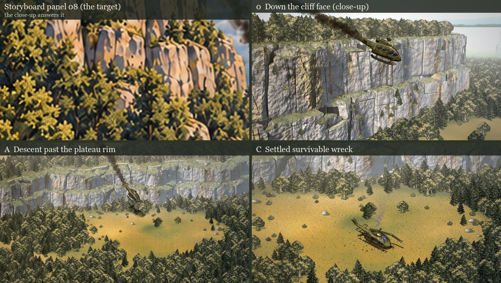
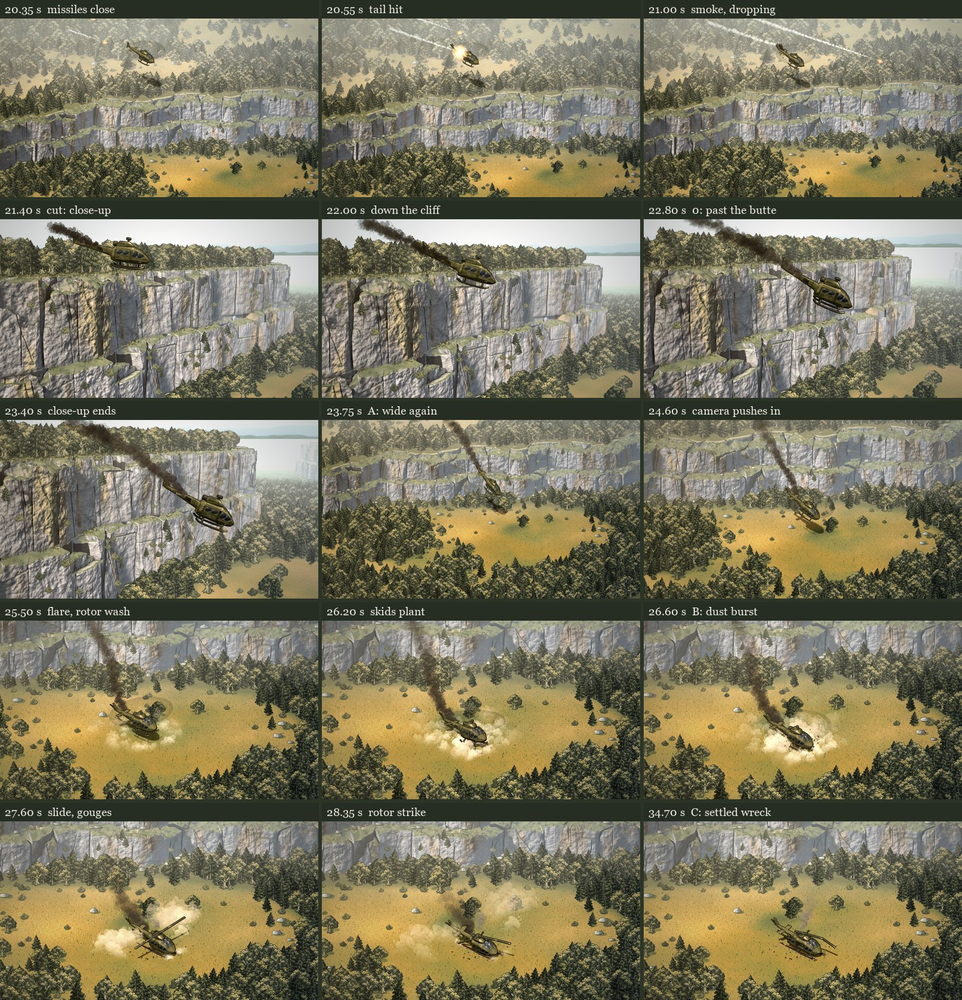

# Intro sprite proof: descent and crash

**Status (October 13, 2026): approved. The architect accepted round 4 (`2152bd0`) as the working crash sequence. It reaches `main` without the helicopter art branch it was built on (see [On main](#on-main)).** Nothing here changes the 3D study.

> **Direction (the user, 2026-10-12), on the round 1 keyframes:** "this version of the crash resolves a lot of my conflicts with it."
>
> **Direction (the user, 2026-10-12), on the animated proof:** "the composition is addressed well, but the aesthetics could be improved a little bit. cut scenes should be a bit higher quality than the game but speak in the same visual language of the sprites. these examples are closer to the style of the games sprite aesthetics. you have translated the gameplay parts of the style well so far." The examples were the goat flamethrower sprite and storyboard sheet 01–06.
>
> **Direction (the user, 2026-10-12), on a crop of the storyboard's cliff:** "this painterly realism is what you should be pointing to"
>
> **Direction (the user, 2026-10-12), on round 2:** "the cliffs feel oversimplified. maybe its as simple as having another shot of the descent. a prior shot that shot that looks like the first panel you included in the upper left where its zoomed in to show the scale and detail of the cliff. the cliffs also look small. perhaps we need some atmospheric perspective to push them back behind the helicopter. the starting scene in the upper right has the helicopter and the trees on the cliff roughly the same color and value, so the helicopter disappears in the background. i like the pacing and the way you handled the landing, that felt right. so much of this works just like it should."
>
> **Direction (the user, 2026-10-12), on the cliff's height in the game (two tiers of 2.12 units):** "mostly taller up close, but i dont mind if you stretch the truth in the intro shot too. its basically a butte, so it should feel tall."
>
> **Direction (the user, 2026-10-12), on the first close-up preview:** "scale is looking good, but it looks fairly low poly with the thick block shapes on a flat plane. this should look fairly realistic"
>
> **Review (the architect, 2026-10-13), on round 3 (9f40d75), passed on by the user:** "The rock still needs a more natural surface. The rounded columns, smooth highlights and repeated horizontal joints resemble constructed stonework. Broader fractured masses, uneven ledges and less regular shading would bring it closer to the painted reference. Adding finer texture alone won't solve that." And: "Watch the scale across the camera cut. The towering close-up becomes a considerably smaller cliff in the wide view. Exaggerating its height works, but the helicopter's position against recognizable ledges should help those shots feel like the same place." Keep the shot sequence, the landing timing and the final wreck composition: "This needs a concentrated cliff-painting pass, not another wholesale revision."
>
> **Review (the architect, 2026-10-13), on round 4 (2152bd0), passed on by the user:** "`2152bd0` gets my approval as the working crash sequence." On the cliffs: "broader fractures and uneven ledges look substantially more natural. The repeated stonework appearance is much reduced." On the cut: "the cliff now retains a convincing scale behind the helicopter when switching to the wide shot." On the landing: "the descent, skid contact, dust and settled wreck still communicate a hard but survivable crash clearly." Polish, not a blocker: "The rock remains slightly busy and cool compared with the painted reference, but I consider that polish. I wouldn't hold up further work over it." On rendering: the backgrounds are pre-rendered images with the aircraft frames and effects composited over them, so the cliff's detail never becomes live 3D geometry. All 18 tests passed, and playback ran without browser errors. On release: "A direct merge into canonical conflicts with existing gameplay and build changes, so I haven't merged it. The approved intro work needs to be separated from those older branch changes for integration."



| Keyframe | What it has to establish |
| --- | --- |
| [0 · Down the cliff face](intro-sprites/keyframe-0.jpg), t = 22.4 s (close-up) | The scale and detail of the butte: the aircraft drops past a towering wall of fractured limestone, trailing smoke, nose toward screen right, with the plateau forest along the rim and the valley hazing into distant hills. |
| [A · Descent past the plateau rim](intro-sprites/keyframe-A.jpg), t = 23.75 s | The curved two-tier rim, plateau woods above it, the lower woods and the open clearing below it. The hit aircraft drops off the rim, nose down, trailing smoke back to the hit. |
| [B · Impact in the marked clearing](intro-sprites/keyframe-B.jpg), t = 26.6 s | The rim stays visible behind the clearing. The skids plant and gouge with the rotor still turning, and rotor-wash dust and soil burst outward. |
| [C · Settled survivable wreck](intro-sprites/keyframe-C.jpg), t = 34.7 s | Same camera as B. The wreck is in the user's circle: upright cabin, damaged tail still attached, crushed skids, broken rotor, an open starboard door facing the camera, thin engine smoke, and skid gouges back to touchdown. |

The stills are frames of the animated proof at those times. Comparisons:

- [The rock, round 3 beside round 4](intro-sprites/rock-before-after.jpg)
- [The cut out of the close-up, round 3 beside round 4](intro-sprites/cut-before-after.jpg)
- [Round 3 contact sheet](intro-sprites/contact-sheet-round-3.jpg)
- [The wide cliff, round 2 beside round 3](intro-sprites/cliff-before-after.jpg)
- [Round 1 beside round 2](intro-sprites/aesthetic-before-after.jpg)
- [Round 2 contact sheet](intro-sprites/contact-sheet-round-2.jpg)
- [The 3D shot 12 beside round 1](intro-sprites/before-after-closing-frame.jpg)
- [Round 1 contact sheet](intro-sprites/contact-sheet-round-1.jpg)

## On main

The 3D Pages build publishes the complete `intro-sprites/` folder, including the
committed plates and aircraft sheets. The [published crash proof](https://syntaxswine.github.io/animal-factory-tactics-3d/tactics/intro-sprites/proof.html)
is a standalone review player; it is not yet connected to campaign startup.
Deployment checks follow all three HTML pages' module imports and verify the
published intro files and their shared map/texture dependencies against source.

Round 4 was approved on `intro/sprite-keyframes` (PR #8), a branch built on the helicopter art branch `work/utility-helicopter`. That base carries older art and gameplay work whose files `main` has since changed: grenade blasts, wall breaches, floor rims, RPG flight, guardhouse consoles, the chair collection and horse sitting. Merged whole, `2152bd0` conflicts with `main` in 26 files, none of them an intro sprite file. The branch `intro/sprite-crash-sequence` therefore starts from `main` (`1dbbc3f`) and carries only the 52 intro sprite files, byte-identical to `2152bd0`. All 52 are new on `main`.

- **Run time.** Everything the proof reads is already on `main`, blob-identical to the helicopter branch: the map (`sector-library/tutorial-step-1/rough-plateau.json`), `ground-grass.png` and `ground-dirt.png`, the three foliage paintings and the smoke atlas. The strip's 15 moments render byte-identical from both branches.
- **Checks.** `npm run check` passes on this branch: 2,290 of 2,290 tests, which is `main`'s 2,272 plus the 18 here, and the asset check. The 15 strip moments that `tools/record-intro-proof.mjs --frames` writes are byte-identical PNGs from both branches (two runs from `2152bd0` agree, and the two servers serve different trees). Playback records 445 frames, none over budget, with no page errors.
- **Left behind.** Codex's 3D intro study (`intro-study.html`, the `intro-*.js` modules, `sam-missile.js`), the storyboard sheets and `INTRO-CLAUDE-HANDOFF.md` stay on `work/utility-helicopter`. Two tools need the study: `tools/bake-intro-heli-sequence.mjs` and `tools/bake-intro-heli-closeup.mjs` photograph its rig. The aircraft sheets they made are committed, so playing, testing and repainting the proof need neither tool. Re-baking the aircraft needs a checkout that has the study.
- **History.** PR #8's five round commits carry 71.1 MB of blobs, every superseded plate, sheet and recording among them. The final files are 23.6 MB. The rounds stay on `intro/sprite-keyframes`.
- **The handoff's checklist.** `INTRO-CLAUDE-HANDOFF.md`, still on the helicopter branch, stands as follows:
  - done and approved: keyframes A, B and C, the animated A → B → C proof, and the normal-speed review;
  - partly done: depth layers (one static plate, whole-aircraft frames and 2D effects; see [Layers](#layers-and-animation-readiness));
  - not started: the approach, briefing, radar and SAM cutaway, and sound.

## Round 4: the cliff-painting pass

The shot sequence, the cameras, the aircraft's path, the landing and the wreck are unchanged. Three things changed: the rock itself, the wide shots' cliff height, and where the cliff plants grow.

### The rock: from stonework to fractured limestone

Round 3's relief was a field of narrow columns, Voronoi cells 1.2 tiles apart, each rounded like a pillar. It had bedding grooves every 1.55 tiles of height and two or three fracture grooves per column. That is a wall's rhythm. Round 4 builds the face the way a jointed limestone cliff breaks (`crash-sector.js`: `masses`, `block`, `relief`):

- **Masses.** The plan is split by a warped power diagram, each seed with its own weight. Joints are about 4 tiles apart and unevenly spaced, and six in ten open into clefts.
- **Breaks.** A mass breaks across only now and then, in beds 4–11 tiles thick (thicker in the wide shots) with each break tilted. Ledges and overhangs are therefore uneven and never line up into courses.
- **Faces.** Between breaks, each mass is the smooth lower envelope of three planes, each with its own set-back, yaw and lean, so it breaks into angular facets. Part of the set-back is shared with the neighbours, and broad lumps swell and sink across the face.
- **Cracks and tops.** Most masses carry one or two long cracks, nearly vertical, and some an oblique fracture. Weathered tops dome down toward the clefts, and some masses stop short of the tier top.
- **Shading.**
  - Close up, the faces carry a fine relief in the shading only: a bump on rotated noise, faded out below 16 px per tile. As geometry it would alias into speckle farther off.
  - Colour comes in patches that run across the joints, since a tone per block reads as one stone after another.
  - Ink goes only in the open clefts, with a faint broken line along the tight joints.

Measured on the geometry along the crash sector's rim, both tiers at mid-height:

| | Round 3 | Round 4 |
| --- | --- | --- |
| Width between joints, mean (p10–p90) | 0.92 tiles (0.30–1.46) | 3.56 tiles (0.73–5.67) |
| Grooves across the face per 10 tiles of height, close-up | 1.99 | 0.92 |
| Grooves across the face per 10 tiles of height, wide shots | 1.51 | 0.25 |

A screen-space measure, the autocorrelation of luminance edges inside the rock, separated round 3 from round 4 too weakly to rely on (peaks 0.014 and 0.003). The comparison is therefore the geometry above and the frames: [round 3 beside round 4](intro-sprites/rock-before-after.jpg). The wide shots now carry 0.8 of the close-up's detail (round 3: half), since broad masses no longer turn into a sawtooth at that scale.

### The cut: the same place, the same size

A probe found the rock directly behind the cabin on screen as the close-up cuts out at 23.6 s, in both shots:

| | Close-up (4×) | Wide, round 3 (1.6×) | Wide, round 4 (2.4×) |
| --- | --- | --- | --- |
| Rock behind the cabin | lower tier, 0.48 of the way up | lower tier, 0.74 | lower tier, 0.49 |
| Cliff height there, in aircraft heights | 3.07 | 2.06 | 3.08 |

In the close-up, the wall behind the aircraft stands 65 tiles from the lens and the aircraft 39. The wall therefore looks smaller beside the aircraft than its 17 units suggest. Raising the wide stretch from 1.6 to **2.4** (`HEIGHT_SCALE.wide`) matches both readings: the same tier, the same height on it, and the same size in aircraft heights. In both shots the aircraft drops just below the shelf, the long planted ledge between the tiers. That ledge is the recognisable one across the cut. A test pins all three readings.

The taller wide cliff affects the shots as follows:

- The opening and A framings show a taller band.
- B and C, the wreck, are unchanged: the frame top cuts the cliff just above the shelf, as before.
- Over the summit the aircraft's skids clear the tallest tree the plateau can grow by at least 3.9 units. A test checks this along the whole flight.

Both shots now share one key light from the front left, raking along the wall (`ROCK_KEY`), so the cut keeps one sun.

### Plants on ledges

Round 3 put 62% of its cliff plants on bare vertical faces. Each now drops onto the first ledge below it, and only onto rock at least 0.12 tiles deep, not onto the sharp edge of a step. The close-up's stretch has 58 cliff plants, all on rock.

### What the measurements caught

- **A tracer stall, latent since round 3.** At full size there were white dots ringed with ink: rays that found no rock at all. Stepping one ray through the tracer showed the cause. It ran alongside the cliff just beyond the safe distance, took coarse steps that shrank toward zero, and spent all 4,000 iterations short of the rock. In one crop, 3.8% of the rock pixels came back empty. The coarse step is now at least 0.1 tile, which is safe within the 0.3 margin. Misses fell from 749 to 0 in that crop, and to 2 in 776,000 pixels over the wall. In round 3 the fill passes had hidden most of them.
- **Speckle in half-size previews** was not a bug. It came from fracture grooves and rounded edges narrower than a pixel, so rock is judged at full size.
- **A plant on a sliver of rock.** The new ledge test caught the first version of the planner accepting 0.015 tiles of rock as a ledge.
- **A weak bound test.** Round 3's cutoff test samples only just beyond the cutoff, where the relief rarely reaches, and a bound set below the real reach passed it. A new test compares the relief's sampled reach with `ROUT` and `RIN` directly. Measured over 120,000 samples:

  | Rock | Out (measured / bound) | In (measured / bound) |
  | --- | --- | --- |
  | Wide | 1.70 / 3.99 | 4.49 / 9.70 |
  | Close-up | 2.09 / 4.87 | 4.62 / 10.49 |

### Tests and costs

`tests/intro-sprites.test.mjs` now has 18 tests, all passing. Four are new, and one is restated:

- the close-up tracer stops within half a tile of the first rock a 0.02-tile march finds;
- across the cut out of the close-up, the rock behind the aircraft is the same tier, at the same height (within 0.15) and the same size (within 20%);
- every cliff plant stands on rock, never on a bare face;
- the relief never reaches past its bounds;
- restated: over the summit, the skids clear the tallest possible tree by 2 units or more along the whole flight. The old check, 10 units above the summit at the hit instant, assumed the 1.6× cliff.

Mutation checks ran in a sandbox copy. Each mutant should fail a test:

| Mutant | Result |
| --- | --- |
| The tracer without its minimum coarse step | caught: 42 of 1,700 rays stop away from the first rock |
| Wide stretch back to 1.6 | caught: 0.48 up the tier in the close-up, 0.74 in the wide |
| Wide stretch 3.2 | caught: 3.07 against 4.11 aircraft heights; skids among the crowns |
| Wide stretch 4 | caught: 0.48 against 0.29; skids among the crowns |
| Cliff plants hang where they settle (round 3's rule) | caught |
| Cliff plants accepted on a sliver | caught |
| `RIN` 3.5, `ROUT` 1.2 (below the real reach) | caught by the reach test; the cutoff test missed both |
| `RIN` without the worn tops or the clefts; `ROUT` without the buttresses | survived. These are equivalent mutants: the bounds keep about 2× slack (the table above), so dropping one term still leaves a valid bound. |

Costs:

- **Painting.** The close-up plate takes 3.7 minutes and the wide plate 1.2 (its tool no longer repaints the close-up plate as well) minutes. The relief costs more per sample, and the wide plate samples a taller cliff.
- **Playback.** First playback in the preview browser: 445 frames, median 0.9 ms per frame, worst 3 ms, none over 33 ms; the close-up's median is 0.7 ms. The recording went 0 of 445 frames over budget (video 9.4 MB).

`tools/preview-intro-rock.mjs` paints either shot's rock in seconds on every core, with no browser and no flora, for trying rock rules before a plate paint.

## Round 3: the close-up, the butte, realistic rock and haze

### A close-up of the drop

A new shot cuts in after the hit, from **21.2 to 23.6 s**, and cuts back to the wide shot on the A framing. The wide shot then pushes in to the crash as before. The pacing and the landing, which the user liked, are unchanged. The hit still plays in the wide shot first, so the close-up follows it.

- **Camera.** The camera floats out over the lowland, looking along the wall (`closeup.js`, `CLOSEUP_CAMERA`). The cliff recedes to the right and the aircraft's nose (+x) stays toward screen right, as in every other shot. The player adds a 6% push-in and a follow pan that takes up a third of the aircraft's travel.
- **Painting.** The plate is painted once through a perspective lens: 1760 × 990 px, the 1600 × 900 window plus a margin for the move. A tracer walks each pixel's ray through the same map solid as the wide shots. The ground uses the same shading; the trees are the game's sprites, drawn as billboards and depth-tested against the rock, so the lip hides the trunks behind it. Behind the cliff are a painted sky and three ridgelines. Beyond the map edge the world reflects back into it, so the plateau ring and the valley continue into the distance.
- **The aircraft.** `tools/bake-intro-heli-closeup.mjs` photographs Codex's rig through the same lens: 51 frames at 20 fps, inked and split-toned like the others. A test checks that the cabin is never inside or behind rock.

### A butte: the cliff is taller than in the game

**This departs from game scale, at the user's direction.** In the game, the two tiers total 4.24 units (about 1.3 aircraft heights). The cutscene stretches them (`HEIGHT_SCALE`):

| Shot | Height | Two tiers |
| --- | --- | --- |
| Close-up | 4× | 17 units, about 5 aircraft heights |
| Wide shots | 1.6× | 6.8 units |

The map's outline, the clearing and every tree stay at game scale; only the rock grows. The wide stretch is kept moderate so the cut into gameplay is not a jump. (Round 4 raised it to 2.4×, matched to the close-up at the cut; see Round 4.)

### Realistic rock

The user's note on the first close-up was that it "looks fairly low poly with the thick block shapes on a flat plane". That was a geometry problem, not a texture problem. Columns sat a fraction of a tile proud of one smooth wall, and their faces were flat facets. Three changes fix it, in `crash-sector.js`:

1. **Real depth.** Each tier gets a true signed distance to its smooth outline: an exact Euclidean distance transform of the warped field, corrected to the field's own sub-cell contour near the edge. The rock surface is where that distance plus a relief, in tiles, reaches zero. The relief has:
   - buttresses and bays, as deep as 0.19 × the tier height;
   - columns that stand forward or sit back by up to 0.55 tiles;
   - fracture ledges and overhangs at each column's own heights;
   - worn column tops;
   - bedding shared across the columns;
   - lumps and hollows.
2. **Rounded columns.** Each column face is rounded unevenly, so light rolls across it instead of breaking into facets.
3. **Light that touches the shapes.** Each rock pixel gets a soft cast shadow, marched toward the key light, and ambient occlusion along its normal. Jutting rock shades what lies behind it. Rock that faces the sky holds moss and grass. Fissures, water streaks, lichen and ochre staining fade out where they could not be resolved.

At wide scale the full detail reads as a sawtooth, so the wide shots carry half of it (`ROCK_DETAIL`).

### Haze, and the aircraft against its background

The user noted that in round 2's A frame the aircraft and the plateau trees were "roughly the same color and value". Both shots now have atmospheric perspective:

- **Wide shots.** A cool veil thickens with distance behind the falling aircraft (`PLATE_HAZE`, clear in front of its depth at 23 s).
- **Close-up.** The veil thickens with distance from the lens and takes the sky's colour near the horizon (`CLOSEUP_HAZE`).

The aircraft is drawn unveiled over the plate, so it stands forward of the hazed cliff and forest: [round 2 beside round 3](intro-sprites/cliff-before-after.jpg).

### What the measurements caught

Each of these was found by measuring rather than by eye:

- **Black pepper dots on the rock.** Rays were slipping through it. The relief is not a true distance field (worn tops change by many tiles per tile of height), so long sphere steps overshot. Fine steps are now capped at 0.1 tiles, and a lone miss inside rock takes its neighbours' colour.
- **Dark specks on the far cliff.** Four guesses failed: trees, ink, grass tufts and ledge moss. A probe that traced individual speck pixels found the cause. They were rays that missed the far terrain past the old 700-tile range and were painted with the near-hill ridge colour. Below the horizon there is no sky, so a miss now takes the colour of the terrain beside it, and the range is 1200 tiles.
- **A wrong relief bound.** A new test found the safe-step bound (`RMAX`) too small. Worn tops cut up to about 4.9 tiles inward, past the cutoff, so the rock function reported solid rock where a notch should be. There are now separate outward and inward bounds (`ROUT`, `RIN`), each a sum of the relief terms' maxima.

  Measured over 200,000 samples, the real reach is well within them:

  | Rock | Out (measured / bound) | In (measured / bound) |
  | --- | --- | --- |
  | Wide | 1.70 / 2.51 | 3.50 / 5.16 |
  | Close-up | 2.51 / 4.60 | 4.27 / 7.81 |

### Tests and costs

`tests/intro-sprites.test.mjs` now has 14 tests, all passing. The new ones:

- both plates were painted for the current cameras, heights, rock detail and haze;
- the close-up cuts in after the hit and out before the push-in;
- the close-up frames cover the cut and sit on the plate;
- in the close-up the aircraft is in front of the rock, never inside or behind it;
- the rock function's cutoff never changes the answer.

Mutation checks:

- With the close-up camera moved behind the cliff, the in-front test fails.
- The cutoff test fails when the buttress relief is made 6× stronger without its bound: 1 point in 2,228 is overridden. It does not catch a 2.5× buttress, because the bounds' slack absorbs it and nothing actually clips. It is a backstop; the bound itself is a sum of the terms' maxima.

Costs:

- **Painting.** The close-up plate takes about 1.8 minutes; the wide plate about 2.3 minutes, with denser ray samples for the finer rock.
- **Playback.** First playback in the preview browser runs at a median of 0.7 ms per frame and a worst of 23 ms; the close-up median is 0.4 ms. The recording went 0 of 445 frames over budget.

`closeup.html` is a development viewer for the close-up plate. Its `?marks` parameter overlays the aircraft's path and the window, `?scale=0.5` paints a quick half-size preview, and `?noflora` drops the trees.

## Round 2: the sprites' visual language

The direction was to keep the composition and to paint it the way the game's sprites and the storyboard are painted. That style is painterly realism with inked forms. Every element below now uses the game's own art, or follows the storyboard's rules where the game has no art for it.

| Element | Round 1 | Round 2 |
| --- | --- | --- |
| Trees and shrubs | Drawn in code | **The game's own painted sprites**, from `dist/assets/environment/foliage/` (`tree-pine.png`, `tree-broadleaf.png`, `bush.png`). Each is cropped to its alpha and stepwise downscaled in 5 tints × 2 flips. Each gets an ink contour like the character sprites, and its own silhouette sheared along the sun as its cast shadow. |
| Ground | Noise colours | **The game's ground paintings** (`ground-grass.png` and `ground-dirt.png`), sampled on two rotated grids to hide the repeat. Brushwork grass strokes take their colour from the paint beneath them, and grass tufts hang over each lip and sprout at each foot. |
| Cliff faces | Banded noise | **Inked limestone pillars**, following the storyboard. Each pillar facet has its own normal, lit warm by the key light and cool by the sky. Dark crevices widen toward the foot, with the odd bedding joint and hairline crack, ochre staining, moss under the lip and rain streaks. An ink line runs along every lip and foot. |
| Rocks | Flat shapes | Weathered boulders with an ink contour, a lit crown and a cool shaded flank. Grass grows over each boulder's foot, and a few stand out in the meadow. |
| Aircraft | Plain render | **An ink pass** (`ink.js`) from colour, normal and depth renders of the same pose. It draws the silhouette, the creases where normals turn more than 38°, and the lines where parts overlap. |
| Light | A warm wash | The measured grade and split tone below. |

### The grade, measured against the storyboard

All figures below are measured on the actual images. Luminance is given as p10 / p50 / p90. Foliage is the lower forest of frame C, split at value 0.45, with mean HSV values. The cliff ratio counts warm ochre pixels (hue 10–38°, saturation ≥ 0.2) against grey ones (saturation < 0.2) in the cliff band.

| Measure | Storyboard | Round 1 | Round 2 |
| --- | --- | --- | --- |
| Frame luminance | 42–59 / 104–120 / 169–188 | 70 / 117 / 147 | 53 / 119 / 163 |
| Lit foliage: hue, saturation, value | 40–43°, .50–.61, 155–164 | 62°, .51, 138 | 46°, .52, 162 |
| Shaded foliage: hue, saturation, value | 64–98°, .32–.33, 56–66 | 72°, .55, 83 | 62°, .32, 70 |
| Cliff face, warm ochre : grey | 1 : 1.1–1.8 | 1 : 26 (almost no warm rock) | 1 : 2.2 |

Round 1 was cool green throughout, with saturated shade and no light/shade split. The storyboard's main painterly move is that split: warm gold where the sun lands, cool grey-green in the shade, and grey limestone with ochre patches. CSS filters move every tone together, so `grade.js` applies the split per pixel, once, on static art:

- on the plate, at full strength;
- on each aircraft frame, at a milder setting so the olive paint stays warm.

The hue shift scales with saturation, so ochre-grey rock keeps the cliff's own cool light instead of being pushed toward foliage green. The tone grade (`GRADE` in `plate.js`) is one filtered copy per frame.

Two targets turned out to be proxies:

- **Average saturation.** Matching the storyboard's mean (0.29–0.33) turned the frame sepia. That mean is low because of its grey rock and sky, not because its foliage is grey. The fix was to measure per material.
- **The warm-rock class mean.** Matching its hue on its own turned every cliff face salmon-pink. The storyboard's rock is mostly grey with warm patches, so the measure that counts is the warm-to-grey ratio.

### One renderer

The stills used to have their own renderer beside the player, and the two drifted apart: B's dust came out grey-green under the split tone. The stills page now renders the player at `KEYFRAME_TIMES` (A 23.0, B 26.6, C 34.7 s). The old still renderer and its five aircraft stills (`tools/bake-intro-heli-sprites.mjs` and `dist/tactics/intro-sprites/heli/`) are removed.

### Playback cost

Measured in the preview browser on the first playback after load, 444 frames at 1/30 s:

| Stage | Frames over 33 ms | Worst frame |
| --- | --- | --- |
| Before the fixes | 13 | 92 ms |
| After the fixes | 1 | 34 ms |

After the fixes, the median frame takes 0.8 ms and the 95th percentile 1.9 ms.

The stalls had two causes:

- the browser decoded each 2048 px sheet lazily on its first draw;
- each puff texture was uploaded on its first use.

The fixes:

- the sheets and the plate are decoded as `ImageBitmap`s at load;
- puff sprites are kept at 256 px;
- a 168 ms warm-up pass over the timeline touches every texture before the page reports ready.

The recorded video went 0 of 445 frames over budget.

## The approach

- **Camera.** All frames use the game camera: azimuth 45°, elevation 30°, a 2:1 tile diamond. The 3D game and the 2D sprite line already share this camera (`GAME_CAMERA` in `hybrid-world.js`). The user's marked map was captured from the same direction, so it shows the same rim-above-clearing relationship as the keyframes. The intro can then end on the frame where play starts.
- **Terrain is the real map.** Each pixel's view ray is marched through `sector-library/tutorial-step-1/rough-plateau.json` (levels 0/1/2, 2.12 units per level as in `DIMENSIONS.floorSpacing`). Tops, the faces of both tiers, the narrow shelf, the scree apron and the lip are all painted from that hit.
- **Woodland is the user's map.** `crash-sector-woodland.json` classifies every tile from the marked screenshot by canopy texture (7×7 luminance deviation > 5). The user's white circle has been cleared to open ground. The clearing's centre is tile (205.5, 104), about 25 tiles from the rim.
- **The aircraft comes from the existing rig** (see Animated proof).

## What made the rim read (and why the 3D set lost it)

The game's trees are 2.3 units tall (pine, `foliage-models.js`), or 1.8× that for the large variant. The two tiers together are 4.24 units. The first draft painted trees at twice the game's scale, and the woods buried the rim completely. The 3D set failed the same way; its reviews covered mechanics, not composition. At game scale, with a 1.7-tile scree apron at each cliff foot and the lip's trees set back 1.1 tiles, the rim reads as a pale stepped band.

## Departures from the data (please check)

1. **The rim is bent into lobes and bays, about ±1.5 tiles, roughly 14 tiles apart.** The tile data is a staircase with no natural outline. Without the warp the rim reads as a ruled masonry wall. The warp moves the rim and never adds ground anywhere else.
2. **Copses and lone trees in the open ground** start 10.5 tiles from the circle and leave a sight lane to the door. This follows the requirement for more trees around the aircraft while the landing and exit space stays open. The user's woodland masses themselves are unchanged.
3. The classifier leaves a few single-tile woodland specks in open ground. They show up as lone trees.

## Animated proof

[`tactics/intro-sprites/proof.html`](../../dist/tactics/intro-sprites/proof.html) plays 20.2–35 s of the intro: the missile hit, the close-up of the drop past the butte, the drop past the rim, contact, the rotor strike, the door opening and the hold. It can scrub, run at 0.25–1× speed and jump to 0/A/B/C, and takes `?t=` and `?play` URL parameters.



[Playback recording, 1600 × 900, 30 fps, 15.2 s (WebM)](intro-sprites/proof-playback.webm).

| Layer | What it is |
| --- | --- |
| Plates | The wide shots: one static painting at the crash zoom (52 px tiles), with terrain, the game's flora sprites and their shadows, split-toned, 3139 × 2051 px. It covers every frame of the wide camera path. The close-up: its own perspective plate, 1760 × 990 px (Round 3). `tools/render-intro-plate.mjs` and `tools/render-intro-closeup.mjs` write `plate/crash-plate.webp` and `plate/cliff-plate.webp`, each with its spec. The player repaints a plate live, slowly, if its stored spec no longer matches. |
| Aircraft | `tools/bake-intro-heli-sequence.mjs` photographs the intro rig at 20 fps from 20.2 to 31.8 s: 233 frames in 4 sprite sheets and 3 shadow sheets (2.4 MB of WebP). The frames are inked and given the aircraft's split tone. The rig supplies roll, yaw, skid compression, rotor strike, fragment and door; the pitch comes from `trajectory.js`. The rails are planted with the study's own `landingSupportHeight`. Each frame also records the tail, engine and blade-tip points and the rotor-disc axes. |
| Motion | `trajectory.js`, which is pure. The flight is a Hermite path: the hit over the summit, the rim crossed at about 22 s, a steepening drop, then a flare (nose 0.16 up at contact, so the skid rears touch first) and contact at 26 s. The slide copies the study's slide profile at 1.5× length and stops on the circle's centre. The study's event times are kept: hit 20.5, contact 26, rotor strike 28.25, door 30.6. |
| Camera | The wide camera opens over the plateau. The close-up cuts in from 21.2 to 23.6 s. The wide comes back on the A framing at 23.6 s, then a log-zoom push-in reaches the locked B/C framing at 25.9 s. |
| Effects | All deterministic, so scrubbing and recording agree: two missiles (one hits the tail, one passes and leaves the frame), the flash and tail shards, tail smoke until the aircraft settles, a thin engine plume, rotor-wash dust, the contact burst, slide scrape, rotor-strike spray, ballistic clods that land and stay, and gouges that grow without reshuffling. The puffs are cut from the painted smoke atlas. |

`tools/record-intro-proof.mjs` writes stills (`--frames`) and the WebM (`--video`). The video is paced frame by frame through `MediaRecorder`.

`tests/intro-sprites.test.mjs` has 18 tests: the 10 below, plus four from round 3 and four from round 4 (see those sections).

- the wreck rests in the circle;
- the flight is continuous, lands at contact and only slides forward;
- the hit is over the summit;
- the nose is up at contact;
- the plate contains every camera frame;
- the committed plates match their camera, height, detail and haze specs;
- the frame manifest is complete;
- no tree stands in the pocket or the door lane;
- every tree keeps the rim apron and lip setback, at game scale;
- the split tone cools and greys shade and warms light, leaves grey rock and sky alone, and keeps ochre rock's hue.

Mutation checks:

- With the exit rule removed, 15 trees enter the door lane, so that clause can fail.
- All 6 split-tone mutants fail the test: no cool shift, no grey guard, no band limit, no warm shift, no shade desaturation, no saturation weighting. The first grey-rock probe was too neutral to catch a missing guard. The probe is now a shaded rock at saturation .05.

## Layers and animation readiness

The proof is built from three kinds of layer: one static plate, whole-aircraft frames, and 2D effects. This works only because nothing static ever stands in front of the aircraft: the trees ring the clearing, and the drop passes well above the canopy. A scene where trees must cover a moving sprite needs the plate split into depth bands.

Not done yet:

- depth-banded plates;
- per-part aircraft sprites, for a sheet a game engine can recombine (fuselage, main and tail rotors, fragment);
- the approach, briefing, radar and SAM cutaway in this treatment;
- sound.

## Questions for the user

The architect's approval answered round 4's first two questions: the rock reads as broken limestone, and the cut keeps the cliff's scale. Still open:

1. **Colour and calm.** The architect says the rock "remains slightly busy and cool compared with the painted reference". That is polish, and it should not hold up other work. It meets round 3's question: should the rock be warmer, closer to the storyboard's pink-ochre? A quieter, warmer rock needs new rock rules, then a repaint of both plates (3.7 and 1.2 minutes).
2. **Copses.** Are the copses in the open ground welcome, or should the open ground stay exactly as the map paints it?

## Reproduce

```powershell
$env:PORT=4496; node tools/serve.mjs              # serves dist/
node tools/bake-intro-heli-sequence.mjs           # 233 inked aircraft frames -> dist/tactics/intro-sprites/heli-seq/
node tools/bake-intro-heli-closeup.mjs            # 51 close-up aircraft frames -> dist/tactics/intro-sprites/heli-closeup/
node tools/render-intro-plate.mjs                 # wide plate -> dist/tactics/intro-sprites/plate/crash-plate.*
node tools/render-intro-closeup.mjs               # close-up plate -> dist/tactics/intro-sprites/plate/cliff-plate.*
node tools/preview-intro-rock.mjs closeup --scale 1 --out rock.png   # quick rock preview, no browser
node tools/render-intro-keyframes.mjs 0,A,B,C     # stills (player frames) -> docs/tactics/intro-sprites/keyframe-*.png
node tools/record-intro-proof.mjs --video         # WebM -> docs/tactics/intro-sprites/proof-playback.webm
node --test tests/intro-sprites.test.mjs
```

The stills page is `tactics/intro-sprites/keyframes.html?shot=0|A|B|C`. The committed review images are JPEG conversions of the tool's PNGs.

The two bake tools load Codex's 3D intro study (`tactics/intro-study.html` and its `intro-*.js` modules). That study is on `work/utility-helicopter`, not on `main`, so serve a checkout that has it to re-bake the aircraft. The other tools and the tests run on `main`.
