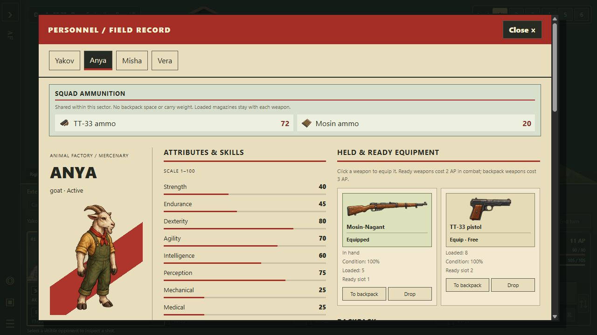

# Inventory, tools and locked doors

Open **Character** to manage the displayed merc's equipment. Visible supply piles now have small 3D supply-box markers; clicking nearby supplies opens the character screen. Loot remains hidden outside current squad visibility, including on Easy.

## Controls and costs

- **To backpack** clears the ready slot, provided its contents fit in the backpack. Stowing the current weapon leaves empty hands.
- **Ready 1 / Ready 2** draws a backpack weapon into the chosen slot; **Draw** switches to another ready weapon. Backpack draws cost 3 AP in combat and ready-weapon switches cost 2 AP; stowing is free. Drawing uses the existing animation.
- **Drop**, **Give** and **Take** cost 2 AP per transfer in combat, free outside combat. A quantity input supports partial transfers of carried stacks. Taking loot collects the displayed stack.
- **Give** lists living nearby squadmates. Transfers require the same physical height and an open cardinal edge (or the same tile); walls, closed doors and tower elevation prevent handovers.
- **Move** changes the selected item's backpack cell. The existing 6-by-3 capacity and two-cell long weapons remain authoritative. Occupied/invalid destinations reject without changing the inventory.
- **Nearby loot** lists reachable visible supply piles and bodies. Body contents remain concealed until **Search body** succeeds (3 AP in combat). Closed containers cannot be bypassed through Take.

Transfers stage both inventories before committing. A failed capacity, duplicate-weapon, quantity, reach or AP check consumes nothing. Loaded ammunition follows a transferred weapon. Medical kits and wire cutters move with their actual gameplay state, not cosmetic duplicate items.

## Shared squad ammunition · 2026-10-21

Reserve ammunition is shared by all present mercs in the same local sector, regardless of distance or elevation. No handover is required. Ammo uses no backpack cells or carry weight; Inventory has a read-only **Squad ammunition** section, and the HUD reports shared reserve counts. Compatible types remain distinct. This applies to the existing ammunition items, including spare grenades, rockets and flamethrower fuel. Loaded magazines and the ammunition in a transferred weapon remain with that weapon.

Picking up ammo still requires accessible, visible, searched supplies and the normal pickup AP. **Take for squad** adds it directly to the common supply even when the collecting merc's backpack is full. Uncollected or unsearched ammunition is excluded. Reload retains its 3 AP combat cost, finite quantities, partial magazines and jam-clearing rules. Guards, NPCs and militia keep their own reserves; absent and captured mercs cannot supply the active squad.

Campaign supplies travel with the people. Before splitting or departing, rounds are automatically divided among mercs who own compatible weapons, or among the whole group if nobody has that weapon yet. Remainders are retained, not discarded. Groups in different sectors cannot draw from each other; returning to the same sector makes their remaining supplies available together. A deceased merc's unused share passes to survivors; if nobody remains, the unspent rounds are left as loose supplies in that sector once.

The serialized `ammoPouch` on each merc records their share for travel and persistence, not an individually managed inventory. Loading older encounter or campaign saves moves reserve stacks out of backpacks once, preserving exact totals, loaded rounds and random streams. Invalid or unsafe quantities are rejected before replacing the running state. The pinned 2D game retains its previous inventory rules; the generated 3D core records this extension in its manifest.

The two-map opening campaign also declares its authored east/west road as a travel connection. This prevents the newer generated tutorial footprint from closing that fixture's only local journey.

## Tools and load

Anya starts with one reusable **Lockpick set**; Misha starts with three units of **Repair supplies**. Both are ordinary backpack items that can be shared, dropped and recovered. Picking requires a carried lockpick set; forcing does not. Each successful repair action consumes one supply unit. Supplies weigh 2 kg each; lockpicks weigh 0.5 kg. Existing maps without canonical stats do not receive the new starter equipment.

Strength sets a comfort load of **10 + 0.4 × Strength kg** (10.4-50 kg). Above that load, movement/climbing stamina cost multiplies by **carried weight / comfort load**. The character screen shows weight, comfort load and multiplier. Weight does not invent an additional hard inventory limit or alter AP; backpack space remains the hard limit. Ordinary walking remains possible at zero stamina.

## Locked doors

In the editor, select a closed wooden, steel or cell door boundary, expand **Locks & repairs**, and apply difficulty 1-100 (0 removes the lock). Inspection displays the saved difficulty. Locks prevent automatic opening and path traversal until picking or forcing succeeds. Nearby battle actions identify the door's direction and material. Existing doors stay unlocked unless explicitly authored.

Lock metadata now survives both full-map and reusable-block export/import, undo/redo, extraction and placement. Moving a block remaps edge coordinates. Replacing a block removes stale locks, and explicit shared doors must agree on lock difficulty, including during connected generation. Successful in-game checks open the door and remove its lock; the editor blueprint is unaffected.

## Verification and current limits

Regression coverage includes quantity conservation, equipped ammunition, full-backpack/AP rejection, utilities and tools, hidden loot, body searches, wall/tower reach, tool requirements and consumption, carrying burden, and portable door locks. Browser review exercises giving lockpicks, dropping/picking up a medkit, stowing/drawing a weapon, unlocking a door, and narrow-screen layout.

Shared-ammo verification: 180 focused checks pass across inventory, reload/jams, weapon loadouts, campaign splits/travel/hiring, casualties, encounter and campaign saves, fire/explosives and packaged module closure. The packaged build, asset audit and generated-core check pass. In packaged Quick Fight, Yakov collected eight pistol rounds; switching Inventory to Anya showed the same new squad total of 72, with 20 rifle rounds unchanged and no ammo occupying either backpack. Browser logs contained no errors or warnings.

Supply boxes are generic markers, not individual models for every item. Lockpicks and repair supplies currently use a neutral inventory symbol with a text label. Tool wear, keys, lock damage, weapon deterioration and arbitrary factory-machine repair are separate systems.
