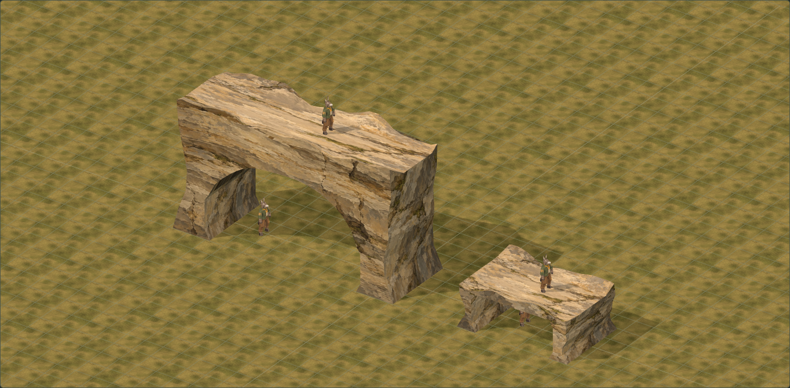

# Natural rock arches

Two matching, reusable limestone arches for Animal Factory Tactics. The large arch is intended as a tutorial-town landmark. Both are closed volumes, finished on the front, back, ends, underside and top, with painterly geological detail on broad economical geometry.

The visual reference is [Frederic Edwin Church's *The Natural Bridge, Virginia*, at the Smithsonian American Art Museum](https://americanart.si.edu/exhibitions/humboldt/online/frederic-edwin-church-natural-bridge). The assets borrow the feeling of substantial weathered stone around an opening, adapted to the tactical grid. Their skins are newly generated materials; the painting is not projected onto the models.

## Final dimensions

Ground is **layer one**. Confirmed by the user on October 21: the large walking surface is on **layer four**, three building-floor rises above the road; the small walking surface is on **layer two**, one rise above ground. Buildings and cliffs share the existing **2.12-unit floor spacing**. Taller cliffs span multiple layers. The preview's vertical ruler names each layer explicitly.

| Contract | Large | Small |
| --- | ---: | ---: |
| Overall span | 12 tiles | 6 tiles |
| Guaranteed ground opening | 8 tiles | 4 tiles |
| Reserved depth | 4 tiles | 4 tiles |
| Continuous level upper route | 2 tiles wide | 2 tiles wide |
| Upper walking layer, counting ground as 1 | 4 | 2 |
| Zero-based upper level | 3 | 1 |
| Upper walking height | 6.36 | 2.12 |
| Author triangles | 2,968 | 2,770 |
| Runtime triangles | 994 | 952 |

The small arch is deliberately a low, shallow natural stone ledge. Its central cap is approximately 0.17–0.21 units thick, with raised irregular rock rims outside the walking strip. This preserves standing clearance at the specified second layer. Do not thicken it downward without rerunning the clearance checks.

The large study uses an independently placed **six-tile road**, leaving one clear tile on either side within the eight-tile opening. Eroded recesses provide a little additional room at body height without adding another traversable tile column. Neither road nor surrounding ground is baked into an arch. Optional green end platforms in the study are separate connection guides.

## Models and painting

- Runtime API: `dist/tactics/natural-rock-arches.js`, with dimensions and contacts in `natural-arch-data.js`.
- Reusable files: `dist/assets/environment/natural-rock-arches/{large,small}-{runtime,author}.json` and corresponding `.obj` files; `natural-rock.mtl` references the supplied source PNG.
- Generated text exports pin LF line endings so their recorded hashes survive Windows checkouts. All ten staged model/texture hashes were checked against the manifest before delivery.
- Skin: one shared 1254 × 1254 atlas, with exposed front rock, alternate rear/end rock, sheltered underside and worn upper stone panels. The small arch uses the alternate front panel to avoid duplicating the landmark's prominent cracks.
- The runtime WebP is **564,670 bytes**. The unchanged reusable source PNG is **3,211,382 bytes**. A decoded RGBA atlas is about 6 MiB, shared by both assets; this is an estimate, not a browser-memory measurement.
- The [asset manifest](../../dist/assets/environment/natural-rock-arches/manifest.json) records the complete built-in `image_gen` prompt, reference, original filename, texture dimensions and hashes, model hashes, exact bounds and counts. No sculpted cracks, moss meshes or tiny rubble are needed.

The author and runtime meshes sample the same constrained closed rock volume. Reducing the depth samples and face refinements preserves the level top and exact connection contacts. Broad unequal coves erode the front and back shoulders outside the protected route, with the deformation carried through every depth station. Tiny face slivers are not subdivided further. Front and rear faces are triangulated from their actual eroded outlines so changed rims cannot introduce crossing diagonals.

The broad painted faces use shared planar normals and a shallow relief field. Their material suppresses received shadows on those two faces, preventing thin self-shadow stripes from the economical cap triangulation. All rock still casts shadows. Top ledges, ends and the underside retain geometric normals and normal shadow reception, including character contact shadows on the upper route. This is an explicit art tradeoff: dynamic objects do not cast shadows onto the two broad faces. It does not change any scene-wide shadow bias. The JSON exports include the `surface` attribute used by this material policy (0 front, 1 rear, 2 underside, 3 top, 4 end). OBJ transfers geometry, UVs and normals; reproduce the library's material policy for the same shadow appearance in another renderer.

Coordinates are **Y up**, **X along the span**, **Z through the passage**, with the origin at the centre of the base. Tile edges along X are integers. The upper walking strip is Z = −1 to +1. Each end has a two-tile contact centred on X = ±half-span at the exact upper walking height. `naturalArchLayout()` supplies separate base-support cells, open passage cells, upper route cells and end connections.

## Previews

[Open the interactive study](http://127.0.0.1:4476/tactics/natural-arches-study.html?arch=large&view=game&grid=1&guides=1&road=1). Controls provide both meshes, all camera directions, every native character, a grid, separate roads, optional end connections, grey forms and wireframe.

| View | Large | Small |
| --- | --- | --- |
| Front | [Preview](review-images/natural-arches/large-front.png) | [Preview](review-images/natural-arches/small-front.png) |
| Side | [Preview](review-images/natural-arches/large-side.png) | [Preview](review-images/natural-arches/small-side.png) |
| Top | [Preview](review-images/natural-arches/large-top.png) | [Preview](review-images/natural-arches/small-top.png) |
| Gameplay angle | [Road and side clearances](review-images/natural-arches/large-game.png) | [Preview](review-images/natural-arches/small-game.png) |
| Back | [Preview](review-images/natural-arches/large-rear.png) | [Preview](review-images/natural-arches/small-rear.png) |
| Underside | [Preview](review-images/natural-arches/large-under.png) | [Preview](review-images/natural-arches/small-under.png) |

## Validation

- Seven focused checks cover closed, consistently wound volumes; valid padded UVs; a level two-tile route across the whole span; exact end contacts; dense underside sampling near the lips and shoulders; road separation; shared resources and disposal; and actual character clearance.
- Actual grounded skinned vertices and fitted Red Hat caps were checked for **12 animals × two outfits × five headings**, at every advertised passage column and four depth positions: **5,760 complete body placements** across the two arches. The tallest measured character is the donkey at **1.77394**. No body/cap intersection was found. Carried weapons are not included in that clearance claim.
- The small underside is at least approximately **1.909** across the densely sampled opening. Its smallest measured body-to-stone margin is about **0.151** in the complete-model placement checks. These are different measurements: a tile-centre ceiling alone is not sufficient proof of clearance.
- `tools/build-natural-arches.mjs` recreates OBJ/JSON exports and updates their hashes. `tools/check-natural-arch-actors.mjs` writes the detailed model report under `artifacts/natural-rock-arches/`.
- The 3D packaging build includes the study, model/skin directory and module-closure checks. The global asset audit validates the new manifest and detects unregistered PNGs.
- Browser captures and disposable-process receipts are under `artifacts/natural-rock-arches/layer-label-review/`. Source and packaged studies are reviewed separately, including front, side, top, gameplay, reverse, underside, grey forms, author mesh, end connections and a narrow viewport. Injected checks also verify disposal of a late-loading atlas and a character texture whose paired mesh failed.
- Independent subagent review approved the finished art and code at **9/10**, then confirmed that approval after the layer-label update on October 21. The review identified and resolved cap shading artifacts and late-load cleanup paths. The user's height confirmation matches the reviewed geometry. Gameplay integration is not part of that approval.
- Delivery checks: **nine focused geometry, character and packaging tests passed**, the asset audit passed, and `build:tactics-3d` completed. The final browser run recorded **20 captures, zero application errors and two passing lifecycle probes**; its disposable browser exited and released its port. Source and packaged gameplay captures match exactly.

## Gameplay and five-layer integration handoff

This branch delivers the art library, reusable models, study and measured contact data. It does **not** register this painted arch art as a gameplay prop. Integration `0715e800` supplies four ordinary layers plus a fifth for authored high terrain and roofs, preserving legacy three-layer maps and decorative roof heights. The earlier `bb4b5ce` baseline lacked that schema migration. Gameplay still uses the separate placeholder arches until the final art and its contact geometry are integrated.

- [x] Extend the schema and serializers: integrated in `0715e800`, with legacy maps, blocks, saves, floor destruction, visibility and height-limit regressions checked. Keep the final arch integration within that shared layer definition.
- [x] Preserve old decorative roof heights. Legacy roofs remain at z3; new fringe roofs use z4. A decorative roof does not itself create a playable floor. Authored high terrain can occupy z4.
- [ ] Reconcile presentation floor spacing 2.12 with logical gameplay floor spacing 3, and existing cliff height 2.0. Use explicit surface/height conversion for the arch and its collision geometry; do not resize character models or silently stretch every wall.
- [ ] Register shared editor/game catalog entries and a rotation adapter. Keep the exact footprint, local origin, top contacts and six-/twelve-tile span consistent through save → reload → playtest.
- [ ] Block only the base support cells at ground level. The whole rectangular reservation is not a solid obstruction. The four-/eight-tile underpass remains available.
- [ ] Supply the separate upper walking surface and end links at the recorded top level. Do not fill the opening with solid terrain columns to obtain a top route.
- [ ] Use the actual rock volume for sight and projectile obstruction; an enclosing box would incorrectly close the opening. Keep upper and lower selection/picking distinct.
- [ ] Validate road placement, all four rotations, characters above and below simultaneously, end connections, pathfinding, fog, saves and any desired carried-weapon clearance in the integrated game.

## Preview helper

The read-only preview on port 4476 is retained for user review, with an actual automatic shutdown at **October 21, 2026, 10:36 PM Eastern**. It is registered with helper lifecycle cleanup. Its source is `tools/serve-natural-arches.mjs`; its private stop marker is `artifacts/natural-rock-arches/server-20261020/STOP`. Restart deliberately with a fresh record and deadline. Disposable browser helpers close at the end of each review and record process exit and port release.
