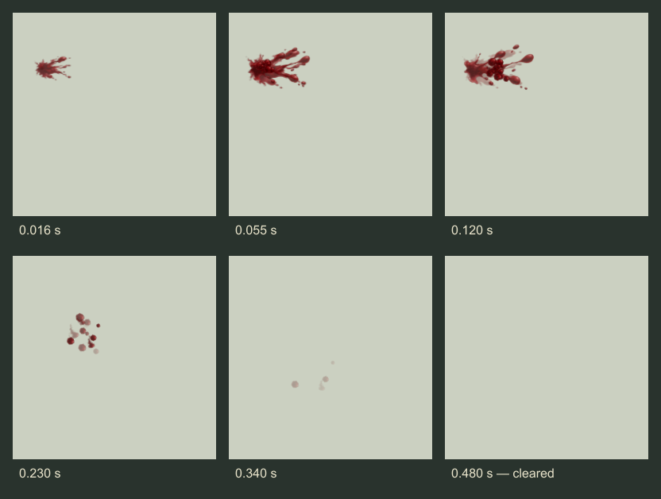

# Painted ordinary blood spray

Artist delivery · 21 October 2026 · Independent asset review: **9/10**

A compact dark-crimson impact opens into a short fan. A few droplets separate,
fall and fade. The effect lasts at most **0.48 seconds**, with restrained strength
variation. It uses painted skins on simple cards, normal depth testing and no
lights or particle shadows.

This delivery follows the ordinary-spray portion of the
[gunshot proposal](GUNSHOT-HIT-EFFECTS-PROPOSAL-2026-10-21.md). The user's next
instruction narrowed this pass to making the spray asset; the builder owns its
orientation and placement at the resolved hit. The character references in the
study are manual scale checks, not a second hit system or a receipt fixture.

## Review

Open the [local study](http://127.0.0.1:4477/tactics/painted-blood-spray-study.html).
It pairs a close view with a **55-pixel-per-tile** gameplay view, with horse and
hen references, grass/snow/dark/red backgrounds, several cameras, pause, slow
playback and scrubbing. The source-axis guide can be hidden. The study is also
linked in the 3D art gallery and included in the packaged build.
Saved comparisons: [horse](review-images/painted-blood/horse-gameplay.png) and
[hen](review-images/painted-blood/hen-gameplay.png), each with both viewing scales.



The [review GIF](../../dist/assets/effects/painted-blood/spray-preview.gif) has a
neutral matte and a blank pause between bursts. It is a review clip; the game
uses transparent PNGs.

## Reusable files

All images and their dimensions, SHA-256 hashes, pivots, timing and provenance
are recorded in the [asset manifest](../../dist/assets/effects/painted-blood/manifest.json).

| File | Use | Size |
| --- | --- | --- |
| [Component atlas](../../dist/assets/effects/painted-blood/spray-components-v1.png) | Preferred: two painted fans, a streak and a bead, with tight UV crops | 512 × 512 RGBA; 106,939 bytes |
| [Transparent flipbook](../../dist/assets/effects/painted-blood/spray-flipbook-v1.png) | Optional flat sprite playback | 512 × 384 RGBA; 17,861 bytes |
| [Source painting](../../dist/assets/effects/painted-blood/spray-components-source-v1.png) | Unchanged generated original | 1254 × 1254 RGBA |
| [Preview GIF](../../dist/assets/effects/painted-blood/spray-preview.gif) | Review only | 256 × 256; 28,357 bytes |

The skins were generated with **built-in ImageGen**, transparent background. The
exact prompt is saved in [generation-prompt.txt](../../dist/assets/effects/painted-blood/generation-prompt.txt)
and the manifest. Runtime preparation only resizes the painting and records UV
crops; the animation is rendered from these painted components.

Choose one runtime representation. The component texture costs about **1.33 MiB**
decoded with mipmaps; the optional flipbook about **1 MiB**. Loading both incurs
both costs. Source art and the review GIF are not runtime dependencies.

## Component motion and renderer contract

[Motion](../../dist/tactics/painted-blood-spray-motion.js) is separate from the
[Three.js renderer](../../dist/tactics/painted-blood-spray.js). The renderer is a
small reusable reference with one preallocated instanced draw per emitter.

```js
const spray = createPaintedBloodSpray(sharedTexture, {
  seed: presentationSeed,
  strength: 1,   // clamped to 0.7–1.2
  reduced: false
});
scene.add(spray.mesh);
spray.setFrame(rigidWorldFrame);
spray.update(ageSeconds, camera, {floor: supportSurfaceWorldY});
// Retire at 0.48 s; reuse/pool or dispose after playback.
spray.dispose();
```

- The contact is local **(0, 0, 0)**; **+X** points away from contact along the
  spray. The builder chooses the basis from the actual hit. An entrance spray
  should point back against the incoming ray; this asset does not imply an exit
  wound. Painted fan pivots keep their root at the contact.
- `setFrame` takes a **rigid, unscaled transform in render-world coordinates**,
  with Y up and distances in rendered tile units. It is not a logical tactical
  height transform. Use the game's shared coordinate adapter.
- **Keep the returned mesh at identity under an untransformed scene/root.** Its
  instance matrices, camera basis and gravity are world-space. Parenting it to
  a moving or scaled character group would apply the transform again.
- Emission is transformed first; gravity is then applied along world **−Y**.
  Camera-facing painted cards do not change the world-space particle paths.
- Motion sampling is deterministic, supports reverse scrubbing, reuses typed
  buffers and consumes no simulation RNG. Full uses **18 cards**, Reduced uses
  **5**. Still/fade mode shows a stationary compact mark for at most **0.18 s**.
- Use straight-alpha **normal blending**, sRGB color and alpha cutoff **0.015**;
  never additive blending. Keep depth testing enabled and depth writes disabled.
- An optional `floor` clips a whole card before its rotated bounds cross that
  horizontal plane. It does not query walls, ramps or complex scenery.
- `dispose()` releases the emitter's geometry and material, and is idempotent.
  **The caller owns the shared texture.** The study preloads it before playback.

The motion-only API exposes separate `launch` displacement and `fall`, plus
velocity, size, opacity and tile buffers. A builder can batch these into the
game's shared particle pool instead of allocating a renderer for every hit.
The study's one draw per emitter is **not** a global multi-emitter draw budget.

## Optional flipbook contract

The sheet has **12 frames**, each 128 × 128, in four columns and three rows,
row-major from the top-left. It is a single, non-looping hit. Cross-fade adjacent
frames using the **nonuniform times** in the manifest, rather than assuming a
fixed frame rate. The first and last frames are fully transparent.

Every frame has the same contact pivot, **(17.7231, 34.4615) pixels from its
top-left**, on a **1.3 × 1.3 tile** quad. The complete droplet path fits inside the
frame, including a transparent two-pixel border. Do not recenter each frame on
its visible paint.

This flat bake includes falling motion in its authoring plane. Rotating that
whole plane for a pitched hit also rotates its baked fall. **Use the component
motion for arbitrary 3D orientation with world-down gravity.** The flipbook is a
simple flat playback option and a visual reference.

## Validation and limits

- Independent visual review: **9/10**, with no blocking asset findings. Reviewed
  horse/hen, grass/snow/dark/red backgrounds, front/three-quarter/rear views,
  mobile layout and the baked onset/burst/droplet/fade sequence. Individual beads
  remain rather round in close-up; gameplay readability is good.
- **9 tests passed:** seven focused asset/motion/ownership tests and two packaged
  page/module-closure tests. The reviewer independently reran the seven focused
  tests. Asset audit and packaged build passed.
- Browser review passed 20 source comparisons and one packaged comparison;
  source and packaged appearance matched exactly. Fifty reset/strength/mode
  cycles retained **27 geometries and 11 textures** before and after, including
  the preloaded character references. Review tools record browser
  ownership and verify exit and released ports in `finally`.
- The bake checks transparent endpoints, occupied intermediate frames and clear
  borders. File hashes and PNG/GIF headers are checked by the asset audit.

This is approval of the **asset and study**. Exact skin contact, live shot
orientation, stance/outfit coverage, fog/visibility, event deduplication, support
surfaces, bounded wall clipping, global pooling and settings are builder work.
No damage, casualty, head destruction, permanent stain or combat wiring changed.
No frame-time or full-battle performance claim is made by these isolated checks.

## Reproduction and preview lifetime

Use Node.js with `sharp` and `playwright` available; review uses installed Edge.
The GIF encoder needs Python with Pillow. `SHARP_PATH` and `PLAYWRIGHT_PATH` may
name the respective packages when they are not on the normal module path.

1. Run `node tools/prepare-painted-blood-spray.mjs <original-png-path>` to prepare
   the runtime atlas from the saved original. This regenerates the base manifest.
2. Start `tools/serve-blood-spray.mjs` as described by its recorded launch
   configuration. It serves this worktree at localhost:4477.
3. Set `BLOOD_REVIEW_BAKE=1` and run
   `node tools/review-painted-blood-spray.mjs` to render and pack the flipbook.
   Then run `python tools/encode-blood-spray-preview.py <review-output>/frames`.
4. Run `node tools/build-tactics-3d.mjs`. Set `BLOOD_REVIEW_PACKAGED=1` and rerun
   the review without the bake flag to compare source and packaged output.
5. Run `node --test tests/painted-blood-spray.test.mjs tests/tactics-pages-files.test.mjs`
   and `node tools/check-assets.mjs`.
6. Run `node tools/assemble-blood-spray-contact-sheet.mjs <review-output>/frames`
   to assemble the unchanged rendered frames and timing captions for this document.

Local screenshots and helper receipts live under `artifacts/painted-blood/` and
are intentionally excluded from this delivery's commit. Curated review images
are saved beside this document. The registered, task-owned preview at port 4477
automatically stops on **22 October 2026 at 7:56 PM Eastern**. Its launch source
and restart configuration are preserved in the helper-lifecycle record; the
deadline is not extended by this delivery.
