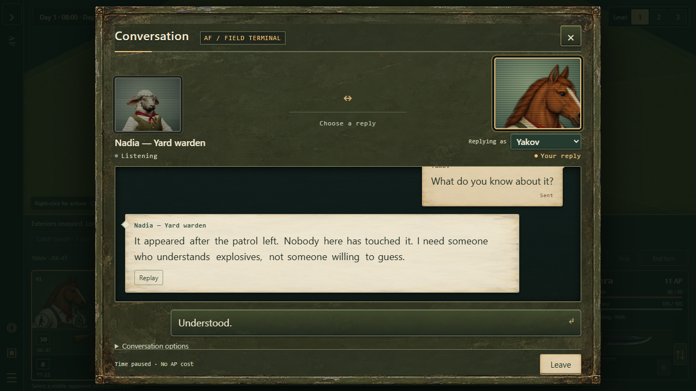
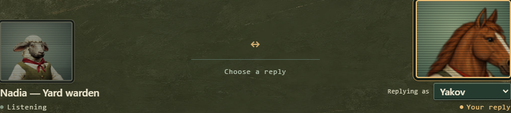

# Painted conversation terminal

The existing Conversation modal now uses worn olive enamel and ivory message stock. Chipped paint, dull exposed metal and oily edge wear give the terminal a used military communications-console finish. The center stays quieter behind live text. The portraits, conversation data, speech, choices and checkpoint behavior remain the existing dialogue implementation.

This art branch starts from the coder's `c29241a` (`work/editor-3d`), the terminal version shown in the user's screenshot. It is not a merge of that dialogue feature into canonical. Integrate the skin after the dialogue dependency, or cherry-pick it onto that feature branch.

## Delivered materials

| File | Use | Dimensions | Transfer size |
| --- | --- | --- | --- |
| `dist/assets/ui/dialogue-terminal/field-terminal.webp` | Nine-slice outer shell; sampled paint on controls and inset panels | 1254 × 1254 | 240,362 bytes |
| `dist/assets/ui/dialogue-terminal/message-paper.webp` | Quiet paper for incoming and outgoing message cards | 1254 × 1254 | 252,780 bytes |
| `dist/assets/ui/dialogue-terminal/crt-green-v1.webp` | Green scanlines and soft curved-glass edge shading over both portraits | 1448 × 1086 | 69,356 bytes |

All textures were created with the built-in `image_gen` tool. [The material manifest](../../dist/assets/ui/dialogue-terminal/manifest.json) and [CRT manifest](../../dist/assets/ui/dialogue-terminal/crt-green-v1.json) contain the complete prompts, original generation filenames, dimensions, SHA-256 hashes and processing records. The generated PNG originals remain in Codex's generated-image directory; the reusable CRT PNG is also included beside its WebP. The delivered images retain the entire generated composition, encoded as WebP at quality 90 for metal/paper and 92 for glass; no text or controls are baked into them.

The three runtime textures total **562,498 bytes (549 KiB)** on disk and approximately **18 MiB** if all are decoded into RGBA surfaces. This is not a measurement of browser memory consumption. They are shared across the interface, not unique per message or portrait. The original CRT PNG is an additional reusable source asset and is not requested by the live UI.

## Integration

- `dist/tactics/battle-dialogue.css` applies the materials to the existing component. The shell slices at 7%, with an 18px desktop rim and 10px narrow-screen rim so hardware does not stretch with the panel.
- Message surfaces use pale solid-color fallbacks. Controls retain hover, disabled and visible keyboard-focus states. Portrait canvases remain live.
- The painted CRT glass uses **Multiply at 20% opacity** in each portrait's `::before` overlay. A separate `::after` overlay draws **2 CSS pixels of dark band, then 2 pixels clear**, also at 20% Multiply. This makes the bands survive the small display size; increasing the opacity of the downsampled texture alone did not make its fine lines visible enough. White is neutral in the scanline layer's Multiply blend, so it leaves the clear rows unchanged. The original raster asset is unchanged.
- `isolation:isolate` confines both layers to that portrait, clipping follows its rounded frame, and `pointer-events:none` keeps input passing through. Small status captions stay above the filter. Both the animated NPC canvas and the mercenary image receive the same treatment.
- The narrow layout wraps the “Replying as” label and gives the speaker selector a nonshrinking width.
- `tools/build-tactics-pages.mjs` copies the asset directory; the 3D packaging build uses this path too.
- No dialogue rules, speaker selection logic, saved state or gameplay rules were modified.

## Review

- 43 focused dialogue and packaging tests passed.
- Asset audit and `build:tactics-3d` passed.
- The real `battle-3d.html?study=dialogue` fixture was inspected at desktop, 390px and 320px widths, and at a 640 × 360 CSS viewport equivalent to 200% zoom on a 1280 × 720 display.
- Browser checks exercised a real reply, Replay, options, keyboard focus, Leave and Escape. The clock stayed paused during dialogue, and closing released portrait resources.
- Packaged output was loaded separately. A failed-texture-decode run retained usable solid-color surfaces and live text.
- Disposable browser processes exited and released their automation ports. Captures and receipts are under `artifacts/painted-dialogue/review/`.
- Independent visual review: **9/10, approved with no remaining blocker**, including the corrected narrow speaker selector and both zoom-equivalent captures. The reply button was hit-tested after scrolling to confirm it remained reachable.

The CRT source asset and its applied portrait overlay each independently received a **9/10** review, with no blockers. The original 30% Color Burn captures are under `artifacts/painted-dialogue/crt-review/`; the later 40% pass is under `artifacts/painted-dialogue/crt-40-review/`. Those versions were superseded after the user found their lines too faint at actual display size.

The final **20% Multiply with 2px bands** passed a fresh packaging build and browser review, including both portrait styles, narrow screens, animated speech and the packaged route. A native-size comparison checked texture-only Color Burn, texture-only Multiply, and explicit bands with either glass blend. Independent review preferred the delivered Multiply/bands version at **9/10**, with visible lines and readable faces at desktop and phone sizes. The banded Color Burn comparison was muddier. Captures and cleanup receipts are under `artifacts/painted-dialogue/crt-bands-review/`; the disposable browser exited and released its port.

The browser review is reproducible with `tools/review-dialogue-paint.mjs` and Playwright (`PLAYWRIGHT_PATH` may point at a local installation). Set `REVIEW_PACKAGED=1` after building to include the packaged route. `COMPARE_CRT=1` also captures the alternate blend treatments.

## Local preview lifecycle

`tools/serve-dialogue-paint.mjs` provides read-only source and `/packaged/` routes with `.mjs`, WebAssembly and WebP MIME types. The earlier hedge preview lacked `.mjs` support, which prevented the new speech dependency from loading; that was a preview-server problem, not a skin or asset failure.

The retained preview on port 4476 replaces verified task-owned PID 33172. Its original deadline remains **October 20, 2026 at 12:03 PM Eastern**. It stops automatically at that deadline or when its private `artifacts/painted-dialogue/server/STOP` marker is created. The new process lifetime is registered with helper lifecycle cleanup. Restart deliberately using a fresh record directory; the script never extends a running helper's deadline.
