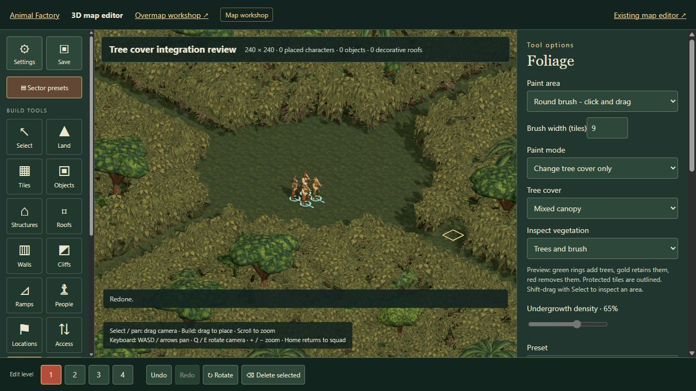
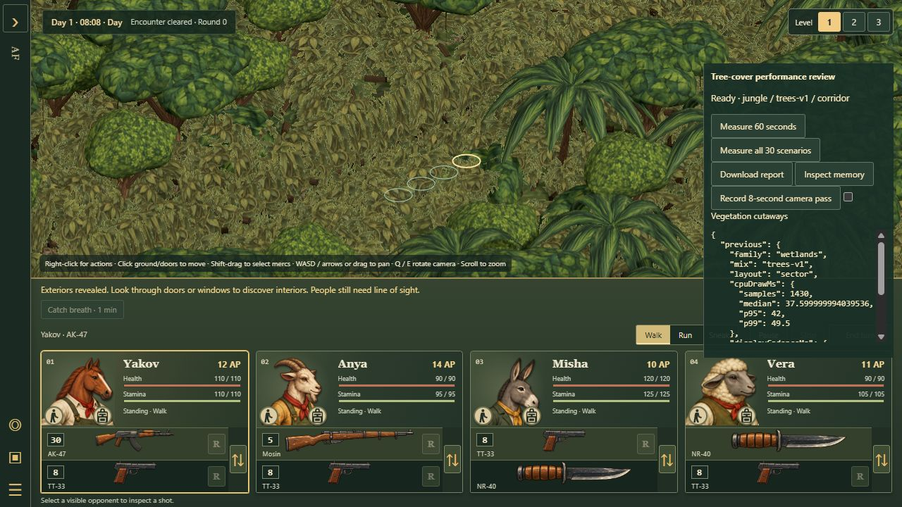
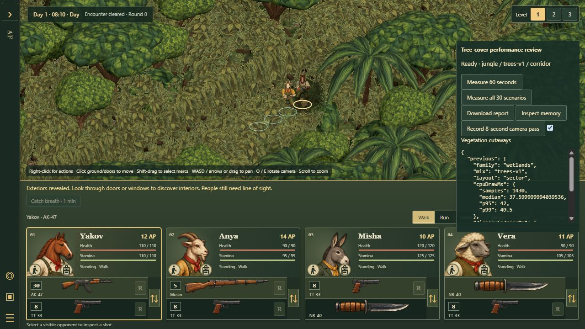
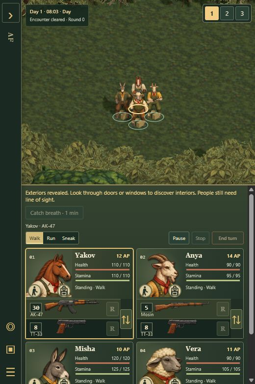

# Saved tree cover and vegetation cutaways

Implementation of [Tree mixes in the editor](TREE-MIX-EDITOR-PROPOSAL.md), on
`work/editor-3d`, based on canonical `6a58a48`.

## Authoring and persistence

In **Foliage**, choose Dense thicket or Dense wetland thicket, then **Tree cover**:
Brush-led, Mixed canopy or Tree-led. Brush-led remains the default. Species
follow the ground habitat. Undergrowth density controls decorative growth; the
dense preset retains its movement and sight screen at every percentage. Open
woodland retains its original Woodland density behavior.

**Change tree cover only** preserves ground, habitat, density and passability.
It skips bare ground, objects and access points. Rectangle, round and square
brushes work; each completed stroke is one undo step. Copy selected settings
reads the saved mix. Mixed selections show Multiple values until a specific
choice is made. Trees only / Brush only remain editor-local inspection views
with “Visual inspection only; obstruction is unchanged.”

The preview marks actual retained trees in gold, additions in green, removals in
red and protected cells in orange. A disposable worker caches the potential
population and coalesces pointer updates to at most eight per second. It never
rebuilds the live scene during dragging. Cancellation, tool changes, document
changes and page retirement clear or replace the preview. Escape leaves the
document unchanged.

The optional fourth foliage tuple field is `mixed-v1` or `trees-v1`; explicit
`brush-v1` is accepted, while painting Brush-led omits the field. Legacy tuples
retain their interpretation. Unknown versions and incompatible preset/version
combinations fail validation. Only dense thicket/wetland presets accept mixes.

Renderer and gameplay use the same deterministic tree descriptions. A complete
candidate population is reserved before filtering by each cell's mix, so editing
a neighboring composition does not move existing trees. Existing trees, the
three-tile clear-ground margin, 2.6-tile added-trunk spacing, supporting height,
headroom and protected-access checks remain. Finite sight screens and deadfall
are unchanged; substantial trunks and branches still stop projectiles.
Composition participates in the geometry/cache signature.

Browser saves, JSON, reusable blocks, sector-library maps, Playtest and encounter
records retain the field through existing map serialization. Block placement
carries authored values and regenerates detail at the destination, as before.
This does not add a block-rotation feature. The study's editor link now opens
the selected saved composition.

## Readability

The selected living merc, known hovered ground and nearby valid route markers
create bounded, feathered/dithered openings in foreground vegetation on their
selected floor. The opening follows the displayed moving merc. Bark retains a
faint boundary indication. Editor brushes and selections provide corresponding
focuses. Color and shadow passes share aperture uniforms; vegetation restores
smoothly when a focus moves away. Ground, cliffs and buildings retain their rules.

Ground picking and movement use the authoritative map. Revealed blocked foliage
is outlined and labelled Impassable. Cutaways never change exploration, occupant
visibility, LOS, bullets, loot or collision. Hidden opponents do not supply
focuses. Unselected mercs remain subject to ordinary foliage occlusion.

Before, at the normal low camera:

After, at the same camera:

[Eight-second moving-camera recording](images/tree-cover-integration-2026-10-16/cutaway-motion.webm).
The horse also successfully walked four tiles along this one-tile corridor with
the grid off.

The reverse-camera [before](images/tree-cover-integration-2026-10-16/corridor-reverse-before.png)
and [after](images/tree-cover-integration-2026-10-16/corridor-reverse-after.png)
captures confirm the same behavior from the opposite side. Switching interaction
levels 1 → 2 → 3 → 1 restored the selected merc's aperture and produced no
application/shader errors.

## Verification

- The uniform 96 × 96 fixture retains 8,463 occupied cells and exactly **73 / 201 /
  393 trees** across all five habitats. Tests cover shared art/physical identity,
  mixed boundaries, all three outdoor levels, protected ground, cached previews
  and retained tree identities.
- Persistence tests cover undo/redo, JSON parsing, block extraction/placement,
  encounter capture/restore and malformed data. Existing foliage LOS, projectile
  and movement tests are retained.
- The broad `npm run check` completed 2,507 tests: 2,503 passed; four renderer
  visibility fixtures lacked animation dependencies now used to follow a
  displayed merc. Their stubs were corrected without weakening assertions,
  and an animated-friendly/hidden-guard case was added. All eight visibility and
  cutaway cases then passed. Final focused results are recorded below; this is
  not a claim of a second complete-suite run.
- Packaged browser checks: painted Tree-led, saved a named design, exported JSON,
  reloaded the named design, sampled its saved mix, repainted canopy only to
  Mixed canopy, and repeated Undo/Redo three times. JSON retained the fourth
  field and density. The actual Playtest button opened the edited sector in the
  packaged game. No game, module-loading or shader errors were observed.
- Worker lifecycle coverage checks coalescing, stale-result rejection, revision
  refresh and termination on cancellation. Inspection modes do not enter saves.
- Final relevant suite: **207 tests pass**, covering foliage, biome, editor,
  visibility and both deployment module lists. The added Open woodland case
  checks that a stale hidden Multiple values selection cannot block its brush.
  The regenerated asset manifest audit, all **20 core synchronization checks**,
  and **`npm run build:tactics-3d`** pass. The manifest records the new placement
  version and cutaway sources; deployment missing-module checks remain intact.

## Performance and limits

**This is not a 60 FPS approval.** The integration preserves the saved population
and approved art. Rendering skips wholly offscreen chunks outside the nearby
shadow region, retaining instancing, tree detail switching and bounded shadows.
Cutaway discard improves readability; it does not avoid submitting all affected
geometry.

The [30-scenario report](images/tree-cover-integration-2026-10-16/performance-30-scenarios.json)
covers a study fill and a 240 × 240 sector, five habitats and three mixes. Both
fixtures include four modeled mercs, a furnished room, upper floor, local lights,
interior fog and fire. Six phases cover close/reverse/wide views by day/night,
continuous hover, movement orders and firearm effects when idle. Each run waits
for ground paint, warms five seconds, then measures 60 seconds. These are
deterministic review fixtures, not campaign benchmarks.

Conditions: Windows, Chromium 155 in the Codex in-app browser, ANGLE/D3D11 on an
RTX 3080, battlefield CSS size 1236 × 394.40625, DPR 1, Easy, initial gameplay seed
1947, normal fixed camera elevation. Raw `seed` is the **final mutable RNG state**,
not the input seed. Source hashes are recorded. All 30 runs have zero hidden
frames and empty renderer diagnostics. CPU draw, GPU timers and display cadence
are separate measurements.

Reproduce from a packaged build by opening
`tactics/battle-3d.html?study=tree-cover&family=jungle&mix=brush-v1&layout=fill`.
The developer-only panel offers a single 60-second run or all 30. The fixture
does not autosave over an encounter. `layout=corridor&mix=trees-v1` places the
squad on the narrow route and offers a cutaway comparison toggle and recording.
Keep the same browser viewport and avoid concurrent builds during timing.

Median display cadence, milliseconds (lower is better):

| Fixture / habitat | Brush-led | Mixed canopy | Tree-led |
| --- | ---: | ---: | ---: |
| Fill / jungle | 24.5 | 24.9 | 25.8 |
| Fill / temperate | 24.2 | 26.4 | 24.4 |
| Fill / snow | 22.1 | 22.2 | 22.2 |
| Fill / dry grassland | 22.4 | 26.1 | 25.9 |
| Fill / wetlands | 23.4 | 25.0 | 25.6 |
| Sector / jungle | 31.7 | 34.9 | 34.8 |
| Sector / temperate | 34.1 | 35.5 | 35.5 |
| Sector / snow | 30.1 | 32.2 | 32.5 |
| Sector / dry grassland | 31.6 | 35.4 | 34.2 |
| Sector / wetlands | 35.4 | 36.3 | 39.2 |

Controlled Brush-led comparisons substituted the three previous renderer modules
(`hybrid-renderer.js`, `biome-scene.js`, `biome-terrain.js`) from `6a58a48` into
the same packaged gameplay/measurement harness. These are renderer comparisons,
not a separate historical deployment. Sources and conditions are in the linked
records; population and gameplay rules are the same.

| Sector | Previous cadence median / p95 / p99 | Current repeat |
| --- | ---: | ---: |
| Jungle | 32.0 / 38.3 / 65.2 ms | 33.1 / 38.1 / 52.2 ms |
| Wetlands | 33.5 / 46.3 / 82.3 ms | 32.6 / 38.2 / 47.7 ms |

[Previous jungle](images/tree-cover-integration-2026-10-16/baseline-jungle-brush.json),
[current jungle](images/tree-cover-integration-2026-10-16/current-jungle-brush-repeat.json),
[previous wetlands](images/tree-cover-integration-2026-10-16/baseline-wetlands-brush.json),
[current wetlands](images/tree-cover-integration-2026-10-16/current-wetlands-brush-repeat.json).
The small median differences fit the observed repeat-run variation; p95 does
not regress in these two comparisons. This limited sample is not statistical
proof of identical performance on every map or machine.

Tree-led wetland sector display cadence: **39.2 / 44.3 / 115 ms** at median / p95 /
p99. CPU draw: 37.6 / 42.0 / 49.5 ms. GPU: 19.1 / 24.2 / 25.8 ms. Median submitted
geometry: 5,052,571 triangles and 2,641 calls, including shadow/light passes and
modeled characters. Raw data includes each scenario's quantiles, query costs
and final detailed/shadowed chunk counts. Gameplay totals are not comparable to
foliage-only art-study triangle counts.

Gameplay has a fixed camera elevation; these runs do **not** establish a separate
high-angle performance distribution. Floor-aware focus behavior is tested
independently. Raw `coldLoadMs` measures document navigation, not readiness for
play. Editor metrics recorded a 3,336 ms load and 956–1,047 ms scenery rebuilds
for repeated canopy edits. Those stalls are separate from warmed frame timing.

The 30-run report used an earlier texture estimator: it includes ground paint,
but omits finite-screen mask bytes and does not separate shadow targets/CPU paint
copies. It is not total GPU memory. The corrected
[jungle corridor snapshot](images/tree-cover-integration-2026-10-16/jungle-memory.json)
records 168.2 MB estimated textures, including 24.4 MB ground paint and 0.92 MB
finite masks; 27.8 MB geometry buffers, 41.9 MB shadow color targets and 21.3 MB
CPU paint buffers are separate. Driver allocations, depth buffers and temporary
uploads are excluded. This full scene includes characters and room assets,
unlike the earlier 91.7 MB foliage-only clearing.

Repeated editor undo/redo stabilized at **168 geometries / 38 textures**; the
[six-step allocation record](images/tree-cover-integration-2026-10-16/editor-allocation-check.json)
shows no growth across completed rebuilds. Further presentation/performance tuning
is needed for a 60 FPS release claim. Repetitive undergrowth remains a separate
art-polish item; approved shapes and snow paint are preserved.

## Populated battle follow-up: character submissions and sight caching

This follows the integration review at `034c0b7`. Live character body parts now
share a render submission when their material, skeleton, binding, vertex layout
and shadow settings agree. The original authored meshes remain available for
animation corrections and exact body picking. The copy uses the live skeleton,
preserves painted part IDs, and updates changed geometry/index buffers after
posing. Transparent or incompatible parts keep their original rendering path.
Camera and shadow culling use the current posed bounds; no character silhouette,
skin texture or shadow setting was simplified.

Render copies sit outside the authored rig. This matters for the hen: temporary
animation controllers restore snapshots of the rig, and must not resurrect old
render copies. Disposing or replacing a batch releases only its copied geometry,
not shared materials, textures or skeletons. The empty aggregate picking box is
intentional; original part boxes continue to define character selection bounds.

Terrain visibility and physical foliage now use the reviewed map-geometry
revision cache too. Ordinary actor updates no longer stringify the full map in
these paths. Doors, destruction, floor/prop changes and explicit foliage edits
invalidate the same geometry contract; mutable editor maps still use content
checks. Visibility observer results are discarded when their scene rebuilds.
The core visibility change is generated by `core-map-cache-adapter.mjs`.

The first combined timing pass exposed an avoidable forest rebuild on the first
enemy shot: the renderer's filtered prop list and the simulation's complete list
describe the same foliage occupancy. The foliage cache now compares its own
signature after a general geometry-cache miss and retains that shared result.
Adding/removing actual occupied cells still rebuilds it. A regression switches
between both views, adds and removes a crate, and compares against an uncached
reference.

The reproducible harness is in `tools/populated-performance/`. Build with
`npm run build:tactics-3d`, then run `node tools/populated-performance/server.mjs`
with an explicit UTC expiry argument less than 24 hours away. It binds only
`127.0.0.1:4371`, reads baseline modules from Git `034c0b7`, and serves the candidate
from `.pages-output`. It never reads a campaign save and disables autosaving.
Do not run builds or tests during timing. The server stops at its expiry or when
`artifacts/populated-performance-2026-10-16/STOP` exists; remove an old stop marker
only after verifying its previous server has exited. Retained agent-run servers
must also follow the workspace's helper registration policy.

Run `/baseline/tactics/battle-3d.html?study=tree-cover&suite=render&size=normal&run=render-normal-baseline-1&seconds=20&gpu=0&verify=1`
for three pairs in ABBAAB order. Repeat with `size=large` and
`run=render-large-baseline-1` for a verified 1920 × 1080 rendering surface. The
desktop browser ignored its viewport override and retained 1280 × 720, so the
harness sizes the battlefield explicitly; this tests rendering cost at the larger
size, not responsive HUD layout at that screen resolution. For the complete
enemy turn, use `/baseline/tactics/battle-3d.html?study=tree-cover&suite=full-turn&run=full-turn-baseline&seconds=120&gpu=0&verify=1&fullTurn=1`.
The harness advances its paired runs automatically and writes raw records to
`artifacts/populated-performance-2026-10-16/`. `python tools/populated-performance/summarize.py`
(Pillow and NumPy) verifies save/state equality and final candidate source hashes,
then exports the compact report and unedited WebGL capture. `/play/tactics/battle-3d.html?study=tree-cover`
uses the same fixture with ordinary gameplay input and animation pacing.

Final repeated timings used the same packaged 240 × 240 wetland sector with
roughly 31,000 foliage cells, four mercs, twelve guards and eight civilians (23 visible
actors), seed 1947, frozen gameplay clock, five seconds of warm-up and 20 seconds
of measurement with 40 fixed simulation ticks. Chromium 155 / ANGLE D3D11 on an
RTX 3080, DPR 1; GPU timer sampling was disabled. No tests or builds ran during
measurement. Each size uses three paired runs in ABBAAB order. Figures below are
the median of the three run medians, not pooled-frame confidence estimates.

| Drawing surface | CPU frame work, reviewed → current | Enemy step, reviewed → current | Draw calls, reviewed → current |
| --- | ---: | ---: | ---: |
| 1236 × 394.4 CSS pixels | 43.7 → 32.6 ms | 131.3 → 94.4 ms | 7,647 → 3,191 |
| 1920 × 1080 pixels | 52.4 → 40.5 ms | 173.6 → 125.9 ms | 8,047 → 3,591 |

The normal-size CPU medians ranged from 42.7–43.8 ms before and 30.9–34.7 ms
after; larger-size medians were 50.9–52.5 ms and 39.8–41.7 ms. Submitted triangles
including shadow/light passes fell from 9.62 to 6.21 million at normal size and
10.61 to 7.20 million at larger size. These include accurate frustum culling of
the new posed body copies. Authored body triangles and skins are unchanged.

All six pairs have identical full save data and final gameplay hashes. Settled
WebGL captures differ at one pixel by at most one channel value at normal size,
and two pixels by at most two values at larger size (8-bit channels). This is
near-identical output, not a byte-identical-image claim. The capture keeps the
same selected-unit cutaway, lighting and contact shadows.

The copies add approximately 14.5 MB of geometry-array storage and 23 geometry
objects in this fixture. Texture count remains 252 and program count 92. These
are scene/resource counters, not total GPU memory or proof of a stable heap.
Thirty material transitions in the disposal regression release every retired
copy without disposing shared skeletons. A longer editor/save/playtest retention
audit remains separate work.

[Raw frame/event measurements and source hashes](images/populated-rendering-2026-10-16/measurements.json)
and the [unedited current capture](images/populated-rendering-2026-10-16/after.png)
accompany this report. Both complete-turn runs returned to player round 2 after
53 simulation steps with identical full save data; their settled captures have
the same one-pixel / one-value difference as the normal-size pairs.

The final packaged code also passed an ordinary input-driven battle: change
Yakov to kneeling, draw his pistol and immediately reopen Inventory; select Anya
by clicking her rendered body, move beside the squad, finish the animated enemy
turn, save to a private test slot, and load it again. The reload preserved round
2, injuries, selection, stance and weapons and started paused. No JavaScript
errors were captured. This was functional verification while the full test suite
ran, not an additional timing sample. The private server and its port were closed
afterward; sources, measurements and a verified cleanup receipt remain locally.

Final `npm run check`: **2,550 / 2,550 passed**, no failures or skips, followed by
the asset check. The generated-core check verifies all 20 modules. The 3D Pages
build passes with the new batching module in the explicit deployment list and
the existing missing-module checks preserved. Two fog fixtures now perform their
scripted live-door edits through the reviewed invalidation contract (one uses
the actual door-opening action); their concealment/reveal expectations remain
unchanged. The foliage manifest records the updated obstruction source hash.

This is a useful reduction in CPU work and submissions, **not a 60 FPS result**.
Enemy-step peaks still reach roughly 200–230 ms; larger-size peaks overlap the
baseline despite the median improvement. RAF callback intervals do not measure
displayed FPS. The existing populated-fixture texture sampler warning and WebGL
error 1281 remain unresolved in both builds; image equivalence does not establish
their harmlessness. The larger-surface test does not measure a full-size browser
compositor or responsive HUD layout. The changes are JavaScript/renderer work;
they provide no new measurement of a Rust implementation.
