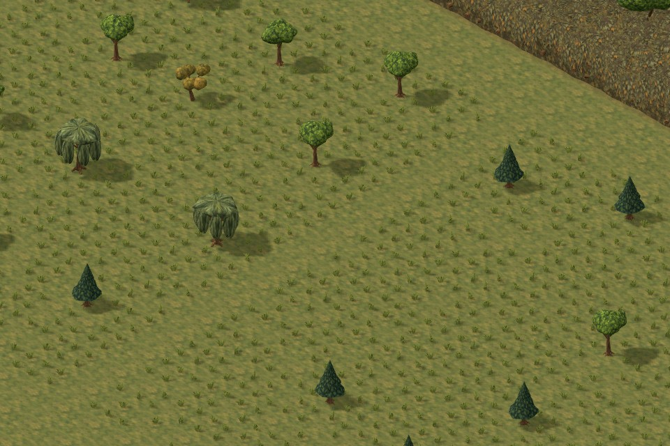
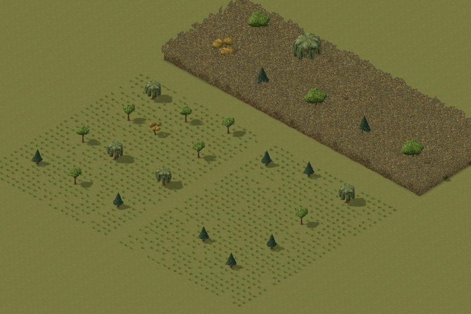
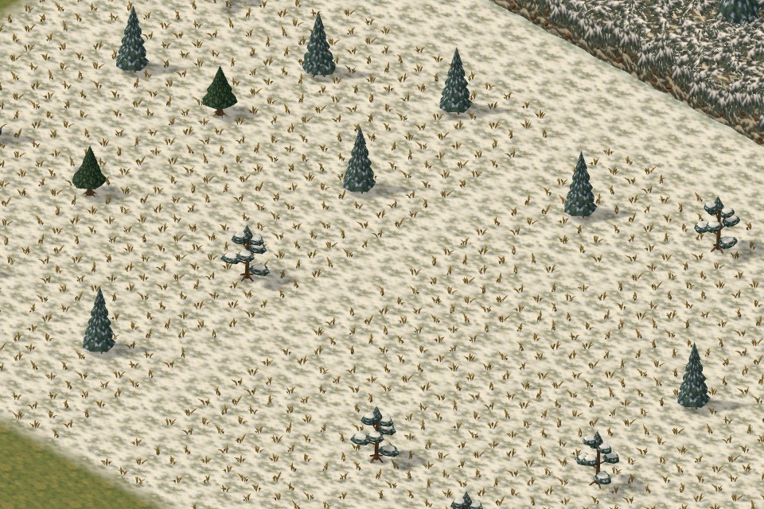
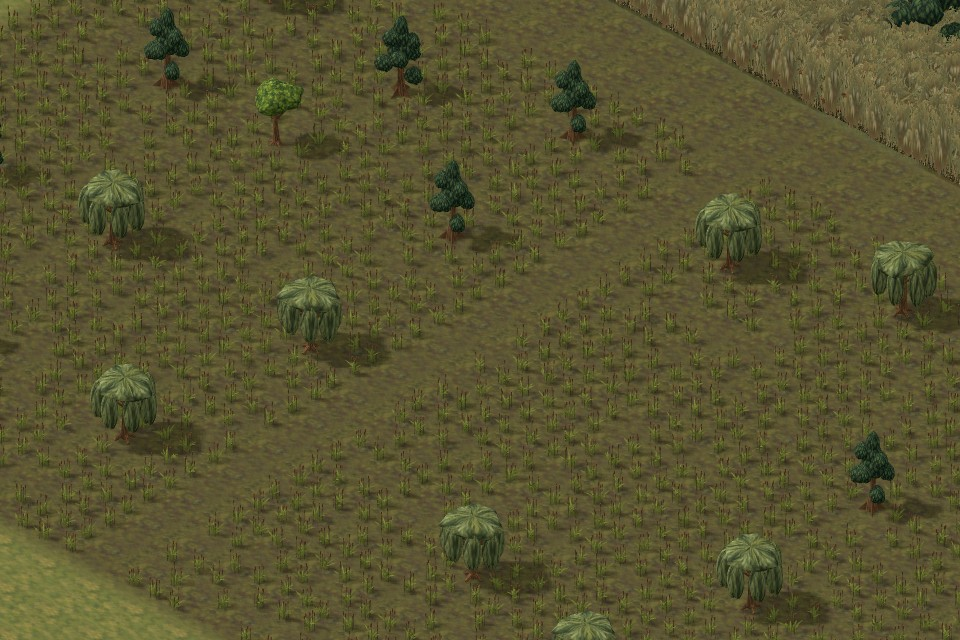

# Mix existing tree models within each habitat

Follow-up to `6ef88ba` on `work/foliage-skins`. The user clarified that different existing models should appear together in the same landscape. The previous pass retained tree detail at gameplay zoom, but procedural selection still restricted each habitat to its two home models.

The new weighted selection reuses the existing ten authored trees. Each habitat now draws from three or four distinct meshes:

| Habitat | Model pool and relative weights |
| --- | --- |
| Temperate | Original broadleaf 4, original pine 3, willow 2, crooked scrub tree 1 |
| Jungle | Spreading canopy 4, palm 3, original broadleaf 2 |
| Snow | Snowy spruce 4, alpine pine 3, original pine 2 |
| Dry grassland | Acacia 4, crooked scrub tree 3, original pine 2 |
| Wetlands | Cypress 4, willow 4, original broadleaf 2 |

These are separate model designs. Rotation variants and the existing mature scale remain secondary variation. The catalog's species ownership stays intact, and no additional sculpt or texture asset is required.

## Review view

Open `tactics/foliage-skins-review.html?view=trees&family=temperate&scale=close`. The Habitat control switches among all five mixes; Scale switches between the complete grove and a closer inspection. A count beneath the view identifies the actual models placed in that grove. This fixture uses ordinary foliage data and the real gameplay planner.

## Integration contract

`biome-tree-mix.js` owns the weighted model pool and deterministic choice. `foliage-obstacles.js` records that choice in the shared tree specification; both open-woodland and dense-woodland renderers consume it. The exact selected model supplies trunk/branch cover as well as visible geometry. Integrate these modules together.

Tree candidate positions, trunk movement tiles, screen volumes, placement clearances and explicit tree-prop semantics remain stable. A regenerated tree can have a different species and therefore different branch cover at the same tile. This is an intentional change to generated trees; the branch colliders are tested against actual rendered mesh centers and widths. Saved overlays and seeds are not rewritten. The selection is deterministic on reload and camera changes.

All reused trees fit the existing reserved space: maximum horizontal reach across variants is 1.85 tiles ordinary / 3.329 tiles mature, within the corresponding 2.5 / 3.5 tile placement margins. The existing full-detail threshold, spatial chunks, fog and shadow restrictions remain in use. Distant proxies use the selected model's paint.

The canonical two-model art catalog is kept separate from the mixed placement pool, so adding guest models cannot overwrite their original biome metadata. New models should follow this same separation.

## Checks and limits

- Independent visual/code review: **9/10**, including all five habitats and close, reverse and overhead/grid views.
- **149/149 affected tests passed**, including seven new model-mix checks, movement/cover, real branch alignment, grounding, clear routes, determinism, saving and packaging.
- Asset audit and packaged 3D build passed. No new textures were added.
- Source and packaged ordinary editor save → load → Playtest passed with no browser errors.
- Browser measurements and screenshots are preserved in the adjacent image directory. Render submission and `gl.finish` timings are not gameplay FPS. The larger wetland grove submits about **1.45 million triangles**, including shadows; this change does not establish full-sector battle performance.

The original comparison fixture was also rerun at the same cameras. Relative to `6ef88ba`, overview calls stayed at 200 while triangles changed from 263,592 to 265,936; the wetland edge stayed at 84 calls / 158,250 triangles; open woodland stayed at 144 calls while triangles changed from 226,582 to 228,990. Known texture allocation stayed at 56,035,787 bytes. See [comparison report](images/tree-model-mix-2026-10-14/comparison-report.json); the larger grove above is a different fixture and should not be compared directly with the small edge view.

Reproduce with `node tools/export-biome-manifest.mjs`, `npm run build:tactics-3d`, and the existing foliage browser checks. `REVIEW_VIEWS=trees-temperate,trees-jungle,trees-snow,trees-dry,trees-wetlands` captures the grove set; `REVIEW_SCALE=close` captures closer views. `node tools/check-foliage-skins-integration.mjs tree-mix-integration` records an independent integration run. Browser helpers close in their finally blocks.

The artist branch is ready for the architect's integration review.
