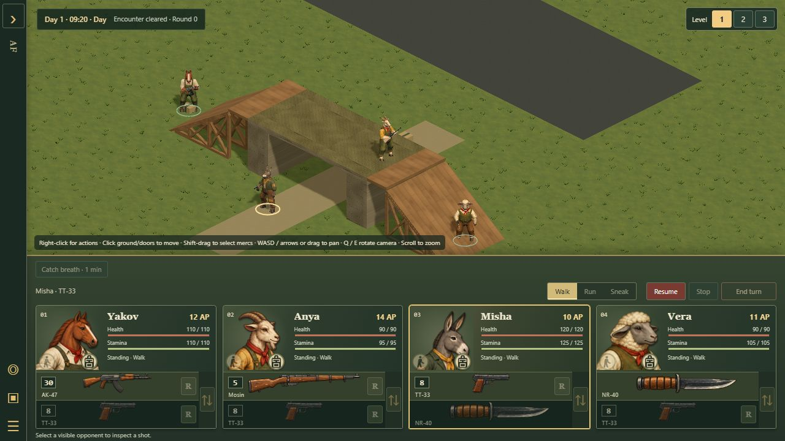
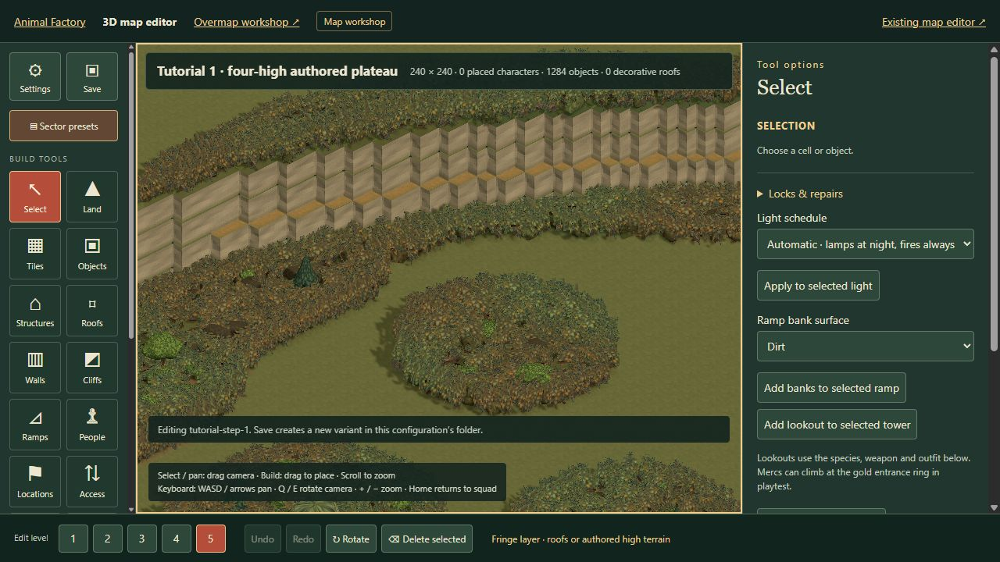
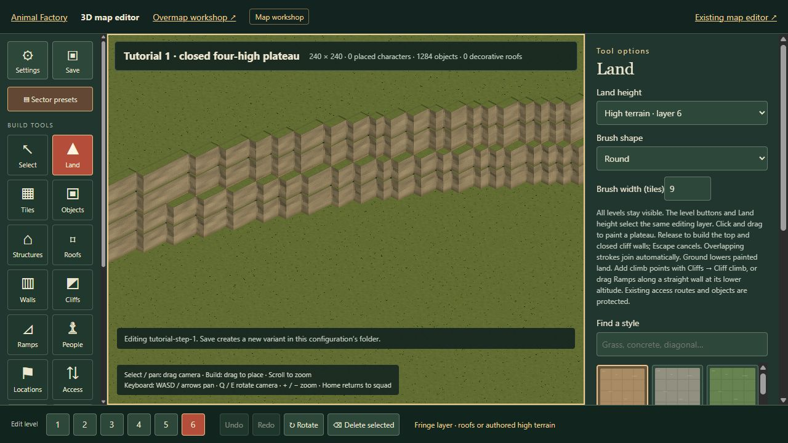

# Six-sector tutorial foundation

The first four tutorial sectors share a two-tier plateau centered on their common corner. Both original cliff tiers are now doubled: two height steps per tier, four steps total above ground. Ground is editor layer 1, the lower shelf is layer 3, and the summit is layer 5. Canonical arrangement: northwest step 4, northeast step 3, southwest step 2, southeast starting step 1. Town sectors 5 and 6 are directly north of plateau sectors 4 and 3. The complete footprint is two columns by three rows: `5 6 / 4 3 / 2 1`. Sector 4 to sector 5 remains the sole plateau descent; sector 3 has no descent to sector 6.

Each map is 240 × 240. The main outer cliff meets shared edges 24 tiles from the outside boundaries (one-tenth), or 216 tiles from the central junction. Between the seams the outline varies into broad lobes. Sector 4’s west cliff follows x=24 from y=24 to its southern edge, with the northern connection still bounded by x=80 and x=160. The upper tier follows this outline with a 0–2-tile lower shelf rather than a large concentric terrace. Width is measured on the tile grid; some sections have stacked cliff faces without an exposed shelf.

In northwest step 4, an 80-tile-wide plateau extension reaches the north boundary between x=80 and x=160 (one-third and two-thirds). Its summit travel marker is at x=120, y=0. Sector 5 continues that same cliff footprint from its south boundary for 24 tiles (to y=216), with matching elevations along the shared edge. Its ground-level town area has test starts and a travel marker. Sector 5 now has a three-tile-wide timber descent at x=119–121: four consecutive supported wooden ramps connect the summit at y=217, layer 5, to ground at y=201. Their intermediate landings are at y=205, 209 and 213. The seam into sector 4 is unchanged. Other cliff faces stay closed. Buildings, encounters and campaign transitions remain to be authored.

Existing full-tile ledge meshes form the perimeter; their potential editor climb capability does not create gameplay links automatically. Lower interior cells are void to prevent walking beneath raised land. Doubling the perimeter increases the cliff tile budget from 1,024 to 2,048, within the existing 4,096 total prop limit.

Files: sector-library/tutorial-step-1 through tutorial-step-6/rough-plateau.json. Original placeholders remain. Each folder is in-progress. The supplied edited first sector is preserved separately as tutorial-step-1/rough-plateau-01-four-high.json, selected first in the library and linked from the combined plan. It retains all 36,496 foliage cells, clearings, ground and summit textures, start identities and horizontal positions. The original supplied file is unchanged. Edit and save normally; rotate the whole six-sector group together.

Open sector-library/tutorial-plateau.html for the combined plan and editor links. All levels are visible by default; choose the edit level for the surface you want to interact with, and Overview to see a whole sector. These maps are terrain foundations without encounters or dialogue.

Generation: node tools/generate-tutorial-plateau.mjs regenerates rough variants and previews; preserve hand-edited versions under another filename first. Tests cover save parsing, closed traversal, elevation seams, 24-tile margin, shelf widths, and the northern approach.

## Town sketch and road placement

The user’s green annotation lines describe newly drawn cliff tiers; they do not invert the original filled preview colours. Ground remains level 0 (dark green fill), the lower shelf is now level 2 (tan), and the summit is level 4 (light green fill), counting internally from zero. Sector 5 adds an isolated lower-tier outcrop northwest of the junction and a larger lower-tier shoulder south of the west road. An upper-tier curve continues from sector 4 into that shoulder. The usual narrow shelf still applies away from these expressly drawn wider shapes. All cliff faces remain closed.

Town roads are asphalt at ground level, six cells wide. The east–west band occupies y=117…122 across the sector. The north branch occupies x=117…122 and joins it at the midpoint. Sector 6 continues the same east–west road along y=117–122. There is no southern road branch. The town descent is a separate timber route; town buildings remain to be authored.

## Stone arches and extended layers

The user specified the large arch’s walkable top on **layer 4**, and the small arch’s on **layer 2**, counting ground as layer 1. The map engine and editor now support five ordinary playable layers plus a sixth for authored roofs, towers and other fringe cases. The plateau summit remains on layer 5. Legacy maps and decorative roofs on layers 4 and 5 keep their saved heights; new decorative roofs use layer 6 and do not themselves create gameplay floors.

- Sector 5 reserves the large landmark at x=184, y=114, ground level, rotation 90°. Its 12-tile span crosses the six-tile road, with an eight-tile clear opening and one ground tile on either side. The reservation is stored as `archLandmark` metadata and drawn dashed in the plan. It remains a reservation until the artist’s finished arch asset and contact geometry are integrated; raising the plateau does not adopt that separate art handoff.
- Sector 6 contains the small six-tile arch at x=172, y=152. A four-tile opening carries a two-tile dirt footpath. Separate timber ramps connect to its layer-2 top.
- Objects → Scenery exposes the arch types and four cardinal rotations. Unsupported height placement is rejected atomically. The small arch can be placed, rotated, captured in a block, saved and playtested now.
- Upper walking surfaces derive from the prop. Moving/removing the prop moves/removes its surface; block capture does not bake a detached floor into the saved block. Ground and upper routes use separate selection levels. The same closed geometry supplies sight, bullet and grenade collisions. Natural rock uses the existing cliff-terrain blast policy.

The current economical procedural stone mesh/skin is an integration placeholder. The artist’s sculpted and painted arch assets, their final dimensions and their collision bake require a subsequent integration review. The artist’s finished large-arch movement route remains a separate integration task.

Review: `editor-3d.html?editing=1&study=stone-arches` and `battle-3d.html?study=stone-arches` rehearse the available small arch with a merc above and others below. The six map folders are also available through Sector presets. The organized authoring source remains `AnimalFactory3D/sectors/tutorial/tutorial-step-1` through `tutorial-step-6`; runtime copies are under `dist/tactics/sector-library/`.

## Prior small-arch verification

180 focused/regression tests pass, including six-sector generation and legacy placement backups, reciprocal tutorial reachability, sector presets, original plateau preservation, small-arch traversal and four rotations, block capture/removal, independent ground/top picking, sight/projectile/grenade collisions, save/load, map caches, editor operations and deployment module closure. The Pages build, asset audit, core regeneration and machine/helicopter bakes pass. Packaged UI review selected the arch top on layer 2, walked Anya across it and Misha underneath on layer 1. The finished large-arch route was not verified in that earlier tranche.

## Four-high update · 2026-10-21

The height conversion stacks each original cliff tile twice without shifting its x/y contour. The first sector has 1,284 cliff tiles, up from 642. Floors, foliage, objects and markers move with their original tier; intermediate cliff bases have supporting terrain. Cliffs remain closed with no new climb links. The six generated foundations preserve their original horizontal seams and narrow shelf. The town descent extends to four stages.

The raised first-sector variant is reproducible from the supplied map with `raiseTutorialPlateau`. Tests fingerprint the supplied ground, summit, foliage and start identities independently of the new heights. Layer checks cover editing and undo, foliage collision, walking, closed cliff edges, ray geometry, reusable blocks, visibility, save/load, grenade targeting and floor destruction/falls on the fifth layer. Connectivity validation uses a temporary read-only geometry view with a separate array identity; it does not enable live caching on mutable editor maps.

The fifth layer is selectable in both editor and gameplay. All layers remain visible, and selection still determines the surface being edited or walked on. The editor opens these plateau maps at the summit’s interaction layer. This does not add buildings, mission objects or the finished arch asset to the terrain foundations.

The supplied first-sector draft already has four connectivity warnings: impassable foliage isolates three squad starts and the travel marker from the first start. The conversion preserves that layout, and tests compare its warnings before and after raising. It remains an editable `in-progress` variant; place the start markers and travel marker together in a connected clearing before playtesting it. The generated foundations remain connected.

Packaged visual review confirms the complete four-step cliff stack, preserved clearings and forest on layer 5. Foliage terrain paint reuses integer biome samples for each rebuild, with tests confirming exact interpolation and fresh results after edits; no cache survives into a later rebuild.

## Sixth layer · 2026-10-21

Layer 6 adds headroom for structures above the four-high plateau; it does not raise or rewrite the tutorial terrain. Editor and battle selectors and shortcuts 1–6 address the same absolute layers. All layers stay visible by default, while picking and movement remain on the selected layer. New decorative roofs sit on layer 6 without making that roof walkable. Ordinary authored floors, stairs, walls, foliage and objects may use the supported high layers when explicitly placed.

Maps still grow their declared sparse floors only when higher terrain is authored. Existing three- and five-layer maps round-trip unchanged. Tests cover layer-6 editing and undo, a roof over the layer-5 plateau, independent floor selection, stairs, block placement, foliage collision, visibility, encounter save/load with partially damaged walls and floors, grenade trajectories, floor destruction and falls. Invalid seventh-layer edits and damaged save references remain rejected.

Verification: 259 focused tests, the packaged build, asset audit and generated-core check pass. Packaged editor review confirms that selecting 6 also selects the layer-6 Land height; gameplay review confirms the sixth button and keyboard shortcut. Both previews logged no errors. The four-high terrain data remains unchanged.

