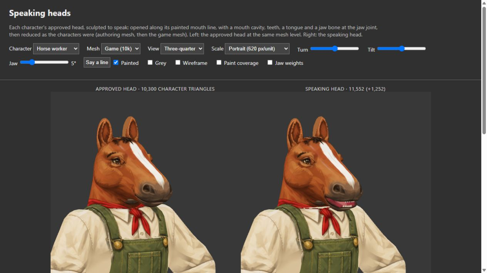

# Visual push review — 15 October 2026

Reviewed `c4e60ab` on `work/foliage-canopy-polish` and `18f963e` on
`art/speaking-heads`, against canonical `11ff7f0`.

## Decisions

- **Foliage:** approve the composition recovery for integration. The combined
  checks pass. The lower, irregular planting recovers the earlier
  direction without restoring the old sight/cover defect. Snow keeps its stronger
  treatment and now tapers into the ground.
- **Speaking heads:** keep the study on its branch for a targeted correction.
  The closed likenesses and the small hen performance are useful foundations.
  Normal-speech mouth-corner defects and the viewer's render scheduling need work
  before wider use. No replacement of the live characters or intro is approved
  by this review.

## Foliage appearance and behavior

The solid, tall perimeter and continuous raised roof have gone. Temperate growth
reads as overlapping shrubs, wetlands as reeds, and snow as drifts and boughs.
The clear route remains legible with the tile grid, including the one-tile strip
beside the full-size horse. The broad snow patch is more convincing than the thin
strip, where exposed wood and bright boughs are necessarily more prominent.

Remaining art polish is localized: repeated exposed branch ends can resemble cut
timber, especially in snow; broad temperate patches could use a little more quiet
space between the busy leaf patterns. Break up that repetition through paint and
root connections without moving the existing solid-cover beams. Do not return to
a continuous vertical wall to solve sight blocking.

The renderer retains the finite per-tile screen mask, exact fragment fog and the
existing gameplay obstacle definitions. The new tests compare actual geometry
and atlas alpha at three detail levels against the sight envelopes. Leaves/reeds
continue to block sight; substantial wood continues to catch projectiles. This is
not approval to make every leaf bulletproof or to change the saved map format.

The build-script conflict was resolved by retaining **both** canonical's
`battle-entry.js` deployment copy and the new `foliage-context-fixture.js` copy.
The existing missing-module/deployment checks remain in place.

## Foliage rendering cost

The approach is sensible: chunked geometry, lower detail farther away, instanced
wood, and skipping wholly unknown screen chunks while preserving exact fog on
partly explored ones. It introduces no new texture artwork or screen shadow
casters. The existing per-region finite mask is shared by the new materials.

The artist's final full-sector comparison is against **`50cf262`, the intermediate
canopy version**, not canonical. It reports:

| Habitat | Submitted triangles, before → after | Draw calls, before → after |
| --- | ---: | ---: |
| Temperate | 569,654 → 496,894 | 421 → 350 |
| Snow | 478,098 → 428,558 | 385 → 302 |

Those are reductions in submitted work, **not an established frame-rate gain**.
The same report has slower CPU submission and a worse temperate frame interval.
Earlier paired runs are substantially different. See the retained
[final battle report](images/foliage-composition-recovery-2026-10-15/final-paint-battle-report.json).
The next performance pass should profile a fixed saved sector, camera, fog state
and squad on an otherwise idle machine, separating CPU submission, transparent
overdraw, shadows and GPU time.

The independent browser check here used the actual integrated renderer in the
study. The temperate copse reported 149 draw calls and 373,076 submitted triangles
at 20 pixels/tile. That small, revealed fixture is not a full-sector combat
benchmark. A separate interleaved CPU generation check against canonical was
faster for the new surface generator, but ran during the test suite and does not
establish gameplay performance.

## Speaking-head corrections

1. **Mouth corners at ordinary speech openings.** The checks still record
   inside-out lip-face slivers on 21 of 24 meshes, with some at speech angles,
   and one or two outer lip triangles intersected by mouth parts on seven game
   meshes plus the hen. Prioritize the ordinary 4.5–8.6 degree speech range and
   portrait front/three-quarter/low views. The donkey's separate 24-degree
   authoring-mesh intersection is outside normal speech and is lower priority.
   The deliberately open sides are part of this study's design; they are not the
   defect being reported here.
2. **One animation loop per viewer.** `render()` schedules itself whenever
   `saying` is true, while controls, completed loads and ResizeObserver also call
   `render()` directly. Starting speech and making five UI redraws leaves six
   persistent RAF chains, each drawing both panes. Reproduced with the actual
   render function in a Node VM with UI/renderer stubs: six callbacks and twelve
   scene draws per simulated display frame, returning to zero callbacks after
   Stop. Keep one pending RAF handle or separate draw-once from the tick loop;
   verify switching character/view/scale during speech never adds another loop.
   This is a scheduling reproduction, not a measured sixfold browser slowdown.
3. **Dispose the skeletons on character replacement.** `release()` calls each
   worker's `dispose()`, but `createLightHorse().dispose()` does not dispose its
   skeleton. Explicitly dispose both mammal skeletons and their bone textures when
   the pair is replaced (the hen already disposes hers), and release the viewer on
   page teardown. Validate repeated
   character changes without monotonic GPU resource growth.

At portrait size the horse's bright red interior and evenly spaced white teeth
draw more attention than the expression. Retain the overall likeness and jaw
motion, but soften the exposed gum band and make the tooth row less mechanical.
The pig director is closer to a usable portrait; the hen reads clearly at the
smaller cutscene scale. There is no reason for another wholesale character rebuild.

The artist's handoff also leaves the localized goat/donkey nostril fills as an
open likeness decision. Keep that visible in the next comparison; it is separate
from fixing the mouth-corner weights.

Rendering cost is modest per speaking character: the budget check keeps every
game character under 12,000 triangles. Examples observed in the viewer are horse
10,300 → 11,552, pig director 9,998 → 11,482, and skunk 9,998 → 11,032. Mammals add
two or three mouth meshes and one jaw bone; the hen adds one mouth mesh. The
individual game-head JSON payloads are about 60–294 KB uncompressed. Load and rig
them for actual speakers; keep distant crowds on their existing models. The
unbounded viewer redraws are a clearer immediate cost problem than this geometry.

## Independent validation

- Speaking-head geometry suite: **24 passed, 0 ordinary failures, 8 TODO cases**,
  357.6 seconds. The command exits successfully, but the TODO assertions still
  document unresolved defects; this is not an all-clean geometry result.
- Inspected all twelve grey contact-sheet comparisons, plus painted game-mesh
  horse, pig director, skunk and hen in the browser. Played the hen's line.
  No warning/error browser log entries were recorded in that session.
- Reviewed all five foliage families in supplied captures and in the integrated
  browser copse, plus snow/wetland strips, with the grid and horse.
- Combined foliage `npm run check`: **2,471 passed, zero failures, zero TODOs**,
  followed by a successful asset audit. `npm run build:tactics-3d` also passes.
- The rebuilt Pages foliage preview reaches Ready and displays the integrated
  temperate copse, grid and horse without warning/error log entries.
- Packaged Quick Fight also leaves its loading screen and renders the battlefield
  with all four squad controls and no warning/error log entries.

The speaking-head branch remains unmerged. This report accompanies the foliage
integration so both builders can find the specific approval scope and follow-up.
