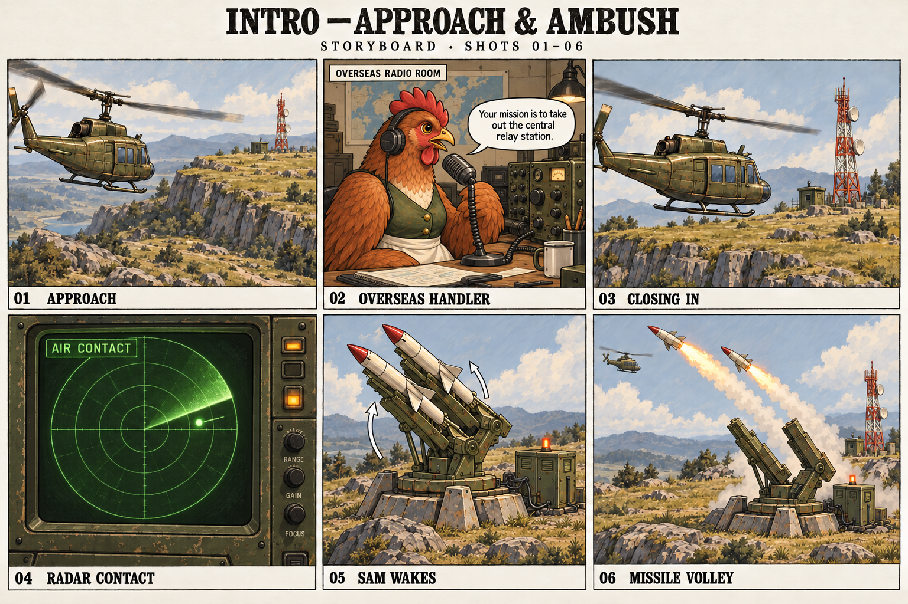
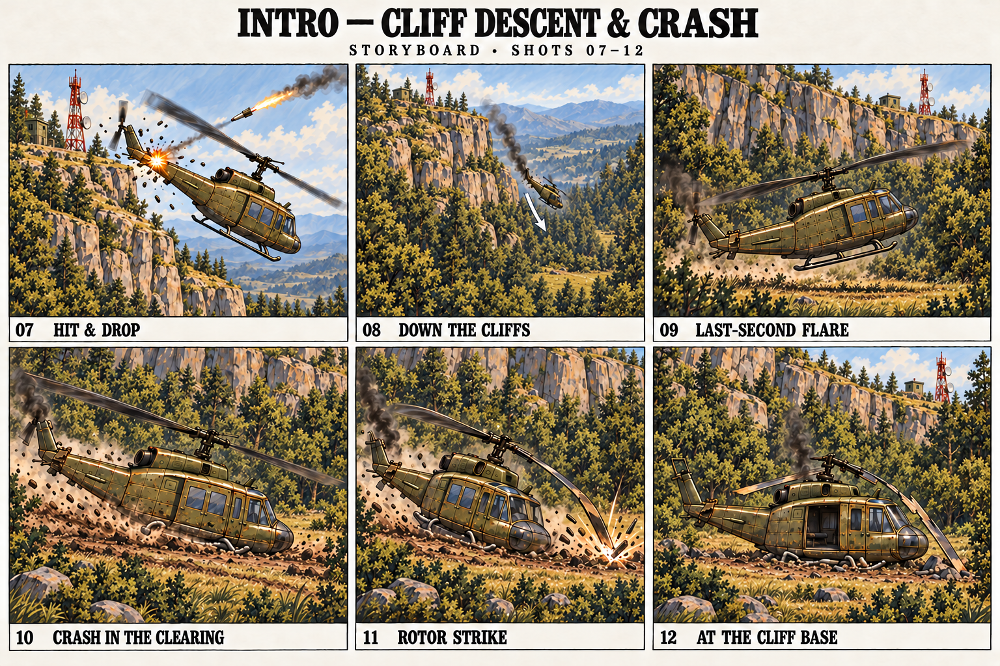

# Intro storyboard: the plateau ambush

The helicopter approaches the plateau while a hen in an overseas radio room guides the mercenaries toward the central relay station. Enemy radar detects the aircraft; a SAM site activates and fires a volley. The hit helicopter drops rapidly past the cliffs and crashes in a wooded clearing at their base.

**Two sheets, twelve shots, approximately 35 seconds.** Timing is a first animatic target. The helicopter, hen, launcher and relay use the existing game designs.

## 01–06: approach and ambush

## 07–12: cliff descent and crash

## Shot and sound plan

| Shot | Time | Camera and action | Sound |
| --- | --- | --- | --- |
| 01 · Approach | 0–4 s | Wide tracking view. The olive helicopter moves left to right toward the plateau. The relay mast establishes the distant objective. | Steady rotor beat and air rushing past. |
| 02 · Overseas handler | 4–9 s | Cut to the hen at a stationary radio desk in another country. Headphones, wired desk microphone and radio equipment establish her role as the mercenaries' remote guide. | Hen: **“Your mission is to take out the central relay station.”** Quiet radio-room ambience; her voice takes on radio filtering when heard aboard the helicopter. |
| 03 · Closing in | 9–12 s | Return to an exterior tracking view with the same aircraft travel direction. The relay, dishes and equipment hut become clearer. | Full exterior rotor sound returns after the line. |
| 04 · Radar contact | 12–14 s | Close view of a radar sweep meeting a bright new aircraft return. This detection precedes launcher activation. | One contact ping over a low equipment hum. |
| 05 · SAM wakes | 14–17 s | Cut to the grounded SAM site. Its control lamp lights; the twin loaded rails turn and elevate. | Relay click, then a rising mechanical whirr. |
| 06 · Missile volley | 17–20.5 s | Two missiles leave in a quick stagger. Both rails are empty after the second launch; trails have different lengths. | Two distinct ignition impulses and overlapping launch whooshes. |
| 07 · Hit & drop | 20.5–21.5 s | Localized impact damages the attached tail/control surfaces near the plateau rim. The aircraft begins dropping nose down. Its central cabin holds together. | Sharp crack and metal tearing; rotor beat becomes uneven. |
| 08 · Down the cliffs | 21.5–24.5 s | Wide view along the nearby cliff face. The rim and relay are high above; the helicopter falls rapidly toward a small clearing in the trees below. Track downward to preserve a clear altitude reference. | Airframe rattle, uneven rotor and rising wind. |
| 09 · Last-second flare | 24.5–26 s | Near the cliff foot, the pilot pulls the nose up briefly to check the fall. Both skids remain intact and airborne; their rear ends are closest to the soil. | Rotor strains immediately before contact. |
| 10 · Crash in the clearing | 26–28 s | Skids bear the impact, buckle, and drag through soil as the aircraft slides forward. Trees border the clearing; the cliff rises directly behind it. | Heavy thump, metal crunch and sustained ground scrape. |
| 11 · Rotor strike | 28–30 s | A short rock onto a collapsed skid brings a rotor tip into the soil. The blade fractures; mast/blade deformation accompanies the impact before the cabin settles upright. | Distinct rotor strike, blade clatter and dirt impact. |
| 12 · At the cliff base | 30–35 s | Hold on the upright survivable wreck in the wooded clearing. Attached damaged tail, crushed skids, stopped broken rotor, open near-side cabin and thin engine smoke. Leave a small clear exit patch; the relay stands far above the trees on the rim. | Rotor winds down into settling debris, engine hiss and woodland ambience. Leave room for squad emergence and player control. |

## Established story and staging

- The hen is outside the country, guiding the mercenaries over radio. She is not aboard the helicopter.
- Radar detects the approaching helicopter before the SAM whirs to life.
- The missile hit begins a rapid descent past the cliffs. The landing clearing is directly at their base.
- Trees surround the helicopter on both flanks and behind it. Keep a modest open patch around the cabin, damaged rotor, skid furrows and exit.
- The tail strike and ground impact cause separate damage: the SAM damages tail/control surfaces, then the landing breaks the skids and rotor.

The current two-rail SAM supplies two rapid launches without a reload. One hit is shown; the other missile leaves the action without an additional impact. The final frame prepares a squad exit without prescribing the roster, injuries or further dialogue.

## Continuity for animation

Keep the helicopter nose toward screen right. Shot 07 cuts to a new angle across the exposed rim; then preserve the cliff, clearing and relay relationship through the downward sequence. The relay remains above the crash site. Establish the clearing in shot 08 before arriving there. Do not turn the fall into a long level approach or move the crash into distant open pasture.

The surrounding trees frame an open descent corridor and a small landing patch. They must not intersect the aircraft, block the open cabin door or imply an additional tree strike. Keep enough exposed cliff and relay visible above the canopy to orient the player.

The tail remains attached and the central cabin recognizable. The brief nose-up flare precedes contact; skid collapse bears weight before the rotor strike. A short rock and rotor/mast deformation explain the blade reaching the ground, followed by an upright settled pose. The illustrated blade curve marks failure: the animatic must resolve it into a bend/fracture rather than a continuously flexible rotor.

At shot 07, make the impacting missile's path end at the tail flash and distinguish the remaining missile as it passes out of the action. Shot 09's airborne dust is rotor wash; reserve the first soil/skid impact for shot 10.

Use the existing **survivable** helicopter at rest, with a clear near-side doorway, shed parts on the far side and thin residual engine smoke. The drawings are narrative sketches; final terrain dimensions and trajectories require staging against the actual map. Preserve the existing aircraft, truck and character scale when building the cinematic.

## Deliverables and provenance

- [Sheet 1 — overseas handler and radar](01-approach-and-ambush-v2.png)
- [Sheet 2 — wooded cliff descent and crash](02-hit-and-landing-v3.png)
- [Exact generation and revision prompts](PROMPTS.md)
- [Review record](REVIEW.md)
- [Existing helicopter model and effect documentation](../UTILITY-HELICOPTER.md)

Created with the built-in image-generation tool. Earlier delivered sheets remain in this folder as historical versions. The subsequent [modular animation study](../INTRO-ANIMATION.md) now implements the twelve-shot sequence in `tactics/intro-study.html`, with a separate missile design view and close launcher/crash inspection. The first missile hits at 20.5 seconds. Voice/audio production, squad emergence and gameplay integration remain separate work.

The storyboard itself required no running helper. The later animation preview's bounded lifetime and stop method are recorded in its [documentation](../INTRO-ANIMATION.md#preview-lifetime).
