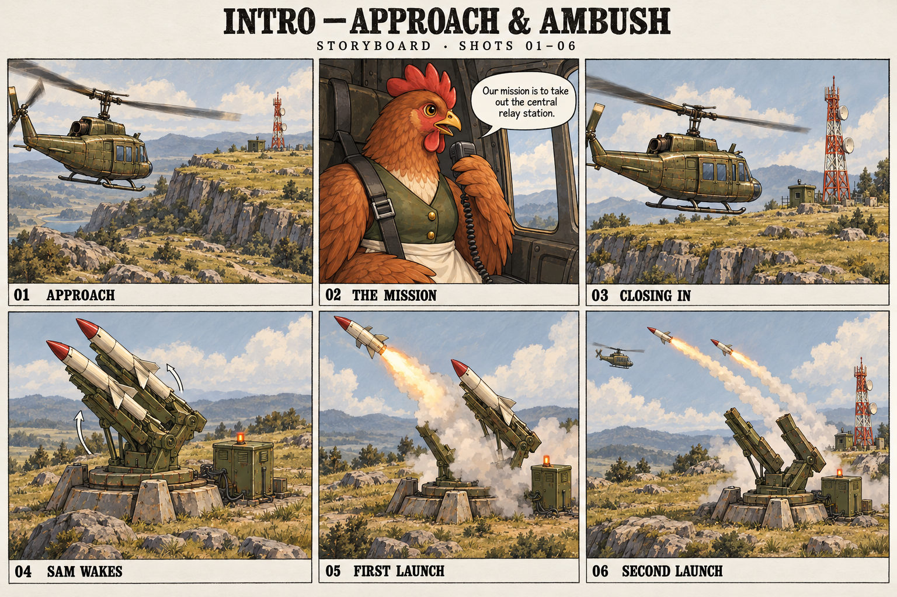
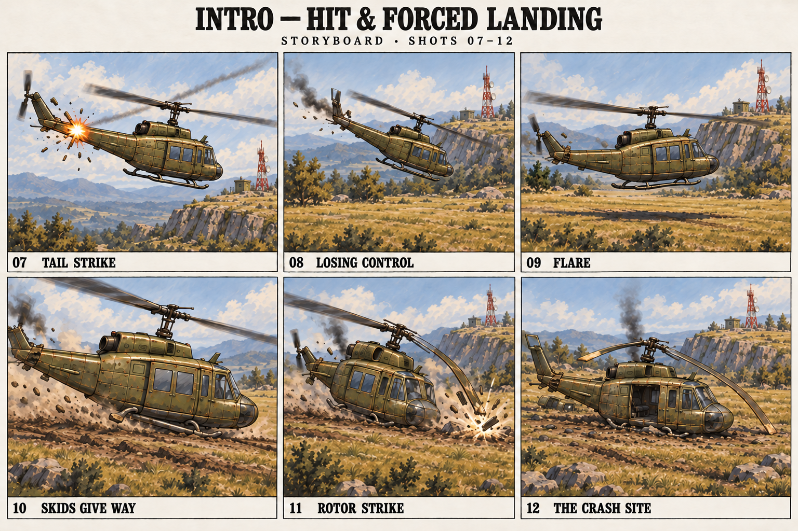

# Intro storyboard: the plateau ambush

Visual proposal for the user's opening: the helicopter approaches the plateau, a hen announces the mission to destroy the central relay station, a SAM site activates and fires a short volley, and a tail strike forces a survivable landing.

**Two sheets, twelve shots, approximately 37 seconds.** Timing is a first animatic target, not implemented playback. The helicopter, hen, launcher and relay use the existing game designs.

## 01–06: approach and ambush

## 07–12: hit and forced landing

## Shot and sound plan

| Shot | Time | Camera and action | Sound |
| --- | --- | --- | --- |
| 01 · Approach | 0–4 s | Wide tracking view. The olive helicopter moves left to right toward a broad plateau. The relay mast establishes the distant objective. | Steady rotor beat and air rushing past. |
| 02 · The mission | 4–9 s | Cut inside to the hen, restrained in the cabin, speaking into a wired microphone. Keep her round silhouette, olive waistcoat and cream apron. | Hen: **“Our mission is to take out the central relay station.”** Interior rotor sound sits beneath the voice. |
| 03 · Closing in | 9–12 s | Return to an exterior tracking view with the same travel direction. The relay, dishes and equipment hut become clearer. | Full exterior rotor sound returns after the line. |
| 04 · SAM wakes | 12–15 s | Hard cut to the grounded SAM site. Its control lamp lights; the twin rails turn and elevate. Both missiles remain loaded. | Relay click, then a rising mechanical whirr. |
| 05 · First launch | 15–17 s | First missile leaves its rail. One remains loaded. A sharp launch flash expands into a pale trail. | First ignition and launch whoosh. |
| 06 · Second launch | 17–19 s | Second missile follows in a quick stagger. Both rails are now empty; two trails point toward the approaching aircraft. | Second launch overlaps the fading first. |
| 07 · Tail strike | 19–21 s | Localized impact at the tail boom/control surfaces. Small fragments break away; the boom and cabin remain attached. Preserve incoming travel from the plateau side. | Sharp crack and metal tearing; rotor beat becomes uneven. |
| 08 · Losing control | 21–24 s | Wider view. The aircraft loses height and yaws toward the lower clearing, still moving forward. Show the pilot fighting the descent rather than a full uncontrolled somersault. | Airframe rattle, uneven rotor and urgent wind. |
| 09 · Flare | 24–27 s | Low side view. The nose rises to slow the descent; rear skid sections approach the soil first. The aircraft is still airborne. | Rotor strains; the sound tightens before contact. |
| 10 · Skids give way | 27–30 s | Stay close to ground contact. Skids compress and buckle under the aircraft, then drag through soil as it slides. The cabin holds its shape. | Heavy thump, metal crunch and sustained ground scrape. |
| 11 · Rotor strike | 30–33 s | Wider three-quarter shot. The aircraft rocks onto a collapsed skid; the low rotor tip catches the ground, snaps and sheds fragments. The mast/blade deform, then the cabin settles back upright. | A distinct rotor strike, brief blade clatter and dirt impact. |
| 12 · The crash site | 33–37 s | Hold on the settled aircraft. Attached damaged tail, crushed skids, stopped broken rotor, open cabin and thin engine smoke. The exit strip is clear; the relay still stands in the distance. | Rotor winds down into settling debris, engine hiss and ambient wind. End with room for the squad's exit and player control. |

## Working staging choices

These choices make the requested sequence concrete; they can change without changing the story:

- The hen delivers the briefing aboard the helicopter.
- The aircraft lands in a clearing below the plateau, so the relay remains a visible objective beyond the crash.
- The current SAM asset carries two missiles. Two rapid launches form the volley; there is no unexplained reload between frames.
- Only one strike hits the aircraft. The other missile leaves the action without a second impact; its departure can pass offscreen.
- Shots 07–11 progress through separate causes of damage. The SAM damages the tail; the ground impact breaks the skids and rotor.
- The last frame prepares a squad exit but does not prescribe the roster, injuries or new dialogue.

## Continuity for animation

Keep exterior helicopter travel left to right and the plateau/relay ahead on the same side. Preserve altitude and forward distance across cuts; the still drawings establish compositions, not world-space trajectories. The incoming missile direction in shot 07 was corrected to agree with the launcher-side approach.

The tail remains attached throughout. Keep the central cabin recognizable and avoid a cabin fireball. The nose-up flare must precede contact; skid collapse must bear weight before the rotor strike. A short rock and rotor/mast deformation explain the blade reaching the ground, followed by an upright settled pose. Do not implement the rotor as a permanently flexible rubber strip: the illustrated curve marks the instant of failure, and the animation should resolve it into a bend/fracture.

Use the approved **survivable** helicopter at rest, not the destroyed wreck. The clear near-side doorway, far-side shed parts and thin residual engine smoke carry forward from that asset. Keep the destroyed variant for separate uses. The drawings are narrative sketches, not replacement geometry or a map scale specification; the existing truck, character and cliff dimensions govern implementation.

## Deliverables and provenance

- [Sheet 1](01-approach-and-ambush-v1.png)
- [Sheet 2 — corrected](02-hit-and-landing-v2.png)
- [Exact generation and revision prompts](PROMPTS.md)
- [Review record](REVIEW.md)
- [Existing helicopter model and effect documentation](../UTILITY-HELICOPTER.md)

Created with the built-in image-generation tool. No game code, airframe models, combat rules, audio files or intro playback were changed by this storyboard pass. The previous local preview expired on schedule and was not restarted; these drawings are saved project assets.
